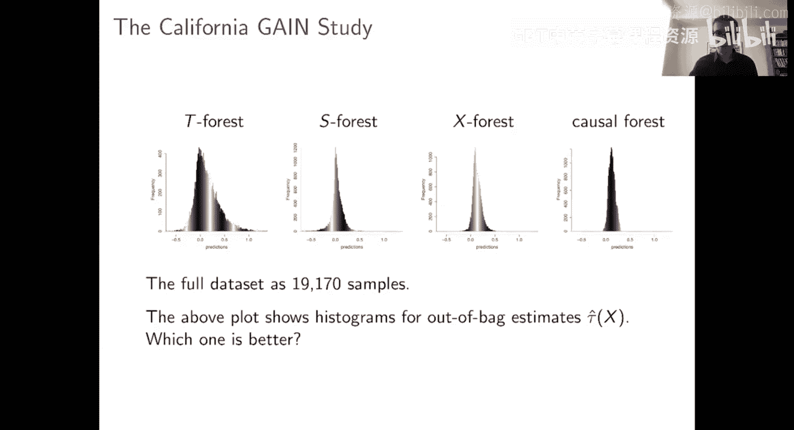
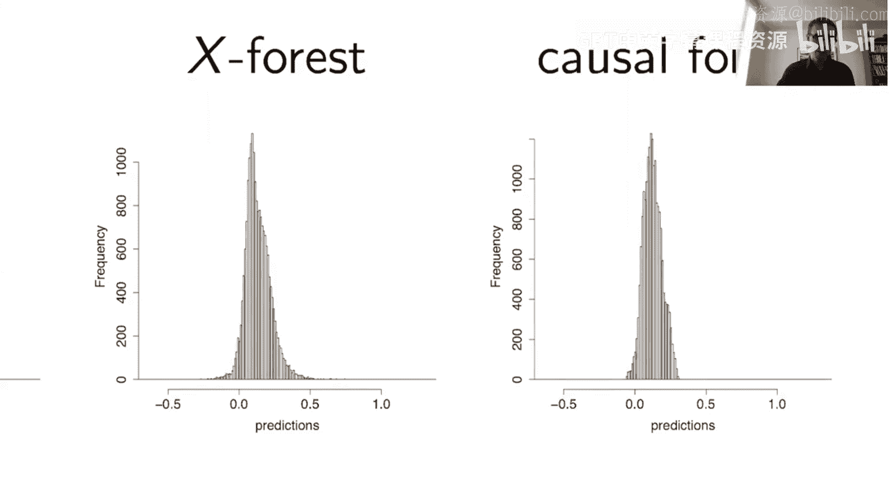
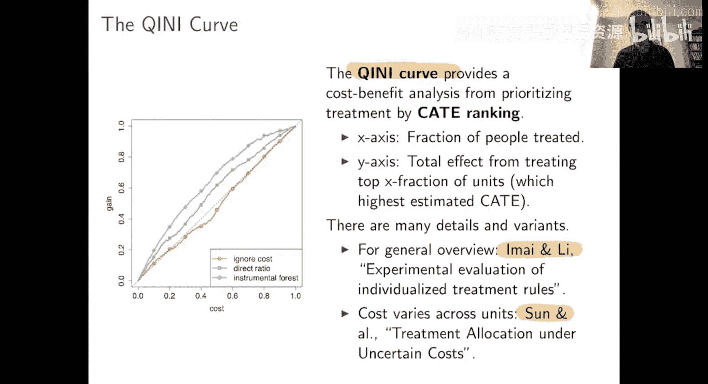

# 斯坦福商学院《机器学习和因果推断｜Machine Learning & Causal Inference： A Short Course》claude-4s p18 -18-Loss Functions_ Validating CATE Estimates.zh_en -BV1M9W7zCEsf_p18-

So far， we've discussed a number of treatment effect estimators。

 and this leads to a natural question。If you have access to many different treatment estimates。

 which one should you prefer？And that's what I want to talk about now。

So far we multi focused on simulations where we knew the right answer a priori。

 so comparing methods was easy， but in real world data we don't know what T x is a priori。

 so we're going to need to come up with some new ideas for evaluating estimators for CA。

So some questions I want to focus on here include given two different estimates for K。

 which when it's better， or even more simply， given one estimate for Kate。

 is it providing any value or is it worse than just predicting zero？So for this purpose。

 we need access to a data， hopefully data that mirrors something。

You might encounter where realistically you might believe unconfoundedness would hold that it's not a randomized trial。

 but where you have access to covariance x and it's at least somewhat plausible。

 that treatment would be as good as random once you condition not X。And for this purpose。

 I'm going to work based on the California Ga study。嗯。

So gain or greater avenues for independence is a welfare to work program that is a jobs training program that is sought to help people get off welfare and rejoin the workforce。

And here we're going to work with data from a randomized evaluation of gain that was conducted in the early 90s。

Incidentally， this evaluation considereds a success。And now gain is deployed in California。

So anyways， and also first thing to note is that as part of this study。

 we have access to 504 covariates， including past income demographics and so forth。

 so we have plenty to work with here for K estimation。But anyways。

 what makes this data set particularly interesting for this purpose is that。

They didn't actually run one big randomized trial to evaluate gainN。

 they ran a number of small different randomized trials in different counties here we have data from Alameda。

 Los Angeles Riverside and San Diego。And。The counties were given quite a bit of freedom in how they ran their experiment。

In particular， they were given freedom about who to enroll in the program。

And they were also given freedom about with fraction of kind of people on the experiment to enroll into the treatment versus the control。

And so then what's ended up happening is that some counties focused on enrolling。

recent welfare enrollees in the program whereas other counties focused on more difficult cases。

 people who had been on welfare for a long time， on the other hand。

 some counties randomize people to treat then control 5050。

 whereas others when think as far as 90% of people into treatment then only 10% of people into control。

ok。We updated datad from four counties each county。Rand randomized trial。

 a different type of randomized trial， how does this relate to what we want？Well。

If you take all these four proper randomized trials and you gl them into a single batch。And then。

 you forget。Which county each unit was from？Now you have an observational study。

There are a lot of people in the data set， everyone in the data was randomized to either treatment or control。

Every one of the data sets was randomized to either treatment or control with a reasonable probability overlap holds。

But the probability with which any given unit with randomized of treatment or control varies。

Essentially based on which county they were from。Now we don't observe other county。

 but what we need to hope is that these 54 covariates we got access to is enough to disentangle any confounding bias introduced by kind of smushing these four different randomized trials together。

 essentially that unconfound inness holds given these 54 covariates。

So that's the data set we're going to work with。So just。

Why do I like working with this data set well first I think this is actually somewhat representative of a setting where you might want to use unconfoundiveness based methods。

In practice， and someone might also believe the output of the analysis。行。

If we had been in a situation where there was extreme selection into treatment。

Like there was someone tried to evaluate gain， but there had actually been no randomization。

 you just had two groups of people， one group of people who wanted to enroll in gain and they enrolled and then you see outcomes for them and then another group of people who did not want to enroll in gain did not then you see outcomes for them。

It's kind of essentially impossible to believe that unconfoundedness type analysis could fix this could give you an estimate of that effect of gain because there's just such a fundamental。

Kind of selection effect。People who wanted to enroll in game were probably。

Kind of both different in a way that you can't measure， but that's very important than people who。

I didn't want to enroll in game and not accounting for these unobservables would just be a huge problem。

On the other hand here， there's no aggressive selection of this type the reason。

You have different treatment probabilities for different people essentially depends more on。

Where they happen to live then on kind of some deep unobservable。Features。

 so it's plausible that kind of。By does think for covariates， you could kind of account for this。

Where you live， affect and be okay。啊。I'm not saying that this is kind of with a data of this type。

 everyone would automatically believe an unconfounded type analysis。Maybe they'd at least humor it。

And another thing is I think this kind of data set。

 it's quite easy to end up and you try for a randomized trial。😊，But then something goes wrong。

 maybe you had under the hoodd you had four different studies and your data sets。

 but you just don't know that your data was collected in this kind of way and then running unconfoundedness type analysis can also protect you against that。

So anyways， that's one thing I like about this data set， the other is that。😊。

Once you've run your kind of observational study analysis on this and you have some claims about how people。

mayy or may not respond to treatment， then if you want to check if you got the right answer。

You can kind of。Retraatify the data set into the four separate counties in each of these four counties。

 you know the true randomization probabilities， so you can give a very kind of transparent objective RCT type assessment。

Of the。Now claims you came up with by working with observational data。

So I'm not going to do this now when evaluating methods for Kate。

 but in the last segment of this lecture， we're going to talk about learning treatment assignment policies and then I am going to do that to check the policy we learned now。

Actually are better than just randomly assigning for。Okay。

 here's the data set we want to do a measure the effect of gain on。future labor market outcomes。

 so let's do it between the T forest， S forest， X forest and causal forest here。😊。

These histograms show auto of bag system that's up Ta hat。And the question is。Which ones of these？

Are good， which ones are not？

So here you probably can't see them。Ex y axisxes here。嗯。But this is here you can zoom in。

The units here。Are essentially the they measure earnings post。

In the average over the nine years post intervention I don't remember what the scaling is exactly。

 but this corresponds to kind of hundreds of dollars of extra earnings average on average per quarter over the nine years post intervention so these are large。

And so what these plots show are histograms of。The out of back treatment effects you get from different forest placements。

So how are we going to compare these？I guess at this point。

 it's not a huge surprise that I'd want to use our loss for this purpose。So so far。

 we've talked about ourLAS as a tool of4。Learning CA estimates。

 but nothing stops you from training a causal forest。

 which is essentially a random forest version of an our learner。Training an X forest。

These are two separate algorithms that may fail or succeed for kind of a number of reasons。

And then using the R loss as a tool to assess both。So this seems reasonable， I do that here。😊。

And here's the answer。吓。If you hit a causal forest， your R loss is 2。39。If you fit an X forest。

 the answer is essentially the same same for the T forest the S forest is a lot forest。

 but all these others are essentially the same and actually if you just fit a constant treatment effect to this data set。

You again get the same answer。So this a little bit。Depressing as strange， right？ How could you get。

These treatment effect estimates look very different。

 and yet these R losses you get from them are almost the same。Seems odd。What's going on？

And to help understand better。It's helpful to expand or de composeose the square term involved in the ROS so here why telde I'm writing is the centered outcome that is y minus M and w Telta is the centered treatment W minus E。

And kind of using the formula a minus b squared， there's a squared minus 28 d plus b squared。

 you can decompose our loss into three parts。The average of the Y Telta squares。

 the inner product between the Y Telta and the tauha W Tta term， and then the term third term。

And what we see。Is that。This first term dominates the loss function The R loss is essentially dominated by this。

Average of y t the I squared。Okay。Another thing that's strange is that this term doesn't actually involve tap。

Can能。The constant TSx causal forests are all just different choices of tau hat。

 so the second and third term are going to be different for all three methods all five methods。

 but this first term。Is going to be the same for all five。So it's kind of strange having。

Could our last be dominated by this term that's actually completely uninformative about Tau hat。

I should note this kind of thing doesn't happen in。Prediction or if it did。

 essentially the fact that。This average of light and the I squared is very large relative to everything else。

Means that this kind of pseudo outcome。Y minus M of Xi is just very， very noisy。

Relative to this Tau hat W Tilda， your best prediction of the pseudo outcome。given X and W。

And if this were a prediction problem， then just kind of having such a noisy outcome relative to a predictor would just mean you have。

 I really love the r squared。😊，And this a meaning of a very poor predictor， but on the other hand。

 are we worried about this in。The setting of the our loss it turns out not so much it's with the our loss you're always going to see things like this and it's because even though this thing looks a lot like a prediction loss function it actually has I mean it's different we've kind of hijacked the form of。

😊，The prediction squared or loss function to target a causal effect。

And usually this loss function is going to be very noisy。😊，Not because your case estimates are bad。

 but just because the treatment effect estimation problem is in a sense harder。

 and this means that kind of the natural loss for treatment effect estimation is going to have more。

But all right， given that we see this and the kind of most of the contribution in the our loss comes from this term that's uninformative about tau。

 which we do， the idea is just look at differences of our losses if you take two our losses for two different tau hat estimates。

This thing here is going to cancel out because it's the same for both and then your left。

With kind of these two terms， which are not kind of。Scale at capture what's going on with Ta。

So what we're going to do here specifically is so we're going to be interested in the R loss of our Tu hat of interest versus the R loss of some baseline case estimate。

And here for this purpose。We're gonna to use。A constant treatment effect estimate has our baseline。

So now this difference is no longer asking。What's the R loss or some value choice of tau hat。

 but rather what's the difference between the R loss？One choice of tau hat versus just kind of。

Predicting a constant treatment of it everywhere and ignoring any heteroity。And if you do this。

 you get something。Much more。Mageable essentially what happens here is that the T forest and the S forest have positive values of delta。

 So what this method tells you is that kind of。They're just doing very badly here。

 they in terms that are lost， they're doing worse than just predicting a constant everywhere。

 whereas both the Xfor and the causal forest here have negative deltas。

 which means that they're actually improving。Over a constant treatment effect estimate and。

That they are actually finding useful treatment heterogeneity here。

Another thing is if you look at the T statistics for these findings from the eggs and causalal forest。

 they're significant at the 95% level。They're bigger than 1。

96 in absolute value so Gaussian P value gives you。Is below 0。05。And what this means is， again。

 this is more validation that both of these methods are improving over saying that there's no hydrogen maybe。

Here the X forest gives you actually a smaller delta than causal forest。

 so the claim here is that the X forest is finding more heterogeneity than causal forest according to our loss。

 but the difference between these two numbers is not significant at the night。W。Anyways。

 so this is the first thing you can do to compare。嗯。 the different treatment effect estimators。

 it's to use the loss。😊，I just wanted to emphasize if you look at the raw number of the our loss。

 it's going to be。Kind of disturbing maybe because you're going to get a very large absolute number for the loss that's going to be roughly the same for any method you compare。

 which is going to suggest that nothing matters but。taing differences。You can cancel out。

This kind of uninteresting term that kind of made all of us functions look big。

 and then you can see meaningful differences between them。So this is one thing you can do。

Are there other methods for assessing Kate， of course， and there's a large and growing number？嗯。

One thing to emphasize， though， is that。Very often。

 the reason you want to fit a case estimate was for a certain purpose。

And then the best methods for evaluating Kate will。Essentially。

 the measures of digital hat estimates enable you to accomplish the purpose of。you want to。So。Kin of。

 it's almost impossible to talk about methods for evaluating estimates for treating nutritionity entirely in the abstract。

😊，Without being connected to kind of。The application you want to address。

But here I'm just very briefly going to survey a handful of ideas。

That have been useful in the past and if you end up。诶 using啊。

Estimates of treatmentity in your own research， you may be able to adapt。In ways that are useful。

So a first kind of。Very simple thing you might want to think about is just。

A reason you wanted to estimate Tao hat is to generally see are some people more responsive to treatment than the others and how much attrogeneity is there？

And so then one very naturally way to capture this is to just look at。Okay。

 there are some people in your study who you predicted to have higher than average treatment effects and some people in your study who you predicted to have lower average treatment effects now on heldout data。

 if I actually ask you to estimate the average treatment effect for the people whose tau hx or below average versus the average treatment effect for people whose tau has for above average。

Did you find any difference？嗯。If imagine I have a training set on my training sit。

 I train a causal forest。On the test set， I go and divide people into who had low versus high predicted tau hats。

 and then I compute average treatment effects on those two hals and there's no difference。

It kind of really puts into question whether the causal of force is learned。Here， on the other hand。

 you can run this kind of exercise and you get fairly different average treatment effect estimates in。

And the high versus low groups， so that's somewhat encouraging。For more about this kind of exercise。

 you can see this kind of application paper。And this's Susan。

Another way to kind of run a sanity check， so the way I think about this grouping into high versus low and then looking at average treatment effects in the high versus low group。

It's a pretty low bar to pass for a treatment of effect estimator。Usually if you get a really good。

To H estimator you're going to want to do something more sophisticated with it than just divide people into a high and a low group and call it a day。

But。😡，It's a very good kind of first sanity check if your Kate estimator isn't able。To reliably。

Group people andhi is a low group with different average treatment effects。

 you might be suspicious about its ability to do much anything else。So this calibration check。

And like what next falls in the same category。It's again， not asking a huge amount。But。😊。

If a method doesn't pass this check， you may again be worried。

So here what we're going to do is kind of this train thought experiment， again。

 you can think in terms as a training set and a test set。So first。On my training set。

I'm going to go learn to hats。Now I'm going to go to my test set。And on my test set。

 I'm going to fit a strange linear model， I'm going to run fit a linear model for the treatment effect where I'm going to ask that the treatment effect is essentially of the form alpha plus beta times tau hat of Xi that is I'm going to on my test set with a linear model for the Kate with a single feature which is essentially my predicted Kate from the training set。

So。Our concretely the way we're going to do it， the model we're going to fit like this is we're first going to have this kind of。

Your cake on the test set should be kind of alpha times a measure of the street average of the tau hats。

 say from before， plus beta times the deviation。Of Tau hats from Tao Bar。So。

We're going to run this regression and then we're going to get estimates for both。This is Alpha。嗯。

And this here is beta。And。Essentially， okay， if alpha and beta were exactly one。

Then what would this say if alpha were beta were1， then that would mean your prediction of the Kate on the test set is just how hat of exc？

That is， this regression actually liked the tau hats you learned in the training set and just wanted to preserve them on the test set。

Now。Yeah， on the other hand， if alpha and beta are very far from one。

 this suggests that something fish is going on。So in this setting。啊。This mean prediction。

 this asks kind of how good was the average of the tau bars you got on the training set as an estimate for them。

Average。Kate， on a test set， this is close to one， which means we're very suggest we're doing very well on the average effect。

On the other hand， this differential prediction。😊，It's kind of saying， if Tao hat。

Exceeds the average prediction by some amount on the training set。

How do you want to interpret this on test set and here we actually get a coefficient of 1。3。

 which actually suggests that the causal forest here is underfitting a little bit。

 So this recalibration is stretching out the predictions and it'm saying that kind of。Hi， I like。

If the Tau hadd predictions you got now were like low versus high。

 then it'd actually prefer onlet testa to make predictions that were spread apart by a factor 1。3。

Com。Which suggests that maybe actually the causal forest was slightly underfitting。

On the trading set。Okay， here we get 1。3。This for calibration exercise in my book is actually pretty good what are things that could happen that are very bad essentially where I get very worried is this number here the estimate。

The coefficient on kind of。How should you adjust the spread？

Of your of your case estimatesaments on the test that if this thing isn't significantly different from zero or if it's even negative if this were negative it'd be pretty embarrassed it'd be saying like。

😊，Based on the training set if you think one observation should have a high k。

 I think actually the test that should probably have a low k and vice versa so you can think about this P value here as just an overall hypothesis test for did your method find any useful hydrogenity at all and if this P value is not significant this means that kind of when you're trying to reinterpret your tau hats on a test set then it's not even clear to you that you want to use these predictors at all or maybe on the test that you'd prefer just。

Estimating the treatment effects overall is constant。So this is the calibration check。

One thing I should notice we implement this in GRF here I talked about everything in terms of training set and test sets but in GRF we implement this using out of bag predictions so kind of this tau head of XI would be your out of bag treatment effect estimate and then we run the regression kind of。

But we run a regression where kind of for each data point， the predictor is tau had of Xi。

 that is the CA estimate fitted from everyone but you。

One final idea I wanted to mention is this thing called the chiney curve。

Which interestingly has recently become very popular in the marketing literature。And。

The genie curve is essentially built on all this idea that。In some settings。

 the reason you're interested in estimating heterogeneous treatment effects is that you have some intervention that's probably going to be beneficial for everyone。

But you think some people might benefit from it more than others and you kind of want to use your CA estimates to rank people in terms of how much they're likely to。

Benefit from the treatment and then you're going to kind of assign people to treatment in order of the rank。

So here the output of this analysis typically this genney plot。

 and on the x axis you're going to have the fraction of people treated from zero to one。

And on the Y axis。You're going to have this number that measures essentially let's say here 。2。

 so this would be saying if I treat the top 20% of people with the highest estimated Kate then。

What's my estimate of the average treatment effect or not average the total effect。

 the total value of treating these 20% of the people？So。

Kin of very concretely and I think this is why it's easy to imagine why or understand why people are marketing like this if kind of you're sending out flyers and the cost of sending out a flyer is one cent then you can think about this axis kind of directly measures the cost of the number of flyers you sent and this curve could be like if on the Y axis your treatment effect is kind of how many people that you get to join your service then you could say okay by sending out 200 flyers I can or 200。

000 flyers， I can get 3000 people to join my service and by sending out 400。

000 flyers I can get 5000 people to join my service something like that and then this curve kind of captures very directly this cost benefit analysis。

So again， on the X axis， you have。The cost and on the Y axis。

 you have an estimate of the cumulative gain from treating that fraction。这个。So again。

 in implementing the chini curve， there are a number of subtleties and a number of choices to make。

 one overall reference that kind of presents this pretty nicely， as is by imma and Lee。And actually。

 this thought I took is from a paper that I was working on recently， this one。

Where we considered a setting where actually kind of the cost of intervening not only does the benefits from intervening on different units change。

 but actually the costs are different， there's kind of one unit intervening on them might be pretty cheap whereas another unit intervening on them might be very expensive。

And we talked about methods for that problem， but again。

 kind of once the dust settles and you want to see how well you did。

Those kind of genni curve objects， again， very useful。You rank people in order。

 you want to prioritize them for treatment on the X axis you kind of。Blot cumulative cost。

How much how much you need to spend to treat that many people and on the Y axis you plot cumulative gain and overall the plot retains its interpretation as a cost benefit analysis。

