# 斯坦福商学院《机器学习和因果推断｜Machine Learning & Causal Inference： A Short Course》claude-4s p19 -19-Loss Functions_ Policy Learning.zh_en -BV1M9W7zCEsf_p19-

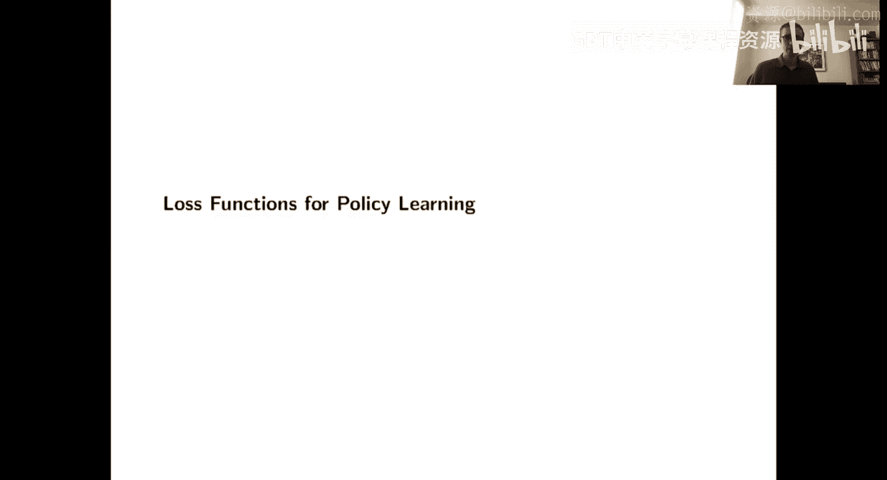

The last thing I want to talk about is policy learning。In this lecture so far。

 we worked in a setting with features X， outcomes， Y， treatments， W， potential outcomes。

 and we wanted to estimate in this setting the conditional average treatment effect。

Policy learning is a problem that's in the same setup， except instead of asking。

What does the conditional average treatment effect look like instead of asking you to describe the treatment effect function。

 what policy learning asking you to do is to be prescriptive to actually make recommendations about who should be treated and who should not be treated。

So specifically， a treatment assignment policy pi is a mapping from your feature space x to a recommendation 01。

 given your features， should I send you the treatment or should I send you to control and the problem of policy learning is to use data to find a good policy of this type。

Now， the problem of policy learning and the problem of CA estimation are obviously very closely related。

 but there are some subtle but crucial differences。One important difference is the end goal。

The end goal of K estimation is to accurately estimate Ta x。

The goal of policy learning is to learn a policy that achieves high welfare。

 that is when you deploy it， it makes the right recommendations for people so you get high rewards on average。

If you're trying to do policy learning and as a byproduct。

 you get accurate estimate a reasonably accurate estimate of Tu of X。

 but this doesn't help you make good decisions。Then in terms of。The goals of policy learning。

 that's not as much use。So the last thing I want to talk about in this lecture is to introduce formalized the problem policy learning and then to say a few words about how to learn good policies in a loss based machine learning setup。

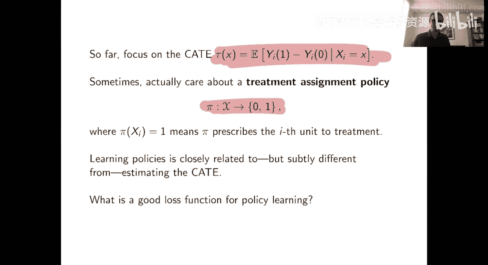

The assumptions are the same as always， so I'm not going to go through them in more detail。

The interesting thing， though， and thing that's new is this notion of a policy that maps again。

 x20 or 1。And then the associate notion of a value of a policy。

The value of a policy is an answer to the question if。I sampled everyone Iid。

Then when I see your covariance X， I send you。To treatment arm pi of Xi， if pi of Xi comes out zero。

 I send you to control， if pi of Xi comes out1 I send you to treatment then the value of a policy measures what would be the average outcome。

Under the sampling design where I assign treatment according to the policy pie。

 or equivalently I get to see the potential outcome as the one chosen by the policy。So。

Writing down the value of the policy。It's very simple。

 it's just the expectation of the potential outcome。

Chsn by pi there's a lot kind of packed into this notation though so if this seems confusing at first it may make help it may make sense to just like meditate on it for a few minutes you of。

understandstand what this notation is doing。But so anyways。

 we're can assume here that outcomes are good outcomes wise。

 you'd want to get higher rather than lower values of y。

 and so the goal is going to be to find a policy to make VF pi that makes VF P large。

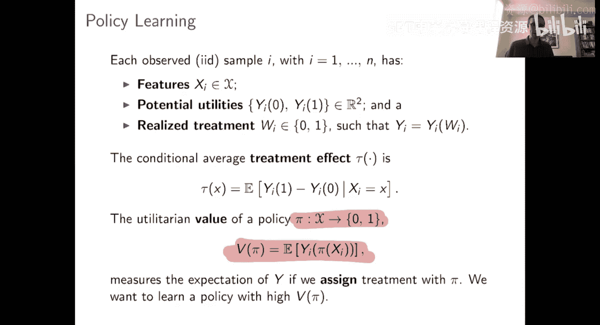

So。In order to kind of get more intuition about this problem。

One helpful thing to notice is that you can write the value of a policy V F pi as。In two parts。

 expectation of Y I0 that is just the average outcome you'd get from the。

The average outcome in the control arm or equivalently the value of a policy who sends everyone to control。

Plus a second term expectation of tau of x times pi of x， which essentially says。

 how does the value of your policy change due to the fact that you send some people to treatment？

This formula is intuitive right the value of a policy is the value of doing nothing plus。😊。

The value of doing something。As recommended by your policy。

But something we immediately see from this is that essentially you'll get high utility out of a policy if you treat people who have a large treatment effect。

So。And otherwise， here， if you just wanted to have the largest outcome possible。

 the optimal policy pi would treat people with a positive treatment effect and not treat people with a negative treatment effect。

If you have some cost of treatment or a budget constraint， then still you'll see that kind of。

In a lot of generality， the optimal non parametric。Treak design and policy pie would just。

Thshold on tau of x threshold at C， so your optimal policy would be at the form pi of x is indicator tau of x is bigger than。

See。😊，So。At first glance， this reduction might really make it seem that there's nothing much to policy learning beyond Kate estimation。

But。😊，Again， the more you look at it， the more there is， the first point is that， okay。

 it's true that non parametrically， the optimal policy is one that threshold holds tau at sea。

This doesn't mean that。The optimal thing to do with data is to first learn a Kate estimate tau hat and then have your policy。

Threshold， T hat。why？Well， so far we've talked about ways of estimating tau of x that essentially try to get estimate tau of x as accurately as possible under squared error loss。

 but actually squared error loss。But Tower of x is not necessarily the correct。

Loss function before really kind of emphasizing the objective we care about in policy learn。

The second。Point so the first point is statistical， the second point is more practical。

 but also very important。It's that as soon as。喂。Move away from just describing the data to actually recommending action。

 there is a larger number there's a large number of things we need to take into consideration that weren't there before。

下。For example。Is your policy？Gamable there might be some features X that you observe in your data。

 but you know that if you start using them for decision rule then people will just start gaming their features and that'll break your policy so you wouldn't want to use those。

Another important one is is it？Legal or ethical to use some variables X in your policy。

I'm going to show I'm going to return to the again example later on and talk about kind of optimal policies。

Util maximizing policies for prioritization， eligibility to the welfare to Work program。And。😊。

This is a setting。We have gender in the data set。Does tau of x vary with gender， it may or may not。

 it's not up to you right when you're just describing the data。

You should just try to describe the data as accurately as possible。

 but then when it comes to actually recommending eligibility for the program you're not allowed to discriminate based on gender。

 so your policy pie should not。Use gender。As a variable in determining who gets access to the program or not。

So this is again another dimension， this wasn't a statistical consideration。

 this was more a consideration saying that yes， nonparmetrically。

 the optimal policy will be one that thresholds on Kate， but just thresholdholding on TAex。

It might given the variables x in your data set may not be a feasible policy or may not even be a legal policy。

 so you want to。Learn policies pie that kind。Satisfy constraints that are required by the application。

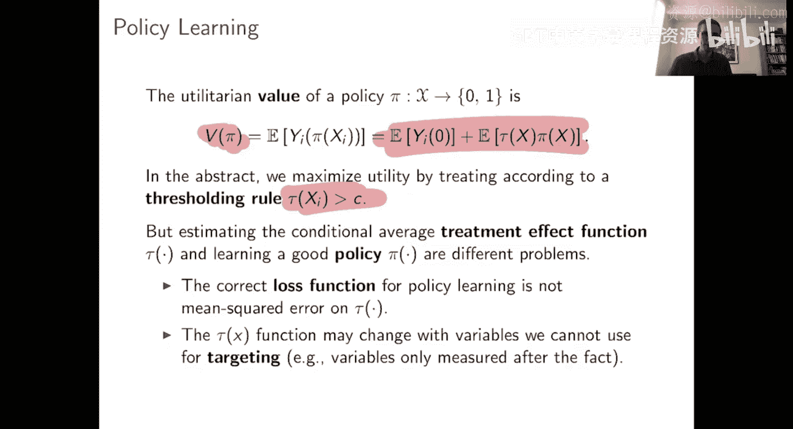

什。All right， how are we going to do this given the theme of this lecture， hopefully。😊。

It's pretty clear the goal is to come up with a loss function for policy learning and then to learn using this loss function。

What the loss function should be is pretty clear。We want to find welfare maximizing policies。

 so our loss is going to be。Negative welfare or we could just。

I've here tried to make all the machine learning procedures be argument over the loss。

 but you could also think of machine learning as doing aG max overestd welfare and that's entirely fine also。

So that's what we're going to want to do and。The big question is just。

How can we design a loss function that？Is feasible in terms of the data that we can optimize and use learning。

And when you first see this， this might seem tricky。

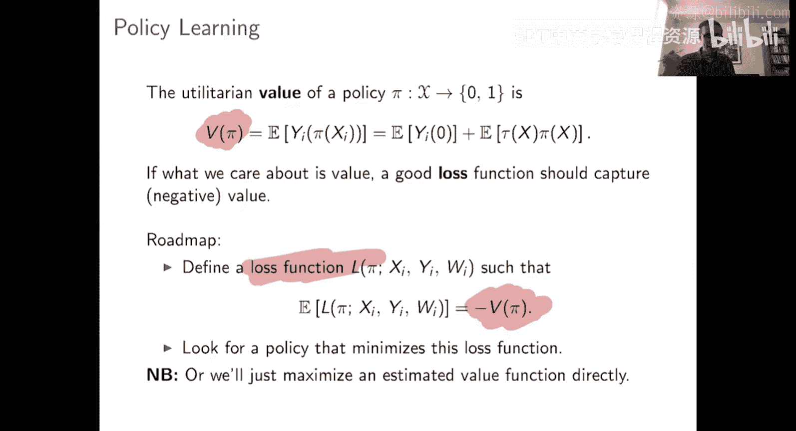

But it actually there's a。Very nice solution。A first thing you can do that very simple it's a nicely just requested in this paper by Kiika and Tttanov what they notice is that you can actually get a very。

Simple estimate of the value of a policy by endverse propensity weighting。

And how is this going to go， well， we want to estimate the average reward。

If we were to give everyone treatment according to policy pie。Well， what this is going to do。

 IPW policy evaluation is going to do is。It's going to look at all samples。

For who treatment matches the policy， if treatment doesn't match the policy。

 then IPW won't consider them。And then it'll just take an average of the outcomes for all samples where kind of the treatment actually matched your policy pie。

 but of course you're going to be missing some samples so you need to kind of correct for your sampling bias like an average treatment of estimation and。

You do this by kind of。Inverse propensity weight。You can check that if the propensity scores or kind of the probability that WI is equal to pi of Xi is known。

 then this inver propensative weighted value estimate be hat pi is unbiased for the true B pi。So。

This is a this is a reasonable value estimate and then a machine learning approach might just kind of。

Take this we hat pie that we got out of this IPW construction and then。Learn by a hat by just。

Maximizing over V has pi in a machine learning sense。

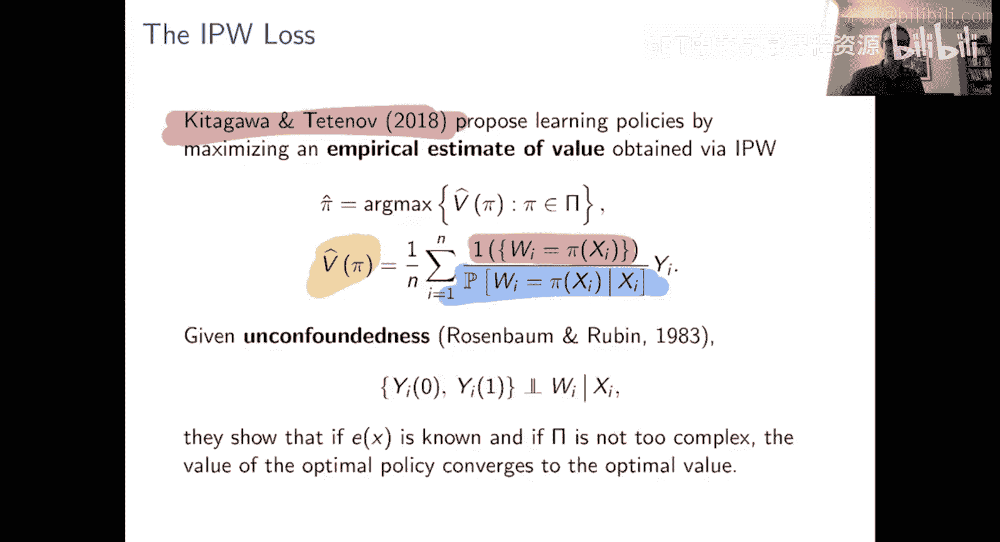

So。In some sense， you can just do that in another sense。

 what's interesting is that this objective function is actually quite different from。

The type of objective functions we've worked with before， before kind of in prediction。

 we worked with squared error loss。And for estimating Ks， we work with the R loss。

 which is essentially like a modified recentcentered squared error loss。

So learning always amounted to kind of going down a quadratic looking objective。

With some regularization。Here， it looks very different。So。

What's going on here is we have right we're optimizing over policies pi。And the policy pi。

 the way it enters into this value function is。看来。Through all the recommendations you make at the samples IF to N。

 so I only care about the policy pi based on does it recommend zero or1。

As all my training samples and then。Based on this kind of if pi matches WI。

 then I get a weighted version of WI into my sample， otherwise I don't。And。This kind of。

I'm not going to say much about this。Here， other than actually carrying out learning with this kind of 01 type decision rule is very different kind of algorithmically than carrying out learning with a square error loss type objective。

And。😊，Solving this problem is actually very closely related。

 it's formally equivalent to solving a weighted classification problem。

You could qualitatively think that what you're trying to do is you're trying to。

Conceptually classifiedify people into the。Correct。Treatment this is not quite true， but。

In terms of the optimization routine， it looks a lot like that。

So and one example of this is that if you want to try this。

 we have this package policy tree that actually solves the subjective over the space of trees。

And then you can， if you're curious about the details of how this reduces the classification problem。

 we also go into it more in that package。And the back is documentation。

So this is IPW things work nicely inverse propensity weighting gives you when the propensity scores are known a nice unbiased estimate of the value of a policy that you can optimize。

Oversay the space of decision trees and。This gives you a nice way of learning policies is there anything left to be said well so far in this class Ive generally not let you stop at the point where you had an algorithm that worked well when propensities scores were known in an observational study you might worry what if these propensities scores are not known so you need to estimate them and。

You could of course， try running IPW with estimated propensities scores here。

 but that wouldn't be particularly robust。Can we do anything else Well remember last time we saw IPW it was for average treatment effect estimation and then we realized that there was a double robust alternative。

To IPW that was AIPW AIPW had these nice robustness properties where it could recover from propensities scores that were perfectly estimated and this gave you better properties for average treatment of effect estimation。

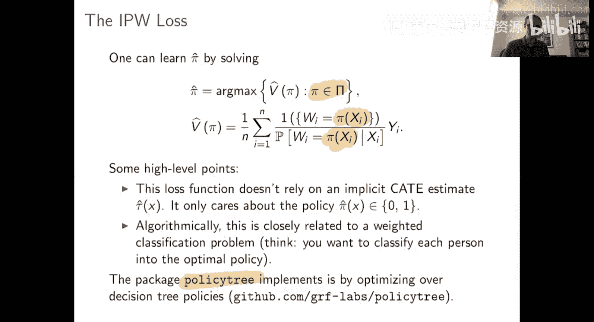

It turns out that in policy learning， the same thing is true。嗯。These things here。

These are what's called double robust scores。If you remember what AIPW does， AIPW。

Estimates the average treatment effect by taking the average of these gamma hat eyes。

So I'll just write it down here to be specific。To hat AIPW。

Is equal to 1 over n some i equals1 up to n of gamma hat I。

Where the gamma hat eyes are just the things we had before。

It turns out if you want to do double robust policy learning， what you can do is you。

Build these same double robust scores。嗯。And then you set up an objective， much like before， except。

Now you can think of what this is doing is you try to classify people into treatment or control here I centered this so this thing here is plus one if you're treated and minus one if you're sent to control now with this。

Welfare objective measure does here it essentially there are these double robust scores which are noisy proxies for the treatment effect you guess but treating the I person。

And。Essentially， if I send you the treatment， I earn that double robust score。

 if I send you to control， then I pay that double robust score and a good policy would be one that。

Usually。One in regions of feature space where treatment effects are positive。

 so gammaha eyes are on average going to be positive and the policy sends people to control and has this thing be negative one in regions of feature space where gammaha I is usually negative。

So again。This is also implemented in policy。

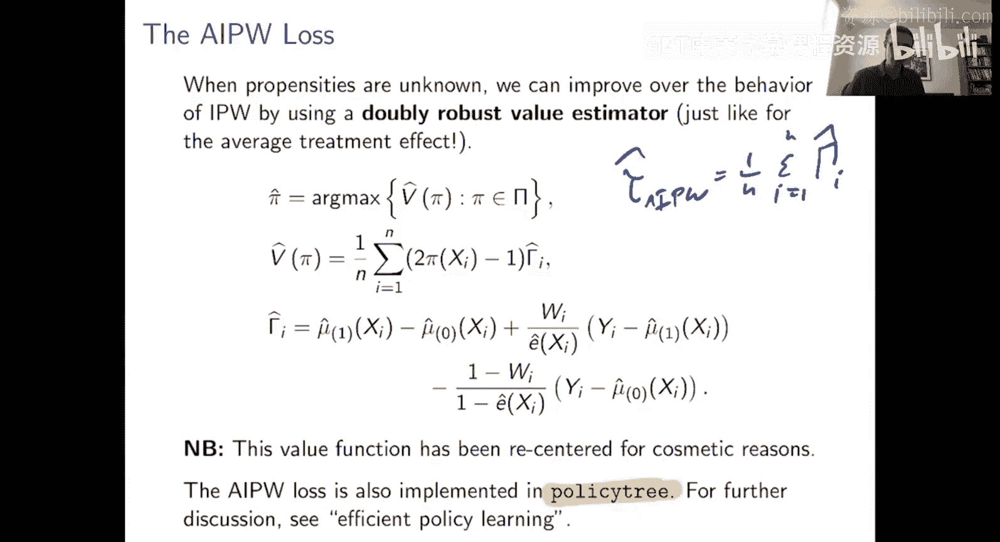

So just to see this in action， I'm going to go back to the gain study we talked about earlier。And。

Here we're just going to do this I'm going to form the same double robust course as before。

 and then the way we're going to learn policies is by。

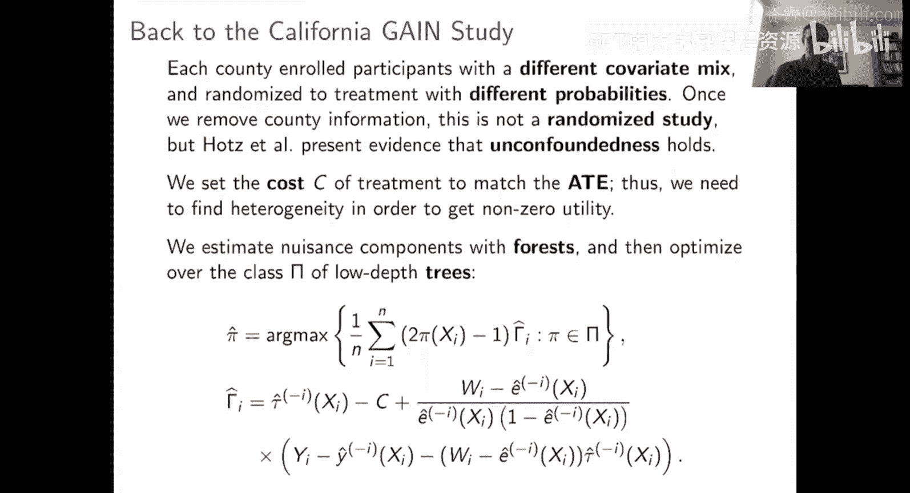

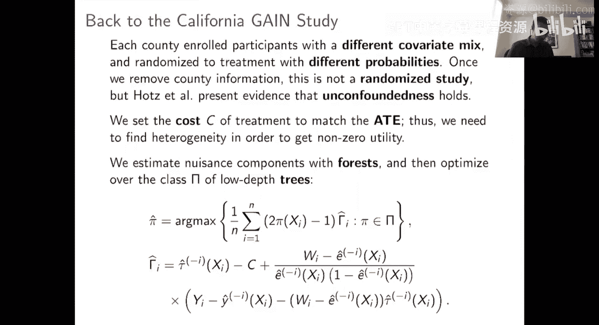

Maximizing this objective。We need to somehow regularize and here the way I'm going to regularize is I'm going to tell you your decision rule can be any depth k3。

 I'm going to try k equals 1 and k equals 2。So essentially。

 I'm going to ask my algorithm to just kind of look over the space of all the trees of depth K and then see which one maximizes my estimated welfare objective I have here。

That's all we're going to do and then I'm going deploy that tree。

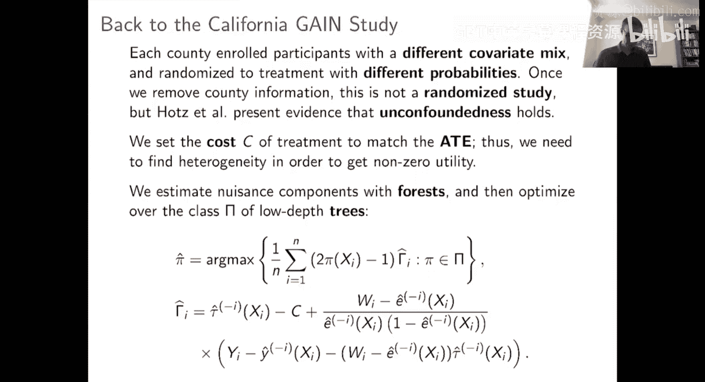

And if we run it here， then this is the output you get kind of a lot of math and nonparmetric statistics went into producing this tree。

 but the outcome is that in the Ga study we talked about earlier the best depth to tree，嗯。

Or what we claim is kind of in terms of welfare， a depth to tree that's essentially as good as any death to tree can be is the fall。

It first looks。Was a person paid three quarters ago， if yes。

 you treat them if they're a high school graduate， if no， you treat them if they have children。Alect。

This is a recommendation。That。 the claim is that from a utilitarian perspective。

 this does a very good job allocating treatment to those who are going to be most responsive to it。

Some comments， like I mentioned earlier， when you're making policy recommendations。

 there are of course， things you're not allowed to do。

Here we had data on race and gender in the data set。But。Given that you're not allowed to。

 and it wouldn't be ethical to discriminate based on these。

We just forbid the tree from splitting on razor gender。There are other things that are going on here。

 we're looking at do the people have children in choosing whether to treat them or not。Is that okay。

 I think at some point it's not up to kind of。sStatisticians。

 economicconmetricians to decide that's up to the kind of stakeholders to see whether this is a decision rule or they're okay with or not and one thing I like about this kind of policy learning over the space of trees approach is that in the end your recommended policy is a very simple tree that hopefully even people without mathematical training can engage with so then you don't need to kind of in the abstract have an opinion about whether this tree is a deployable policy or not in terms of fairness criteria you can just go ask stakeholders whether they like it or not and then take it from there。

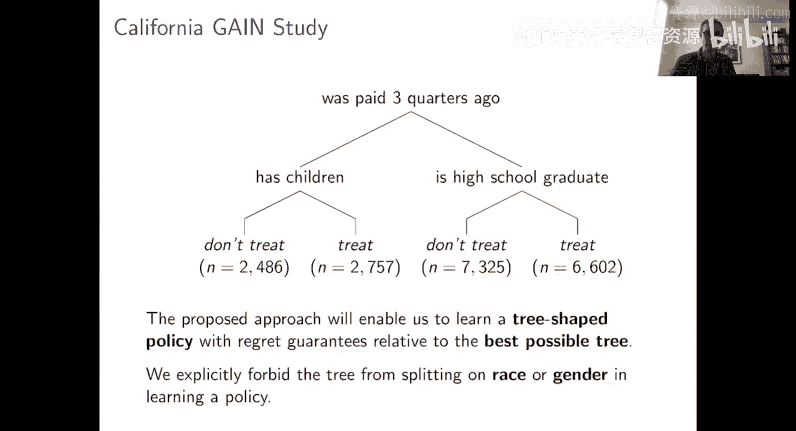

You might also ask is the is this policy any good or not and here of course what criterion are we going to use for。

Assessing the quality of the fit well of course we're going just use our estimated welfare as a great thing。

As the criterion， so we're going to do some kind of cross validation type stuff where we're going to kind of on one part of the data try to learn a policy and then on another part of the data。

Evaluate what is the average value of this policy and。

Take policy as well in terms of evaluation on this loss。And here。

You see that essentially learning in terms of depth to trees that the picture I showed you earlier in terms of out of sample。

We kind of cross validation type evaluation on the welfare metric does well relative to everything else so you notice there are two columns here in the left column i'm kind of working in the same regime I talked about earlier where I pulled the for。

Small experiments into one and then just kind of try to estimate propensities scores so this is an evaluation of how well we're doing in terms of the estimated propensities scores on the right here。

I cheated and I went and kind of。brorought back the true randomization probabilities in order to get an objective assessment and actually check that yes。

This policy is kind of。Measurably better than random。

In a way that we can validate by looking at the true randomization problem。Anyways。

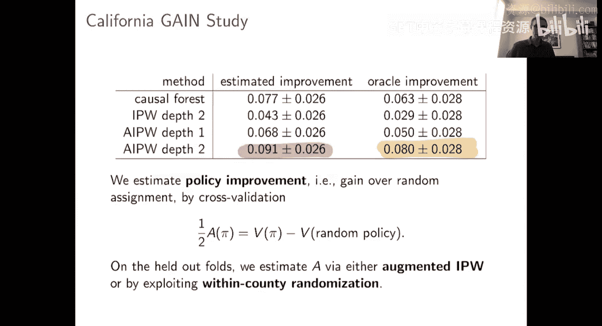

I went very quickly here because we've talked about many things in this lecture already。

In terms of references， so first for the second half， again， if you mon to。

Read more about policy learning than this kind of a cursory introduction I gave here。

You can I recommend first starting from this paper by Hidago andtetanov they set up the problem very nicely and they propose the IPW base estimator there and then what we do in this paper is we kind of。

Proposed the double robust policy learning estimator and propose a study that estimator also if you want to read more about the gain application and policy learning then we talk about that in detail here。

In terms of the first half of the lecture term。So that is robust loss functions for estimating T X itself。

嗯。The presentation today followed most closely this。Biometrica for the cominging paper。

Where in particular， the examples I showed about say stacking bart and causal forests they're taking from there if you want to learn more。

So this is kind of。This paper outlines that the methodology for the R learner and has some kind of preliminary formal results。

 but more recently paper there's a pair of papers that has kind of gone。

Much deeper into this proving much more general and also more powerful results about our learner type estimators so the two here are this paper by。

F students Gus and the other is by Kennedy， so again。

 if you're interested in theory for this kind of stuff， these are two very nice papers to read。

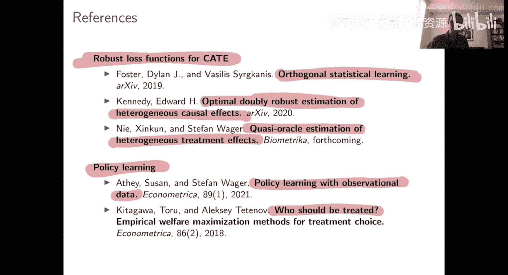