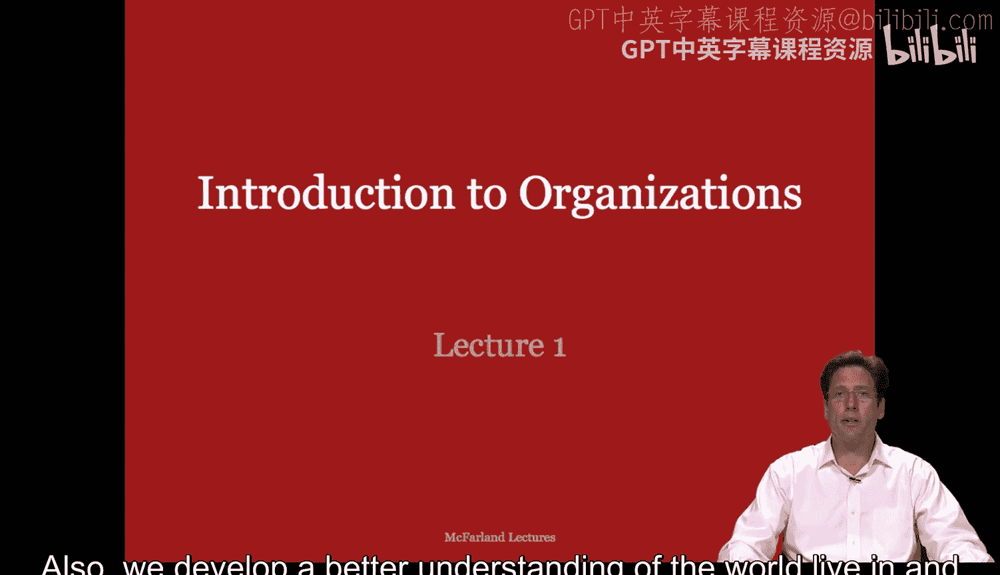
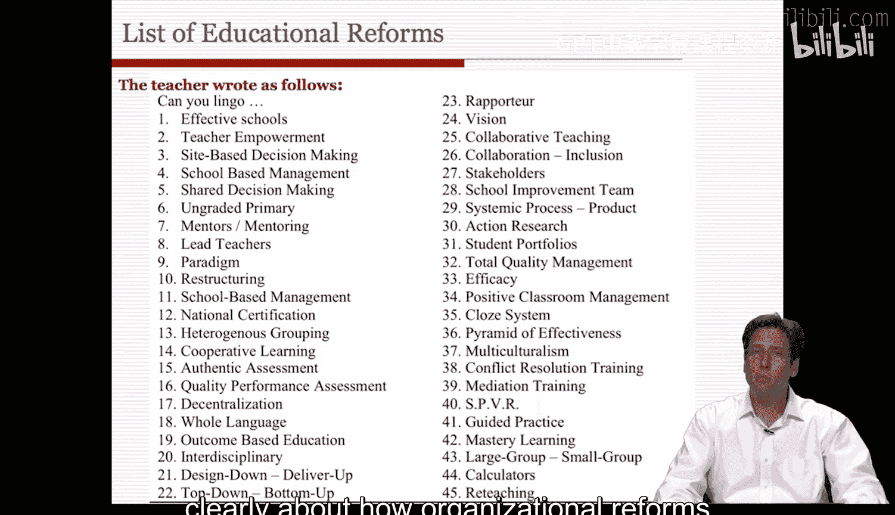

# 斯坦福大学《组织分析｜Organizational Analysis》中英字幕 p01 001_01_01_第一讲-组织导论-第一部分.zh_en -BV17J4m157qN_p1-

Welcome to organizational analysis In this introductory lecture。

 I will introduce you to the concept of an organization。 in so doing。

 it will become clear that organizations are everywhere and come in many different forms。

 Their ubiquity and complexity means many of our social problems are organizational in nature。

 And this is why we need to study organizations and why we need to take courses on them。 Also。

 we develop a better understanding of the world we live in and how to better manage it。

Let's begin with our preconceptions and understandings。 First， what is an organization。

What is not an organization？When most of us consider organizations， we think of hospitals， schools。

 businesses， stores， companies， and factories。But what about families or various voluntary associations and even street gangs？

What qualities make something an organization and what qualities are missing that make it not an organization？

One of the best writers on organizations has been Richard Scott。

And his work will draw on heavily from time to time in this course。

 Scott defines organizations this way。Organizations are conceived as social structures created by individuals to support the collaborative pursuit of specified goals。

Now there's a lot packed in here， so let's simplify it some。

What Scott means is that organizations are groups whose members coordinate the behavior in order to accomplish shared goals or to put out a product。

Given this， let's reconsider what is and is not an organization。So if we look at this chart。

We see that organizations like companies， schools， families。

 and voluntary associations all have certain features that fit our notion of what an organization is。

 that members coordinate their behavior， that they have shared goals and that they put out a product。

Examples that aren't an organization seem to fall short of this definition。

 so random collections of persons or isolated individuals that have no rules， no rules， nor goals。

 nor even patterns of recurrence in their behavior。

 or even a boundary to where that group begins and ends lack the definition of an organization。

Ambiguous cases are somewhat unclear。 Some features the definition may be lacking there。 So。

 for example， with street gangs， friendship groups and social movements。

 we have less clear characteristics of share goals。 We have porous boundaries。

 and we have fluid participants that come and go。 We even have less clear rules for behavior。

Now that we have some sort of idea of what is and is not an organization。

 we can start reflecting on how common and important organizations are。

Organizations accomplish most of what society wants and needs。

 from socialization in schools to resialization in prisons and mental health care facilities。

 from tax collection， public administration， protection and soldiering。

 to production and distribution of goods， service provision， preservation of culture， communication。

 and even recreation。Organizations are the means by which many of our collective goals are pursued and accomplished。

 for example， would disaster relief for schooling be possible without organizations focused on those efforts？

Organizations are so common that they've become the medium of modern social life。

 We can't imagine existing outside of them。 We live in a world greatly made up of formal organizations。

 their rules， their structures， their goals， their members and instrumental efforts。

 Organizations are also collective actors or social entities that take action， use resources。

 own property and inner contracts in legal documents we often see in organization's name listed。

 and they've attain somewhat of a thing status。So organizations are everywhere and they vary tremendously。

They vary in size that some are huge and others are small， for example。

 IBM is an enormous company while youth voluntary organizations run out of someone's basement are quite tiny。

 even a startup can be two or three people。They vary by market sector。

 some organizations emerge in the private sector， others emerge in the public or not for profit sector。

 they can even be voluntary associations like unions。

 parent teacher associations and religious groups。Their social structures vary。

 Some are hierarchical like the military and football teams， some are centralized dictatorships。

 like perhaps how Henry Ford and Andrew Carnegie managed their companies in the 1920s and 30s。

Other organizations have a flat governance structure。

 like consulting firms with many projects and teams。

 While yet others are horizontally differentiated into many different divisions and relatively autonomous units。

 like， say， university departments。Organizations vary by their environmental context。

 they vary by temporal context or era， for example。

 the context for the federal government is very different today than it was in 1790。

 and a time of recession is very different than a time of economic boon。

They vary also by regional differences， reflecting different cultural contexts。 For example。

 Euro Disney worked very differently than California's Disneyland。

 The idea here with environmentron is that the same organization will not have the same effect in a different time。

 a different culture or even with a different set of participants。So organizations are everywhere。

 they are very important to the function of society， and they are very diverse。

 Theyve also changed a lot over the last 50 years and have altered the World Society as a result。

 For example， in developing countries， manufacturing has given away to service industry and women have become half the labor force。

 partid subcontracting has grown and so on and so forth。

The point is that the organizational world in which we live is changing right in front of our eyes。

Through this course， you will gain a better appreciation of organizational complexity and the difficulties of redirecting organizations in desired directions。

Sometimes coordination and contracts fall apart， and they need to be renegotiated。 Schools。

 for example， don't live up to our expectations and need reorganization。

 militaries may be gender biased and need to change。

 and government regulation fails to prevent corruption。

Participants frequently propose and implement reforms in an effort to change an organization。

 Many reforms fail long before they' are ever implemented。

 and those that are implemented often end up looking like something very different from what they plan to be。

Many reforms are rejected outright， or they're dramatically altered and adapted to the local context。

Some of you have been managers and you already know what I mean。

Much of my research focuses on educational organizations like schools and universities。

 so many of the reforms I see try to change the nature of schooling。Many of these reforms fail。

 In fact， they fail so routinely that I had a teacher give me a list of 45 failed school reforms。

 adopted in very piecemeal fashion that went through his school over the last 20 years。

 Many of these are jargon and hard to interpret， but they often target change efforts on certain organizational features over others。

 For example， some are focused on the social structure。 Take number 8， lead teachers。

 Here is a reform effort that attempts to insert an additional level in the flat hierarchy of faculty roles。

You don't just have teachers， you have lead teachers， and then department chairs。

Others present a technology or schooling process that caters to a particular goal， for example。

 number 13 concerning heterogeneous grouping。This reform gives students an active role in their education and emphasizes a goal of equality。

And yet others attempt to manage pressures from the external environment， for example。

 number 12 and number 27。Most of these reforms are developed and tested in one school and then packaged and applied to many other contexts。

 Unfortunately， the local environment often differs from the original testing ground。

 so the reforms goals may not be valued by the local managers。

 or the targeted change may disrupt other valued tasks and missions in the organization。In addition。

 there is a governance structure in place within most schools and districts that's threatened by external plans of change that assertp their established coordination patterns。

 In short， every reform emphasizes certain rules， certain rules， participants and goals。

 thereby supplaning others or shifting attention elsewhere， and this creates problems。

This course will help you think more deeply and clearly about how organizational reforms are generated and implemented and what factors likely contribute to their success or failure。

