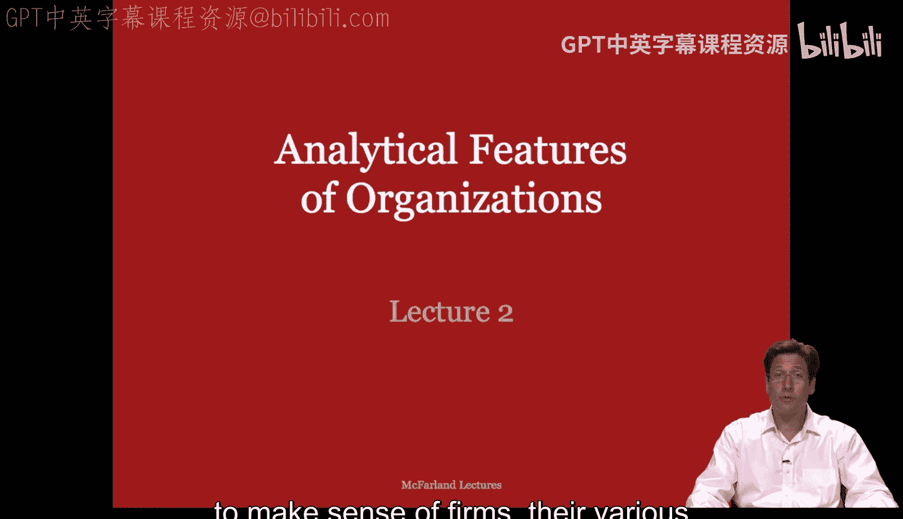
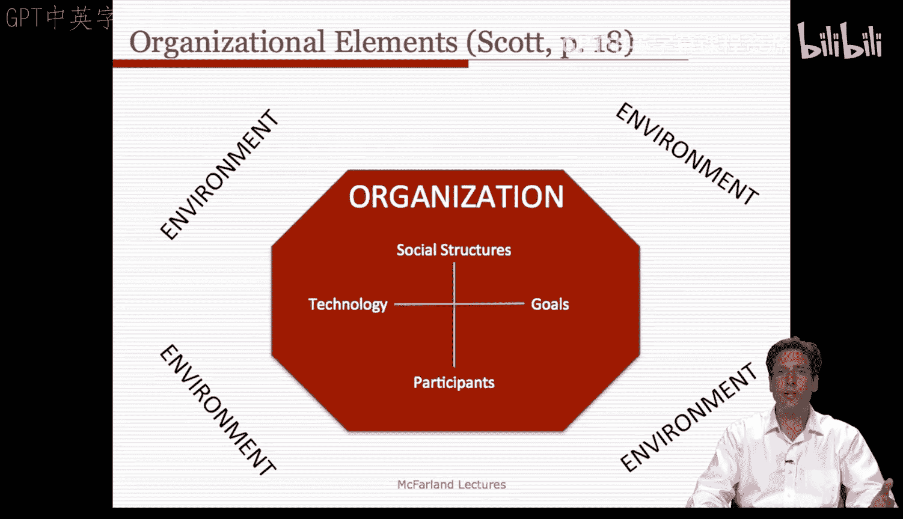
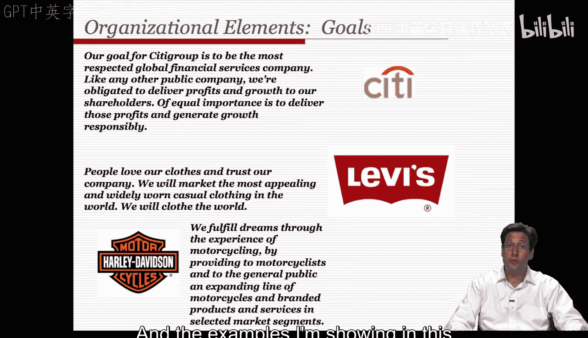
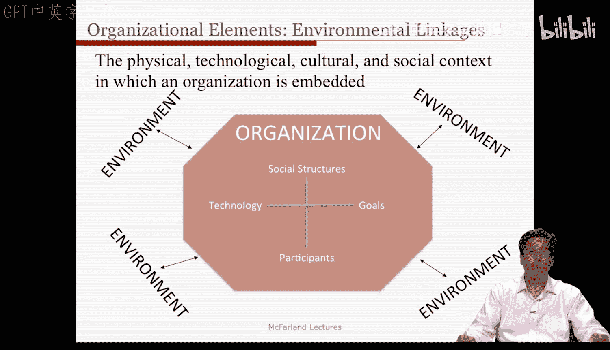
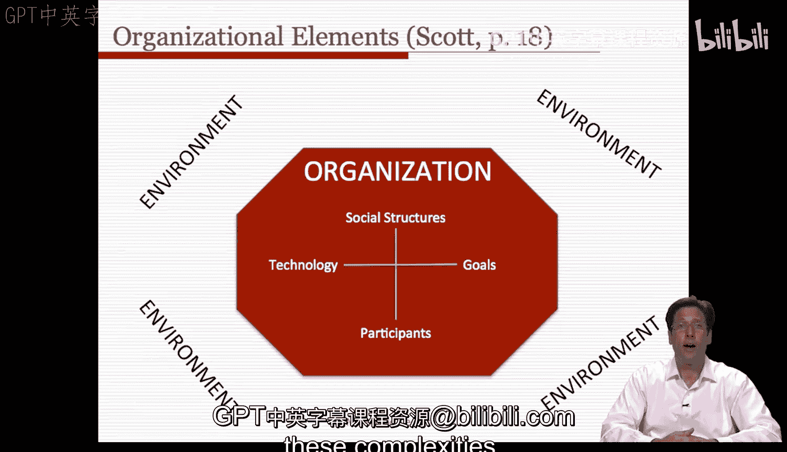

# 斯坦福大学《组织分析｜Organizational Analysis》中英字幕 p03 003_01_03_第二讲-组织的分析特征-第一部分.zh_en -BV17J4m157qN_p3-

Welcome back to organizational analysis In this second lecture we will identify some core analytic features of organizations。

 These analytic features give us a language or terminology we can use to make sense of firms。

 their various forms and their prevailing problems。

Organizations are complex， so it helps to have a concept space or a set of things and elements to focus on in discussing them。

 this will require some abstraction from the details of our own personal experiences and firms。

Richard Scott in his writing， reviewed the history of organizations research and identified a finite set of organizational elements for us to consider and focus upon in this diagram an organization is represented as having a boundary and being placed in a wider environment。

 every organization has certain elements and has a set of social actors or participants。

 a social structure by which they interrelate a goal or mission and a set of technologies or task it performs to render inputs into the desired outputs。

 Let's take each of these elements of an organization in turn。

First， we have an organization's participants， they're the firms social actors， employees。

 and stakeholders。Participants are social actors that make contributions to and derive benefits from the organization。

For schools。These social actors are adults and children and they typically assume roles like administrators。

 for example， superintendents and principals， they can also be roles like teachers。

 students or staff and the staff can vary from custodians to counselors， nurses。

 cafeteria workers to even administrative assistants schools also have parents in politicians connected to them in various ways。

Participants can also be organizational actors like firms in a field。

 if you recall we noted that organizations are often things listed in contracts and legal documents。

They're considered unitary actors in many cases， and the technology industry。

 firms often have relations with one another， like partnerships or even being on shared boards of directors。

They influence one another's affairs in this manner。Second。

 we have an organization's social structure， this concern is features that regulate and establish the usual pattern of relationships between participants。

 so social structure concerns the persistent relations existing among participants within an organization。

These social structures can vary in form， some organizational charts are highly vertical with many levels。

 others are horizontal with many different departments。

 and yet others are matrix forms that have both levels and departments and projects that may span across them like a layered organizational structure。

These can vary in degree of formality， formal organizational structures entail clearly prescribed and demarcated social positions while informal structures emerge in our unplanned relations that persist in a school for example。

 the formal structure might reflect the prescribed rules we briefly mentioned above such as principals。

 assistant principals， department chairs， teachers， students， counselors。Eettera。

 all roles with relational obligations。 The informal structure within a school might be the actual advice relations in friendship relations that arise between participants。

 For example， some teachers may be popular and a locus of authority。

 even though they lack such a formal position， Likewise， for students。

 Some may hold undue authority and influence。 They may influence the manner in which curricular at taught。

Social structures are more than just recurring behavioral patterns。

 They're also cultural systems that entail normative principles and cognitive beliefs。 In fact。

 these cultural aspects of social structure often guide behavioral patterns。 For example。

 adults in classrooms often follow norms and ideals concerning how a teacher or manager should interact with others that is we have a sense of better and worse role performances and organizations tend to reward performance that most coincide with the ideal。

Social structure can run even deeper and reflect cultural cognitive beliefs and understandings。

 For example， we find it hard to imagine schools without teachers and students。

 and this belief is distinct from our sense of a better or worse way to perform those roles。

 The belief that every school has to have these roles is a deeply ingrained one。

 The belief may invoke particular behavioral norms of teaching。

 say traditional or progressive norms of teaching。 And in turn。

 this may partly shape the behavioral patterns witnessed in an organization like a school。

But it need not do so perfectly。 Other social structures are at play， like those of gender role。

 class differences， peer cultures and so on， And they can cloud the clean appearance of prescribed forms of behavioral coordination。

 So what principles and beliefs give shape to these structures。 So people's behaviors adhere to them。

Is it one of authority and control in the formal organizational chart？

Or is it one of task adaptation from the informal organization， it's not clear。Third。

 organizations have goals and these goals are desired ends that participants attempt to achieve through the performance of task activities。

 for example， for schooling， the goals are technical and moral socialization of youth or the development of achievement skills or cognitive skills in youth as well as kind of the development of them into good citizens。

Now if we focus on faculty and universities like Stanford。

 we see this historical change and what the goals are early on it was all about student training to becoming an elite institution it was about research production to now one of resource acquisition。

 whether that's through gifts and endowment or grants there's even a function of community service or the fact that this university tries to have research and kinds of scholarly production that relates to social problems as well as to town golon relations how we relate with the local community so many organizations have multiple goals and it's possible that they can come into conflict as one strives for achievement you may find that the effort at equality is diminished so role and goals can come into conflict depending on which ones are put in place and emphasized if we look at concrete missions we can see that they vaguely relate to some of these ins that we just mentioned。

Here are a few examples of company mission statements where they make vague references to the general goals of the organization。

 and the examples I'm showing in this slide are for Citibank Levi Strauss。

 and the motorcycle company Harley Davidson。

But organizations also vary in the extent to which their goals are focused or multifaceted。

 they vary in the extent to which they're clear ambiguous for example。

 let's take a look at two schools that I work in， the Graduate School of Business and the Graduate School of Education here we have a very succinct kind of mission statement for the Graduate School of Business and a longer multifaceted one for the Graduate School of Education。

Fourth an organization has a technology， technology is often a confusing term。

 but what we mean by it is that it's a means by which organizations accomplish work or render inputs into outputs so by technology it's synonymous with the notion of tasks。

 we call task technology because often machines and factory lines accomplish these tasks。

 a computer or FMRI machine often is technology that translates an input into an output and therefore we use the term technology sometimes instead of tasks。

 but you as students should think of them as synonymous。When we think of technology。

 we think of what is being processed as varying from material inputs of manufacturing equipment to people being processed or educated。

 even people being coordinated to become more knowledgeable active citizens， so in schools。

 technology can be lesson plans， curricula， courses。

 or even kind of a technological interface of a computer。Last is the environment， the physical。

 technological， cultural， and social context in which an organization is embedded。

What does the environment a school confronts？Schools are often dependent on state and city governments for resources and funds。

 they rely on trained workers and teachers from local universities。

 they depend on neighborhoods that they're situated in for clients and student populations and so on。

A lot of organizations are embedded in this way， so it's not just schools。

 but it's an example we can all relate to。

Environments can vary culturally in the sense that Euro Disney initially didn't work because an American version of Disneyland couldn't just be plopped down in Europe without some changes。

Environments can vary technologically as well， such as having an office in Silicon Valley where everything is wired for internet access and video conferencing in comparison to say my parents home where they're still figuring out a CD player。

Physical environments also matter， consider for a second something as basic as your firm's location in a cold region versus a hot desert。

Very different pressures emerge because of these distinctive physical environments。

All the internal features of an organization can come into relation with elements in the environment。

 let's take each in turn。First， let's consider the participant environment linkage how porous is the boundary for participants in a school。

Is it a total institution like a boarding school where everybodys sequestered within that building or a monastery。

 or is it open like a loose commuter campus？Second， technology environment linkages。

No organization develops all of its own tasks and technologies， they borrow them。Also。

 they have to adapt to the norms and pressures of larger occupational structures and professions。

Does the school get most of its curricula from textbook publishers or university faculty or practitioners in other schools？

Gal environmental linkages also exist。 The social value we attribute goals varies in some communities。

 the safety of students may be of greater value than achievement。In our local area。

 concerns of suicide matter， it's a high achieving climate where there's lots of stress placed upon these students。

 therefore that's a distinctive kind of concern than say achievement would be in other schools other schools。

 it may be a problem of equal opportunity where inequ is the greatest problem the district confronts often many of these same goals arise。

 but they vary in salience from environment to environment or from context to context。

Social structure and environment also have a linkage。 Most schools look the same in terms of roles。

 but different communities espouse different beliefs and norms about how these role should be performed。

Elite schools may worry about stress and progressive models of teaching。

 while struggling schools may see the best teachers as the ones who meet standards。

 and in some immigrant communities， the ideal may be rote learning and traditional modes of instruction where test scores are the greatest kind of indicator。

So we have all these elements and they tend to have various relationships like a system of interdependencies。

So we have a system of these elements and the elements relate in various ways with the environment these abstract elements are seldom clean or simple features when we observe real world cases。

 in fact， ambiguity is more the reality。For example。

 schools are often described as having uncertain technologies or uncertain tasks for accomplishing moral and technical socialization of youth。

We have courses or course labels， but it's far from clear that particular tasks and lessons lead to certain desired outcomes。

And which of those do so more effectively over others？Also。

 we have ambiguous indicators of accomplishing said goals。 achievement tests or citizen tests。

 Are they biased or accurate， There's much debate about whether our indicators are even reflective or accurate in terms of these outcomes。

Furthermore， participants can belong to multiple organizations。

 So the question becomes which organization most influences them。

 Children spend most of their day in school， So it's more of a contained environment than other organizations。

Nonetheless， they bring with them all sorts of baggage and experiences from elsewhere。

 like from the family。And that can influence their behavior in the school。

So the reality of organizations is a little more complex and ambiguous than the simple theories and analytic frameworks we're providing。

 but they become kind of a foundation upon which we can elaborate and discuss these complexities。

