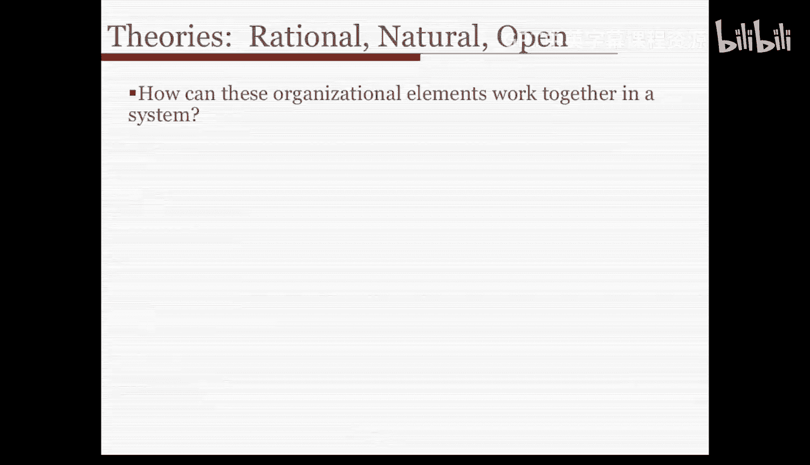
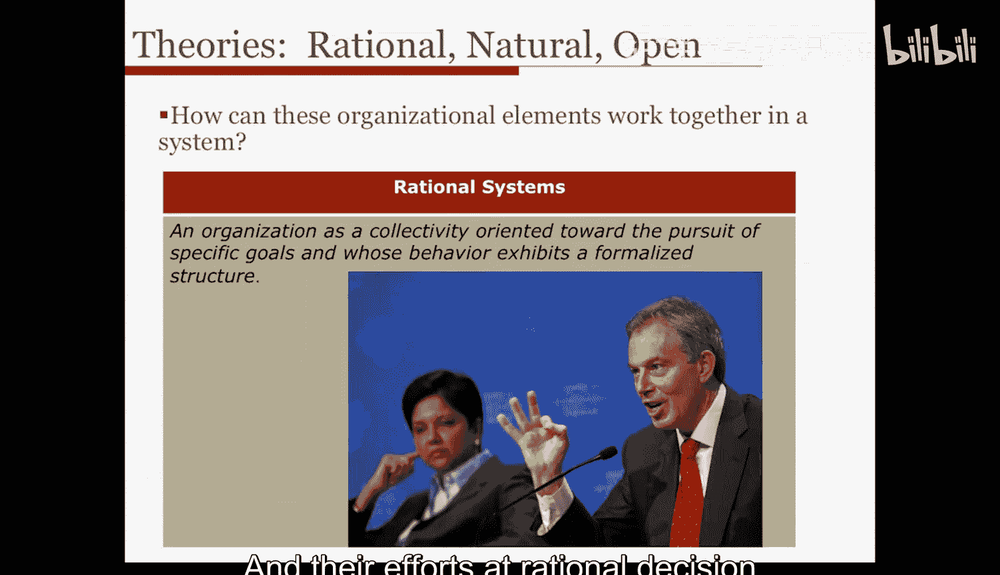
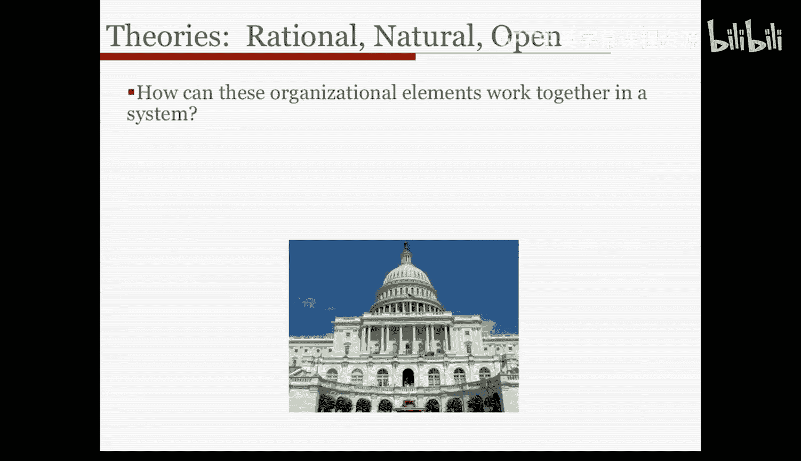
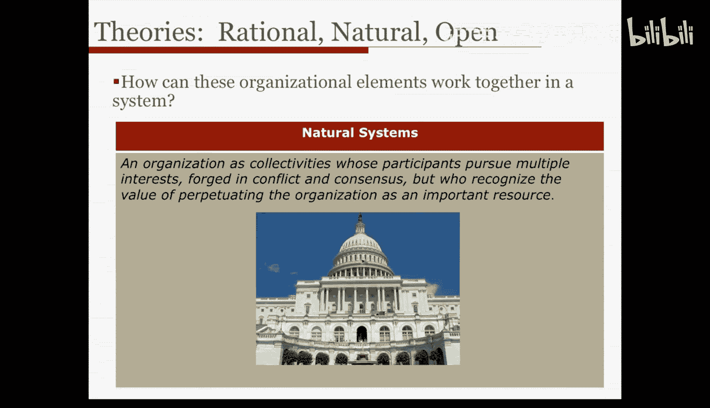
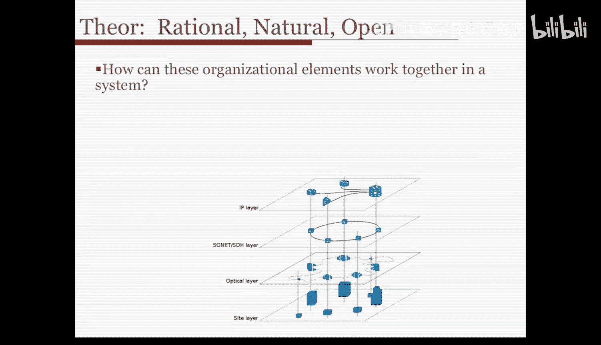
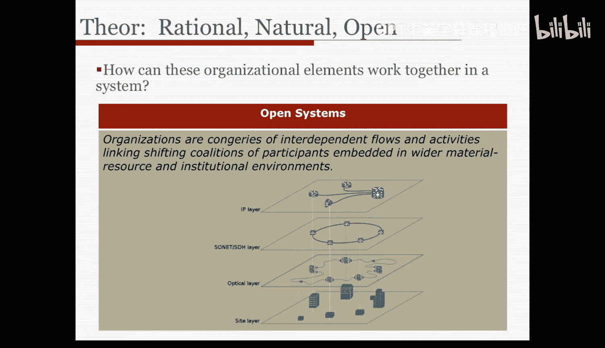
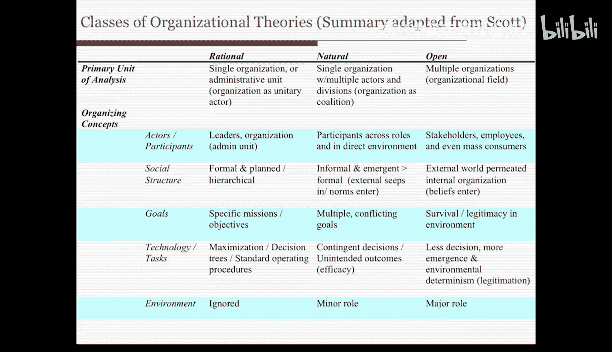

# 斯坦福大学《组织分析｜Organizational Analysis》中英字幕 p04 004_01_04_第二讲-组织的分析特征-第二部分.zh_en -BV17J4m157qN_p4-

So how do all these elements work together as a system is the next question？Fortunately。

 Richard Scott's review of organizational research not only identifies organizational elements。

 but it also describes how theories in different eras focused on certain organizational elements over others and characterize their interrelation in certain patterns。

In short， he recognized three classes of organizational theory。

The earliest class of theories regarded organizations as rational systems here the theories characterize an organization as a collective that was oriented toward the pursuit of specific goals and whose behavior exhibits a formalized structure。

 these theories tended to focus on the administrative units of organizations and their efforts at rational decision making to optimize and to solve problems。

An ensuing class of organizational theories characterized them as natural systems。 Here。

 the theories related an organization as a collectivity whose participants pursued multiple interests。

 and these interests were forged in conflict and consensus。 However。

 the participants recognized the value of perpetuating the organization as an important resource。

 So therefore， they wanted the organization to survive。

As a natural system， the organization is unplanned and it has emergent relations and coalitions that measure。

For example， things like the informal structure of relations that develop among participants is more influential in guiding behavior than the formal structures。

 role expectations and guiding principles， so the formal organizational chart is less important than the informal organization that emerges in between it。

 so this class of theories is regarded as an organization as an adaptive organizationism as opposed to as a rationally admined one。

Most recently， organizational theorists have come to characterize organizations as open systems。

 and here organizations are conju of interdependnent flows and activities。

 linking shifting coalitions of participants embedded in wider material resource and institutional environments。

 This class of theory focuses more on the environment than any other organizational feature。

 hence the shift goes from a rationally administrative unit of the rational actctor view to a natural system of informal emergent processes and inconsistent preferences within an organizational environment。

 to the wider environment， influencing the actual organization itself and being the kind of primary concern。

So let's review what we've covered and what I'm going to do now is just walk through this table here。

 the three systems we have are rational， natural and open systems。

And what I'm going to do is first look at the primary unit of analysis here we have a single organization with the rational system view and as a single organization that focuses on the administrative unit or the brain of an organization typically and have views the organization as a unitary actor for the natural system we see a single organization again。

 but with multiple actors and divisions， the organizations more of a coalition or a loose federation than a unitary actor。

 and then finally with the open system view， the unit of analysis shifts to an organizational field and we have multiple organization。

Next we have our organizing concepts and as you recall。

 these organizing concepts were actors or participants， the social structure， the goals。

 the technology or tasks， and finally the environment。So for actors and participants。

 let's take each theory again。For the rational system we see that the key actors that are focused upon are the leaders of the organization or the administrative unit。

 the natural system， the focus on participants across roles and in the direct environment。

 the immediate environment around the organization， then finally for the open system view。

 we focus on stakeholders， employees and even mass consumers in wider society。

For the social structure， here we have another organizing concept it also varies across rational。

 natural and open， so for social structure we see that in a rational system it's formal and plan。

 it's a hierarchical kind of organization in the natural system it tends to be more of an informal and an emergent kind of system and it's more important than the formal and plan the external kind of seeps in here with norms as well with the open system we see that the external world permeates the internal organization。

 so beliefs from outside resource dependencies from outside all of those matters start to greatly affect the way in which an organization relates to others other organization and survives in this environment。

Third， we have goals。And for a rational system， the goals are specific missions or objectives right for a natural system。

 the goals aren't so clear they're multiple and conflicting。

 and then for an open system it tends to be a goal of survival and legitimacy in the environment。

 so with each of these theories you notice that each kind of system from rational， natural and open。

 we see a shift in how these organizing concepts are being related and described by these prevailing kinds of types of theories。

So for example， with technologies and tasks we again see with rational actor views that there's an effort to maximize decisions to have decision trees and to identify standard operating procedures and the like in a natural system we see contingent decisions or decisions that have unintended outcomes so here efficacy is kind of a concern of tasks。

 and then finally we have the open system and here the task or technology is less about decision and more about environmental determinism and legitimation from the environment where it dictates if your organization fits conceptions of what that type of organization should be。

 for example what school should look like you therefore survive and acquire resources。

And finally we have different notions of environment across these different types of theories。

 so for example， with a rational actor view the environment is almost entirely ignored in a natural natural system view it tends to have kind of a minor rule。

 albeit it's there and then finally with the open system view。

 the environment is pretty much everything in great part。

 it's the key variable that drives the behavior of an organization。So we have these three theories。

 rational， natural， and open， that kind of are general frameworks for how our concepts or analytic features relate and combine。

Now one could argue that these theories reflect the organizations of their day。

 but I'm not sure that's a case and by this we mean that rational systems were early theories that you had for Taylororism when people tried to kind of organize things and plan everything and have administrators kind of find the most efficient decision trees they could entail and designing a workplace to later in modernist times after the industrial revolution。

 we had more of these kind of natural system kind of use to finally today we have this open system perspective in a global economy where organizations are highly dependent on their environment to survive now we could say that that's some kind of historical shift but it may also be that most organizations always entail these features。

 it's just that scholars and the kind of information we collected we just shifted what we focused on as we learn more and more how to study。

So we have three classes of organizational theories or three meta narrativerrs about organizational theories from rational to natural to open system views and each of these theories has been argued to reflect the organizations of their day so that the rational system view reflected early kinds of organizations in the industrial revolution where people tried to make factory lines。

 very efficient and administrators planned everything and had decision trees with rational action being the word of the day but then later in the modernist time or era we had more of these kinds of natural systems where organizations were rife with conflict and lack consensus and it was this kind of dynamic and emergent process of organizing to what we have today which is where in a global economy we have organizations maybe that are highly contingent on relations in the environment to survive now one could argue that this is。

a historical progression， but I'm not so sure that's the case。

 Most organizations still entail all the features in the processes that a rational。

 natural and open system perspective entail。So I think we'll gain a lot by learning these different kinds of perspectives in the course。

Another view could be that organizational theories have expanded their focus as our understanding of firms and instrumental social groups has grown。

All these features have likely always been there within organizations。

 and they've perhaps shifted some in salience。 But to this day， rational。

 natural and open system qualities persist in many organizations。

