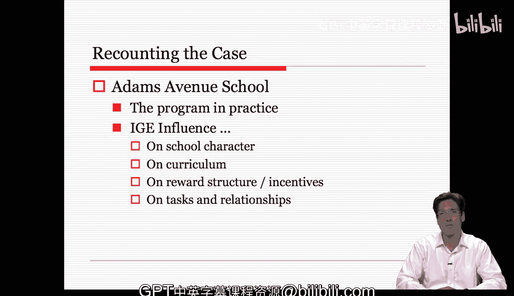

# 斯坦福大学《组织分析｜Organizational Analysis》中英字幕 p05 005_01_05_第三讲-案例应用-第一部分.zh_en -BV17J4m157qN_p5-

In my remaining lectures of the week， I'm going to discuss some case applications， this lecture。

 I'm going to discuss a case of a school reform effort and identify the organizational elements being discussed within it。

The case we use wasn't written for organizational analysis， but rather for educators。

 hence the writer Mary Metz， selects the features she thinks characterize this case。

We want to see if we can identify the organizational elements in the case and see if they help us understand what sort of account it is。

 what elements are the point of focus， which your characters as having an interrelation and being changed。

Through such an application， I hope you'll begin to see that even when we take off the shelf a random case that we can see how it draws our attention to particular details or particular elements and describes there in a relation in a particular way。

 and from this we can begin to see how a particular organizational theory can help elucidate the case。

 how it applies and is relevant to this particular organizational phenomenon。

Let's begin with a quick review of the core elements before I recount the case first we have actors or participants。

Organizational participants make contributions to and derive benefits from the organization。Next。

 we have social structure and the social structure is the persistent relations existing among participants in organization。

 And if you recall， the social structure can go from surface to deep。 And by deep， I mean。

 more into cultural features like values and principles that guide the kinds of patterns of relations that we have within organizations。

Next we have the goals and goals are the desired ends that participants attempt to achieve through the performance of task activities。

Fourth， we have technology or the tasks that an organization tries to accomplish。

 and tasks are the means by which organizations accomplish work or the means by which they render inputs into outputs。

And then finally we have the environment and here in the environment。

 we have the physical kind of the physical locale， the technological kind of environment。

 the cultural context， and even the social context of other organizations。

In which an organization is actually embedded， so we have participants， social structure goals。

 technology and environment as our elements。Now that we've reviewed the organizational elements。

 let's recount the case of Adams Avenue School。This is a case about the creation of a magnet middle school with a new kind of curriculum that will hopefully serve a struggling population now for many of you a magnet school。

 it's helpful to know that a magnet school in the United States is a school that people are apply to to get in it's usually a high school and it usually has a theme focus like science and math and it's usually kind of a lottery to get in or it can be achievement- based by test score in this case it's really a lottery so this is a case about the creation of a magnet middle school that has a new kind of curriculum that hopefully serves a struggling population and it's meant to build a sense of community to bring into the full lower academic performing students and the ultimate goal is to improve student achievement overall。

Now there's a history to this school before it was a magnet school or it became a magnet school。

 Adams Avenue School was a seventh grade annex， that means it was like an offshoot from a middle school that was really just one grade in a separate building and it was built。

for an annex to Williams juniorni high school， which was overcrowded。

 and it was an overcrowded African-am Americanican school in the poorest part of this town now the Williams annex was established to relieve severe problems of discipline and underach and it was voluntarily staffed by young faculty who lacks seniority at the Williams juniornior high School so he had this annex of people whoarily staffed it that lacked seniority at the main school。

Now Miss Michaels led this annex， it was one grade and one grade annex to this junior high。

 and she was not a principal， but she had a good deal of saying how the annex。

 the members of the annex developed their program， and she and her colleagues decided that the annex should follow a multiunit plan and be divided up into three small schools of around100 students each。

SoMeanwhilewhile， the district was going through change。

 it was planning a new magnet school program which meant that you would have a variety of schools with different kinds of curricular programs that people could apply to so school choice to some extent。

 the Williams annex was selected as a great site for becoming a new Mag School called Adams Avenue School。

 which is the case that you get to read if you'd so like within this course。

Now Michael's was selected to be the principal at the time she was just the annex lead。

 but they wanted her to lead this new magnetna school and the faculty decided to adopt a particular kind of program that would help these underachieving students and this particular program was called individually guided education in this individually guided education which is now it's a technology or a particular means by which input students are made into output socialized skilled individuals and the curriculum itself was designed so that students could proceed at their own pace and complete a series of individualized task showing mastery of material。

So it' a particular kind of curriculum or technology， right？Before the school opened。

 the faculty were sent for training in this program， but it was tailored toward elementary students。

 the training program， it wasn't suitable for the junior high faculty。

 but nonetheless they were sent there as a result they were kind of ill prepared when the school opened to sixth through eighth grade students which are students that are from 12 to 13 years of age。

 12 to 14 years of age。When Adams Avenue opened the faculty also lacked materials。

 meaning like the materials they had learned were for younger students。

 but nonetheless they may do the best they could by their second year the school received funds and faculty received more training and individually guided education and according to the author Metz Mary Metz。

 the school seemed established and had a coherent program in place and eventually by year three it was really starting to hum。

Now parental involvement was somewhat varied at Adams Adonu， upon opening。

 it attracted well-educated parents mostly for a gifted program that they had there。

 and they had an influential role in the school's affairs and took up a good deal of the principal and assistant principal's time。

 these parents weren't afraid to tell the teachers what to do and check up to see that they actually did it。

In addition， they campaigned for the school at board meetings and with the district office to retain an assistant position and to get a larger。

 better building。As the school's reputation grew， it attracted the interest of lower middle class families and ordinary families by the third year of operation。

 the magnet School's population reflected that of the surrounding community and had less of a bifurcated population of highly educated families on the one hand and working class families on the other。

By the third year， the very high achieving kids of the initially aggressive parents were now in the eighth grade。

Now as far as the individually guided education， they had these textbooks。

 but it was not as clear as it might seem the curriculum from those textbooks。

 given that the plan was written by a specific group of educators for other schools。

 so faculty found it far from clear in implementation。

 hence the principal had broad discretion in how it was defined。

 eventually this curriculum was defined on two sets of requirements。

 the first specified a number of concrete learning objectives for each subject in each grade。

 and students were to be tested on them before and after instruction was given。

 and this progress was to be monitored carefully。Second。

 children were grouped according to the progress they had already made like a pretest and instructed from where their knowledge left off。

So these skill groupings were to be fluid and reconfigured whenever a new objective was introduced。

Now the school kept its small school layout and each school had four home rooms that traveled through all the same classes together。

 teachers in each school had an hour a day for common planning and the lead teachers met with the principal as an instructional improvement committee that enabled twoway communication between teachers and the principal。

The school itself had a particular character， Metz reports that teachers directed their attention on their work with students。

 that their energy was directed toward planning and teaching and running lots of extracurricula。

Rather than speak of students in terms of the individually guided education。

 they spoke of them in terms of their relationships with the students。

 So the schools notable in that potentially volatile relations were not evident。 and instead。

 positive relations persisted between the faculty， parents and students。

 there were exceptions that suggested a harder past， say in the first two years of operation。

 But the schools mostly in harmony by year 3。The classes were heterogeneous in composition。

 but as stated earlier， they were internally divided into groups on the basis of skills development with relation to each learning objective。

 so lower skill groups had more African Americans， but they remained relatively heterogeneous and the interactions between students and teachers with students were task oriented and respectful for the most part。

 Student themselves reported having interracial friends and seemed open to heterogeneous relationships。

There was a general absence of conflict at Adams Avenue School， discipline was often a simple matter。

 and faculty issued yellow cards as warnings， and then they made formal referrals to the administrators for discipline that they couldn't handle。

 this of course was noted on the child's record or permanent record in some cases。

Mas reports that the yellow cards were issued less than two times a day for all 300 children over the course of the year。

 and suspensions totaled less than one out of 10 kids。

Less than one out of 10 kids were actually sent home or suspended from attending school。That said。

 disciplinary problems were more common than these formal indicators suggest。

 but the thing was that they were handled informally。

 and this in turn reinforced positive relations between teachers and students。

If there was any conflict， it was between the principal and some of the teachers。

 the actual conflict that was observed and reported by Metz goes back to the end of year one。

 and during that time period some of the there was a strike and some of the teachers did not strike with the rest of them。

 some of them actually sided with the principal and some of the union leaders were especially bitter over this。

 so if there was any degree of conflict it's this residual sense of conflict over the kind of not striking with the rest of the faculty。

So now let's talk about the program and practice， the teachers in principal followed the two sets of practices believed to be the core of the individually guided education program。

Teachers charted progress for each student and the principal checked it。

 but there was still some variation in teacher compliance with individually guided education。

Some teachers were relaxed in their application of individually guided education。

 and some rotated students through the same set of tasks in spite of being in differently skilled groups。

 so they did not really have differentiated work。Some produced charts on estimates of student progress rather than pretest posttest scores and these teachers said they adapted individually guided education like this because it was a lot of work and they were unwilling or unable to do all of it so this is on top of their regular teaching they felt a few other teachers actually resisted individually guided education。

 they didn't comply as a matter of principle， they argued their subject matter was ill suited to individually guided education and required fundamentals or too many skill demonstrations but even these relaxed resistant teachers were influenced。

 they conveyed clear purposes for each day's instruction。

 they had relatively wellformed understandings of each kid's skills and deficits and even if they didn't use the explicit features of the curriculum they seemed in line with the general philosophy and focused on skill development and their subject they thought carefully how to get that across various kinds of students and how to track progress。

So instruction also involved a lot of field trips， projects and a rich extracurricular experience and this added a further personal element。

 so in spite of following the individually guided education to varying degrees。

 we see this kind of personal element， this kind of effort to at least in principle relate to it somewhat now individually guided education actually had some influence on the school character Metz reports that the imposition of individually guided education changed the character of the school and especially the relationship of the low-achieving students with teachers and between students of different races that has individually guided education induced a common or communal ethos and a denser set of positive relationships among participants of the school so here we have a case of a technology shaping social structure right。

The individually guided education program and curriculum also changed the traditional organizational structure。

 the curriculum removed grade level differentiation from view。

 instructional differentiation was rendered more individualized and remove both the stigma placed on a student performing at the fourth or fifth grade level and enabled accelerated students to work at a level well beyond grade level。

 all that matters was forward movement for every kid， not where they were moving forward from。

The individually guided education program and curriculum also affected the reward structure and incentives for students。

 Adams Avenue used report cards and emphasized effort and the level at which the student worked in each subject。

In many ways you can think of report cards as pay right within an organization。

 you get grades in exchange for work， hence a hard working student with a fifth grade skill level might receive an eye for superior effort and progress while lackx aadaical for a sixth grader with eighth grade level skills might get an E for inadequate progress。

The honor role was based on effort grades， not skill level grades。

 and in this manner the individually guided education's reward structure worked to equalize social prestige and include lower performing kids and give them academic legitimacy this conversely lowered the rewards experienced by high achieving students and some teachers worried these students weren't pushed enough to excel higher。

The individually guided education curriculum also influenced the task structure of students and teachers with students。

All the instruction was done in groups based on skills where those students worked independently。

 and this meant that no one performed before everyone publicly and achievement in work was more a matter of private accomplishment and few opportunities for public embarrassment。

 Teacher spoke with the student as a group for instruction and then guided progress through the tasks individually。

 Mary Metz reports that everyone felt they got the attention and assistance they needed。

 These relations built into ones of trust between teacher and student and they lessened conflict。

 They also equalized persons more。 deemphasizing initial differences and skills。

 and this served to build interracial ties。

