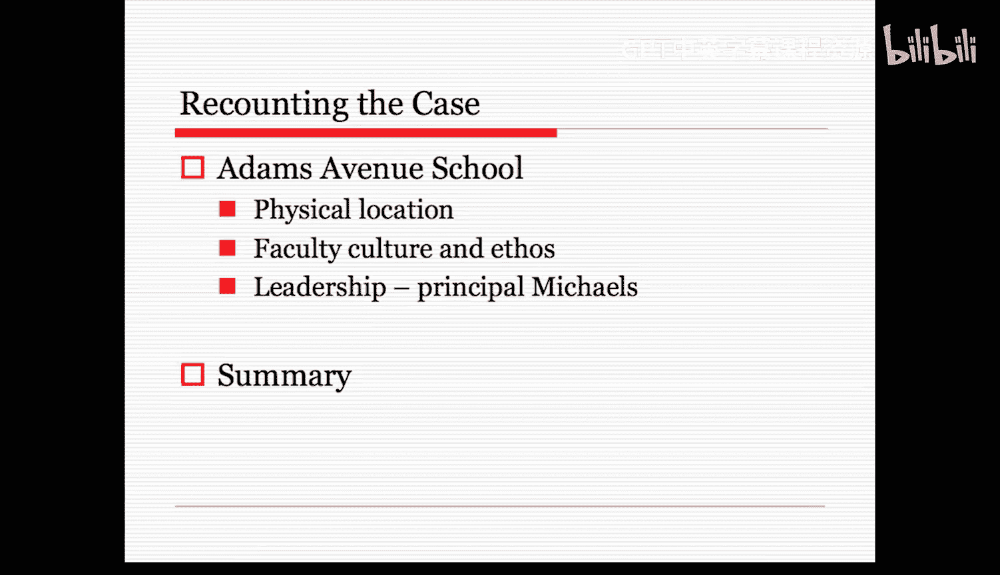
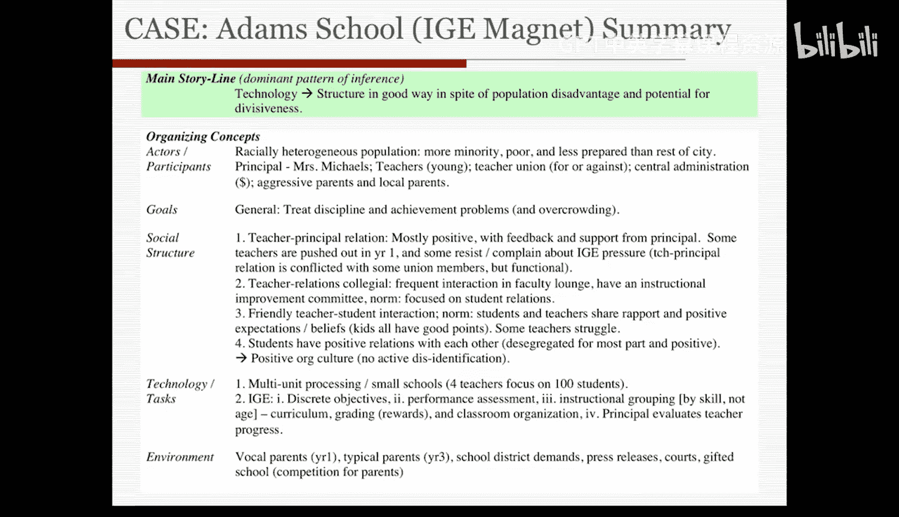
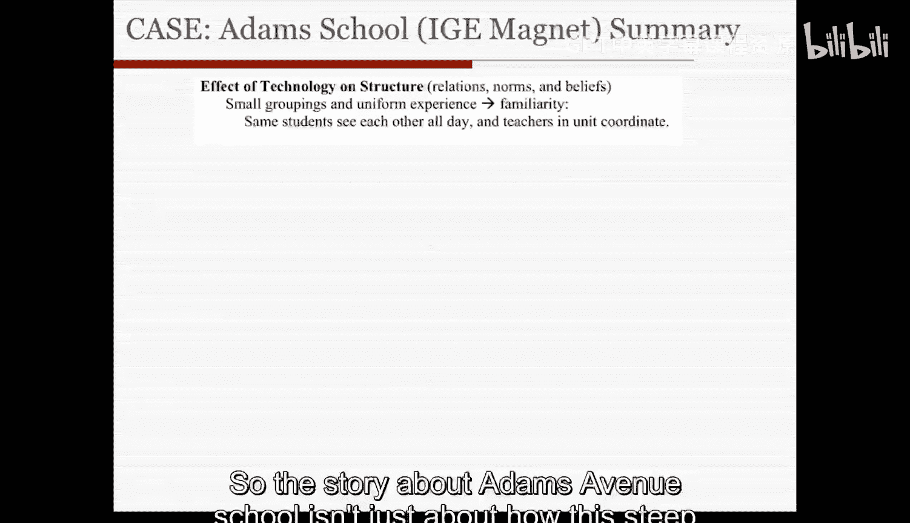
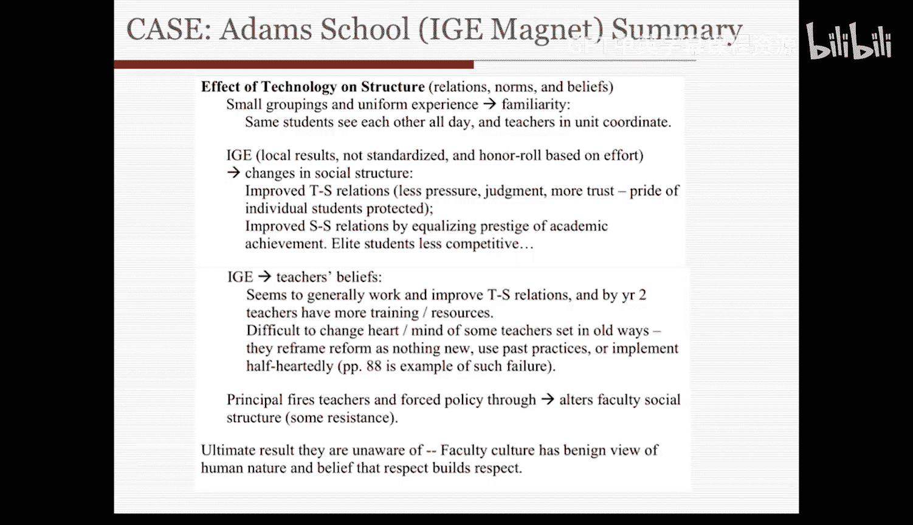
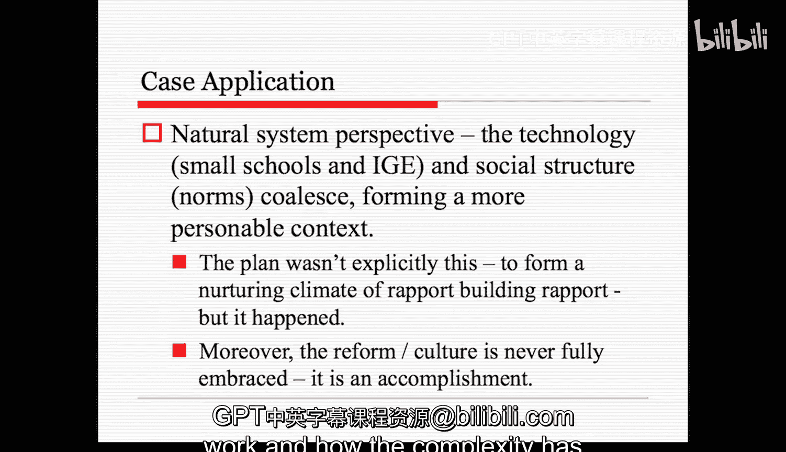

# 斯坦福大学《组织分析｜Organizational Analysis》中英字幕 p06 006_01_06_第三讲-案例应用-第二部分.zh_en -BV17J4m157qN_p6-

Mary Metz also discussed the physical space， and she discussed the school's location in a downtown area。

 which lent itself to field trips and businesses， museums and the like。

 The building was small and and it actually lacked sufficient space for a gym and its heating wasn't always certain。

 In spite of this， they did not want to move to another building。 Marymettz argues the context。

 this physical context put everyone into shared spaces and created more of a warm atmosphere。

 All the teachers reported that the school's small size and parting into three units or small schools enabled the teachers to know students individually and to have a healthy rapport with one another。

Mary Metz makes a lot of discussion about the school culture and ethos or the deep social structure。

Faculty regarded good relations with students and with one another as an end in itself and helpful to learning。

 in some ways this kind of culture， this set of principles became the basis for a new goal or a shared mission。

With few exceptions， the teachers viewed all students as essentially good。

And they regarded the mutual rapport as normal。The teachers didn't misidentify with their students。

 they had strong， solid professional relationships with them that were kind of personal。

A lot of the faculty felt like and practiced various activities that helped rebuild and pass on this culture that enabled it to be renewed。

 and this occurred in several ways during team meetings and faculty lounge conversations。

 teachers tended to interject positive comments into their conversations that spun if they were ever spun in negative directions。

 they would redirect them toward positive kinds of things and new recruits got socialized through these experiences so the culture was passed on。

 even informal leaders respectfully sanctioned new teachers adopting a negative view of teachers。

 they redirected them to be one of respect and building up students as opposed to tearing them down。

That said，F cultures are uniform， there were exceptions and Matt's remarks on how five teachers angrily confronted students。

 these teachers tended not to use group instruction but rather whole class instruction and recitation In addition。

 students knew who they were and responded to them negatively。That said。

 Metz is quick to point out that these teachers were relatively negative。

 but not noticeably so in comparison to say traditional school teachers that taught in other contexts and schools。

 her point is that the school culture is a fragile construction that needed to be reproduced and was far from a sure thing。

Mary Me spends some time also on the administrator or the kind of the leader of the organization and the principal's influence。

The principal Mrs。 Michael， influenced the tone of interpersonal relationships via indirect and informal means。

 but she also controlled the individually guided education curriculum and its instruction via direct informal means so on the one hand the culture was was kind of a natural system in way in which she managed it with informal kind of emergent relationships and efforts whereas the actual curriculum itself was something that she managed more via direct and rational system means now it was an official doctrine to have positive relationships with students but the principal encouraged it in a variety of ways so she used indirect means to do this and her speeches she valued building up students she wanted relative assessments to occur over say objective universal test scores she wanted teachers to do field trips she encouraged ethnic pride and was involved in many of those groups。

She also sought out integration wherever she could。

She publicly appreciated teachers who led extracurrula and made it a point of giving them institutional resources they needed for those endeavors。

 in short， the principal's relationships with faculty and with the students mirrored that of the school culture。

 whether one influenced the other isn't clear but they reinforced each other for certain。

The principal's relation with faculty over the individually guided education program was a different matter。

The individually guided education program was imposed from the district and the faculty felt they had no choice or discussion over it and felt a degree of resistance Mrs。

 Michaels kind of resorted to formal hierarchical authority to implement this program and the faculty meetings the first two years she reminded teachers they had to implement individually guided education or they would have to find a job in another school or district at the end of the first year she even demanded three teachers transfer and this led to a lot of conflict eventually two were persuaded to leave in the third filed a grievance that means they went to court in order to kind of figure out whose right or wrong in this case The faculty were upset some because they felt the involuntary transfer wasn't too fair and many didn't know how to implement the individually guided education in their first year so they felt like it might not be that individual's fault。

Anyhow， by the third year， teachers were more comfortable with the individually guided education program and they resisted less than the principal resorted to more positive reinforcement and lessened her use of official powers。

Now the last thing to talk about here is teacher resistance。

 a minority of teachers criticized the principle for a reliance on hierarchical forms of authority to push through the individually guided education program。

The minority's anger was recognized by the majority of teachers， but it did not diffuse。

We have kind of a natural system in many ways where some of the teachers had a resistant view that differed from the main culture。

 so we had perhaps even ambiguous goals or multiple kinds of perspectives within this organization。

 it was held together as a coalition and the administrator or principle tried to guide this in various means through whether a natural system of informal relations or through the formal organizational kind of chart。

Now in summary， the distinctive features of Adams Avenue School was the constructive relationships。

 the school implemented the formal individually guided education program to a moderate degree and the positive relationships seemed to reinforce the elements of the individually guided education program that seemed consistent with it。

 for example， the aspects of individually guided education that rendered negative judgment private were reinforced。

 the focus on the individual or relative performance of a student was reinforced。

 and the effort to nurture individuals and relationships by a support of skills groups was reinforced。

As such the pride of the slow learners was protected and special activities built a sense of fun and camaraderie。

 the technological or task arrangement of the school did not work alone。

 it required a faculty culture and a school character that assumed respect would breed further respect and this kind of culture led to the kind of observed relationships。

 so we have deep culture guiding the kind of observed social structure and that social structure reinforced the implementation of a particular technology or task。

The lack of training and rush to get individually guided education going led the principal to use her formal authority and to push individually guided education through the principal believed it was her choice to do this in response and was not a pressure from the district office per se this pressure from the principal led the faculty be to resist in and upset at first a minority remained somewhat angry even but the faculty and principal did find ways to work respectfully and productively together and again this was partly a result of the small schools and the positive collegial ethos that led to positive relationships。

The teachers at Adams Avenue believed the small schools contributed to their getting to know their students individually as well as each other。

 and this was the secret to their success。The teachers did not recognize or notice the contribution of their culture。

 nor did the students on the technology or task of the individually guided education。

 their benign belief or even unconscious belief seemed natural to them。

 the belief that we should respect each other that we should diminish this kind of achievement culture and whatnot。

 that that seemed natural to them， and the culture operated at its best effect because of it。

So what I'm going to do at this point in the case is relate a summary table of where we start to apply the concepts from the course。

Or from our theoretical frameworks to the case。And the first thing to keep in mind is when you think about a case is to consider what's the main storyline that this author is portraying。

 in this case， Mary Me's main storyline is characterizing a dominant pattern of inference or how something comes about in this organization and in particular she's saying that a technology was imposed in this organization and that the structure social structure was such that it enabled the kind of technology to be implemented。

 so that's her general storyline， if we look at the actual actors and participants。

We see that it's a racially heterogeneous population， there's more minority students and poor。

 and they're a little bit less prepared than the rest of the city， we have a principal they miss。

 Michaels who's the leader， we have teachers who are relatively young and an experienced。

 we have a teacher union that is for and against this kind of individually guided education program。

 and we have a central administration that controls money。

 we even have aggressive parents that want gifted students to excel and we have local parents that have more that reflect more of the composition of the community。

If we look at goals， we have a general goal， which is to treat discipline and achievement problems。

 to deal with overcrowding， to create a new kind of experience that solves a lot of the kind of goals of schooling。

 right？And here we have a social structure which has various elements like teacher principal relations which are mostly positive with feedback and support from the principal。

 we have some cases where teachers are pushed out year one and some resist and complain about individually guided education's pressure so there's some conflict but mostly there isn't。

 they're pretty collegial， now the teachers' relations with each other are also collegial。

 there's frequent interaction in the faculty lounge。

 they have an instructional improvement committee， there's kind of a norm to focus on student relations and having positive ones with them。

Third we have friendly teacher student interactions so and this seems to be enormous as well that students and teachers share rapport and positive expectations and beliefs of one another the teachers have a deeper structure of belief which is that kids all have good points this isn't to say that all teachers are successful some struggle to do well in this kind of relating。

Now students also had positive relations with one another。

 so again we have all these patterns of relations right with different network populations or roles and the students' relations with each other were also pretty positive and they were desegregated for the most part。

In part， the argument is that all of these kinds of relationships that manifest were the result of a positive organizational culture that people pushed forward these norms and values and principles of relating。

 okay。Now the technology and task of this organization， there's multiple technologies and tasks。

 one is that it was a multi unit processing organization。

 so the school was divided up into several schools right。

 so you had three sets of four teachers that focused on 100 students right？

And the other part was that you had this particular curriculum， an individually guided education。

 and it had particular discrete objectives， it assessed performance individually。

 it grouped students by their skill， not by their age。

 the curriculum grading and classroom organization was all very different than traditional means in the sense that it was individually guided。

 to students themselves guided how the education went。

 they got to decide their progress at the rate they wanted to go。

 and the goal was that they would improve from moment to moment on their own。

The principal also evaluated teacher progress so here we have a technology or a task by which the principal could kind of alter teacher input outputs right and so we have multiple kinds of tasks and technologies going on in this school and the main storyline to this point is that。

You knowYou have this culture within the school and ethos that creates these kinds of positive relationships that seem to be coterminous or at least aligned with the kinds of tasks and technologies that are being implemented and that's the general narrative of mets for this whole story now the environment itself also has effects on this whole narrative。

 which you have these vocal parents in year one， by year three。

 we have more typical parents of the community the elites start leaving the district for some reason。

 and then the school district has various demands upon the principal， there press releases courts。

 there's a gifted program it small and crowded and its the physical setting of the school itself kind of induces some of this kind of association that we observe that's kind of cozy close kind of experience that's personalized。

So the story about Adams Avenue School isn't just about how this deep culture leads to these positive relations that then facilitates the technology。

 it's also a story of how the technology itself， the curriculum and the actual。

Way in which the school was organized。To process students and to socialize them actually shape the social structure。

 so this individually guided education program set conditions from which these positive relations。

 norms and beliefs could arise so for example， the small groupings of students in the small schools where they had the same sets of teachers and moved from one class and an X enabled them to have familiarity with each other and a uniform experience。

 the same students saw each other all day and the teachers coordinated as a unit the individually guided education really didn't have you know global or objective standards it had local results that weren't standardized and the honor role wasn't based on achievement like an achievement test but was based on effort and this kind of these rules of the curriculum。

 the technology。And the way in which people had to do work and were judged on their work led to changes in this social structure it actually facilitated improved teacher student relations because it lowered pressure achievement pressures and judgment and this gave more trust and pride relations I protected the student self-esteem in addition to improved student student relationships by equalizing the prestige of say academic achievement elite students were less competitive and lower performing students did a little bit better the individually guided education curriculum also influenced the teacher beliefs it seemed to generally work and improved teacher student relations and by year two that teachers had more training and resources so that actual effort to train teachers their exposure to this curriculum led them to implement it better it's difficult to change the heart and mind of some teachers。

th that are set in the old ways， they're going to reframe any reform as nothing new and they'll use past practices or implement these new things halfheartedly。

So the principal's efforts to actually fire teachers and force through the policy kind of altered the facultys social structure。

 creating a drop in this kind of positive principal faculty relations， there was some resistance。

 but ultimately the result was that they were unaware of was that this faculty culture its benign view of human nature and belief that respect builds respect。

 that this kind of was generated part by the individually guided education and all the efforts of the curriculum and technologies that were put in place。

 and conversely that the actual implementation of the social structure through a variety of emergent practices that reinforced it and reproduced it had positive feedbacks back on the curriculum itself enabling it to be enacted。

 so this is the general story。Of the Adams avenue School。

So in sum， the case application of Adams Avenue School is really a natural system perspective。

 the technology of small schools and individually guided education。

And the social structure of norms and valuing students。Kind of coalesced。

 it formed a more personable context。And that's kind of the story of this organization and its reform。

 the plan wasn't explicitly this to form a nurturing climate of rapport that built rapport but it happened。

 and that's why it's a natural system of sorts as a account of a natural system because it had emergent kinds of processes and moreover。

 the reform or culture wasn't ever fully embraced， it wasn't uniform for everybody so it doesn't fit a rational system。

It was more of a natural system because it was an accomplishment。

 there was some degree of ambiguity at times and it had to be completely reproduced from moment to moment it seemed。

Now it wasn't an open system either perspective because the environment itself and all the other organizations and interdependencies with them weren't extremely relevant to this account。

 so in some here we have from our first case an example of a variety of the organizational elements in play and in addition we have some kind of explication of a natural system perspective。

 now mind you this wasn't what the author's intention was from the beginning but we can apply these concepts and theories to further elaborate meaning and depth to this organizational phenomenon so we better see why the changes happened the way they did and come up with some kind of deeper explanation that helps us understand how these organization work and how the complexity has some kind of rhyme or reason to it。

