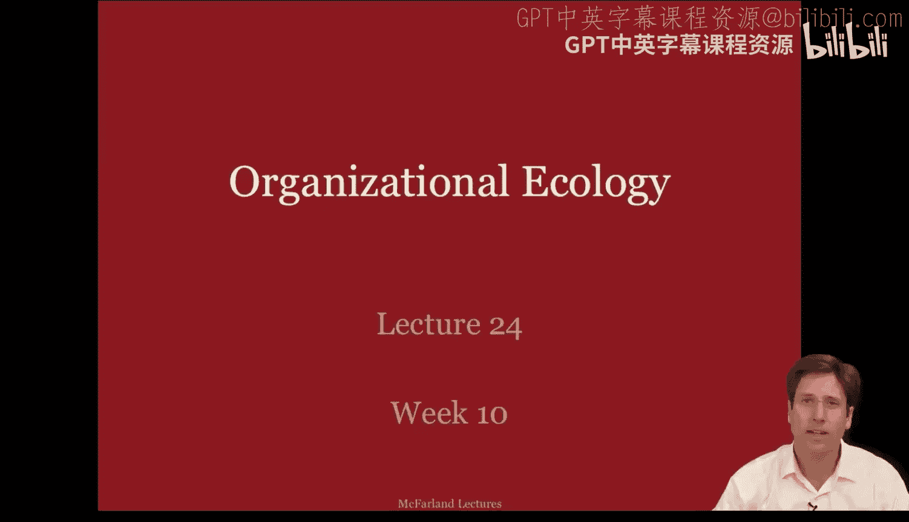
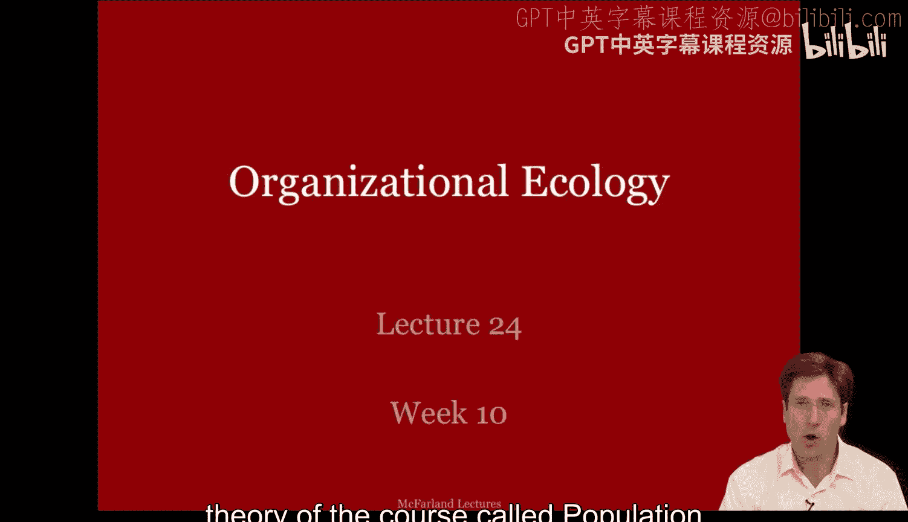
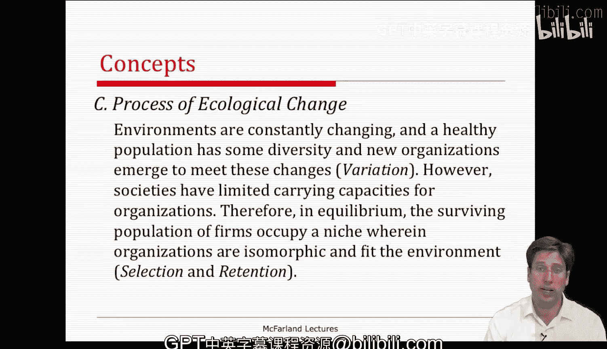

# 斯坦福大学《组织分析｜Organizational Analysis》中英字幕 p100 100_10_01_第二十四讲-种群生态学-第一部分.zh_en -BV17J4m157qN_p100-

This week we continue our study of organizations as open systems whose survival and success depends on their reaction to the environment this week we introduced the tenth and final theory of the course called Pop ecology or organizational ecology。

There's actually a long history of work that applies biological and natural selection kinds of metaphors to the study of organizations in fact there are many of these applications even to social theories。

 theories of society， a few of the kind of seminal figures might be people like Milton Freeman who relate neoclassical economics to natural selection arguments there he would talk about utility maximization and firm survival depending on that people like Carl White and Jeffrey Feffer are organizational theorists in the '60s and '70s who wrote more about the natural selection processes of variation selection and retention。

 but kind of in more metaphorical terms someone like Art Stinchcomb though in the 60s talked about firm founding and the fact that firms when they were established had an organizational form。

That was highly inert and stable。And then it was retained over epochs。

 other people that we're going to draw on today in talking about population ecology are someone like Richard Nelson and Stanley Winter。

 and they offer an evolutionary account。For how firms and industries change over time by relating them as organisms with。

DNA or proteins， and that those proteins and DNA of an organism happen to be strings of standard operating procedures or tasks。

And they talk about how these firms have random mutations over time and that those more fit tasks or DNA strands actually get selected and retained and the others that don't have those die out this week we're taking on Mike Hannnnon and John Freeman's theory of organizational ecology and they take this metaphor of organizational populations and apply natural selection arguments to it to a far more elaborate degree。

Organizational ecology begins with several questions。

 the first is why are there so many kinds of organizations and you'll note that this is an opposite question of neoinstitutional theory。

That theory asked， why are all the organizations looking the same？

The second question that population ecology asks is what can explain the diversity of organizations？

And then finally， where do all these different organizations come from and if you recall again with the institutional theory。

 the question was why are they so similar， why are they stable。

 a very different set of questions and approach here with the natural selection metaphor and the effort to talk about an ecology of organizations。

 there is a focus on diversity and selection， organization ecology explains organizational change as the result of environmental forces acting on populations of organizations so here we have this open system view of many organizations within an environment。

 and the argument here is that the social economic and political conditions of this environment affect the relative abundance and diversity of organizations and that context or environment accounts for their changing composition over time。

So population ecology is distinct because it kind of talks about Darwinian selection in regards to the population of organizations within an environment。

Now that you have a general sense for what a theory of population ecology says in general。

 let's dig a little more deeply into the details and elaborate some of the core concepts perhaps the first concept to begin with concerns the notion of a population and if you call neo-institutional theory had an elaborate definition of something called an organizational field in contrast population ecology has this notion of a population and it similar in certain regards。

 but with less emphasis on self-aware and more of an emphasis on regional boundaries and competition。

 so what is a population a population of organizations is composed of a class of organizations facingsing similar environmental vulnerabilities and sharing the same internal form like the same technical kind of core？

This shared internal form is a consistent blueprint for action or a pattern of activity。

 so it's kind of similar to what I said Nelson and Winter were arguing standard operating procedures and tasks were。

 the kind of DNA， the blueprint of an organization when I talk about shared environmental vulnerabilities I'm referring to external sets of relations and dependencies that an organization has in its environment。

 the last thing to think about with regard to a population is that it's bounded within a common system。

 and this means within a geographical region whether it's political kind of region or even an economic kind of market boundary so examples of what a population might be are things like financial institutions in Seattle or car dealerships in Houston。

 Texas， or now in the digital era，an entire industry like beer and the niche within it of microbrewing might be considered slightly different notions of populations so there are populations of organizations and organizational ecology contends that the environment can be partitioned into different kinds of resource spaces where populations of firms can persist and they call these environmental niches organizational ecologists describe two kinds of environmental niches the first is called a fundamental niche and the second is a realized niche in biology a fundamental niche is where a species of animal is able to live and survive and the realized niche is where the organizationism actually lives so for example an animal might be able to live within the entire forest but because of human encroachment and noise and might only live in a small area of the forest as such the entire forest is a fundamental。

N and the realized niche is the small part of the forest the animal actually lives in。

So think of it this way with this figure here you see all kinds of eco kind of systems right and with that in mind a fundamental niche for bears might be very broad they can live across all of these right。

 but today of course bears。Live only in a particular part of the United States which is the northern area。

 so their realized niche is the northern parts of the United States and Canada whereas the fundamental niche could have been all across the continent。

 coming up with an image of organizations and their kinds of fundamental and realized niches is actually quite a challenge and I'm limited to what the internet and the creative commons can afford me。

 but I think this image to my side here does some of the work and gives you some figurative understanding of say how certain products if you think of each node as a different kind of corporation and they're coloring as kind of certain types or fundamental niches but that they could have spread all over the place in this space。

 however they're kind of sequestered to or segmented into particular kinds of co-occurring domains and those can be thought of kind of environment。

Where resources are coas by these different kinds of firms in an effort to kind of sell these products so I think while it's not a perfect image gives you some figurative idea of segmentation in markets and the kinds of environments that may link to each of those segments as kind of a niche in organizational terms a fundamental niche refers to a region of the resource space in which an organization can persist in the absence of competition so examples of this might be health education entertainment or the beverage industry。

 the realized niche is the subset of the fundamental niche in which an organization can sustain itself in the presence of given competitors so examples of a realized niche might be music。

 dance and movies within the entertainment industry or beer wine and soda within the beverage industry。

 notice that，The fundamental niche of education doesn't compete with health but within that the realized niches have subsets of firms that kind of compete with each other now the width of that realized niche can determine the degree to which one species of firm can coexist with others without out competing one another so in the beer industry for example。

 microbreweery companies find themselves in a partition resource space where they can survive in spite of these huge brewers like Budweiser。

 same thing in education whether these massive public school systems some of these private schools charter schools and public magnets find a way to or even Catholic schools find a way to survive and serve a realized niche that's partitioned off within that kind of environment a key feature of population ecology is the process of ecological change and much of this is borrowed from natural selection arguments in biology。

The general idea is that environments are constantly changing and a healthy population of firms has some diversity and new organizations will emerge to meet these changes so there's variation right however。

 societies have limited carrying capacities for organizations， therefore in equilibrium。

 the surviving population of firms will occupy a niche wherein organizations are isomorphic and they fit the environment so you hear you have processes of selection and retention like a natural selection any firm that deviates in form will be eliminated as unfit in this kind of context so we have three features here to describe ecological change。

 variation selection and retention。

