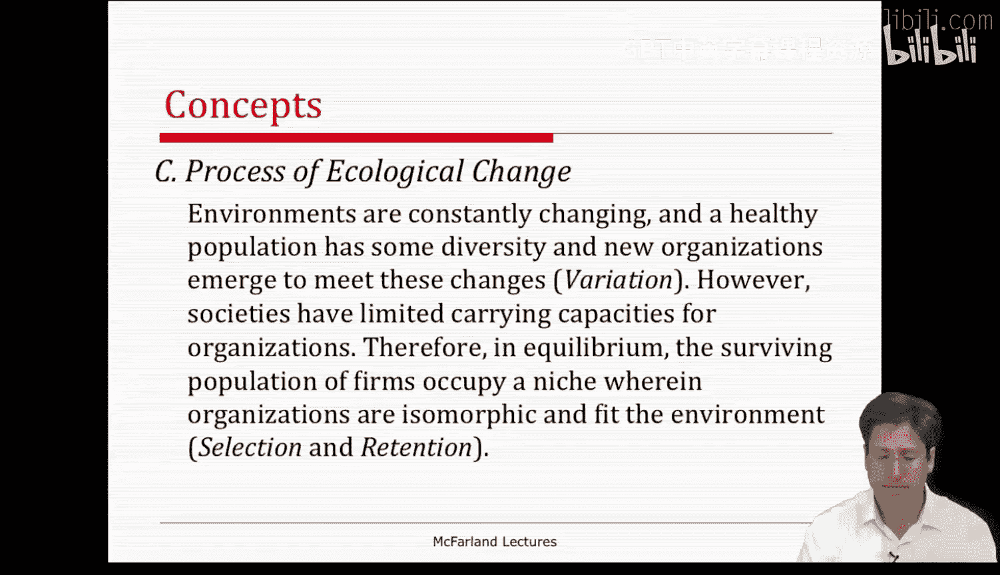
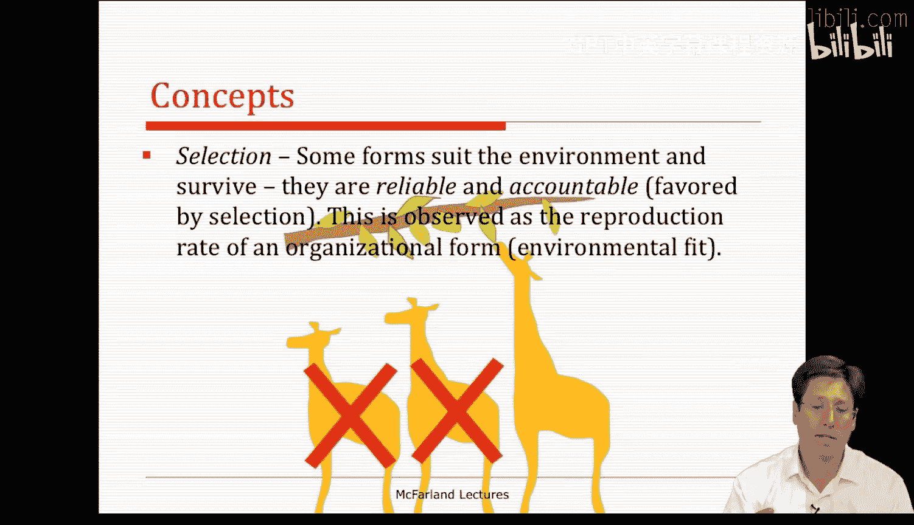
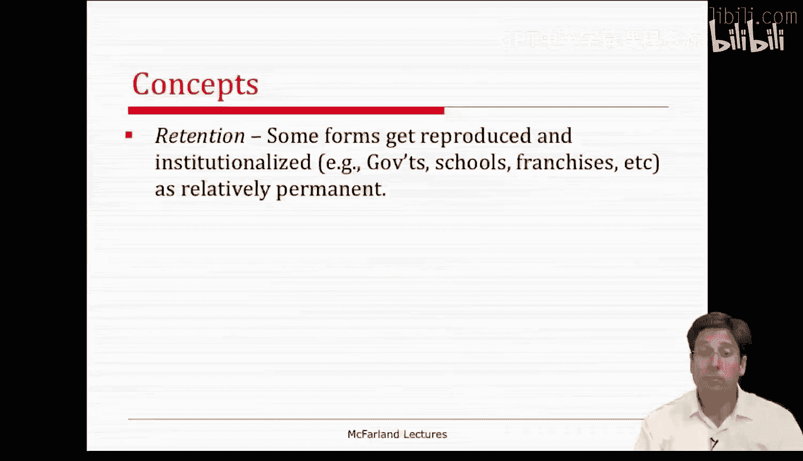
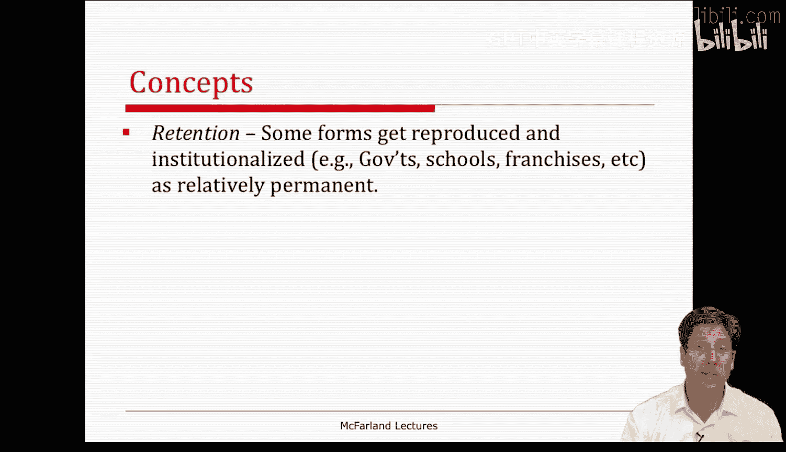
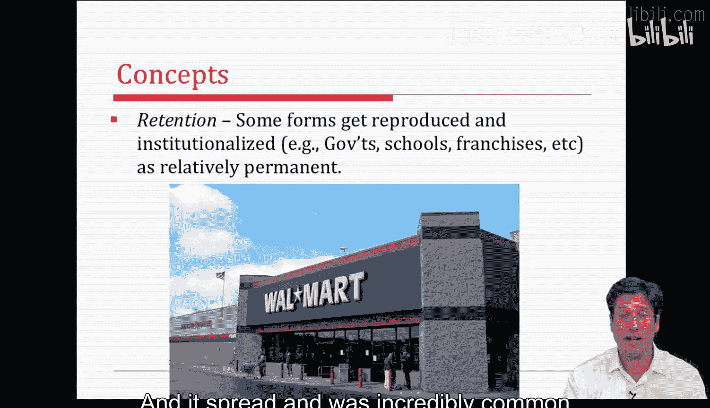
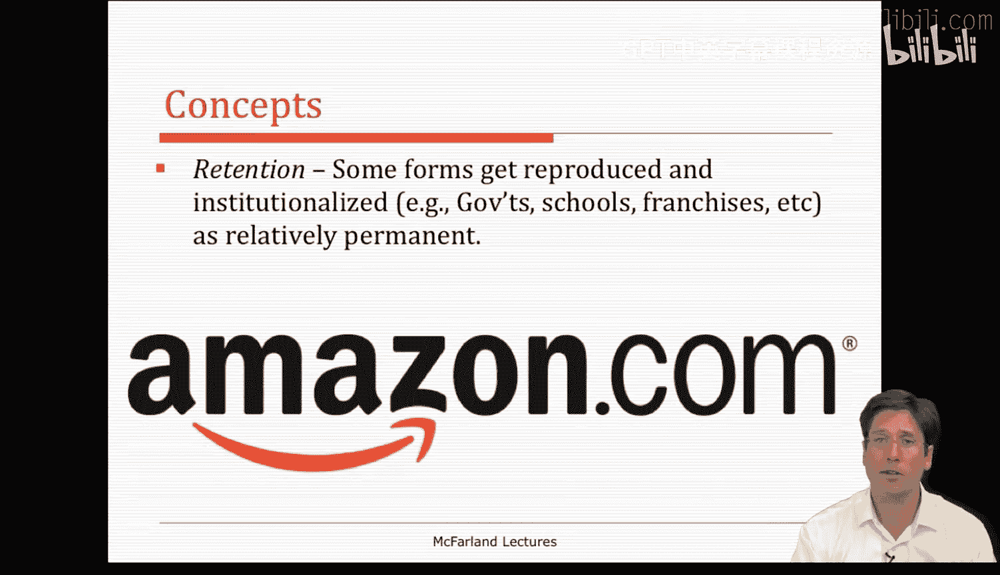
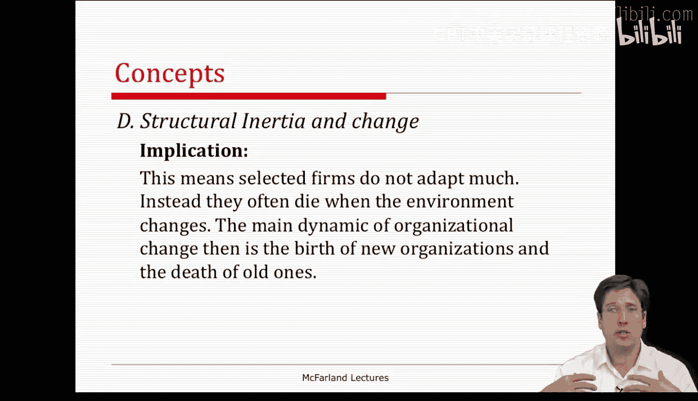
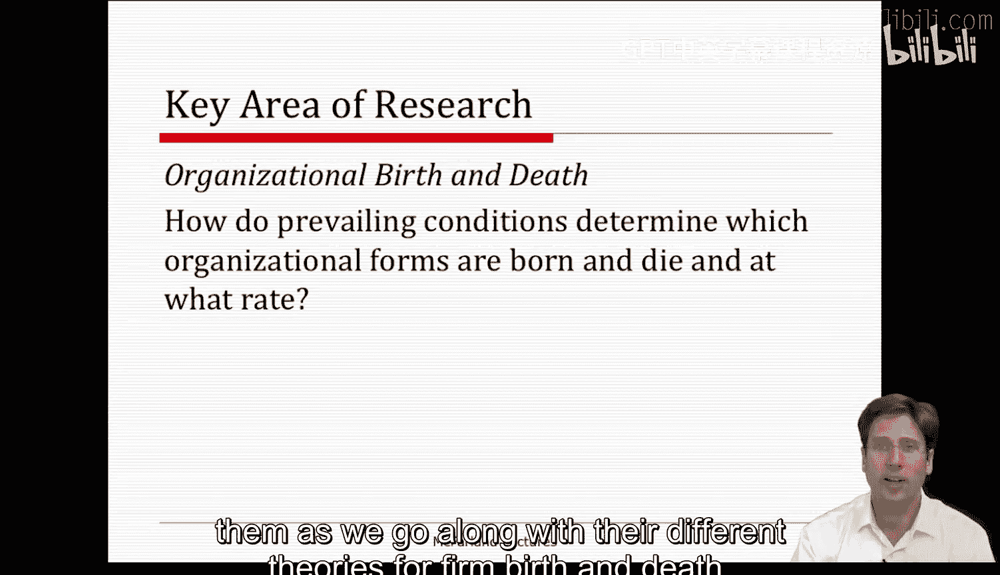
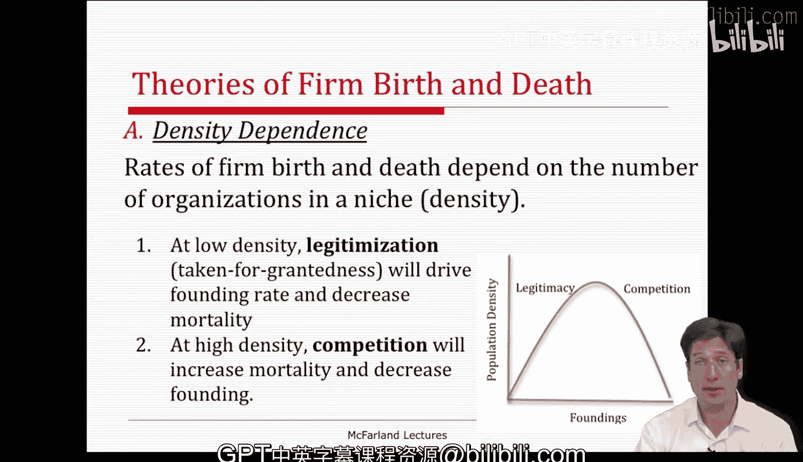

# 斯坦福大学《组织分析｜Organizational Analysis》中英字幕 p101 101_10_02_第二十四讲-种群生态学-第二部分.zh_en -BV17J4m157qN_p101-

New organizational forms emerge all the time to cope with perceived needs in the environment now this kind of organizational variation is due to things like mutation which is imagine in biology where you have a random gene change within organizations that be a really new idea or innovation like online education right in other cases the variation can occur through recombination of forms so they mix and match old ideas together right a third is a crossover of forms so for biology this is a crossover in chromosomes but in organization that occurs when one idea is taken from one day domain say education and applied in another of say beverage industry so you have this kind of idea of biology metaphors being extended in terms of variation into organizations if we look at animals we see species vary within niches。

Here we see a variation in biodiversity， one of the images to my side is a fungi in Saskatchewan。

 Canada， and the other represents the biodiversity of butterflies。

You can also imagine something very similar if only I had the visual to give you。

Of the variation in Seattle financial firms， so Bank of America is located there。

 but there are many other。smaller banks and competing banks like Wammu and the like up there。

 so that's a great example for you to ponder about the variation in terms of organizations within any particular niche or environment。

Now some organizational forms suit the environment more than others， so in spite of this variation。

 only some of them survive and reproduce the survivors are often called reliable and accountable。

 as firms right and they're basically favored by the selection process this selection can be observed by the rate at which that form reproduces in an environment so the more it's spread and selected and retained。

 the more that characterizes its fit now when we take these two processes of selection and variation together。

 it doesn't necessarily mean it's one of optimization or even one of lamarian functionalism which is one where the giraffe stretches its neck out of need as opposed of some random mutation in the case of population ecology it's whatever works。

 there is no kind of assumption of optimization or lamarianism。

 albeit they leave room for the fact that organizations do have intent and they can adapt in minor。

sSo that there is this potential for themarking and kinds of processes of evolution and selection Some organizational forms that get selected are reproduced and institutionalized and we all know examples of government agencies。

 schools， franchises， etc that have gone through this process of selection reproduction and retention right in biology we see these as animals that have a strong fit and reproduction rate so many of us have seen mallard ducks everywhere across the world or starlings and so on organizational ecologists identify retention though through the focus on rates of organizational founding and death the more something doesn't die but is founded the more they see this kind of retention process and we can observe this kind of variation selection and retention in action we consider the retail industry like so for example。

And the environment has greatly changed for retail over the last 100 years back in the 1940s and 50s stores like Woolworths were very common in the United States and had proliferated then in the 1980s there was another retail firm that took over had a different form it was like this megamart right and that was Walmart and it spread and was incredibly common up until probably the last 10 years it's still common but we today see a new organization organizational form that's taking over as the environment shifts and that happens to be Amazon right now and in each era the fundamental niche remains but a new organizational form kind of arises and outcompes the others it gets selected and proliferates and is retained within that kind of niche so that's the kind of process that organization ecology is trying to articulate through the biological。

Metapphhorre。So to this point， we've discussed populations， environmental niches。

 and processes of ecological change。Another key concept in organizational ecology concerns structural inertia。

And contrary to contingency theorists and natural system perspectives that we talked about earlier in this quarter。

 the organizational ecologists believe that organizations are relatively inert and stable and at best slow to adapt and change in fact they articulate a variety of reasons why organizational change is difficult。

 there are all these constraints working both internally and externally to prevent adaptations of organizational form。

 so for example， in terms of internal constraints， there are things like investments and equipment。

 information limits， intraorganal politics that have been worked out and the institutionalization of organizational routines and for a lot of firms they've sunk a lot of costs into these efforts and into establishing internal technologies and social structures and it makes it hard for them to adapt to new circumstances that may。

All upon them， to change。Other barriers and constraints might come from external features and in particular external constraints are barriers to entry and exit to the firm。

 the firms like to retain people to keep them as well as kind of legitimacy concerns that we talked about last week in neoinstitutional theory。

 inertia in general is associated with an organization's age。

 so it's pretty hard for them over time to change characteristics like their mission goal forms of authority。

 their core technology as well as their market strategy。

 those are perhaps the hardest features for an organization of change。

 and they're often the ones that the environment selecting on in terms of finding a population of the most fit organizations with current environmental conditions。

Organizational inertia is important because it has all sorts of implications that lead population ecologists to posit their theory for environmental selection。

 so the greater the inertia of organizations the less the organization can adapt and the more important environmental selection becomes so instead of adapting most firms die when the environment changes so therefore the main dynamic of organizational change is the birth of new organizations and the death of old ones。

 so if you want to change a niche you need a new better organizational form that can outcomp the firms already present。

 that's the implication of this theory， it's much easier to start something new than to adapt the key areas of research for population ecology concern the birth of new organizational forms or diversification and the death of old outmoded forms。

In this manner it's basically identifying the key processes that establish a population ecology so organizational ecology asks how do prevailing social conditions determine what organizational forms are founded and their rate of founding and it also asks the converse how do social conditions determine what organizational forms die and their rate of death so I'm going to cut the conclusion here a bit and tell you their answer in most instances they find that volatile times encourage the birth of new organizational forms and this freeze resources for organizational founding now there are a variety of other kinds of conclusions and I'll kind of reveal them as we go along with their different theories for firm birth and death。

A variety of subtheories arise from organizational ecology to account for firm birth and death。

 and one common theory in organizational ecology is called density dependence。

 the theory of density dependence argues that there's a curvallinear function where social processes of legitimization found firms and then a process of competition cu their numbers。

 so in low density or in sparsely populated niches。

 the density dependence model predicts that the legitimization process will dominate to increase the organizational founding rate。

 and it will decrease the mortality rate。At higher levels of density or in a highly populated niche。

 competition will dominate leading to low founding rates and high mortality rates。

 and so this inverted U curve here to my side shows the x axis as the number of foundings and the y axis as the population density。

Now if you look to my side as well， legitimacy here really refers to the taking for grantedness of an organizational form。

 so the more legitimate the form the easier it is to acquire resources and there the mortality rate decreases in terms of competition that refers to organizational forms that seek the same limited resources in a niche when there are few resources to go around competition grows intense so the founding rate starts to drop that's where you see that peak on the backside of that U curve and as it declines。

 you see the founding rates drop and the mortality rate increases so because of this competition is inversely related to density。

And that's basically the theory of density dependence。

