# 斯坦福大学《组织分析｜Organizational Analysis》中英字幕 p103 103_10_04_第二十四讲-种群生态学-第四部分.zh_en -BV17J4m157qN_p103-

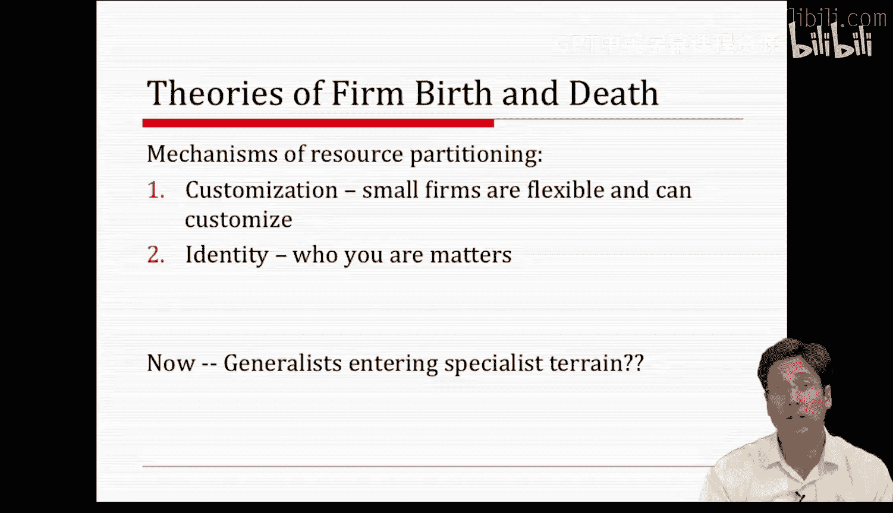

So organizational ecology concerns populations of organizations and it considers environmental features that drive firm birth and death what I want to do next is quickly summarize the main points of the theory so you walk away with some kind of general understanding of what it's saying and how to use it so the first thing that considers that organizational ecology assumes an open system perspective and this regards the environment as inseparable from the birth and death of an organization。

The second feature is that for an organizational ecologist。

 organizations do not catch up with the environmental change。

 there isn't internal adaptation is uncommon or difficult， especially for large firms。

 so because of this the mechanism of the primary mechanism。

 the organizational change is actually organizational selection。Now。

 much like Stingchcomb argued in 1965， an organization's firm is pretty constant and consistent so that after a founder puts their imprint on a firm。

 it has this stability， moreover， as He and Freeman talk about。

 there's some costs in internal and external relations， so it's hard to adapt。

And this makes the process of selection very important。

So if two populations of organizations occupy the same niche while differing in some organizational characteristic or form。

 the organization likely won't adapt very fast and the population with the less fit environmental characteristic will be eliminated。

So the diversity of organizational forms is ultimately isomorphic to the diversity of environments in equilibrium each environment is going to have one organizational form and the one that adapted to the demands of the environment best and this is the idea of a realized niche each unit in the environment faces the same environmental constraints and therefore it has to have the same organizational structure to survive that is if it was an equilibrium but often they aren't the point is that isomorphism results from selection and the environment selects only those organizations that fit the environment the problem is that the environments changing so that kind of requires variation and constant selection and retention processes it's more dynamic so in review resource dependence theory。

 contingency theory and neoinstitutional theory or all about organization trying to adapt to their environment whereas organizational population ecology theory explores the。

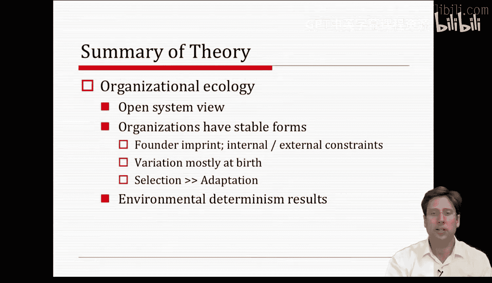

Relationship of organizations to the environment from the selection perspective compared to the other theories。

 the population ecology view is somewhat more environmentally deterministic。

 so that's a good way to kind of sum up the theory and to contrast it with our prior open system views that have been covered in the class so now I've given you kind of a general sense of the theory as well as the specifics。

 but how might a manager apply the theory of organizational ecology and especially if it's so environmentally deterministic。

 how do we approach this theory to begin with。

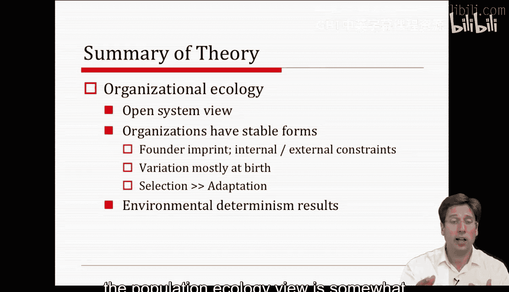

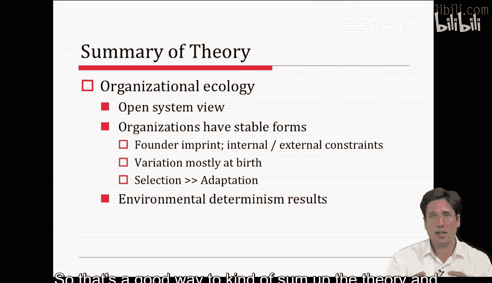

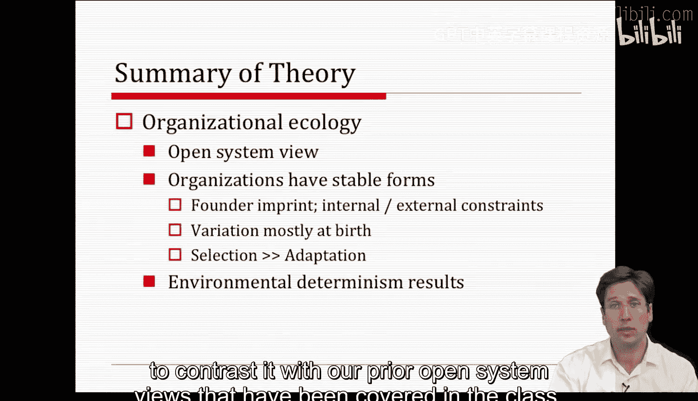

In many regards， I see organizational ecology as kind of a theory of forecasting here you have a theory at the population level or the industry level。

 and through it you can kind of ascertain the environment and your organization's fit with that environment and its chances for survival if you can just collect enough information on that industry and the fundamental and realized niches and your kind of organizational form in relation to it。

Now。Given the stability of organizational formss， it's frequently hard to change your firm unless it's kind of small。

 so managers of organizational ecology really focus outside the firm， they focus on their fit。

 they focus on the niche that they can occupy。

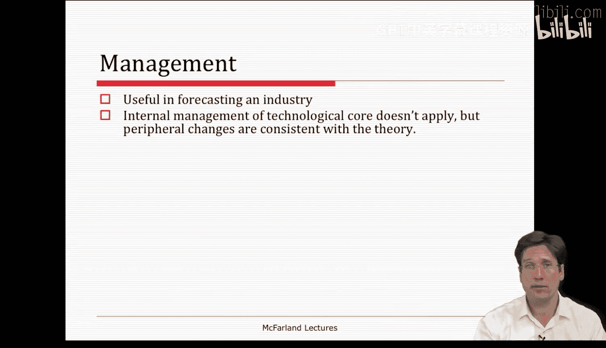

嗯。The main focus really is on trying to find an environmental niche where the firm can reasonably survive and this means the manager considers the population of firms they're part of who do they compete with。

 what technology do they share with others and what resources do they rely on are there enough will they be outcompd then they ask kind of questions like what is the composition of these firms and how do they differ are some of these firms generalists doing many things and are others focusing on only one thing and how similar are different are they from my own firm do they rely on the same resources etc。

Then one looks at and asks how many of these firms can the niche hold what's the carrying capacity of this niche and how fast is the environment changing are the changes rapid and co grainin or they slow and finegrained depending on those answers。

 it's going to inform you as to whether your specialist or generalist firm can survive it should inform you about where your key competition resides and as you consider the competition you may come to see the resource based partitioned and that some forms of competition between other firms can create opportunities for a small specialist if that's what you happen to be。

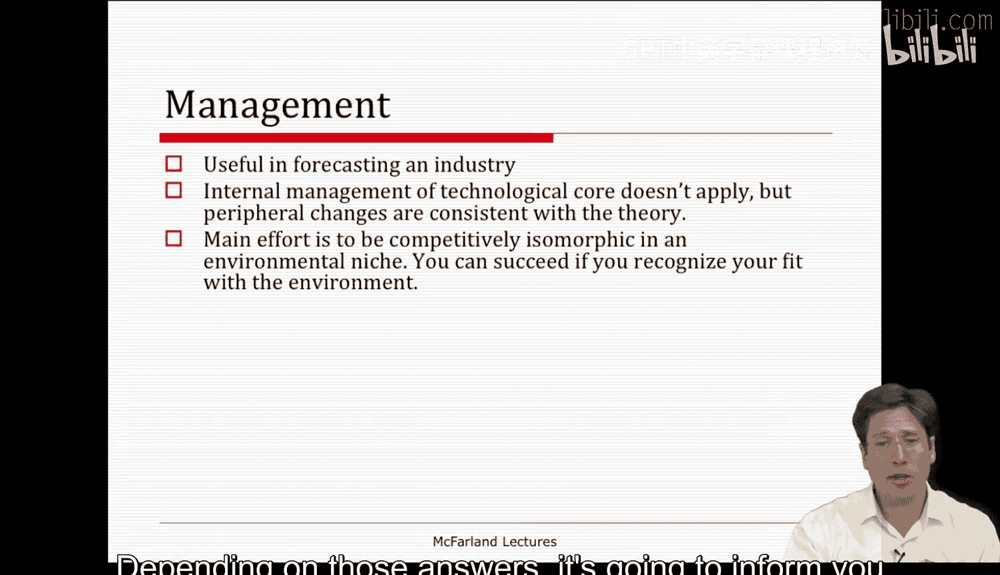

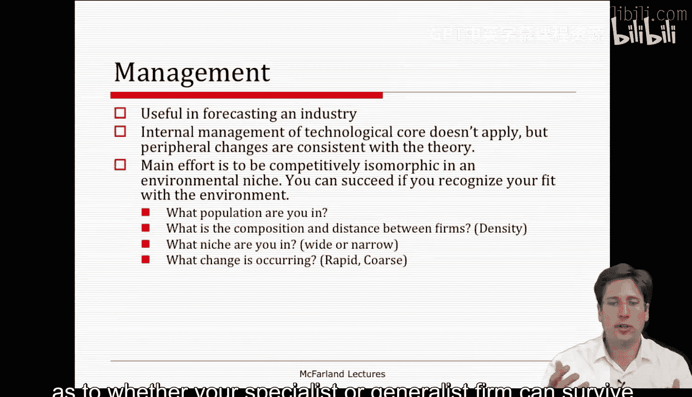

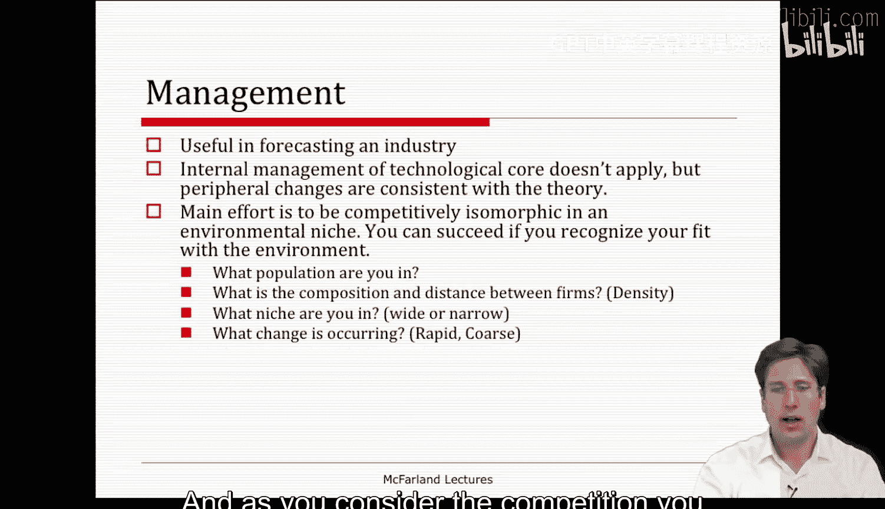

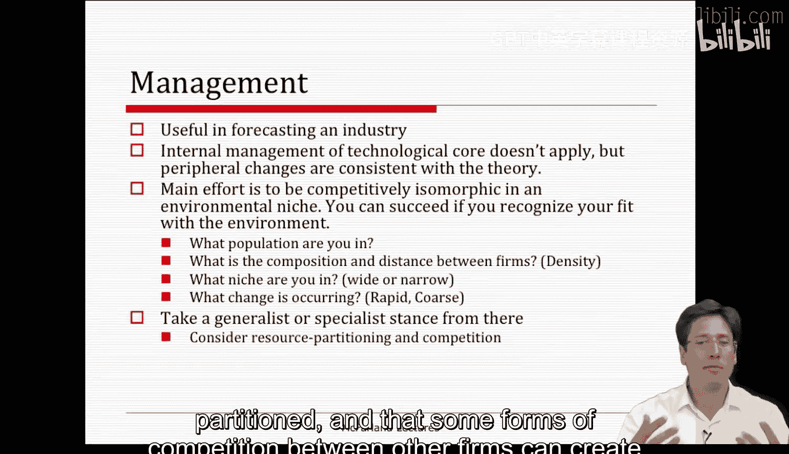

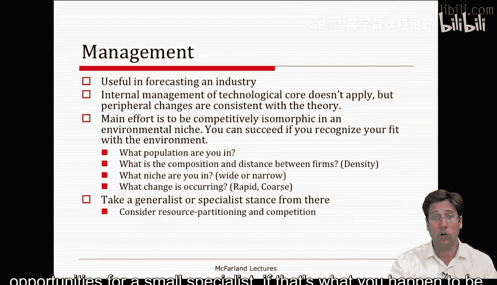

Finally， you consider the firm's history， you consider your firm's identity and the liabilities of newness recognizing that legitimacy may work for you in certain circumstances like a resource partition market where you're in the periphery。

 you're not a generalist firm， you're a specialist firm or if you're like in a slow stable environment。

 you also have room as a specialist but you might also think about where you could be competing with other firms and as a specialist。

 outperform them and exploit kind of an environment。

 so you can think about taking over a microbw kind of particular niche right in addition as a generalist you can think about how to kind of situate yourself in a fastpaced volatile market where you might you might survive when all these other specialized firms get called off。

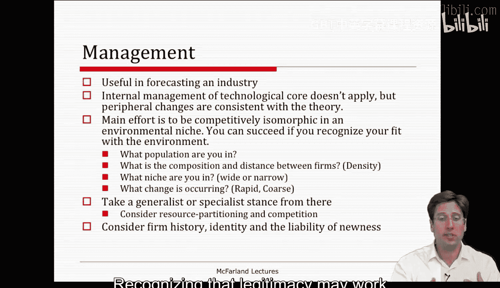

And in general， you'll know it may be better to start over or to reinvent the firm than to adapt it。

 given you know all those things about the internal constraints and the liabilities of newness。

 it may be often the case that you look at the current niche and think about what it needs and invent a new firm that can kind of meet those demands。

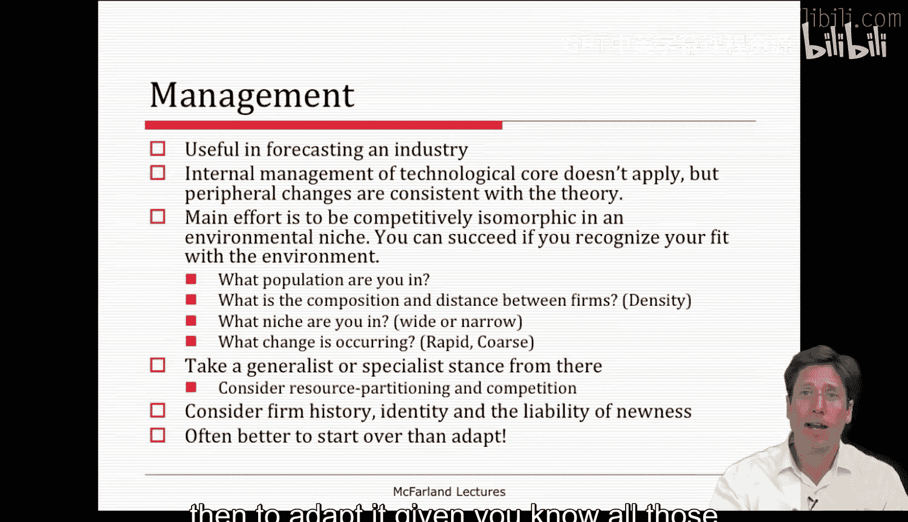

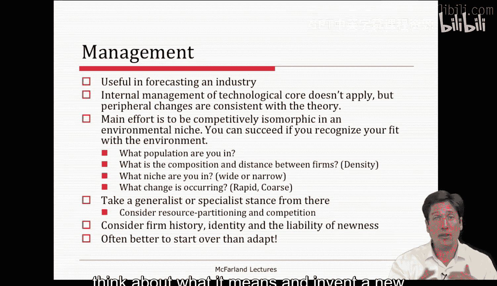

As with all the theories presented， organizational ecology has certain limitations and it can be critiqued perhaps the most common critique is that population ecology is so environmentally deterministic。

That there's kind of a loss of human agency， things like adaptations and decisions seem to be pushed to the periphery or to the side or only occurring in certain circumstances and certain kinds of resource partition environments。

 but nonetheless， many of you as managers know that these kinds of adaptations and decisions seem to be pertinent and feasible。

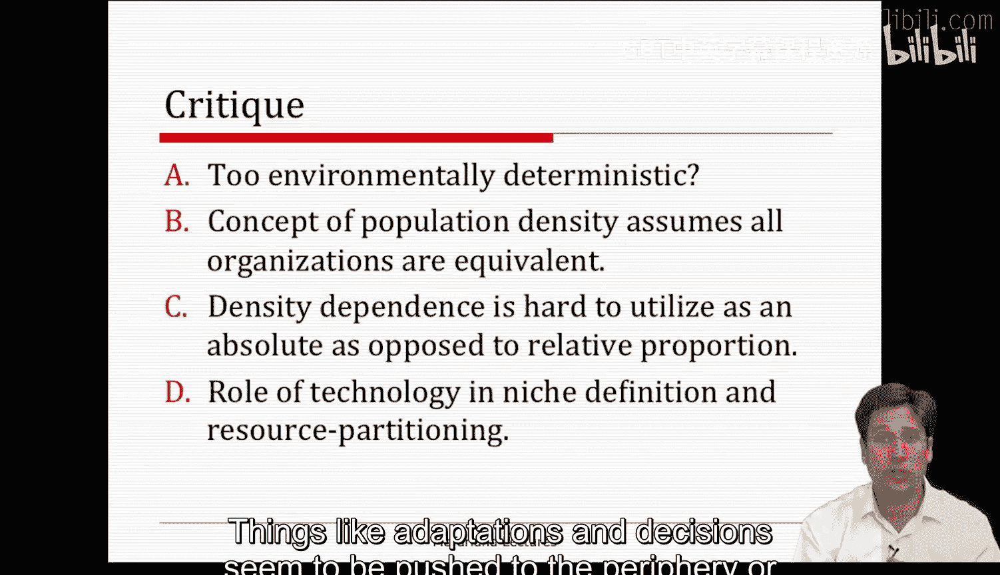

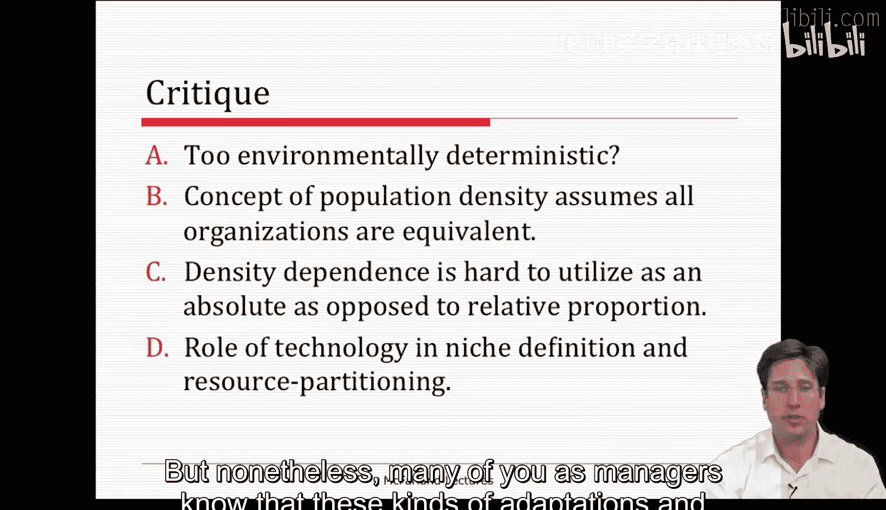

Another critique is that the concept of population density assumes all organizational members are equivalent in terms of measuring competition。

 for example， you would take the number of those firms within an environment。

 but not all of those organizations are equally competitive， some firms are huge， others are small。

 therefore the kind of number that you generate for the metric of density dependence is questionable and doesn't seem to reflect competition accurately in every case。

Moreover in terms of density depends the term density itself is used to refer to an absolute number and I think this could be a little misleading since populations vary in size。

 so the density of 100 firms for one population that's tiny could be huge it could be a big relative number whereas in a huge population10 firms in an environment may be really low so what might be more useful is a relative normalized notion of density and that might take into account the environment size so that whether this is more dense than usual for that type of environment or not。

 so I think that's something that could be improved as well now population ecology also neglects the role of globalization and technology in linking these different populations so a variety of complications arise in terms of niche definition with the advent of the internet and telecommunication how can the size of a population or resource space be。

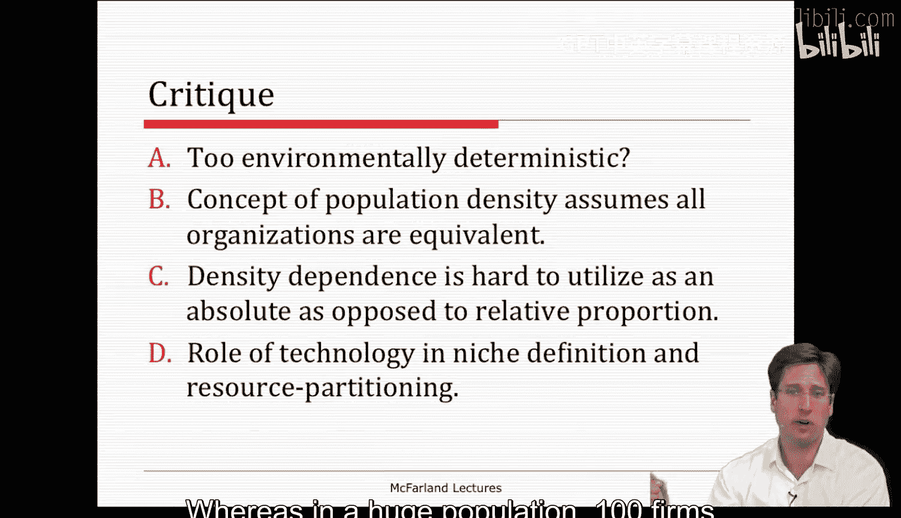

min in this case is it fair to call a niche one like Seattle financial firms anymore can we do that also what happens when a firm is a generalist in a local market。

 but then they're a specialist in the global market because different cultural definitions and taste kind of make them more a feasible as a specialist on that stage so these are the kind of issues that I can imagine just for population ecology but they're kind of easy and I think a lot of them could be overcome by this theory and various works that they're currently developing so。

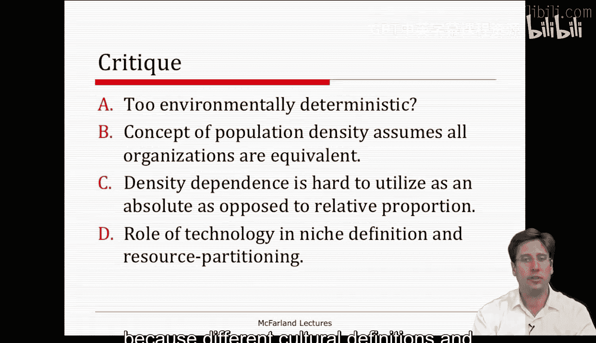

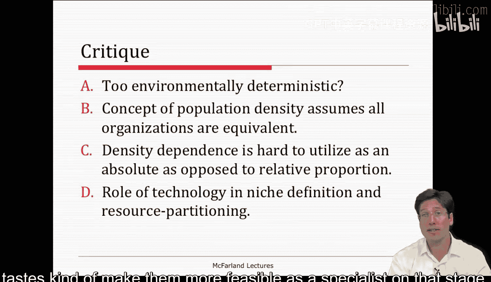

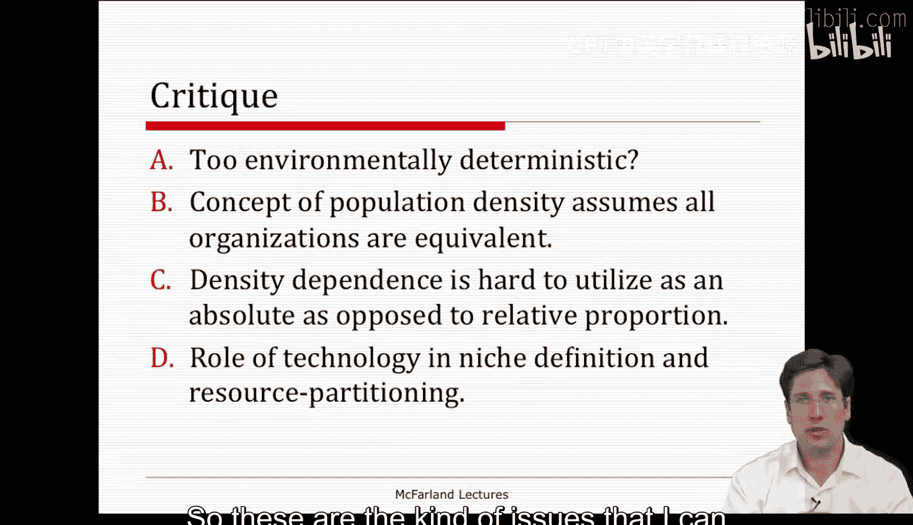

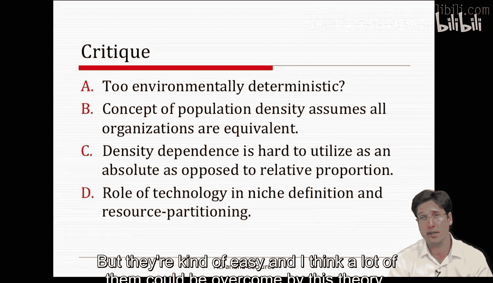

As you consider each theory， I'm sure you can level certain kinds of shortcomings and concerns as well that perhaps make it more or less useful to you in particular contexts。

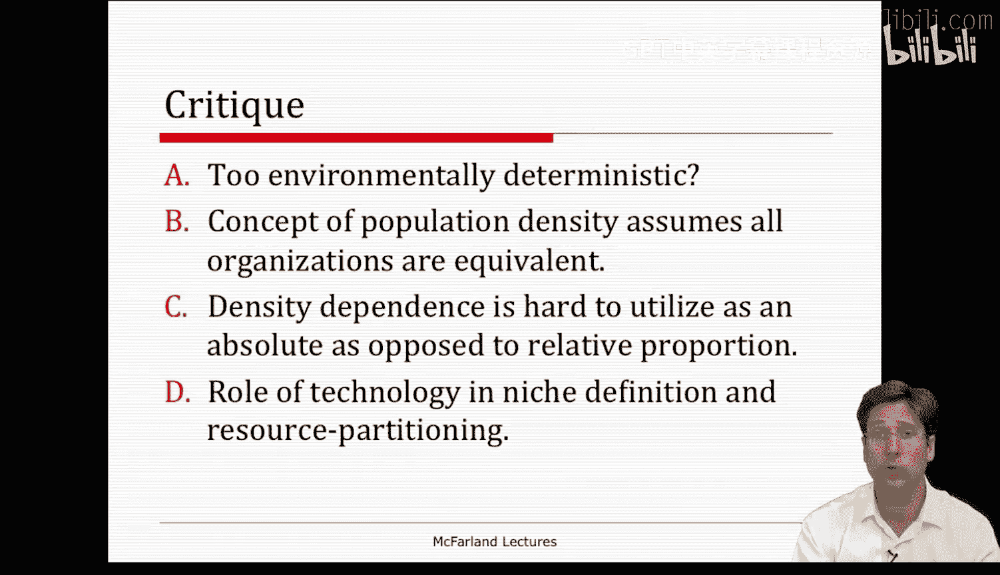