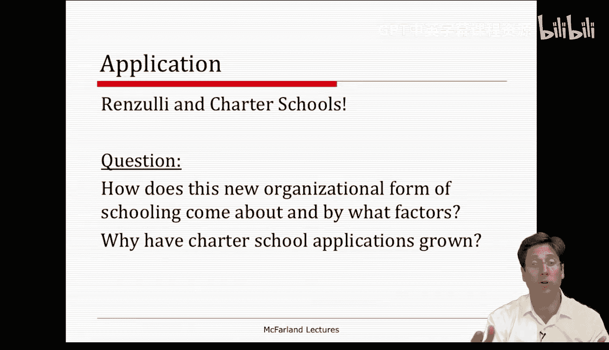
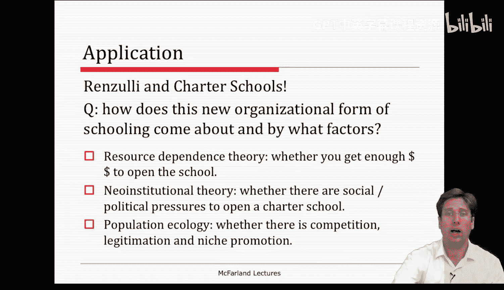
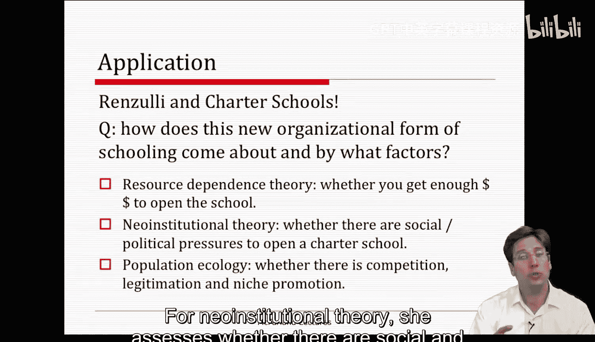
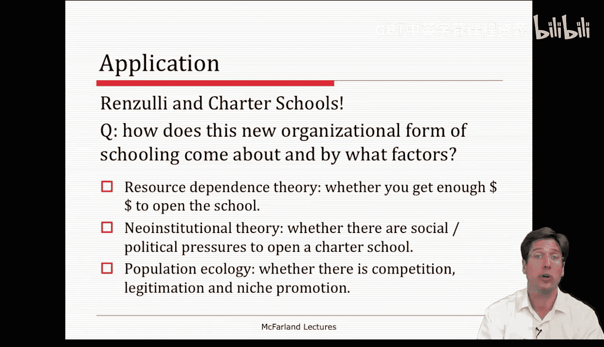
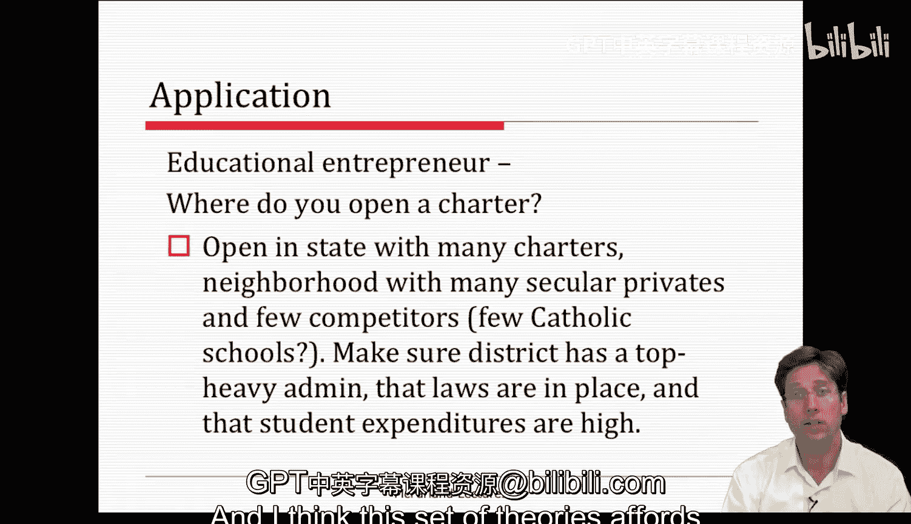

# 斯坦福大学《组织分析｜Organizational Analysis》中英字幕 p104 104_10_05_第二十四讲-种群生态学-第五部分.zh_en -BV17J4m157qN_p104-

That we've described the theory and highlighted some potential trouble spots。

 let's consider an application。

I asked you to read Linda Rnzi's work because she does an actual empirical study at charter schools and when they are proposed。

 in effect that the question that she asked focuses on how this new organizational form of schooling charter schools has come about and by what factors。

I think it's a nice piece because it compares several open system theories about organizational environments like resource dependences。

 the institutionalal theory and population ecology so it's kind of a neat way to compare and contrast and see how people study these theories in tandem when it comes to a phenomenon like her specific question which was why have charter school applications grown and if you drive by a charter school there's really nothing especially kind of noticeable about them。

 they look like a typical school， but for those of you who may not know charter schools in the United States are publicly funded primary and secondary schools and they're not subject to the same rules and regulations as typical public schools。

 they're expected to produce certain results as laid out in their charter or their mission and they' are attended by choice as an alternative。

To typical or traditional public schools。Most charters are over prescribed。

 so attendance is often allotted by a lottery， and the charter schools frequently vary。

And this means that most of them in their charter offer some a curriculum that either specializes in a particular field。

 say， mathematics and science or arts and music， or even vocation。

Others actually offer a general curriculum and attempt to be more efficient cost effective and outperform the usual public school so that's their charter instead。

 all of these charters though are open to inspection and accountability through testing。

 so they're kind of different in that sense。So again， in the Renzoi case。

 she wants to know what theory explains the growth in charter school applications now to have a charter you have to apply。

 you have to propose it to school districts and states right and in a way her answer helps the future educational entrepreneur know where he or she should consider opening a new charter school so it's kind of a substantive question for a solid subsection of the people currently taking this course now to answer the question she assesses resource dependence theory。

 institutional new- institutionalstutional theory and population ecology arguments and she renders her analysis kind of a horse race between proxy characteristics of each theory。

Now for resource dependence theory she tests whether they arise in districts that give enough money to open a charter school and she measures this by the instructional expenditure per student that a new charter would get if it opened right like a operating budget for the institutional theory she assesses whether there are social and political pressures to open a charter school and she measures this via legislative union pressures like stronger versus weaker legislation in the state concerning charter schools or age of founding legislation whether the founding of a charter law within a state and what year how early and the number of administrators in a district that are charter school administrators so that's kind of legitimacy concerns for population ecology she looks at local competition so this is a proxy of density dependences in the number of district charters she also looks at niche promotion which she measures as the number of private secular。

schools since those will promote the demand for charter schools for poor students right so she kind of has all these various things that she can capture for each theory and then she kind of runs these regressions on them and her results suggest that educational organizational environments are indeed key in the process of generating charter schools she finds strong evidence for population ecologies so she finds that non-religious private schools increase the submission of charter school applications so niche promotion is occurring and she also finds that the density of extant charter schools in local districts has an effect so with saturation there's a decrease in the submission of applications so there's competition charter schools don't open。

She also finds some evidence for new institutionalstitutionism and resource dependence so she finds things like local political environments。

 solid funding and legislative support help too in terms of the formation or the application for a new charter so given all of that you're an education entrepreneur where youre going to open a charter school so this is kind of like you considering as a manager of open systems kind of forecasting where to kind of plant your new organization now the results here suggests that you should open it up in a state with lots of charters in a neighborhood with many secular private schools and in a district with few competitors so there aren't many Catholic schools say where the tuitions low and they might compete with you and then make sure that the district is top heavy with administrators and that laws are in place to support charters and that the student expenditures are high。

So I think all of these characteristics that you get from this paper really suggest kind of a more system level or population level kind of understanding of where an entrepreneur can begin a business。

 which I think is a very important consideration in terms of management。

 that it's not all internal kinds of operations and adaptations that it's often you know where your situated and when。

 which greatly matters in terms of your business a success。

 and I think this set of theories affords us， a series of means to consider that。

