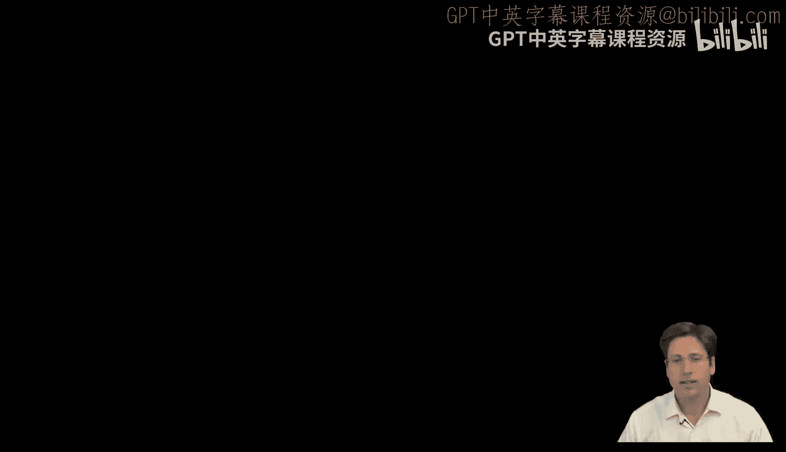
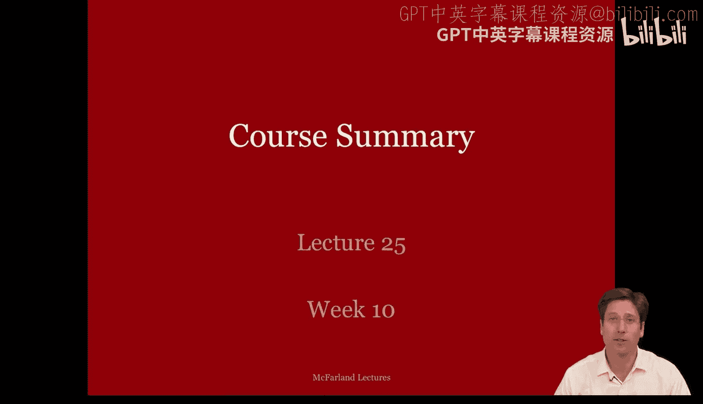
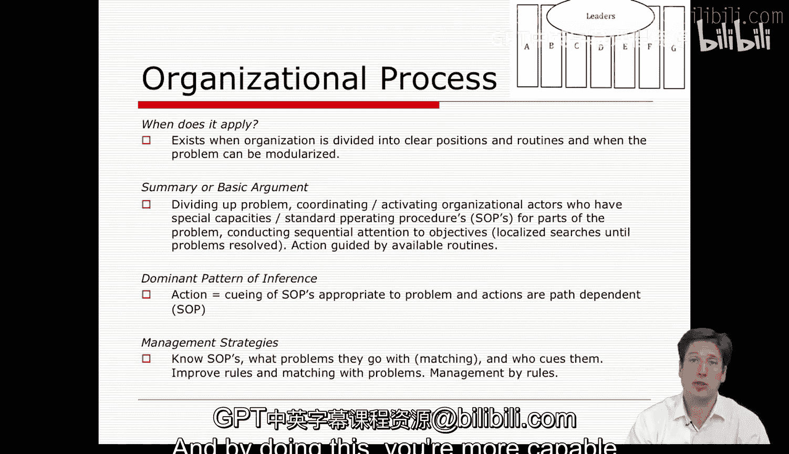

# 斯坦福大学《组织分析｜Organizational Analysis》中英字幕 p105 105_10_06_第二十五讲-课程总结-第一部分.zh_en -BV17J4m157qN_p105-

In this final lecture， I will review the theories and offer some reflections on how they apply and can be utilized in a variety of the cases you've had this quarter。

If you consider the course for just a moment， you'll realize that you've come a very long way and covered a ton of material。

You were introduced to something called organizations and their behavior。

 you were given a wide array of cases to study from governmental organizations， lobbying groups。

 technology companies， classrooms， high schools， school districts， universities。

 organizational reform efforts， online educational courses， multiplayer online games。

 and even national policies。You were given a variety of organizational features to consider as well。

 like the environment， social structure such as behavioral。

 normative and cognitive features from surface to deep structures。

 you recovered things like participants， technology or tasks， and even the goals。

 shared goals of an organization， and all of this， these elements were meant as a language and as a checklist by which to consider the complexity of organizations more deeply and thoroughly。

You were also given a variety of theories by which to consider how these features kind of work together。

 so conceptions of organizational behavior span rational actor models where administrators made rational decisions in ideal means and kind of ways or in even more realistic。

 boundly rational ways of satising and even in rule matching manners of duty- drivenriven behavior。

 so you had clear kind of aration actor model， we then developed a more natural system view of how firms acted like an organizationism with many internal contingencies。

 we observed how firms often followed organizational processes or bureaucratic rules and how others only coordinated when they had performed political wrangling and form coalitions。

And yet others seem to follow an anarchic process of flows into and out of meetings。

We also came to view firms as self reflective， kind of learning organizations and as potentially putting in place a social structure that could sustain that form of association。

With organizational culture， we dug deeper into normative and cognitive principles guiding action。

 and we learned that firms had their own ethos and styles which greatly shaped the members' experiences。

The past few weeks， we've extended our focus into the environment and how it influences firm behavior and survival with theories like resource dependence。

 we focused on dependence relationships between firms， with network forms of organization。

 we looked at larger arrangements and patterns of coordinated actions。

 viewing a traffic jam from a helicopter as opposed to from our car。

 and with neoinstitutionalism we looked at the deep structures and cultures in the environment and how firms succeed by mirroring them and finally this week with population ecology。

We looked at hard forms of environmental determinism。

And a process of natural selection that arises from interfim competition。And across all this。

 we went from micro level agents， driving an organization as a unified actor to messo level groups。

Of people being coordinated by rules， politics， meanings and feedbacks or sense making。

Then we finally have come to macro level environments where resource constraints。

 network contexts of reciprocity and trust， and sociopolitical patterns of belief impinge on the organization。

 we went from micro to macro from rational to natural to open systems。So along the way。

 you were given management prescriptions as well， each theory saw the world in certain ways as being driven by certain facets。

 and this suggested a variety of maneuvers by which organizational creation。

 change and stability could be accomplished， in some cases it was the resources in the environment in others it was the beliefs and context of relationships。

In other cases， the internal dynamics of the firm or school mattered more。

 where people bought into the company's goals and rituals， and if they didn't。

 how they could be persuaded or how a decision could be made anyway。

You also learned how these hard fought lessons of organizing could be remembered or forgotten。

How they could be harnessed toward a learning organization。

In my mind you really now have a toolkit to be a serious researcher。

 and analyst and manager if you so wish， you just need to consider how these frames or worldviews or theories apply and when and why。

 then you can switch between them as the case may be。

 instead of viewing them as independent tools you view them like a carpenter would they're set on the wall。

That they would have to combine these tools in different ways。To become a master carpenter。

 to create a full nuanced understanding of a case that would be useful to a client and useful to readers and people consuming organizational knowledge out there in the world。

 so I feel like you now have the set and you're ready to use them and we just need to go one step further and think about how to integrate these theories。

Just to give you a little bit of an idea of how far you've come。

 let's recall some of the cases you've covered。The first one was about magnet school reform by Mary Metz。

We had another one about a Cuban Missile crisis where Allson applied multiple theories。

We had a couple studies about the Chicago public school reforms in the 80s and 90s。

We talked about Hurric Katrina in a variety of ways to interpret that disaster。

We talked about a Milwaukee parental Cho program or a voucher program where schools where students get money or parents get money to send their children to other schools that buy choice。

We talked about lobbyists that run around in Congress or in legislatures trying to build the kind of coalitions。

 we talked about school desegregation efforts in San Francisco and how it had a particular process of kind of organized anarchy。

 we looked at legislative efforts within kingdom for sure。

 but then also we talked about no childild Left behind a national policy kind of act and how that came about。

We talked about academic ses or any kind of meetings where individuals that are relatively equal come together and try to make decisions。

We talked about。Xerox machine workers。The world of Warcraft， a massive online multiplayer game。

We talked about learning communities， schools that we're trying to or organizations that were're trying to。

Reform themselves into reflexive learning organizations。

And we talked about a technology company that Kunda related or even the one that Martin and Myon related at Osco。

We spent some time talking about my alma mater in the inner of Chicago and its kind of effort to merge with Northwestern as a case of resource dependence。

 we talked about an attempted union strike。In a silicon systems firm。

ITalked about classroom and school networks in my own research， as well as university networks。

With Eggers and Goldsmith， we learned about national park kind of service and how they form network forms of organization。

And then we even had charter school networks in a reading by Smith and Wosteadter。

 here's a field of organizations where there's an effort to kind of alter the form and create variation in something that was quite consistent in terms of every school looking the same。

 here you have some effort to experiment。We talked about schools and high schools and how they often do look the same and how they replicate many of the same structures that regardless of where we go。

 we see this institutionalized format that if you deviate from very much。

 that your institution will struggle to secure social resources。

We talked about debates of framing and how institutions can be applied at that level in terms of a debate between intelligent design and teaching of evolution。

 as well as kind of presidential platforms where the Republicans in a prior election had framing strategies that were quite normative and the Democrats lack that。

And we talked about massive open online courses like Coursera and University of Phoenix is kind of an operation like that and how those challenged or at least called into a question and deeper reflection on the process of legitimation and the use of environmental institutions。

And we even spend some time talking about microbweeries and wine。

 which is sort of fitting for the end of the course and I hope you all have a nice toast to yourselves for completing this class。

And finally， yes again， we came back to charter schools as a movement to create variation and selection within the schooling and field and population。

 so we've had many， many cases this quarter， and I hope that many of you realize the variety and the number that we've covered。

 of course there are many more that we discussed in the forum and that were briefly mentioned in a lot of the lectures as well as in the readings that will go well beyond this small list。

 but I think it helps to kind of remember just how many and how varied they are。

 and the variety of theories that we applied to all of them。We covered a lot of theories too。

 10 and all， and just to remind you， we had rational choice models。

 bureaucratic models that reflected organizational processes and rule following。Coalition theory。

Organizational anarchy or garbage can theory。Organizational learning。Organizational culture。

Resource dependence theory， network forms of organization。

 new institutional theory and organizational ecology。 We had 10 different theories。

 and now you have this set。 Let's spend a little more time。

Reviewing each one so that you walk away with some sense of what the core features of each are。

The first theory we covered was the rational actor model and the rational actor model is also known as the rational choice model to my side here you can see an actual flow diagram that does a nice portrayal of the theory as a kind of a series of path if then kind of sequence of decisions and I think if you download the lecture slides and expand this kind of figure。

 I think you'll see all the elements that I'm about to talk about。Now。

 the first thing to ask about any of these theories is when does it apply。

 and in the case of rational actor theory， it applies when you confront or perceive a unified team or actor。

That seems to be driving a lot of the processes of the organization。

 and this actor typically has consistent preferences， lots of information， clear goals。

 and time to actually calculate things， so it's better perhaps for planning than for reacting in some cases。

 the general argument of the rational actor theory is that this actor confronts a problem。

And it assesses its objectives or goals， that it has these particular preferences。

 and it identifies options or choices， potential choices。

 calculates the consequences of each option or choice。

And then selects the option that maximizes rewards and minimizes costs。

Now of course that assumes quite a bit of heroic capacities for collecting information and calculating consequences。

 foresight， but that's not always possible， so in reality we actually talk about bounded rationality and satisfyising as a variant of this theory and here we recognize imperfect information or uncertainty and then ambiguity where things aren't clear in terms of consequences and then the selection process is not so much one of optimization as one of satising or finding a good enough solution。

So it's a slight variant on the rational actor， still means end。

 except that the boundly rational actor selects a threshold lower and presupposes imperfect information。

Now the pattern of inference is basically the means by which a decision occurs or by which action for the organization occurs。

 and here in theory it is the maximization of means to an end and or satisfyising a means to an end。

 so that's the dominant pattern of inference， and then finally as a manager of rational action。

In your firm， you basically want to focus on knowing the alternatives and their consequences for options。

 having clear goals， making sure things are centralized and consistent。

 that you optimize the features of applying a rational actor model。

 and then that you really spend a lot of time worrying about the quality information and analysis that you're employing and by doing this。

 you're more capable of managing bycon。

