# 斯坦福大学《组织分析｜Organizational Analysis》中英字幕 p106 106_10_07_第二十五讲-课程总结-第二部分.zh_en -BV17J4m157qN_p106-

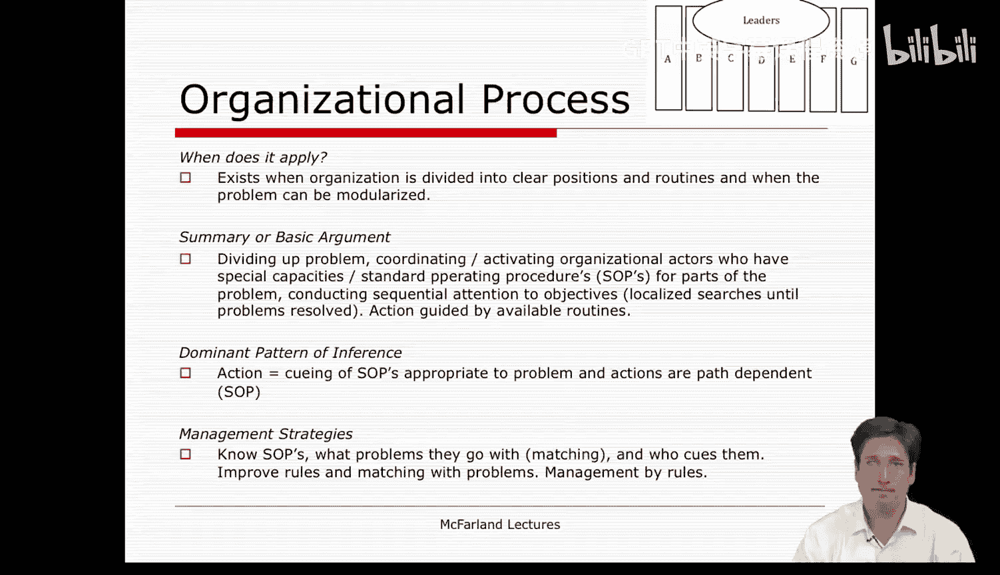

The second theory we covered was also introduced in Graham Allison's work and he calls this the organizational process model。

 which is also kind of like a bureaucratic kind of rule procedural logic of appropriateness model and here the question is when does it apply again and I think it really applies when the organizations divided up into clear positions and routines and when the problem can be modularized。

 that means it can be broken up and different units within the organization or different organizations that specialize in that kind of subproble。

 can handle it and they have particular routines or procedures in place for doing so。

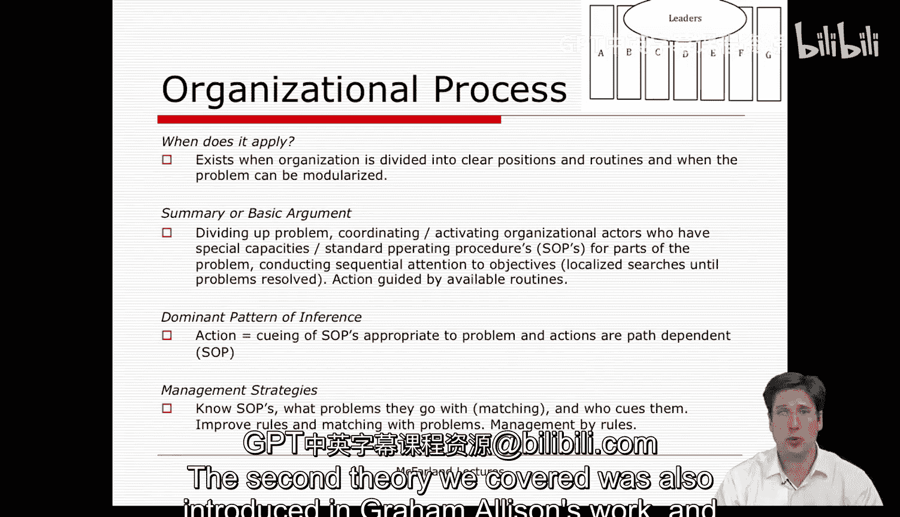

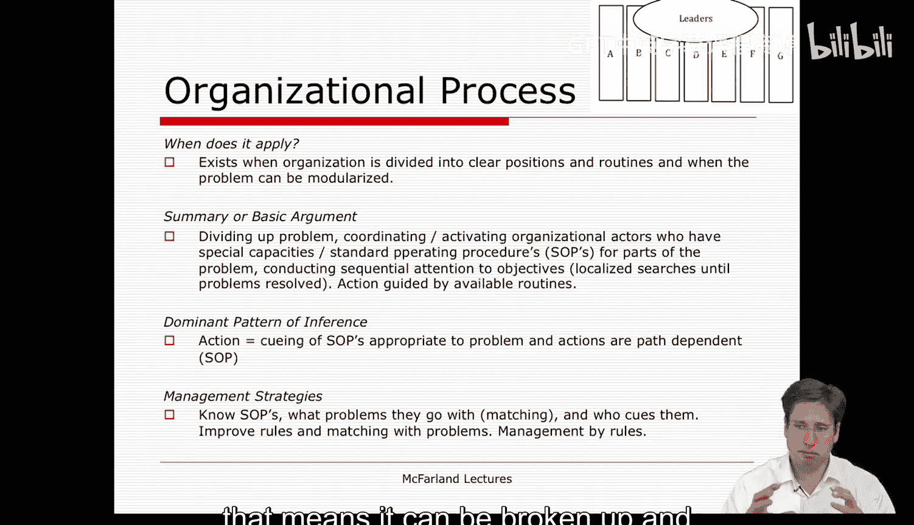

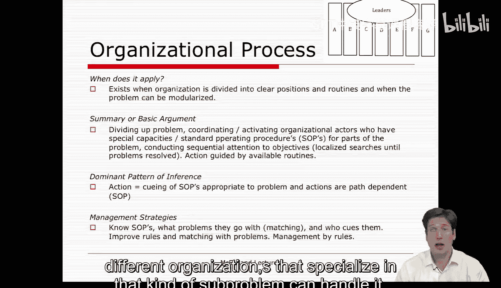

Now the general argument for the organizational process model is several steps here。

 which is first you divide up the problem， so anytime you get a problem like Kennedy did。

 he would divide up this potential for Armagedddon and say as having multiple components， right？

And then he coordinates and activates organizational actors who have。

Special capacities that that are situated in subunits or in different organizations that have in place standard operating procedures that apply to these sub problems。

 right and then。You know you align， you match those subproblem to those units and then you conduct sequential attention to your objectives that you make sure with each step of the subproble it gets solved and that it's being resolved by the available routines。

 so that's a general argument of an organizational process model and what you would see if you were to apply or recognize it in a firm that you're studying。

Now the dominant pattern of inference here or the main means by which decisions are made in organizational action comes about is that you're queuing appropriate standard operating procedures that link or match particular problems and that when you do this。

 the action will be path dependent penant， meaning that it has inertia。

 the individuals and the team follows that standard operating procedure。

So that's the general inference， it's rule following and bureaucratic。Now as a manager of this。

 you really want to know the standard operating procedures are your firm。

 which problems go with which units， who cues them and controls them in those positions and then you really want to think about improving the rules。

 so that they match better with the problems， you really want to manage positions and standard operating procedures。

 that you drill， you practice those things and you're prepared for a variety of them and that you know that you have a good filing system and you know where to go in times of need。

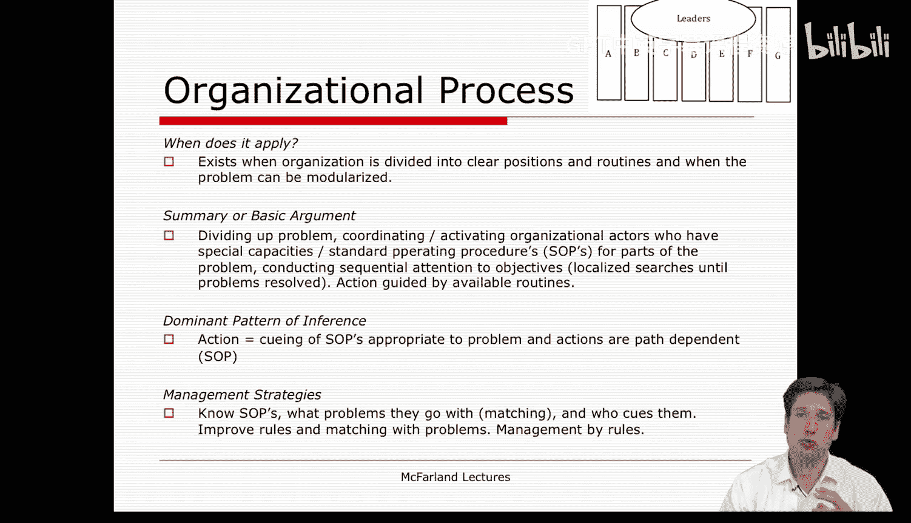

The third theory of the quarter we encountered in both weeks two and three。

 it was introduced as a bureaucratic politics model by Graham Allison。

 and then later by Huula as a and also James March is a coalition theory。

 a theory about how coalitions form within organizations or across them。So。

The first question is when does this theory apply again？

And I think coalition theory applies when there are multiple actors with inconsistent preferences and identities。

 and none of whom can accomplish a task or accomplish a goal without the assistance of others。

 they have to pool things， they have to come together in some fashion。

Now the summary or the basic argument of coalition theory is that the participants involved。

Occupy different positions and they have parochial interests。

Their conceptions of problems and solutions is quite different。

 moreover they have a variety of resources or。Chipps that can play in this game of bargaining。

Of trying to find an agreement， they may have expertise， money， they may have people。

All of those can be resources that can be bargained with。And then finally。

 there's a process of bargaining， right so you have people in different positions with their interests and they have it resources。

 kind of like players with different sets of cards。

And they have different goals that they're trying to accomplish with their cards。

 and they enact the bargaining process， and through this process。

 they try to establish an agreement or a coalition that can get through this decision。

Now the dominant pattern of an inference here or the manner in which decisions come about or by which action comes about from the collective。

 a focus concertcered collective action， like an organization has。

 this comes about through political bargaining right and then finally if you're a manager of coalitions。

 the things you kind of focus on are the bargaining processes。

 you bargaining strategies that you try to utilize， you log roll。

 meaning like if you're going to vote if you don't vote against me on this one。

 I won't vote against you on the next one you horse trade。

 you basically trade one thing for the other you hinder the oppositions coalition formation。

 you try to undermine things when they go the way against what you want and this is accomplished by learning the interests of other groups or individuals or positions in this kind of process。

 you learn their weaknesses， so know what kind of leverage you would have。

and then you basically manage this process by trying to bargain and leverage agreements out of various partners so it's pretty dynamic it's very political and it has quite a bit of ethical kinds of concerns that we did talk about that week of the quarter and I think they still hold and it's also kind of a temporary coalitions are quite temporary in the sense that they come to a decision and once that decision is made they often fall apart so it's a different kind of theory and it was done in week three。

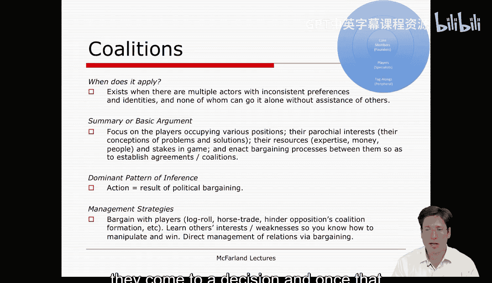

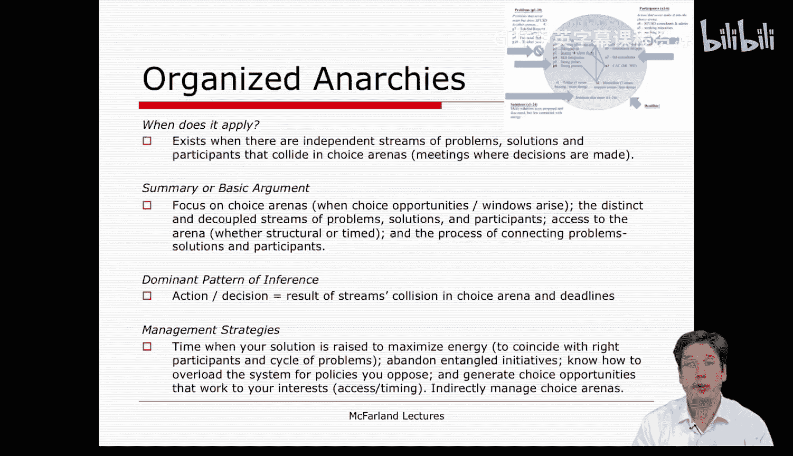

The fourth theory that we covered in this class is called organized anarchies or garbage can theory garbage can theory applied when we observe independent streams of problems you know there's a consistent barrage of problems maybe from the media and elsewhere。

 a variety of different solutions that come from say experts or from different interest groups and then participants who kind of come and go within these kind of choice arenas and the choice arenas themselves kind of flow as well。

 there's punctuated moments at which decisions get made or even have the opportunity to occur and they flow through as well。

 so it's a very dynamic notion of decision- making that seems very inaric and if you encounter kind of that environment where it seems kind of very fluid and happenstance in terms of when a decision and how depending on。

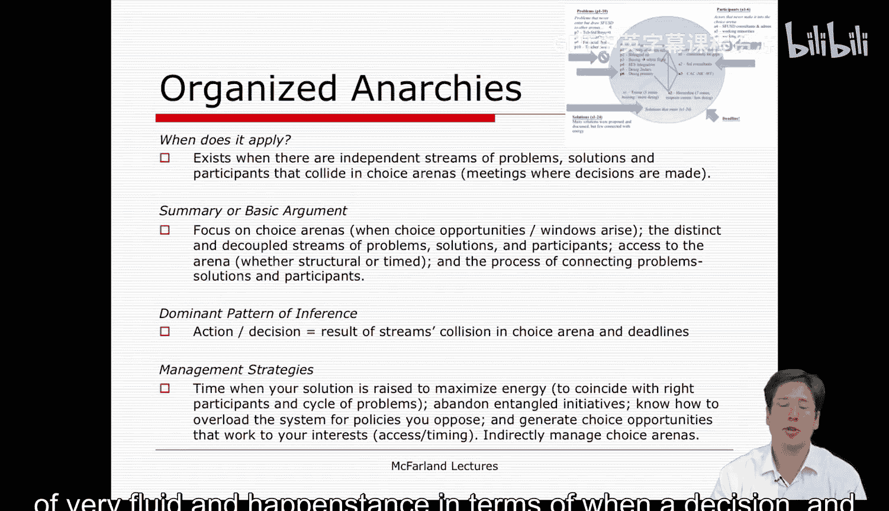

Who's present and which things get connected to which you've got an organized anarchy situation。Now。

 the basic argument of course I kind of related already to some extent。

 which is that here you have these choice arenas or windows of opportunities where decisions arise and all these streams are kind of flowing through so the image to my side here that you've seen before conveys quite a bit of this。

Where solutions come in， some of them enter the garbage can or the meeting， others do not。

 certain problems get affix to other solutions， etctera。depends on which participants。

 some participants get called away to other meetings or cannot attend these meetings or these choice opportunities。

 so there's this process of connecting problem solutions and participants and they have deadlines right so often we don't cover everything and they're full of bounded rationality。

 ambiguity， all kinds of things that make it closer and closer to a real decision context and all of its glorious messiness。

The dominant pattern of inference in the case of this theory was that it really came about the decision itself and organizational action from the collision of these streams in the can。

 shake up the garbage can and whatever is connected to each other or gled to each other is kind of the decision and so it's kind of got this。

Anarchic kind of chance driven to some extent， or at least contingent model of decision making。

If you're a manager of these kind of contexts， you have quite a few challenges and I gave you some kind of suggestions on the forum and in my announcements as to readings for this。

 particularly the new kind of a manager of these kind of distributed teams and fluid kinds of environments where you're kind of an embracing this garbage can or this enarchic kind of environment。

 and the various ways that you can deal with this is by。Timing when your solution is raised so that。

You're sure to have maximum energy， all the right people are there。

That the cycle is right so that the right problems get affix to this solution as opposed to others。

Like you don't want to raise your solution and certain problems when another problem that's more important starts to rise up in the media and with everybody's attention on it。

You probably as a manager want to abandon andtangled initiatives。

 you don't want to take ones that are all gnarled up with all sorts of other things that will demobilize the process and you want to be kind of strategic you want to know how to basically overload the system as well you want to not just look for good opportunities for your own decisions but you also want to think of ways to undermine it when they go to the wrong route and so here you know you can think of things like access and timing where you place things in an agenda and on it goes and last if you really fully embrace this kind of strategy as a manager。

 you want to think of meetings very differently， not as places to accomplish decisions but perhaps to get observations and understandings of each other where all too often decisions just aren't made or at least minor ones and many are tabled and that kind of perspective will probably help you as a。

in terms of thinking of it as a sense making process， one of constant anarchic procedures。

 but ones in which we get to understand each other and have more buy in from participants who feel like they have a say in the process。

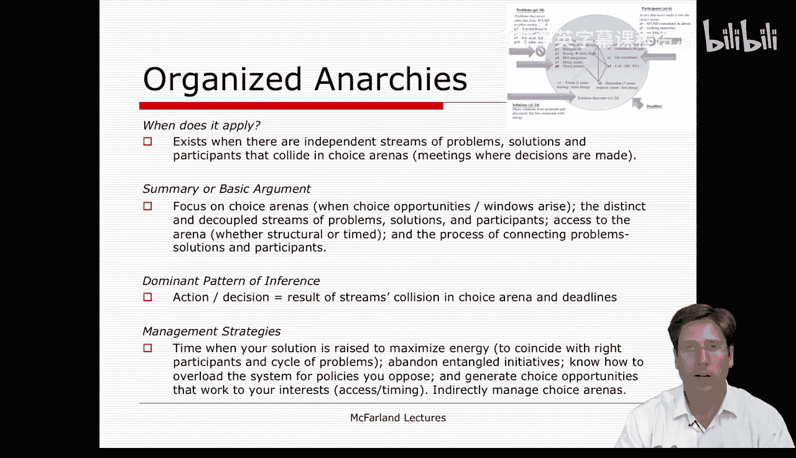

In the fifth week of the course we talked about organizational learning。

 and for many of you this was seemed like an ideal model of organizing because it really applies well when you have an organization that has clear feedback loops seems to adapt routines so that people learn practices。

 knowledge， they have real knowledge about implicit processes， that they remember what works right。

 that they have kind of an organizational intelligence， where。

You know adaptation and experimentation is valued so that the firm is constantly trying to actually apply things in novel ways and learn from its success and failures so that it can continually improve upon its performance so it's a learning organization and so for a lot of us it was like wow。

 this sounds like an ideal kind of theory and organization now the basic argument of this theory is that you can accomplish decisions and action really by。

Focusing on the actual practices。And the effort to continually improve those practices。

 so you need to remember and improve upon whatever kind of outcome that's central to your community to your technological core and what it proposes is that this is done by creating both a community of practice we have lateral ties among all the participants within the firm where they actually share and communicate and diffuse that kind of knowledge about best practices。

 but also through networks of practice that extend out from that firm to other firms where they learn about global maxima or better ideas that may be persisting or being created in other firms and they can translate them back down to the local level of your own firm and this kind of reflects an organizational intelligence so to say and so that's the general argument or at least the outlook of this theory in a very coarse caricature。

Now， the dominant pattern of inference or the way in which action actually comes about through this theory is that。

You inspect practice。You assess its returns to the organization and you do all this through this constant iteration。

Of interaction in the community of practice that's local。Local collaborations。

 as well as these kind of external network searches into the environment。

And as a manager of such a firm， the kind of things you want to do to encourage this kind of behavior is to create lots of lateral ties between the workers so that knowledge gets passed and transferred more quickly。

A lot of you remember the case of the Xerox workers where having them sit by each other at the same desk next to an expert was a better way of diffusing that kind of practice。

 that knowledge expertise that wasn't readily accessible through a manual of rules， in addition。

 another way to do this is to create organizational memory through all kinds of say even a website a listserv or what have you catalog。

You can also do other things like create applied social learning experiences where you send people off for professional development as an entire team where they actually apply。

 simulate， role play a variety of the same practices。Then last you want to value improvisation。

 you want to make it so that kind of communication and knowledge sharing and constant discussion reflection on practice is nurtured and if you create that kind of context in theory。

 you will have kind of a learning organization so that's the general gist of this theory。

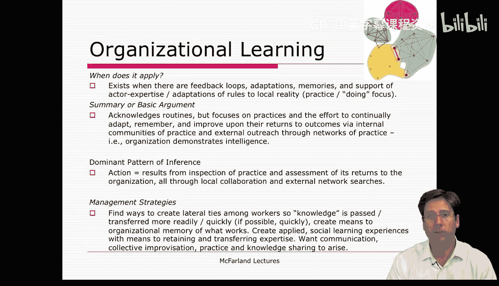

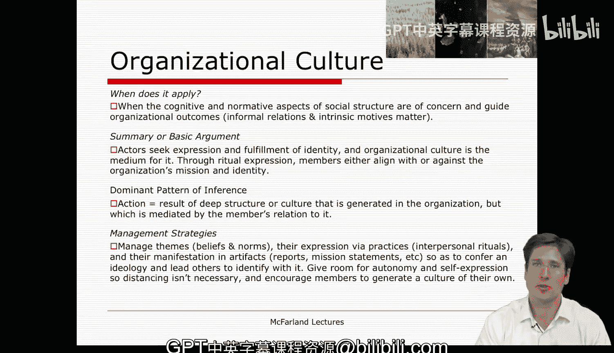