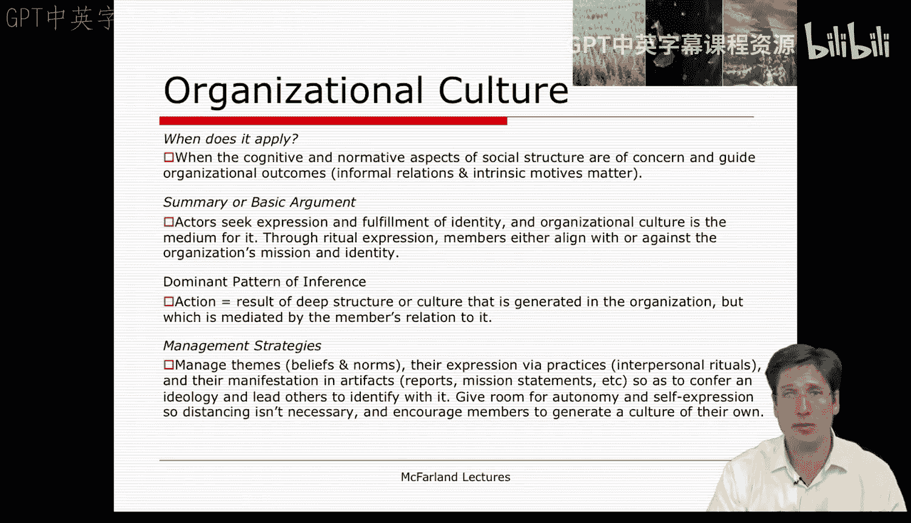
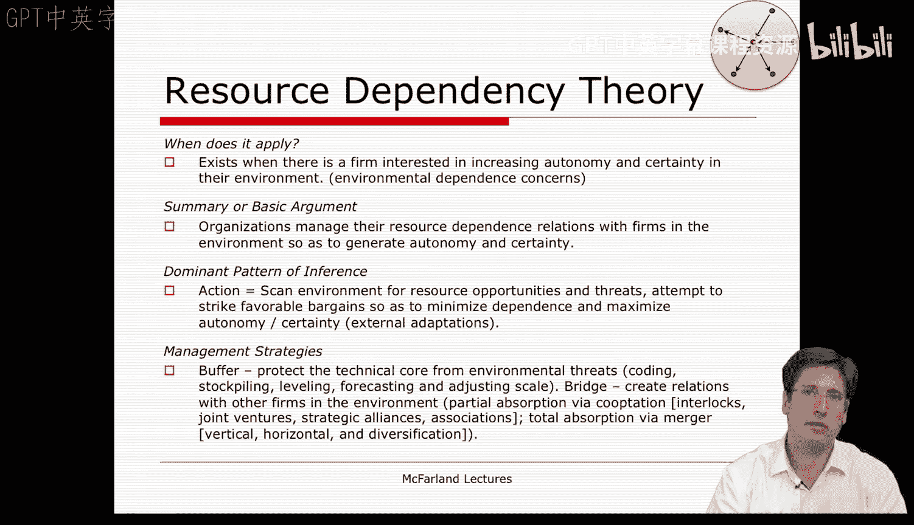
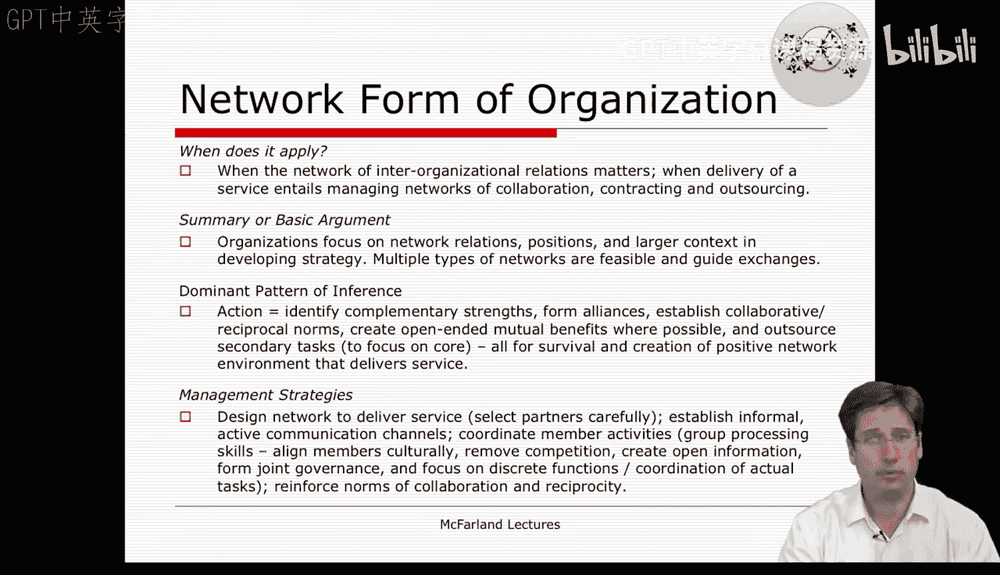
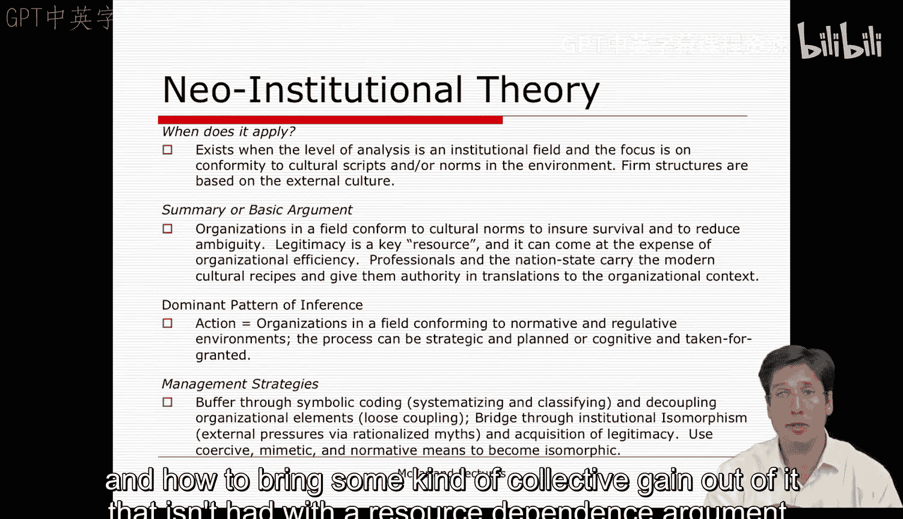
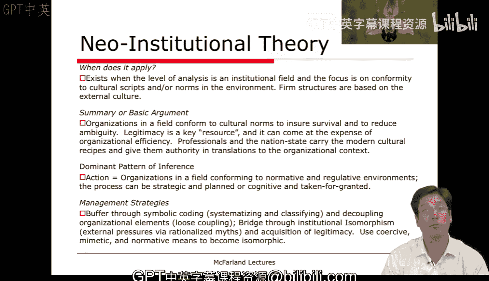

# 斯坦福大学《组织分析｜Organizational Analysis》中英字幕 p107 107_10_08_第二十五讲-课程总结-第三部分.zh_en -BV17J4m157qN_p107-

In week six， we discussed organizational culture and if you recall organizational learning kind of presuppose that everybody bought in to being concerned with practice and wanting to improve it and wanting to improve it that they would come to agreements on improving it。

 organizational culture was different it focused on the deep social structure whereas organizational learning seemed to focus at that surface structure of communication and collaboration so when did the organizational culture apply。

 well it applied when cognitive and normative aspects of social structure were of a concern that the informal relations and motives of the members really mattered that we wanted to win over the hearts and minds or that the hearts and minds of the employees were what was most important or at risk for your firm。

 that's when organizational culture matters。Now the basic argument of organizational culture is that actors within a firm want to seek fulfillment and expression of an identity。

 so it's again a logic of appropriateness thing right and organizational culture here is the medium by which they develop a sense of self or present the self within their everyday lives after all they're spending most of their life at work right？

And through ritual expression， through interactions of like presenting work of conducting team projects having kinds of presentations and meetings that these members find out each other's positions and how well they perform on various things and what kinds of identities and meanings they value or not。

 what gets ratified as sacred or profane， and that's the general argument behind a organizational culture view。

 through all these symbols and enactments of rituals。

 we come to an understanding of the kind of cognitive and normative environment that everybody's living within the firm。

Now the dominant pattern of inference are the ways in which action comes about or decisions come about from an organizational culture standpoint is。

Driven all by this deep social structure of the culture and kind it's the member's relationship to that culture or identity。

 whether they embrace it， whether they distance from it that creates this sense of whether they feel obligated to it。

 whether they want to stay late for it， all of that creates a sense of action and commitment to the organization's goals and activities and procedures。

 so in a way it's this kind of focus which seems to be presented by organizational culture。

 theorists and analyst。Now as a manager， if you want to instill this kind of culture。

 you the things that you're going to focus on are the beliefs and norms。

 the ways in which people express beliefs and norms in the interpersonal rituals of work processes and how they manifest in various artifacts like how they place them in reports mission statements how they arrange their desk and symbols and this kind of confers or even how you use space the architecture。

 this all confers in ideology and leads others to to either identify with it or resist it and often as a manager you want to give some room for autonomy of self-expression so that the employee doesn't feel like they have to distance themselves from the organizational culture and this encourages them to kind of build into the culture some expressions of their of their own and in this way they further。

Identify with the firm and stay late and work extra hours for little pay so in a way sounds terrible。

 it's a deeper form of organizational control but organizational culture affords that kind of perspective it doesn't have to be so dark。

 it can also be one that you look as fulfilling you know in spite of the fact that maybe all too often we do things without pay because we find them enjoyable and if we can create that context for people at work。

Why not？In week seven， we shifted our attention to the environment and the discussion of open organizations as open systems。

 and the first theory we talked about was resource dependence theory。

 resource dependence theory applied when the organization was terribly concerned with its dependence relationships with other firms in the environment。

 meaning like resources that it needed from other firms or kinds of concerns about autonomy and certainty of exchange within the environment。

 and that's when we start talking about these interfirm relationships that are focused on the ego like the particular focal firm。

Now the general argument of a resource dependence view is that the organization's going to manage its dependence relationships with other firms in the environment。

So to generate autonomy， it doesn't want to be dependent on others。

But then on the other hand it wants to create certainty。

 that means it wants to make sure that inputs are certain from others so that others are dependent on them。

So it's this kind of preferential positioning within this kind of market or not market。

 but this set of relationships the firm has。Now the dominant pattern of inference here is one where action or the firm's behavior and decisions are based upon resource opportunities and threats in the environment。

 and the whole process of selecting certain relationships and dropping others depends on favorable bargains that minimize dependence and maximize autonomy。

 so it's really external adaptations with other firms。

Now if you're a manager of resource dependence theory， you're going to do a couple of things。

 you're going to buffer your technological core， buffer the firm from kinds of control and influence on your core。

 and you're going to bridge， you're going to create relationships with other firms so as to create certainty and to control them and so the buffering things that you'll do are things like protecting your core from environmental threats by coding。

 you'll categorize a lot of your features inside so that other firms see a surface feature without going deep into your technological core。

 you stockpile resources， you level and forecast， you adjust scale。

 you do a variety of things so as to buffer your core from internal from external kinds of invasions of your technological core me。

Now bridging is slightly different here you're going to create relationships with other firms in the environment。

 all is an effort to kind of create greater certainty and control of them and the ways in which this is done is by partial absorptions which are done by you have interlocking boards of directorships that you're part of so you learn about information that these other firms and what they're doing you engage in joint ventures。

 strategic alliances and associations， these are all ways of kind of stockpiling together information and resources so that you share them and have some control over how they use them then finally it kind of total absorptions by mergers and here these mergers can be vertical or horizontal you can even diversify your sets of relationships so that you're not dependent on anything any particular firms they are a whole variety of strategies that are pretty political but interfirm and that's different than the coalitions kind of internal。

Ppective of creating some kind of consensus for a moment decision here we have kind of this machiiavellian view of interfim relations and dependencies for a particular focal firm。

In week8， we turned to the network form of organization and in many ways it built off of resource dependence theory。

 but instead of just focusing on a focal firm and its political kinds of relations in the environment。

To secure and bargain resource advantages。Here we have a concern with the larger network。

And how to establish something that's more。Sustainable in the long term so to provide a service so network forms of organization。

Matter。When we're concerned with interorganizational relationships as a larger context。

 it's when the delivery of a service entails managing a network of collaboration。

Of contracts and outsourcing as opposed to just having these kinds of efforts to control one another that resource dependence theory affords so it's a slightly different effort and concern and it entails different kinds of relationships built on trust as opposed to leverage now the basic argument of the network form of organization is that you know。

Here we have larger contexts of firms and their relationships that are guiding exchange and that provide some kind of resource to the participants of the network。

 that it's bring something more than any particular resource relationship can afford a focal firm by having this larger network form of organization that all the participants of the network have an added benefit now the dominant pattern of inference here that brings about the network。

 say or a decision to adopt this form or to establish that kind of action is an effort to find complementary strengths to have complementities as opposed to competitive relationships。

 it's the forming of alliances， establishing collaborative reciprocal forms。

 norms and trusting relationships where there's open-ended mutual。

Benefits all of this is done in an effort to survive and create a positive network environment that delivers a service that none of the individual firms could have done on their own and that by doing it as a collective kind of network。

 they gain something more beyond than if they just try to act strategically in a resource dependence fashion。

Now， the managerial strategies that you would adopt to establish this kind of network organization are that you would try to design the network to deliver this service that you would think about what partners would be feasible in terms of not being competitors with each other and that would find complementarities and what they have to offer。

 and then you would establish informal communication channels。

 frequent communication where they have a joint governance。

 they have open information between the firms where they align with each other culturally。

 and they coordinate that they have distinct functions， but they coordinate。

 they act as instead of a multiunit firm， it's become a multi firmm where each unit is a different function of sorts。

 so it's outside as opposed to inside and this requires quite a bit of group processing skills where you try to align members and a variety of ways。

And last you want to have this kind of norm within the network of reciprocation and collaboration where the different firms actually see one another and the network as a whole of some kind of benefit to them so I think it's a slightly different organizational theory it's clearly different from market or hierarchy as we talked about in the lecture but I also think it's clearly different from resource dependence theory and the notions of how to manage it and how to bring some kind of collective gain out of it that isn't had with a resource dependence argument in week nine we discussed the institutional theory and here we have a theory that expands the unit of analysis to look at an entire institutional field and which is consists of a whole set of organizations that regard each other as salient for the kind of task and technology that they。

and here you have this kind of wider environment of firms and what they're concerned about is the external culture。

 it's not the organizational culture within the firm。

 but with mirroring or conforming to the cultural scripts and norms that are within the institutional environment that surround them。

Now the basic argument of organizational theory is that the organizations in the field conform to cultural norms so as to ensure survival to reduce ambiguity and to basically secure social resources you know the more this firm looks like a legitimate kind of firm of that type the more they secure resources from the environment and all too often they adopt these kind of rationalized myths or appearances of what a firm is and we talked a lot about schools as being this where they adopt a lot of ceremonial features that make them appear like a rationalized school every university has you know various departments so as to look like a real legitimate university。

 but when you look at the actual courses and their contents they dramatically differ and the point here is that professionals or rationalizing agents like accreditation agency's university。

feSt bureaucracies dictate that those kind of features are legitimating。

 they have authority behind them and so they make sure that there's conformity to that without actually investigating the content itself so in many ways professionals in the nation state carry the modern cultural recipes and they give them authority and translations to the organizational context the dominant means by which an organization acts or comes to decisions or conforms in this way or has this kind of process of acquiring legitimacy is that it conforms to normative and reative environments and looks to the taken for granted features in the environment and it tries to conform to them。

 it tries to look like a real school and so we talked about a lot of this in week nine that firms adopt a lot of the。

That make them appear legitimate or the websites and their goals and things that would resonate with an environment and not be considered illegitimate for that particular field。

Now as a manager， the things that you want to do。Have quite a few similarities to the buffering strategies talked about in resource dependence theory like symbolic coding where you classify your organizations structures in such a way that they link up to external conceptions of what that firm should be。

 so like we have degrees at universities we have different departments。

 we have various credentials and grades and employers look for that。

 they've look for those classifications and coding that we have of the contents。

 even if there is some decoupling between what the students actually accomplish or the contents of each course can vary dramatically we have this kind of effort to classify and to mirror what is expected in the environment。

 and the universities with high schools the same deal that they have these kind of things they look for across them so there's this kind of system of a logic of confidences across these institutions that sustain this apparatus。

Of rationalized myths we also bridge with institutional theory and here you can do this through all kinds of efforts to acquire legitimacy and this is done in the Powell and Damaggio piece through coercive mi medic and normative means of isomorphism and that means like you adopt kind of the best the appearances of the best firms or that you try to follow what associations say or professionals that you bring in consultants from banin consulting。

So as to make yourself look or a professor， to make your company look legitimate。And so on。

 so there are a lot of these strategies that as a manager。Institutional theory would dictate。

Would be beneficial to you in appearing legitimate so that you secure greater resources from the environment。

