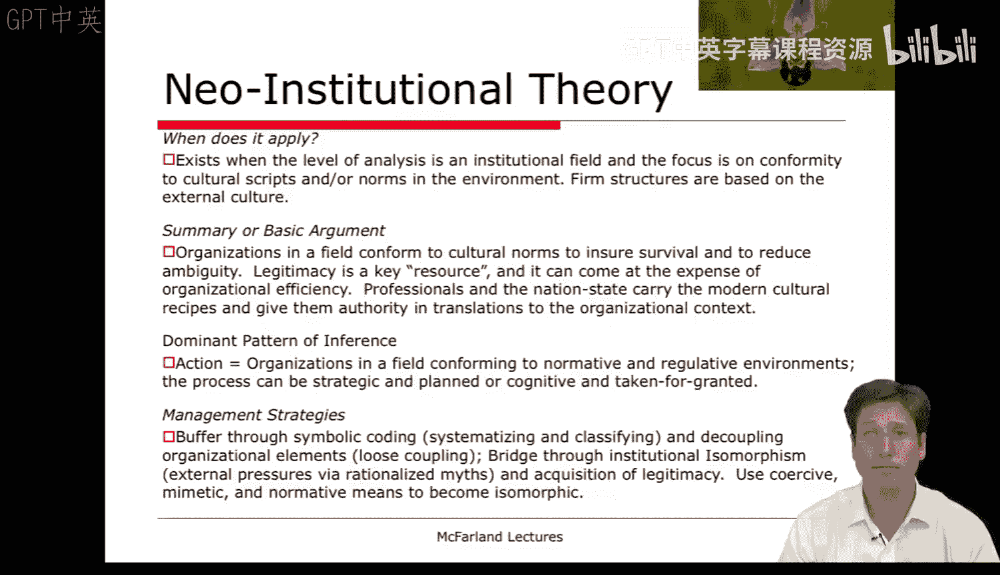
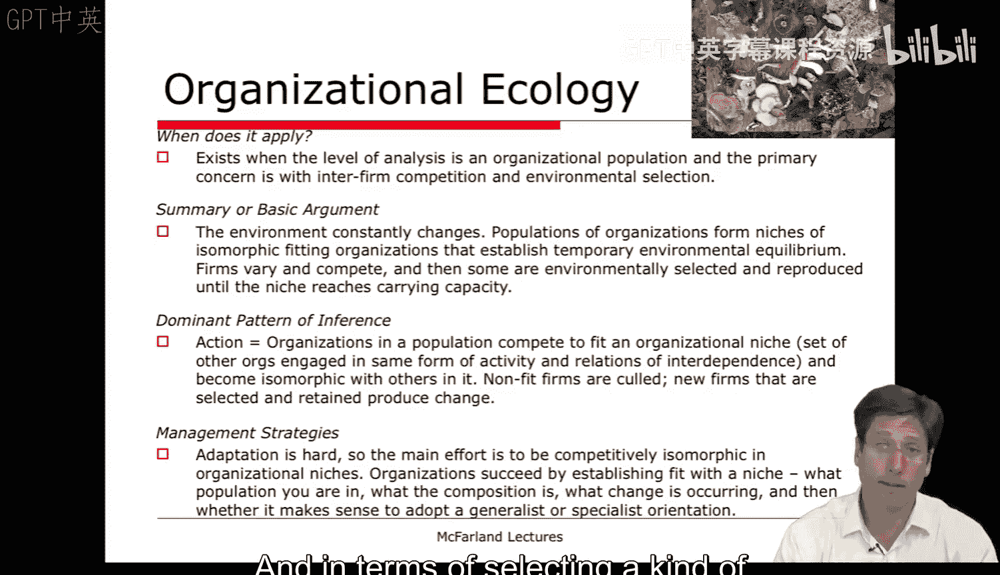
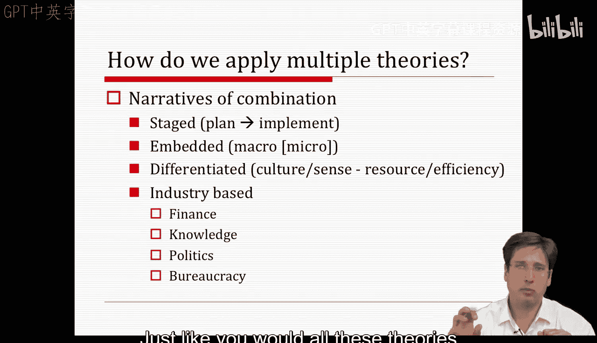
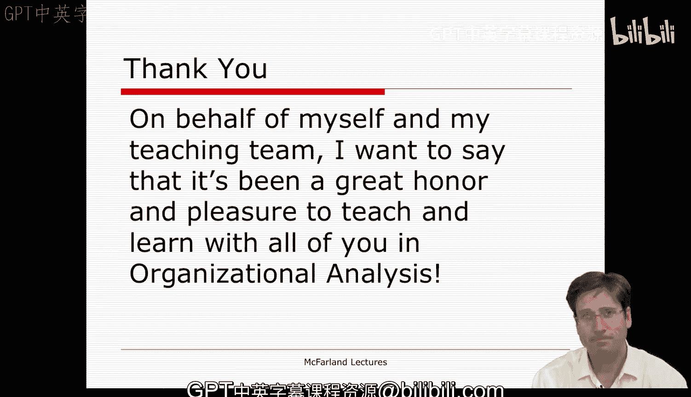

# 斯坦福大学《组织分析｜Organizational Analysis》中英字幕 p108 108_10_09_第二十五讲-课程总结-第四部分.zh_en -BV17J4m157qN_p108-

The last theory that we covered in the course is called organizational ecology。

 and it applied when we thought again about the level of analysis as an entire population。

 and this was quite similar to an organizational field that the institutionaltal theory called。

Or identified。Here we have this population and it shifts to the notion of a population because now we're following a metaphor of natural selection and kind of Darwinism of sorts for firms。

 and here the concern is not with why firms all look the same like the institutional theory was concerned with but why they vary and some survive and die and so it's more about this process of interfirm competition and environmental selection。

 so it's a distinct kind of theory and that it's kind of environmentally determined deterministic and it's great for thinking about kind of whether my firm would fit and what kind of firm I would need to start it's for forecasting or predicting whether it's feasible to move into this new niche and whether your firm would survive。

Now， the summary or basic argument here is that the environment's changing， right？

And you have populations of organizations that form niches of isomorphic fitting organizations and these sets of organizations fit the environment or have equilibrium in the environment temporarily now think of it this way as kind of firms that vary。

 they alter certain characteristics over time and they outcompe one another within this kind of ecosystem and the ones that fit that ecosystem better。

Get selected and reproduce， they fill up the niche until they reach carrying capacity and then any new ones kind of can't survive because there's not enough room it's too dense。

 so we have this kind of notion of an ecosystem with a variety of species。

 some that outcompete others that proliferate and that over time this doesn't stay static but over a long period of time it'll eventually turn over into a new kind of subspecies that maybe outperforms the others。

Now， the dominant pattern of inference again here is that it's competition。

 it's that firms there's this kind of inertia to firm structure that they don't adapt very well。

 and what happens is that the environment selects a particular structure to survive or die。

 so that becomes the primary means of its selection。It's not about adaptation。And because of this。

 you have species competing within and each， according to the form they。Practice。And over time。

 this can change， right？Because the environment as a niche。

 changes as well as do the forms of those firms within it。And some of them become more fit。

So as a manager when you look at this change or adaptation of your firm is pretty hard。

 it's kind of disconcerting right so the main effort becomes being competitively isomorphic in a niche。

 it's to look like the other firms that are doing well in that niche and to think about whether your firm has a slight adaptation or a mutation actually that you founded that withoutperform the other and so you succeed by fitting the niche。

 what the environment in that ecosystem needs， and what population you're in the composition of it。

 whether it's reached a carrying capacity or not， and what change is occurring and then whether it makes sense to adopt some kind of generalist strategy of diversifying like whether youve your firm is a large kind of multifaceted firm or whether。

It's a specialized kind of niche， so you think about the structure of the niche。

 whether it allows for kind of partitioning into different segments where you can be a specialist like a microbreweery or whether it's better to be a generalist。

 it depends on whether that niche is going through a transformation of a great turnover or whether it's stable。

 all of those features of the niche and the ecosystem are quite deterministic in terms of a firm survival in terms of selecting a kind of organizational form that's considered fit。

So you got10 theories this quarter that's a lot of theories and for any particular case it's likely we'll want to apply several of these theories so we start to come to this point where we ask are there ways we can combine our application of the theories and one way I think that helps is to consider how they vary。

 and so some of these theories if we reflect on them appear to be more idealistic models than realistic models or descriptive models。

 so they may be better suited to planning than implementation。

 similarly some of the theories are more limited in scope。

 they focus on decision moments and administration of them while others concern the organizational context or environmental context or the conditions of decisions。

Now， some of the theories also presume an internal capacity to change and adapt that we can change the technological core and the structure。

 while others think that's really hard that they're full of inertia and there's these deterministic matching efforts like population ecology or organization ecology。

Some of these theories focus internally right they focus on the internal or as others go out in the environment like we said in terms of an open system。

 and then finally we have some theories that concern themselves with a deep structure。

 the cultural elements of organizations and the organizational environments。

 while others are more concerned with surface structures of resource relations or networks of association。

 so they vary tremendously in terms of what they focus on and depending on any particular case depending if we want to focus on planning whether we want to focus on a decision within a context。

 we can select certain theories and combination to afford a more robust or elaborate characterization of any particular case Now of course as a manager。

 you want to think about distinct narratives or ways in which you can frame or characterize the combination of multiple theory。

And one way is in terms of staging， so some of these theories can be used in the planning and then others in implementation。

 right， so the rational choice could be for plans and then the implementation could be。

 say org process。Another way is to think about them as embedded theories。

 where within the context of a macro context， we have these micro processcesual decision models。

 right？A third way of thinking about it is more of a differentiated kind of perspective that some of these theory we would regard each case as having certain dimensions like culture and surface structure。

 and so we would want to look at culture and sense making processes within this firm or this case as well as kind of resource and efficiency concerns in another。

Yet another kind of view is that these theories could be applied differently depending on the industry so that in some cases or some industries like finance。

 we have these centralized structures with very clear information and its representation as numeric and quantitative that would make it more useful and pertinent to a rational actor model。

 and in another industry like a knowledge， production industry where a lot of these things are uncertain and ambiguous where culture may be more important beliefs and norms。

 different sets of organizations may be even more salient than say a rational actor model。

Political kind of systems or ones with high cost kind of momentary decisions of inconsistent preferences could also pertain to certain theories over others。

 and again， political kinds of like policymaking context as opposed to policy implementation or both it's hard to say depending on what you're studying or analyzing or managing as the case may be。

 but political context probably require distinct organizational theories yet again。And then finally。

 we have bureaucracies and quite a few of you did mention that you work in governmental bureaucracies that' are quite stable。

 stayed and hard to change， and there again I think these kind of organizational process models and theories of that sort still have great salience and relevance to what you're observing and how to manage it。

 so I think a variety of these theories could be combined or seen as matching certain kinds of industry。

 we could also approach them as being differentiated in terms of what we think are the salient dimensions of organization culture and structure。

We can embed these theories in ways that are both macro micro or even decision and context。

 same thing right and then finally that we have this kind of staged view as to where an organizational phenomena can proceed right so in the planning to the implementation could require a vastly different theories for you as an analyst and manager and I think that these are all viable narratives by which you could combine multiple theories and still retain some kind of larger sense to it。

 so it's not just a mosaic here you have an actual sensible narrative that the combination follows and can be kind of reflected upon as being more suited to the case or not so I hope these kinds of multiple combination theories or narratives for them。

are of value to you in becoming more of a master carpenter as opposed to just viewing your screwdriver as only suitable for one thing that you start to see the screwdriver in relationship to the hammer and relationship to the saw as being relevant to certain kinds of projects just like you would all these theories that some of them will be relevant to certain kinds of firms or certain kinds of narratives that you're trying to portray and understand for organizational phenomena so now we come to the final part of the course where I say thank you and goodbye and I don't want it to be a sad one。

 I'm hoping that you've enjoyed the journey and I'm hoping that you learned a great deal I know that my teaching assistants and I have learned a tremendous amount from this experience and from our interactions with you and it's been invaluable I've learned a great deal and I walked into this hope。

To do such and hopefully we've provided you with some kind of material and resources that are of value to you there are a few people I want to thank and in particular I want to thank and most of all my teaching assistant。

 Charlie Gomez， Emily Schneider and Dan Newark you know they've put in many hours for free and I just couldn't ask for a better team of individuals to help me present this so if anything worked well please give them credit。

And then I also want to thank Coursera and Rellli。Who is at Coursera has been helping us throughout quite a bit of this。

Without her support in Coras， we wouldn't be able to implement。

A lot of these kind of procedures that we're trying to。

test out and figure out how to improve kind of online learning so that it more closely resembles a real high quality class with a lot of substantive material and kind of feedback for you in terms of writing and the like。

And then last， I want to thank Stanford and the Vice Provost of online learninging and Jane Manning for being supportive as well of giving us access to kinds of you know。

Places like this sound booth and helping us with putting on the screenside chats and on and on it goes there's so many people that if anything went right。

 they deserve credit for the things that didn't go right I apologize we did take your comments seriously we are going to improve on all those and they're invaluable feedback。

 you've always been constructive， you've always been kind about things that impatient with us and trying to afford this material to you and we're very grateful and hopefully if you didn't get to acquire a certificate this year we' be able to afford this again in the fall of 2013 with a variety of improvements and a much smoother kind of presentation that will be of interest to you and many others out there so I hope this isn't goodbye I hope it's thank you and until the next course or the next。

And if any of you are ever at Stanford and if I'm not in the middle of a course like this。

 I would love to sit down and meet with you and say hello。Thank you。

