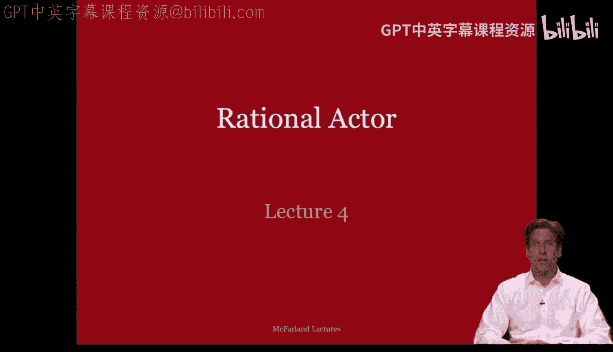
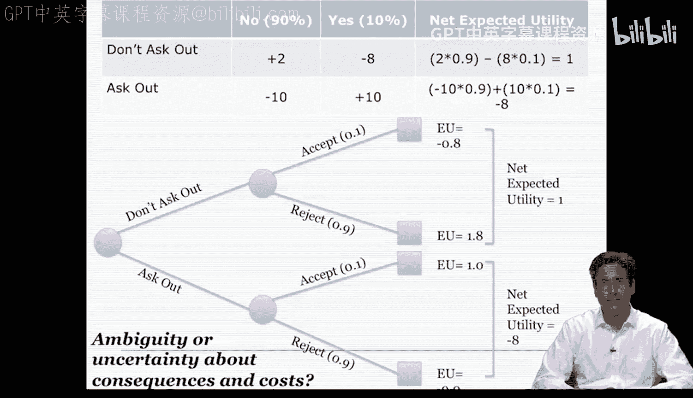

# 斯坦福大学《组织分析｜Organizational Analysis》中英字幕 p12 012_02_01_第四讲-理性行动者模型-第一部分.zh_en -BV17J4m157qN_p12-

Welcome to our second week of lectures， This is the theory lecture of the week。

In this lecture， I will present a general introduction and discussion of decision making in organizations。

 In the lecture， I will relate various rational system views of organizations that tend to focus on in administrative units or leaders of organizations。

 A simpler example of organizational decisions can be found in the image in the slide deck showing a decision tree right next to me。

 The choice here is whether to upload a picture or not onto my Coursera course。

A variety of criteria apply and help us decide。 Fortunately。

 this particular image of a decision tree was taken off creative Commons and freely viewed。

 So we're O。Nonetheless， it gives you an initial sense of what we mean by decision making and the kind of process people use to make some decisions within organizations。

This week， we read some work by James G。 March concerning decision making。

 Jim is a faculty member here at Stanford who has spent several decades studying actual decision making behavior in organizations in the work you read。

 he classifies types of organizational decision making that helped situate our readings further。

 particularly the rational and natural classes of organizational depictions that Dick Scott's work described last week。

Jim March describes two general classes of organizational decision making or logics of decision making as he calls them。

The first is the logic of consequence or rational choice theory。

 And the second is the logic of appropriateness。 What Allison。

 Graham Allison might call organizational process models。

 and others referred to as as perhaps sense making。

 The core distinction between these logics is that one is concerned with choices and instrumental efforts。

 and the other one is concerned with rule following and interpretive activity。

Both are intentional forms of behavior。 The former entails means and rational action。

 and the latter entails value rationality or duty driven behavior。 Val rationality contends that。

 regardless of the cost or without attention to them， we often make decisions out of duty to a rule。

 a principle or a particular identity。The rational actor model is essentially a model that follows the logic of consequence for the rational actor approach。

 The first aspect is knowing your alternatives here， A decision make asks。

 what are the options available to me。Second， it's important to know the consequences of these alternatives。

 here one asks what happens if I take each option？Third。

 you have ordered preferences or ranked goals and objectives in terms of greater or lesser value。

 here you weigh the value gained or lost by taking each option。

The fourth aspect of a rational decision process or a logic of consequence concerns using a decision rule or a choice process。

 Graham Allison refers to this as an inference pattern。 Here。

 the choice process is a rule by which an alternative is selected on the basis of its consequences for preferences or goals。

 Two decision rules are commonly discussed and reflect different notions of a rational actor。

 The first is really an ideally rational person， traditionally called economic man by its critics。

 This individual is typified by clarity in knowing and consistency of preferences and objectives。

 Theyre an ideal form of a rational actor。 The second kind of actor is aboundly rational person and is typified by ambiguity and uncertainty and knowing incomplete information and inconsistencies in their preferences and objectives。

 So we are here we have an individual who is more like the real person we all know and experience。

Let's start with a simple example of a rational choice in action， just to see the difference。

Very soon， it's going to be the rainy season in California。 and we call this winter。

 It dips down to about 60 degrees Fahrenheit， and it rains quite a bit because we're so tough。

 We always worry about whether to bring an umbrella or not。

So let's say on a particular day there's a 40% chance of rain。

 and we have to decide between bringing an umbrella or not bringing an umbrella。Now。

 let's say on that day， we see certain costs and benefits in each scenario。

 and the scenarios are pretty simple， not bringing the umbrella， and it doesn't rain。 Yeah。

 I didn't have to carry it。 That was a great decision， not bringing an umbrella， and it rains。 Well。

 I get wet。 And that's kind of a downer。If I bring an umbrella and it doesn't rain。

 I have to carry it around all day and there's a cost to that。

 it kind of doesn't fit in my bag and it's kind of a trouble。But finally， bringing an umbrella。

 and it does rain。 I'm prepared that day， and I stay dry。

 So let's use use some values from 10 to negative 10 in order to kind of depict this。

 Let's say that not bringing an umbrella and it not raining is a 6 out of 10。

 I'm happy not to have to carry my umbrella all day。😊，If I don't bring an umbrella and it rains。

 well， then I get wet， and I find that that really terribly disconcerting to be wet all day， right。

 I'm going to give that a negative 10。 really， it's really upsetting on our scale。 On the other hand。

 say， I do bring an umbrella。 And there is no rain。 Then I have to carry it around。

 That's kind of a discomfort to walk around with it in my hand。 So let's give that a negative 5。

And then if I bring an umbrella and it rains， then I'm kind of pleased with myself for being so well prepared。

 I give myself a plus 8。 So below or next to me here is this kind of matrix， a chart。

 And you see kind of a decision tree where the chances of rain versus no rain is 40% to 60%。

 And in each of the options is listed， right？ And we want to calculate the expected utility of each kind of scenario。

 And here all we have to do is multiply not bring an umbrella， which is plus 6。

 with the chance of no rain， which is 60%。 And from that， we get a second value of 3。6。

 So if you have 6 times 06， 3。6。 That represents the expected utility of not bringing an umbrella if it doesn't rain。

😊，But if I don't bring an umbrella and it rains， it's negative 10 times 0。4 or 40%。

 and that equals negative 4。 Now， if I add those two together of not bringing an umbrella in both cases。

 I get the net expected utility of not bringing an umbrella， and if we add those two。

 we see that it equals negative 04。Now， if I go through the same kind of operation in the lower branch of this tree for bringing the umbrella in the case of raining or not raining。

 I find the expected utility of 0。6 Now if I compare the two， it's clear that bringing the umbrella。

 given my preferences or my sense of cost and rewards for each outcome is better than not bringing umbrella because I really don't want to get wet。

Now， let's do this for a more interesting case of dating。

 Many of you are single and perhaps looking for love。

 And what I'm going to do now is show you how the logic of consequence can perhaps work to your favor as you consider your options。

 So let's take them one at a time here。 Sa you're wondering whether to ask someone out。

 And let's say they're pretty attractive。 So you've got a 10% cent chance that they'd actually say yes。

 right， And here are options。 You don't ask them out。 And they say no， That's pretty good， right？

 You're not embarrassed。 The other option is， you don't ask them out。 but they would have said yes。

 In that case， you miss out on something quite interesting and wonderful。 That's kind of a downer。

A third， you do ask them out。 and they say no， That's kind of mortifying， right。

 That may be terrible。 And finally， there's the last option， which is we do ask them out。

 and they say， yes， when that happens， it's quite gratifying。

 how would you value each of these options， though， from a 10 to a negative 10。

 Are you a high interest， low cost person or a low interest， low cost person， meaning， you know。

 you ask people out all the time。 And you don't have much to lose。 Are you a high cost person here。

 you see it as a risky kind of endeavor， no matter what happens。

Now me personally I find it kind of mortifying to be rejected so I'll go with high cost and so in this table you see here not asking someone else out and then them saying no。

 well hey that's good for me， I saved myself the trouble I'm going to give it a plus two okay。

Not asking them out。 And they would have said， yes， that's kind of a downer。 That would have been。

 let's say a negative 8 for me。 It's pretty bad， but not terrible。

 But then asking them out and them saying， no is just awful。 You know。

 I feel terrible and miserable over that。 So I give that a negative 10。And then finally。

 me asking them out and them saying yes is a plus 10。 And that couldn't have happened better。

 Best of all， worlds right there。So if we go through the decision tree again and we can predict the net utility of each option of asking someone out or not。

And let's say they're super attractive， right， like I said before。

 and our chances are pretty low at 10%， right？If we go through the math again like before。

 or we don't ask them out and get a yes， that equals negative8。

Then we multiply that by the probability of yes at 0。10 or 10% chance， as such， negative 8 times 0。

1 equals negative 0。8 expected utility。The opposite of don't asking them out。

 and they reject you as a positive utility of 1。8。 so we have a net expected utility of not asking people out equal to one if we add those two together。

So in contrast， if we actually ask attractive people out。

 then given the risks and the probability that they will say no and that we would be mortified。

 we have an expected utility of negative8。 So the net expected utility of that is pretty low of asking them out。

 So that's pretty severe。 So， of course， as a result， we just avoid the whole effort altogether。

 we don't ask them out， right。That gives you two examples now of a very simple decision tree that people make in terms of common types of decisions。

 but you can extend this to organizations and their types of decisions as well。

 and their kinds of options。 For example， if a company does X。

 then a competitor or client has a probability of reacting in a certain way。

Later I'm going to discuss the Cuban Missile crisis as an example of organizational decisions in that case there are really clear choices。

 there are potential outcomes and there are values affix to each outcome that's going to bring us closer to a real worldor organizational case。

Now， clearly， there's a ton of ambiguity here。 whether reports aren't that accurate。 Plus。

 I really have little good evidence to go on to decide if someone one might be receptive to being asked out or not。

 thus far， the rational actor model is an idealized model that assumes Herculean abilities of decision makers。

 In reality， most of us are boundly rational。 We are unclear on our preferences and goals。

 We have vague information on the consequences and vague probabilities in terms of what we think others will do。

 So this leads us to our next question about ambiguity。

