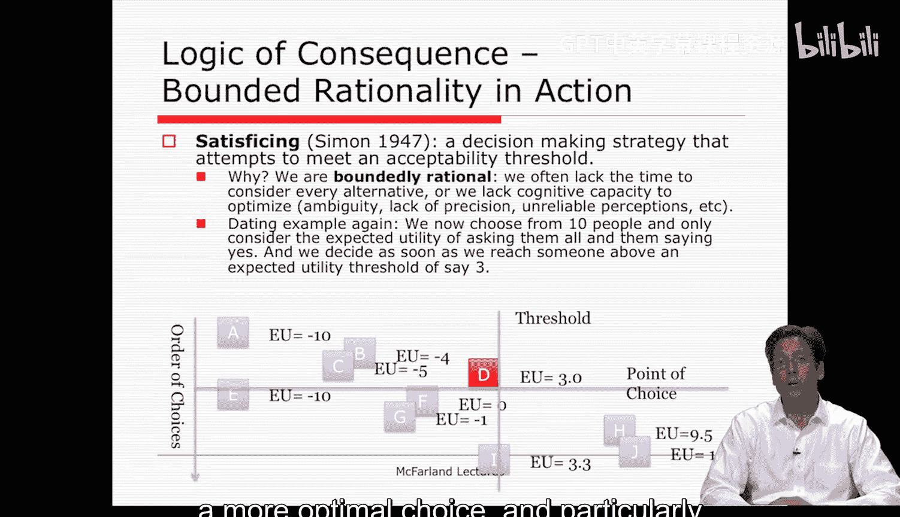
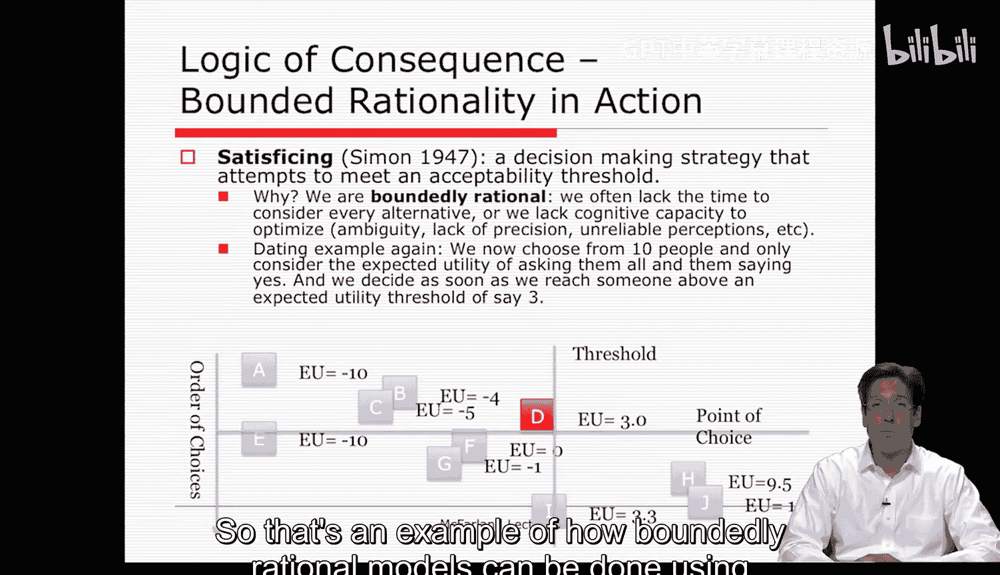
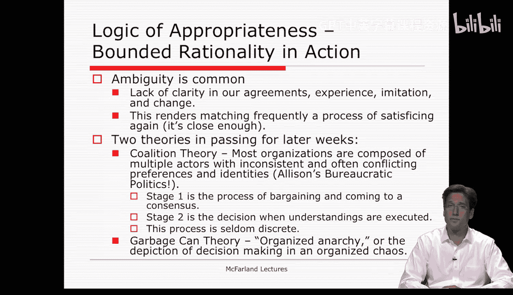

# 斯坦福大学《组织分析｜Organizational Analysis》中英字幕 p13 013_02_02_第四讲-理性行动者模型-第二部分.zh_en -BV17J4m157qN_p13-

So what would a boundly rational model look like， what's the choice process there？

There an actor is uncertain about consequences and costs。 Moreover。

 the ordering of preferences isn't so clear。 Herbert Simon related a theory of satisfying as a potential alternative。

 one that may offer a more accurate description of how we usually make decisions as boundly rational persons。

Instead of calculating all the alternatives， we start with one that is most near to us。

 not bringing an umbrella or not asking like we always do， right。

 And then we see if that option has a satisfactory consequence。 For example。

 I wouldn't calculate on every day the same kind of equation， right。

Nor would I go through every particular option of people to date。

So I kind of think about a threshold or some kind of habit of decision， and I stick with that。

So we probably say that choices are good enough and stop somewhere along our sequential search of options。

 But if we don't meet our threshold， we move on to the next option down the list。

 and then we pick the next closest one。 So search is simulated by a failure to achieve a goal and continues exploring alternatives until it's good enough to satisfy it。

 So if we look here in the model below。 let's look at the dating example again。

 And we have to choose from 10 different people， and we have to consider the expected utility of asking them all and them saying yes。

 And we decide as soon as we reach some person above our expected utility threshold of say。

 let's give it a3 right， That's the person we pick。Now， I'm not going to be able to ask everyone out。

 and nor will you。 So we start going through an order of choices。

 going downward through this list from a to J。 And as soon as we hit the3。

 that three that expected utility of3， we have our point of choice。

 And the figure we can see that threshold out here on the vertical line。So once we reach D。

 after we go through A who wasn't even that was like the lowest score。

 wasn't even close and B and C who are next to， they weren't even good enough either。

 we finally hit D and it's good enough。 So we stopped searching。

 that's considered a satisfyising kind of decision or move。 Of course。

 because we haven't gone through every option， we haven't optimized decision。

 we just didn't consider everything。 As you can see。

 persons H and J at the bottom of the figure if we had selected them we would have probably had higher utility and a more optimal choice。

 and particularly J who is the highest expected utility。

So that's an example of how boundly rational models can be done using satisfyising in a logic of consequence way。

So far， we've discussed the logic of consequence or rational actor models。

 but there's a second class of models or a second class of decision making that Jim March relates。

 He calls it the logic of appropriateness。Most of the time in organizations， people follow rules。

 and， and they follow them， even if it's not， obviously in their selfinterest to do so。 For example。

 when soldiers follow orders in war and march out to their death。

 it seems hard for us to see any utility in that。 So particularly the individual's utility。

 So that obviously following some kind of form of duty or rule。 And yet。

 a lot of behavior seems to follow that kind of logic within organizations。 within organizations。

 we accomplish specified tasks， we perform routines， we meet professional standards and norms。

 and we do standard operating procedures， all is part of our function of being in an organization。

 when a problem or issue confronts the organization。

 it often becomes a question of finding the appropriate rule to follow。

 instead of valuing alternatives in terms of their consequences。

 rule following matches situations and identities。 So let's take a moment， and think about a little。

in more detail what this involves。Three factors really are involved in rule following and kinds of logic of appropriateness decisions。

First， decisions are classified in the categories associated with rules and identities。 We ask。

 what kind of problem is this， Who usually addresses it。How has it been addressed in the past？Second。

 decision makers have official identities and rules that are evoked in particular situation。

 Who usually addresses this kind of stuff。 Who's the appropriate person for this problem。

Decision makers also match rules to what they see is appropriate to their role in the classified situation。

 that is they match rules and identities to kinds of situations they say this is an X situation for Y people to manage。

Now this is akin to the inference pattern of matching that Graham Allison talks about in his case。

 so it's like the organizational process model he describes， but it's not identical， of course。

 but they're similar。 So as you read through those you'll see the similarities。Now。

 one notices rule following in the logic of appropriateness being used in organizational decisions whenever someone follows traditions。

 hunches， cultural norms， advice， pre existingisting rules and standard operating procedures。

 We even see them in heuristics。 They're just everywhere。

 And they're clearly a second class of decision making that is no less intentional。

 but it's less concerned with consequences， than actually matching rules and identities for a situation。

Now， decision making via rules is as ambiguous as decision making by means in calculation。 here。

 There is no ambiguity or lack of clarity concerning consequences and preferences。 Rather。

 there's lack of clarity and ambiguity in our agreements and experiences。

 You don't experience the something the same way I do。

 And our agreements or may not be what we both had in mind。 In addition。

 the decision making here is less conscious。 matchingching is kind of intentional and rational。

 but it's often done in a subconscious way。 and we often do it in a taken for granted way。

 Its intended action we don't reflect on in many cases。

This leads to sense making and issues about whether decision making is really about less about consequences than about meaning making。

 so here we have allusions to interpretive methods and organizational culture that people follow beliefs as opposed to means and rational calculation。

The primary product of decision making with the logic of consequence may be less the decision outcome than the than the actual decision process。

 establishing individuals and their social meanings。

 So one can say here that decision process or theory。

 explaining organizational dynamics suggests they don't arise for reasons of improving consequences。

 But for engaging in a meaningful process and the ability to maneuver it。Now。

 Jim March also alludes to the fact that both logics get further complicated when one considers that most organizations are composed of multiple actors。

 and these actors have inconsistent and often conflicting preferences and identities。Here。

 the theory of coalitions comes into play， as does the negotiation and bargaining process。

 This interaction among the individuals is akin to Allson's bureaucratic politics model that you're going to read in the Cuban Miss crisis case。

 March， of course， suggests that there is a two stage decision process to this。

 St1 is the process of bargaining and coming to consensus。 And then in stage 2。

 the decision is actually and the understandings people share is finally executed。 Unfortunately。

 these two stages are seldom discrete。 there are many compounding decision moments。

 and consensus waxes and wanes and falls apart， even as people finally decide to act。

The set of a system and its implementation are often intertwined。 Hence。

 the world of alliances is not one of precision and formality。

 but one of informal loose understandings and expectations。

Last， in his reference to temporal orderings， March is evoking the theory of organized anarchy or garbage can theory。

 which is the depiction of decision making in a fluid form or in organized chaos。

 This is something that we're going to cover in week  four of this course。 And today。

 I' am just remarking on these these distinct theories of coalition and organized anarchy in passing。

 But please note them as as we're going to come back to them over the next two weeks。

