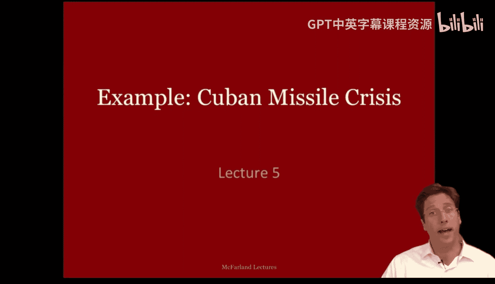
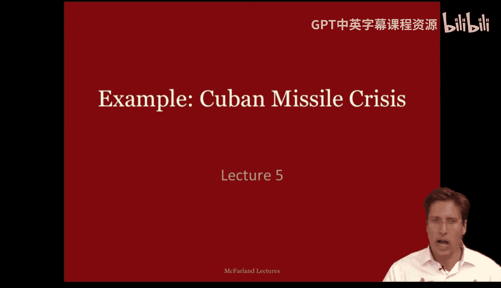
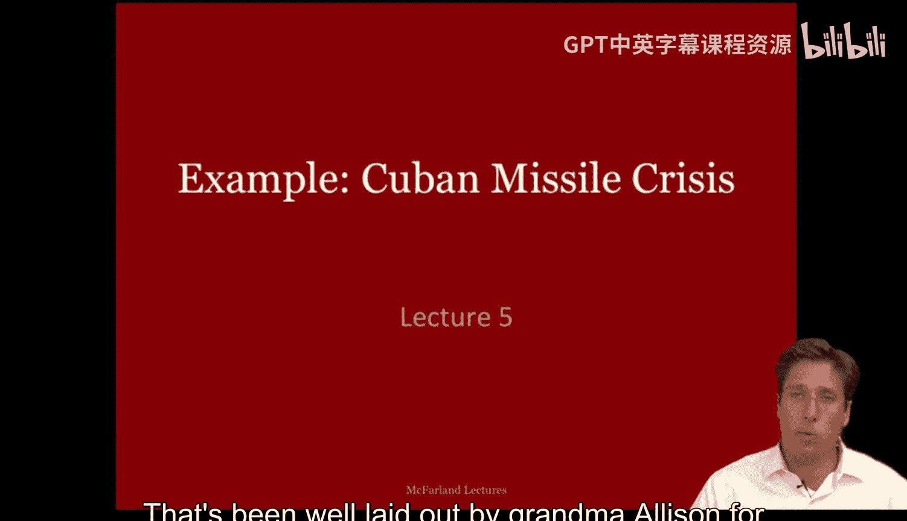
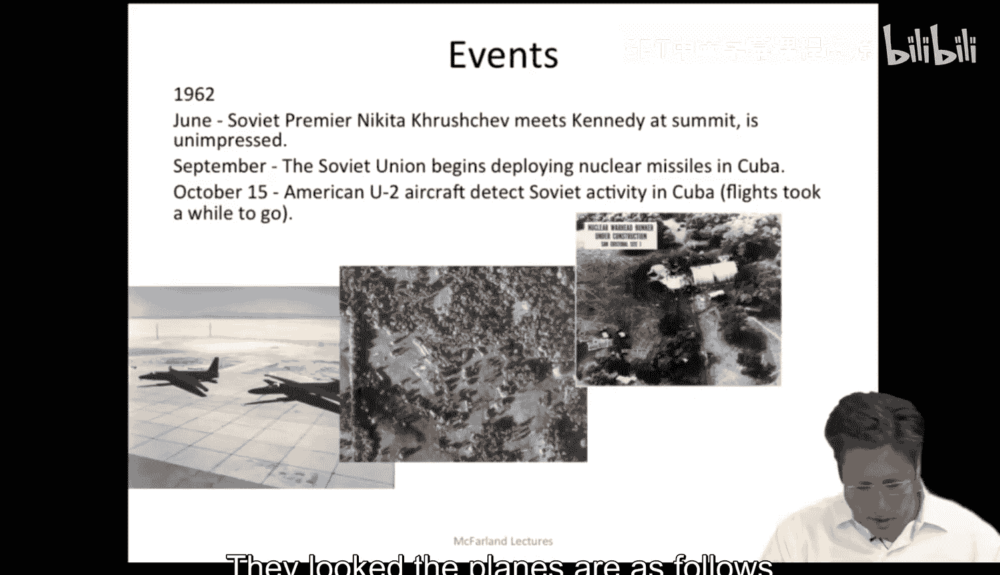
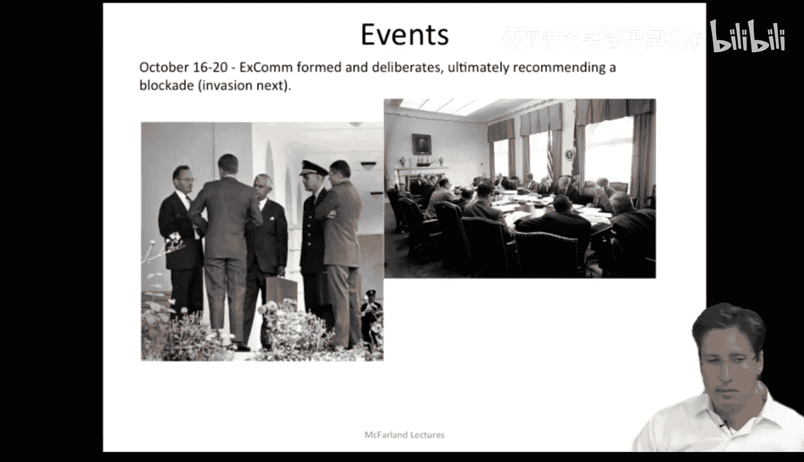
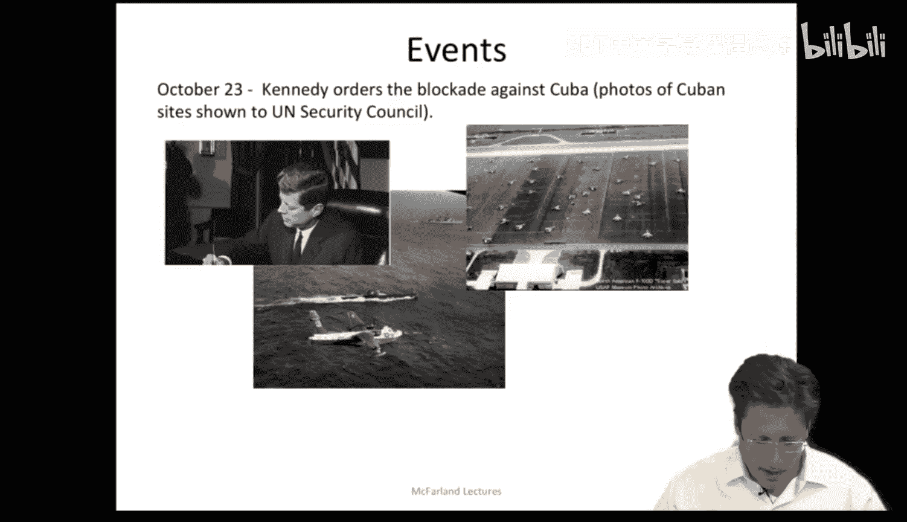
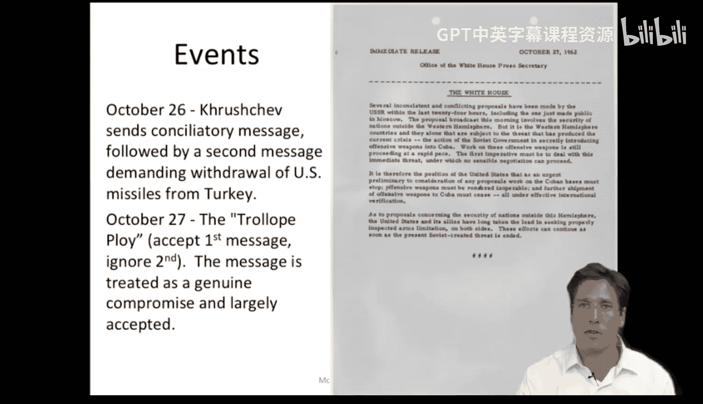

# 斯坦福大学《组织分析｜Organizational Analysis》中英字幕 p14 014_02_03_第五讲-案例：古巴导弹危机-第一部分.zh_en -BV17J4m157qN_p14-

Now that you have some idea of March's logics and passing references to culture。

 coalitions and anarchic decision environments， we can turn to Allison's study。

Of the Cuban Missile crisis。Why the Cuban missileile crisis？

It's clearly a policy environment but it has lots of nice qualities applicable to nonprofits in government organizations。

 in fact， crisis management is common in many organizations， and in many instances。

 the stakes of policies and decisions are enormous take for example in the United States we have no child left behind as this massive policy effort and education that creates crisisises in schools and whether they get money take。

 for example， harassment and grievance claims within organizations。

 suicides and deaths within organizations。

In these circumstances， what do you do？How can you describe what happened and how people reacted and whether people followed some kind of reasonable procedure。

 how can we successfully manage in those situations。

 and here we have kind of a wonderful example of a Cuban missile crisis。

That's been well laid out by Graham Allison for us to begin this kind of conversation the Cuba missileile crisis was a huge event。

It was arguably the closest we came to World War III when well over 100 million people could have died。

In fact， John Kennedy， the president at the time in the United States。

 is quoted as estimating the chance of failure in that event as one in three or even one in two。

It's a little too close for comfort for most of us because of this。

 analysts want to understand how national governments and their organizations maneuver crises。

 they want to get a better sense for how to prevent disasters in the future and to possibly manage these crises better。

Let me give a brief summary of the Cuban missileile crisis in case anyone is unfamiliar with it。

The events that we're going to discuss occurred back in 1962。

 and it led the United States to be in its highest state of war readiness ever。

 and the Soviet field commanders were prepared to use battlefield nuclear weapons to defend Cuba if invaded。

Fortunately， war was averted。A little context may help you though back in 1962 the Soviet missiles could only reach Europe while U。

 missiles could reach the entire Soviet Union， so this was a time of advantage for the United States and upon meeting with Kennedy at a summit the Soviet Premier Nikkita Khrushchev walked away thinking somewhat little of Kennedy as a statesman and thought that he might have the upper hand in some kind of encounter。

 so in April 1962， Khrushchev started thinking that the placement of intermediate range missiles in Cuba could deter a potential USS attack against the Soviet Union and serve their interests。

Of Detente right Fidel Pasro on the other hand in Cuba was worried the US would attack again after it failed to do so in the Bay of Ps in 1971 Fidel approved Khrushchev's plan to place missiles on the island and saw them as a deterrent to a US invasion of Cuba so the two sides kind of agreed to have this happen in the summer of 1962。

 the Soviet Union began to secretly build its missiles and installations in Cuba the crisis for the United States began around October 15。

 1962 when U U2 reconnaissance planes photograph Soviet missiles under construction in Cuba and they looked the planes are as follows and the kind of reconnaissance photos looked like the ones on the screen now at the time when President Kennedy was informed of these installations。

 he convened what was called the Excom a group of。

1wel most important advisors， an Xcom met for a bunch of days， seven days。

 and Kennedy decided to impose a naval quarantine around Cuba in these meetings。

Quite a few key actors were in this group from Robert Kennedy， who was the Attorney General。

 Dean Rusk， the US Secretary of State， George Ball， who is the underecret of State， John Mcconhn。

 McGorge Bundy， the National security Advis and Robert McNamara。

 a very important figure who was pretty domineering in the meetings was a secretary of defense。

 and then Luwellyn Thompson， an ambassador at large， the former US ambassador to the Soviet Union。

 who's only Russian expert on that committee。

On October 22nd， Kennedy announced the discovery of the missile installation installations to the public and his decision to quarantine the island and here you see the letter that he wrote to Khrushchev announcing his being upset about the state of events。

On October 23r， Kennedy orders the quarantine to actually occur the blockade against Cuba。

 he also proclaimed that any nuclear missile launched from Cuba would be regarded as an attack in the United States by the Soviet Union。

 and he demanded that the Soviets remove all of their offensive weapons from Cuba。

And as you'll see here， you can see the blockade， Kennedy signing that act。

 and then the planes on the tarmac are spread out in case of a counterattack or some kind of attack on the United States and Florida。

 that bombs would not hit all the planes at once on October 23rd。

 Khrushchev wrote Kennedy stating that the quarantine constituted an act of aggression。

 propelling humankind into the abyss of a world nuclear missile war。

On the 24th Russian vessels turned away from the blockade so they saw eyeball to eyeball as Dean Rusk said。

 and then on the 25th， the blockade was pulled out further to sea because Kennedy and his naval commanders were worried about mistakes and boarding any craft that might trigger a nuclear war。

 so tensions were pretty high。You know， Kennedy raised military readiness to Dfcon II on the 25th On the 26th ExCO received a letter from Khrushchev proposing the removal of Soviet missiles and personnel if the USS could guarantee they would not invade Cuba。

On October 27， the U2 plane was shot down over Cuba。

 and the Excom received a second letter from Khrushchev demanding the removal of U。

 missiles in Turkey in exchange for Soviet missiles in Cuba。At this point， the trollop poy was done。

 which is the United States responded to the first letter accepting the conditions and both sides largely agreed to this。

 so it was kind of an interesting ploy and deal of compromise and trying to get advantage of the situation on October 28。

 tensions eased a bit when Khrushchev publicly announced that he would dismantle the installations and return the missiles to the Soviet Union。

And he expressed his trust that the United States would not invade Cuba；

 further negotiations arose to implement the October 28th agreement。

 and during that time the US secretly removed missiles from Turkey。

And here you see photos of the actual effort to kind of observe and record the actual removal of missiles and that was actually occurring。

