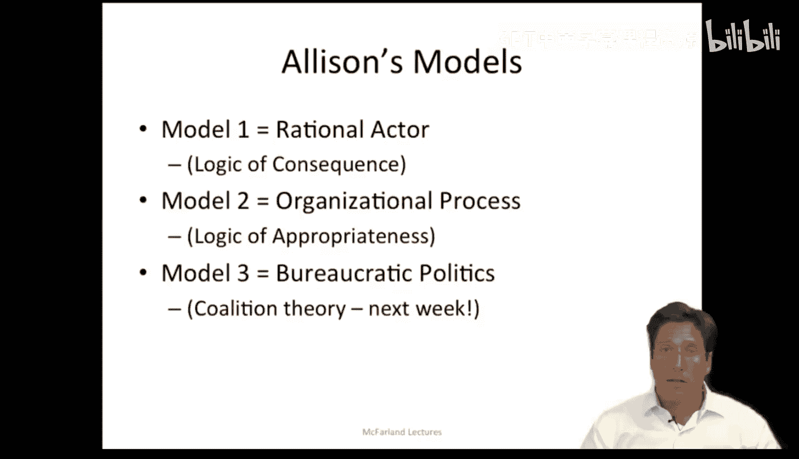
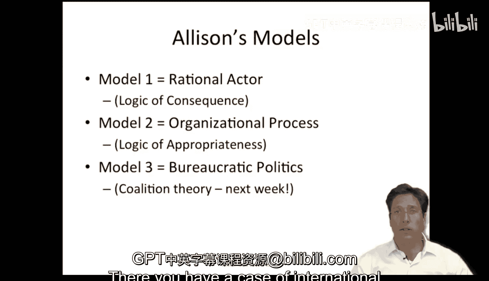
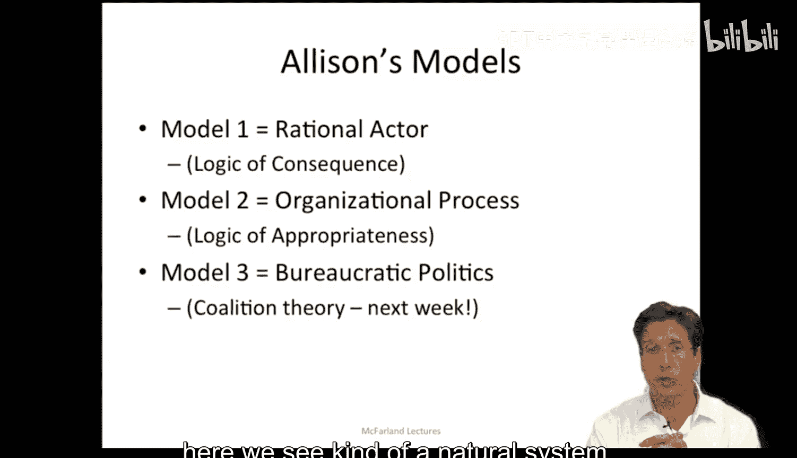
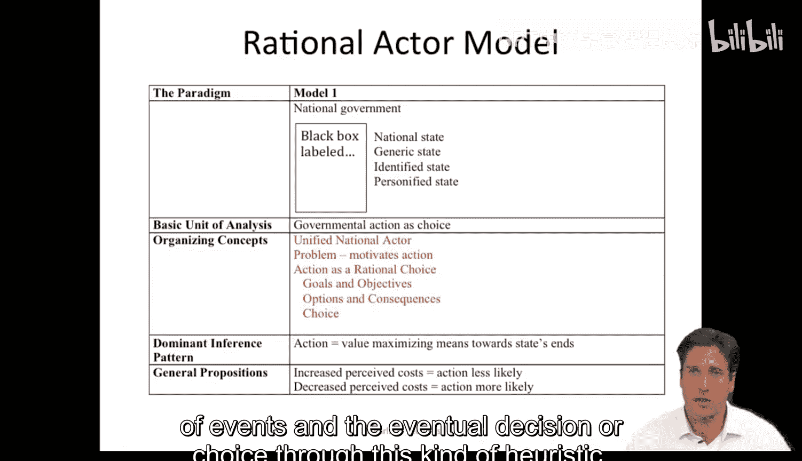
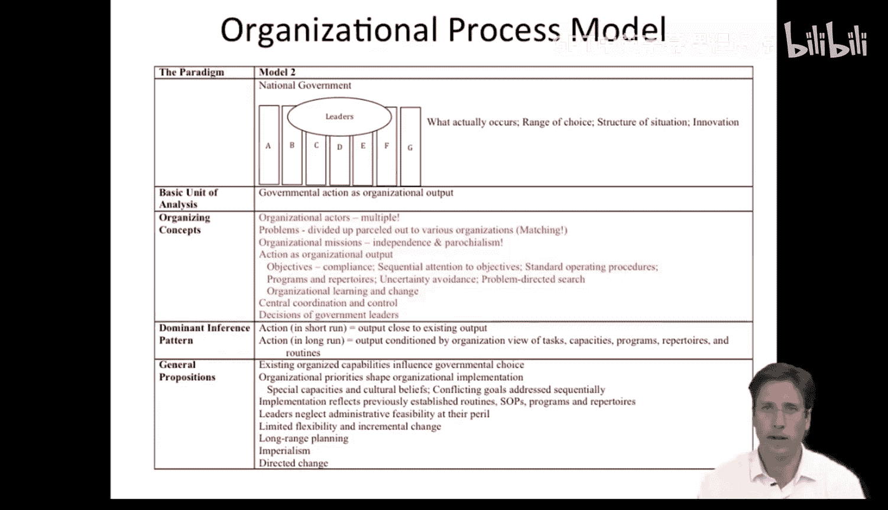
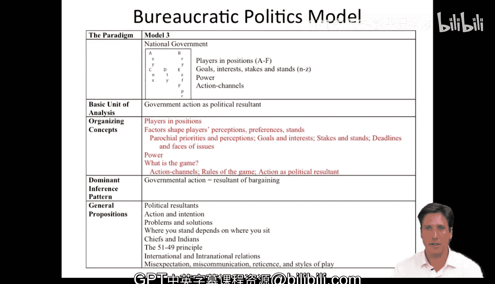

# 斯坦福大学《组织分析｜Organizational Analysis》中英字幕 p15 015_02_04_第五讲-案例：古巴导弹危机-第二部分.zh_en -BV17J4m157qN_p15-

There you have a case of an international dispute crisis that almost led to war and the kinds of actions that occurred during this conflict Allison does this interesting thing which is very emblematic of the kind of ambition this course has in terms of applying multiple theories to the same phenomenon and coming to very different perspectives of it and in so doing he comes to a deeper understanding of what happened that can inform policy experts and people involved in such crises so Allison presents three models in particular that he thought were the prevailing models that analysts would use at the time the first was the rational actor model which as we said in a prior lecture dealt with the logic of consequence the second model concerned organizational process which really is characterization of the logic of appropriateness。

That Jim March related and then the final model was called bureaucratic politics and here we see kind of a natural system。

 a dynamic coalition kind of view， something that we'll actually approach in more detail next week When we use the rational actor model。

 we assume every action has a purpose or goal behind it。

And we reconstruct action accordingly， thinking people are intentional。Looking at the table。

 we see the basic organizing concepts for the rational actor model。

 Let me deconstruct what that means for the Cuban Missile crisis。 First， if we look at the actor。

 we know that the unified national actors United States in this case from Alice from Allson's perspective。

 the problem which motivates action is that the Soviet move in the Cuba with missiles and bombers requires a response。

Now if we then look at action as a rational choice。

 we have to break it down further according to Allison。

 so here we look at the goals and objectives and the clear objective here is national security。

 the options and their consequences basically concern the courses of action available。

 the ones they consider and the results that could arise from them。

 so let's think about what those were in the case first one option is do nothing and there's a cost here。

 the Soviets outflank the early warning system， they reverse the United States advantage of power at that time。

 America loses credibility in Europe and so on。Second。

 we have another option which is we can make a diplomatic response。

 and the cost here is that the UN veto is probable because the Soviets hold a seat， time matters。

 and the missiles are already deployed， so we can't really wait。

A third option is that we approach Castro。And the cost here is that the Soviets are in control of the missiles in Cuba。

 so Castro's influence is somewhat moot， it seems。The fourth option is to invade。

 and the costs here are that the Soviets could parallel with an invasion in Berlin or a retaliatory strike is possible with nuclear weapons。

A fifth option is an air strike。 And here， their cost is the probability of knocking out all the nuclear weapons is 90 per cent since they're spread out all over the island。

 Moreover， retaliation is is highly likely and a massive strike would be needed to make that succeed。

 So there is big risk there。The sixth option is a blockade。

 the cost of the blockade is that they could retaliate with a blockade to Berlin。

The benefits are that you get extra time， you can get Khrushchev to think and consider that a nuclear Holocaust is possible here and last a naval engagement in the Caribbean actually favors the United States in this circumstance so what was the actual choice if we did a decision tree of all these things and we looked at value maximization。

 it would reveal that the blockade is the solution， but why。Well。

 consider the decision trees earlier， if Armageddon occurred。

 the costs to that are so high that even if it is highly improbable。

 it's likely that the actors will not select that as their choice so from a rational actor model。

 we can see somewhat how to interpret the series of events and the eventual decision or choice through this kind of heuristic。

Now let's consider the organizational process model in the diagram next to me here you see a schematic of what that looks like and it's greatly based upon Allson's work in 1971 page 256 or something so how does organizational process apply。

 there are multiple organizations involved here and each has their own identity and standard operating procedures by which they handle different parts of this problem that the United States is confronting。

 so the actors are really a constellation of loosely allied organizations， not a unitary actor。

In addition， the problem isn't confronted as one thing。

 it's confronted as something that's parsed up or cut up and parceled out to various organizations。

 so here we see instead of a logic of consequence and the clear schema of a rational actor model that mirrored that we now see a logic of appropriateness and there's matching。

So let's think here for a moment， if we're limited problem solvers too。

 the organizations have developed the capacity to do something better and by experience so to some degree that's why we rely on organizations we cue them to do the things that they have always done and are good at and by doing that we get something accomplished better According to this kind of theory so let's go down the list here what are the missions and capacities that this model perceives it's going to see that each organization's kind of quasi independent。

And it's going to conduct affairs according to its own missions and interests。

 So this is what leads to organizational parochialism that the organizations aren't just out for some goal that we all share。

 but but also their own interests action here。Is an organizational output。

And it arises when organizations act out their pre establishedlish routines。

So as I go through this list here of objectives， programs， et cetera， let me rattle them off。

The organizational objectives， you should think of them as kind of constraints that define acceptable performance。

Each group is going to have their own missions objectives and meeting them defines whether they did it right or not。

 The existence of conflicting goals across these organizations or even in accomplishing the tasks leads them to give things sequential attention right the organizations too rely on standard operating procedures。

 which means they have these built in routines that they tend to train on and they follow repeatedly。

 and they get good at it their programs are clusters of these standard operating procedures。

 So fighting， for example， entails a series of these tasks that are coordinated。

 The organizations engage in uncertainty avoidance so they kind of ignore details have systematic contact and conventionalized means of processing information All of this leads to kind of distorted information that they get So what the CIA gets or what the Navy gets as information is distorted through their channels and their routines。

They then perform kind of problem directed searches and this is led by organizational routines and kind of has a local neighborhood focus so they focus on kind of what they're used to seeing and what is common to them seventh is kind of coordination and control and it's a problem they have to coordinate across different organizational enactments of distinct standard operating procedures and their clusters so how to get them to work together is always a challenge that if the Navy does one thing and the Air Force does something else do they line up well or do they do them at the wrong time and then last what do executives do they merely call into play different organizations and their standard operating procedures according to this model so。

I may have lost some of you here because that's quite a bit of jargon。 so let me give you an example。

 An example of this model occurring is that it took a long time for the report on sighted missiles to reach the president the information was lost in tons of inaccurate information and the transfer took a long time because people followed standard operating procedures within their organizations。

 So for example， the first sighting of the missiles was on September 12 and then September 19 information suggested the presence of the missiles they started to report it more and on October 4。

 they think the missiles are there and then there's a territory dispute between the Air Force and CIA as to which one will get to do the flyover and there's a mechanical delay that they have to ground the plane only to have an October 14 flight that finally confirms the presence of these missiles and they informed the present。

 that's a full month that was lost there。 another example of organizational process model。

Was when the Excom leaders are acting as organizational representatives。

 Each one is asked their opinion in those meetings and they respond as a representative of say the Navy or the Air Force and whatnot。

 And they state what someone as a representative would do。 So， of course。

 the Air Force people say that an airstrike and the Navy says blockade。

 and there are problems with each proposal， of course。

 and the Air Force can't guarantee success only 90% and Kennedy has an identity issue with Pearl Harbor the Navy couldn't do a block could do a blockade。

 but they did it their way 500 miles out the way they had trained to do it instead of 180 miles off the coast as commanded。

 And even after the president got angry about the fact that they were in the wrong place that was difficult to change。

 So simply put the Navy followed their standard operating procedures。

 So quite a bit of the behavior in this kind of event or。Cycle of events。

Was guided by organizations doing what they do。 They follow their routines。

 The third model now is the bureaucratic politics model。 So how does it apply？

 The bureaucratic politics model asks the following。

 Is the government composed of multiple actors with different problems and objectives。

Is the choice and outcome of bargaining games that unfold over time。

Was power and skill a factor that was involved？Were there compromises？

What distinct or overlapping games were it play？And who are the leaders， followers？

Staffers and ad hoc players in all of these events。So。Multiple players were there。

In the series of events， and they of course， had different perceptions， different priorities。

 and they focused on distinct problems。For example。

 the Air Force and army had very different views of the atomic bomb the Air Force saw it as something positive and the army saw it as something negative probably because the army has to go in after and the Air Force sees it as some kind of effective success that they had in the past Of course these are relative judgments all these players contribute pieces to this puzzle and they're compiled over time into different arrangements and outcomes so think of it as a loose coalition or agreements that come and go had different players been involved the outcome of the Cuban missileile crisis probably would have been different and had the timing of series of events that pushed consensus or the decision process that might have also altered the outcome as well a key feature of the bureaucratic politics model are points of leverage as well as the personality。

And very various interest coalitions that form to create this kind of politic how people negotiate posit claims and thwart or work for them is how these temporary agreements arise and force a decision so for example。

 let's take the actors and their stances to give you some sense of what this means concretely so Kennedy his weak spot was that he had sent in the military to the Bay of Ps in 1961 and it was a fiasco it was a disaster so he had parochial interests at stake。

 which was he wanted to get reelected and he couldn't fail and seem weak on Cuba again the military on the other hand wanted to repprise the Bay of Ps and succeed so what arose there were kind of in this series of events was two coalitions of sorts。

One formed around the decision to go for a blockade and another that formed around an airstrike。

 and one coalition was formed when the secretary voiced that a Holocaust was a potential result。

 and so the President， RFK， Robert Kennedy， his brother and，McNamara。

 the Secretary of Defense and Sorenson are all for the blockade。 So that's one group， right。

 In contrast， you have six chiefs of staff， including Mcconone， Rush， Niska， Nitsky and Atchison。

 and they all wanted an airstr。 And this other coalition fell apart due to a lack of guarantee the problem of retaliation and Kennedy's concern。

 a parochial concern to a great extent of mirroring Pearl Harbor。

 So you have these kind of politics going on。 And these the interests align in odd ways。

 So the bureaucratics politics model assumes a variety of views and their alignments in different camps right。

 and these camps then duke it out， basically。And that's what leads to the kind of result that we see。

