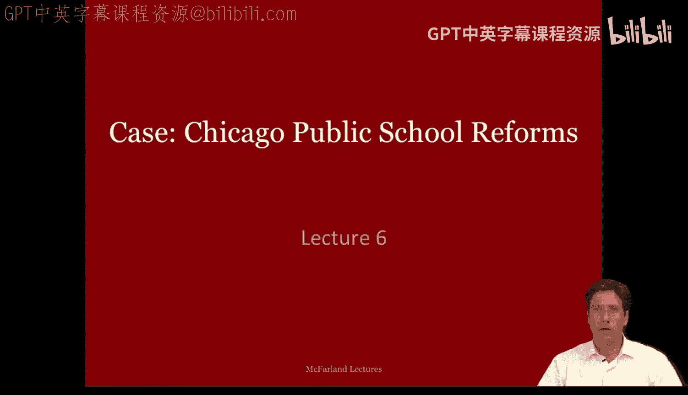
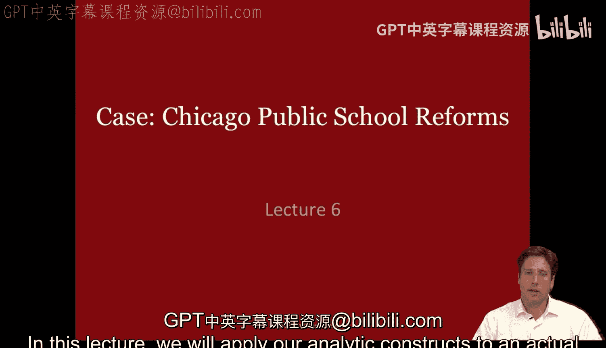
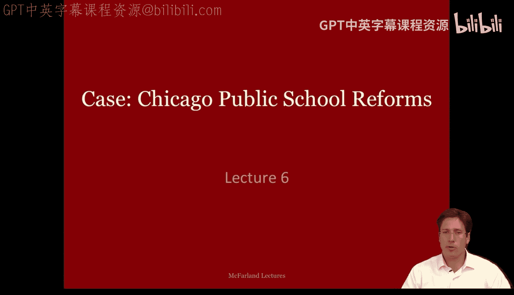
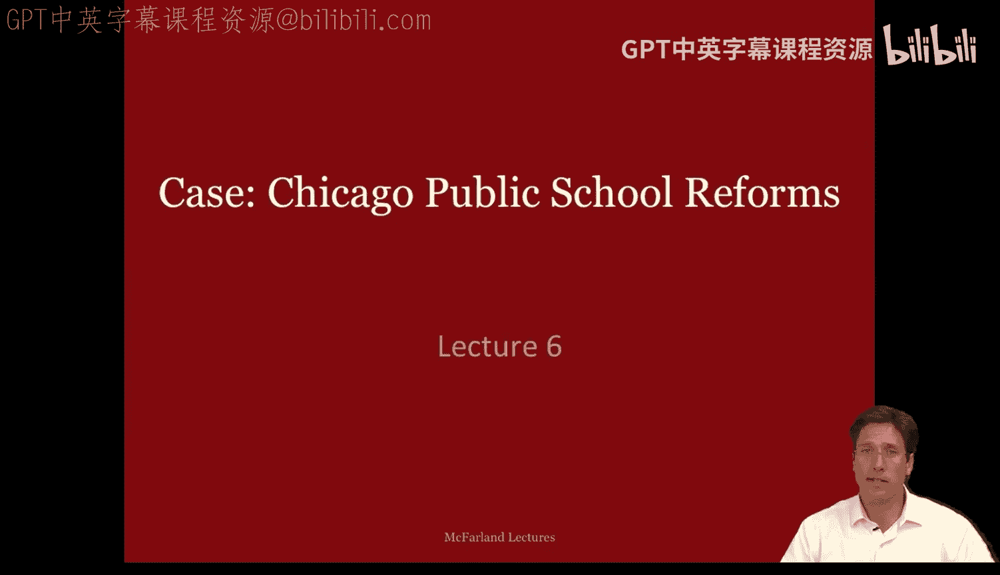
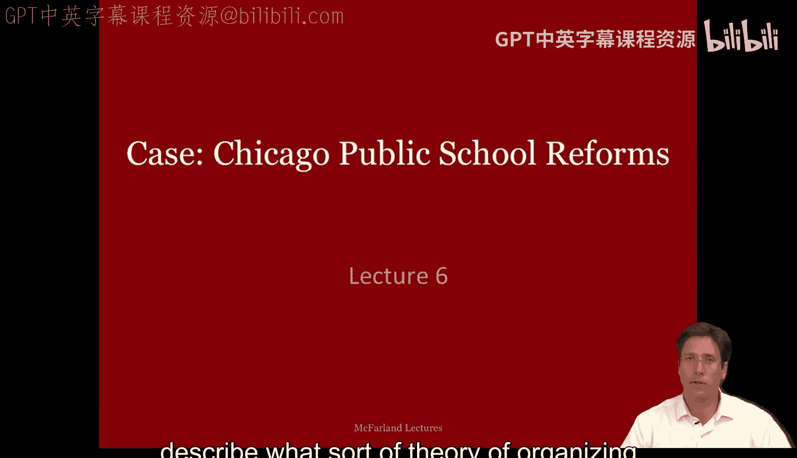
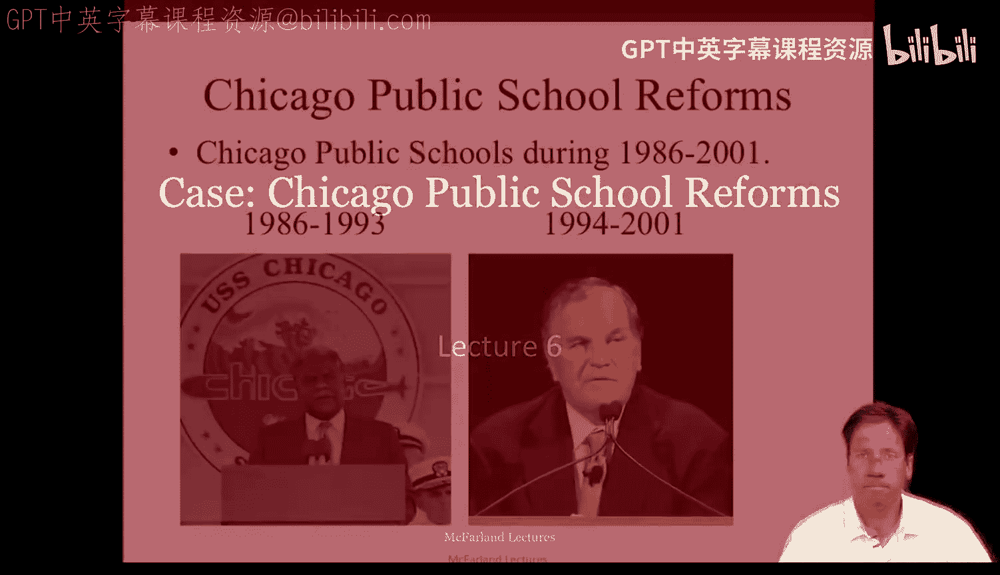
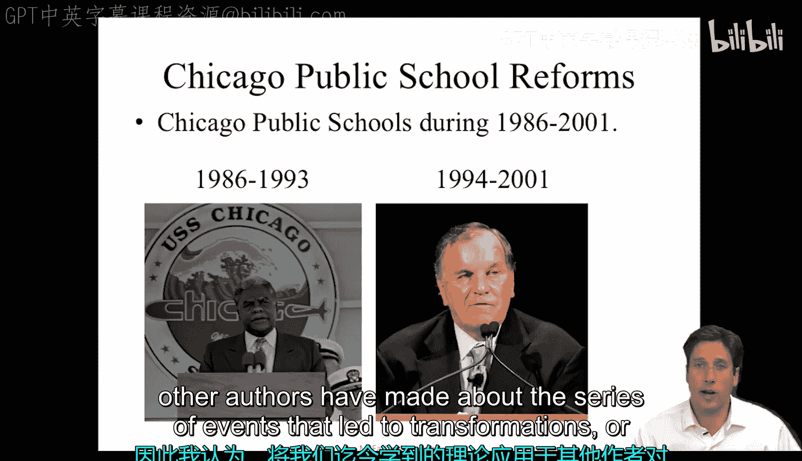
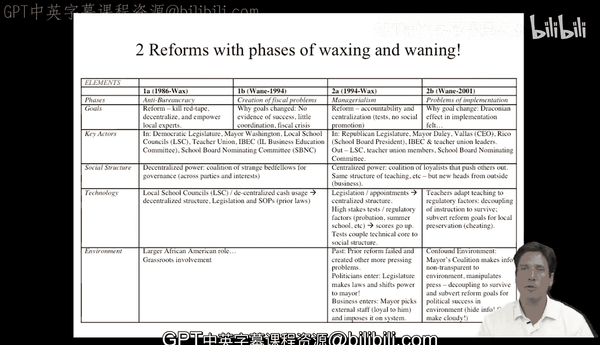

# 斯坦福大学《组织分析｜Organizational Analysis》中英字幕 p17 017_02_06_第六讲-芝加哥公立学校改革-第一部分.zh_en -BV17J4m157qN_p17-

In this lecture。We will apply our analytic constructs to an actual case of an organization undergoing reform。

 To do this， I will first recount the organizational elements presented in the last lecture。

 Then I'll summarize the case。 And finally， I'll identify the elements in the case and describe what sort of theory of organizing as implied by the author's account。

The case that I'm going to talk about。Concerned Chicago public schools during the time period of 1986 to 2001。

 it spans two different mayors， mayor Washington in the early period and then mayor daily in the later period as these two reforms occur there's shifts。

I think you'll find it insightful in terms of applying the kind of theories we have so far to these elaborations that other authors have made about the series of events that led to transformations or efforts at transforming the Chicago Public schoolss the case materials that I'm drawing upon are the readings by Dorothy Shippps and Anthony Bke。

 and they basically concern this entire period。

嗯。As you'll see， the two reform efforts have kind of a period of wax and w where you have a shift in terms of how they。

 the coalitions or the groups or the organizations that evoke routines and rational actors involved kind of。

Arise in a certain beginning of that period and try to implement， and then as they implement。

 you see this kind of waning。Into a different era where all kinds of problems。

Come up and lead to a shift。The basic changes that occur were an initial effort at。

antti bureaucraccy and forging managerialism or accountability。

 so you have these two phases and they're proposed as different means of solving the problem of low achieving schools in Chicago。

The case。Rlates key stakeholders and groups。Their interests and relations and their responses。

 so both readings kind of elaborate features of this that allow us to kind of see。

 at least with some depth how our different models or theories could be applied or help us understand what happened。

So it's a great case by which to kind of try to apply our analytic constructs and theories。

Let's begin with the first period where Mayor Washington was in charge。

So here I made a quick table that goes through the key elements。

 organizational elements and the two periods of wax and w that are depicted in the case。

 So the first phase is kind of all about anti bureaucracy and the kind of goals that are talked about are killing red tape。

Decentralizing power and empowering local experts， right？Later in this kind of phase of reform。

 there arise other problems like fiscal problems， right。

There's actually some kind of question as to whether those reforms of killing red tape and empowering local experts actually did anything。

 so they the reason for the w was people came to realize there was little evidence of success and little coordination and a fiscal crisis that precipitated an effort to do things more efficiently。

Now the key actors at this early phase was there was a democratic legislature。

 Mayor Washington was a key player， of course， and then the local school councils were a key conduit through which decentralization and empowerment of local experts could occur。

There were also teacher union of course， is pretty powerful group in Chicago， IbeEC。

 which is the Illinois Business Education Committee。

 that was pretty prevalent and had been there for a long time committee of business leaders who wanted to see the education system create workers that they could use in all the businesses of the area。

 and then there was a school board nominating committee。

 which I believe nominated principles and the like the social structure so those were the key players。

 the social structure was kind of decentralized during this period so the coalition occurred for governance across parties and interests in the local level down at the wards and the like it was a time period of。

Decentralization in chi。The technology or the tasks that were being applied to accomplish this was really a governance or an organizational reform right were local school councils and they decentralized cash usage to those councils right and the legislation and standard operating procedures were things that were kind of evoked during that period。

Finally， the environment in this period was one where Mayor Washington as an African American。

 empowered African Americans in the community， and there was grassroots involvement in schools。

 it was considered to be somewhat of a renaissance for Chicago in these regards。

In the second period we have Mayor Daley and Mayor Daley was in charge during 1994 to 2001 period that these texts talk about。

 and the general form that was presented after this fiscal crisis and a concern of all these problems of inefficiency and no evidence of improved achievement that there was a push for accountability and centralization you know they didn't want to just socially promote students to make them feel good。

 they wanted evidence and so this effort to create a new phase of reform was geared toward managerialism or centralization where business leaders and experts of how to run organizations came in and tried to guide the public school system in a different direction now toward the end of this period of course。

 you the reform itself came into problems too。And the basic reaction was on the ground floor that there was a dconian effect of the implementation and teachers and schools were adapting to these new regulations in a way。

That kind of countered the spirit of the goals of。No social promotion and testing by cheating and whatnot。

Now the key actors in this phase had shifted， they were no longer a democratic legislature。

 it was now a Republican one and the mayor now was mayor Daley。

 which is a former legacy of his father who was also a mayor there was now a CEO they had centralized school authority under Valas and Rico was a school board president and Ibeck was still there and the teacher union leaders were still there。

 so you had some of the players had changed in terms of who had access to power and clout and it's partly because the legislature decided to give authority to daily and Da assigned a CEO to run the district and so it was a much more centralized structure away from the local school councils and this led to certain players being more important than before。

So of course the people that are out， local school councils out， teacher union， somewhat out。

 the school board nominating committee as well， they had less authority， they were circumvented。

Now the social structure， like I said， was kind of centralized power。

 so you had a coalition of loyalists to this cause that pushed others out and the same structure of teaching was used。

 but now you had where teachers did the work and educators were implementing this。

 but now they kind of took over the administration with business individuals with business training。

 and the argument was that this kind of managerialism that could be brought into an education system would improve it。

So the technology here， the task， which altered this governance structure。

Was kind of legislation and appointments， so the state legislature had control over budgets and gave that budgetary power to the mayor and asked made him accountable with appointments and whatnot so it was a centralized structure that was imposed to develop this kind of effect on the system。

 so what occurred was high stakes tests regulatory factors like probation for students that didn't achieve they had to go to summer school if they didn't achieve at a certain level scores went up of course。

 but tests of course。Also were kind of coupled more to instruction as well。

 so teachers started to teach the test and so there were certain kinds of reactions。

 so this is considered to be kind of recupling of educational institutions with the leadership efforts that they kind of drive down into the technological core of teaching or instruction。

Now， of course at the later period of the reform the teachers adapt to this regulatory factors and they start to subvert the reform goals to preserve themselves and their careers and their jobs and even students self-esteeem and whatnot。

 and so you see teachers cheating on these tests， you see students that repeatedly take the test score of course get better。

 and so there's all kinds of issues as to whether the system adapted to the reform so that it could demonstrate success。

 even though its kind of surface level or not possibly even true。So finally。

 the environmental elements we could look at as。In the past you had kind of prior reform that failed。

 so here's an effort to kind of correct that and pressing problems of fiscal issues right so politicians enter to deal with this crisis and the legislature makes laws and shifts power to the mayor and of course business enters because the mayor picks external staff and they're loyal to him and he imposes this kind of administrative unit on the system。

Over time though in the later phase the waning of this reform。

 the environment kind of confounds things， the mayor's coalition makes information non-transparent to the environment right so they claim successes even though there's all kinds of other evidence to the contrary they manipulate the press in terms of kind of reporting good news but hiding the bad this kind of decoupling managing the environment to survive even when it wasn't true in some cases to subvert reform goals for political success so they could be reelected and so on so you make information cloudy in some cases and then hide it in others that aren't very beneficial so we had this kind of interesting account of the waxing of a reform and two periods and this waning in two periods and shifts in leaders and what have you right？

So the general change， though， if we think about it is really a shift here， I mean。

 this is a schematic of a decentralized structure on the left。Or。On my right。

 whichever it's the one with the little stars in it and then a centralized structure which is kind of one that's focused on a particular individual and everybody reports to them and it's a typical phenomenon in a lot of reform efforts in organizations that when there's crises or problems there's an effort to centralize efforts and when there's an effort to coop groups on the shop floor the ground floor in the society and community or in the environment you decentralize them to build up kind of buy- in so these two different efforts really reveal different kinds of managerial strategies and efforts to accomplish reform。

Now of course， if we combine all these phases into one table。

 it's useful to someone like me and possibly to many of you， but it's a pretty dense table。

 but you see all the features of the kind of narrative and the actors， the goals。

 the social structure， technology and environment and it's kind of useful to see it all lined up as an analyst。

