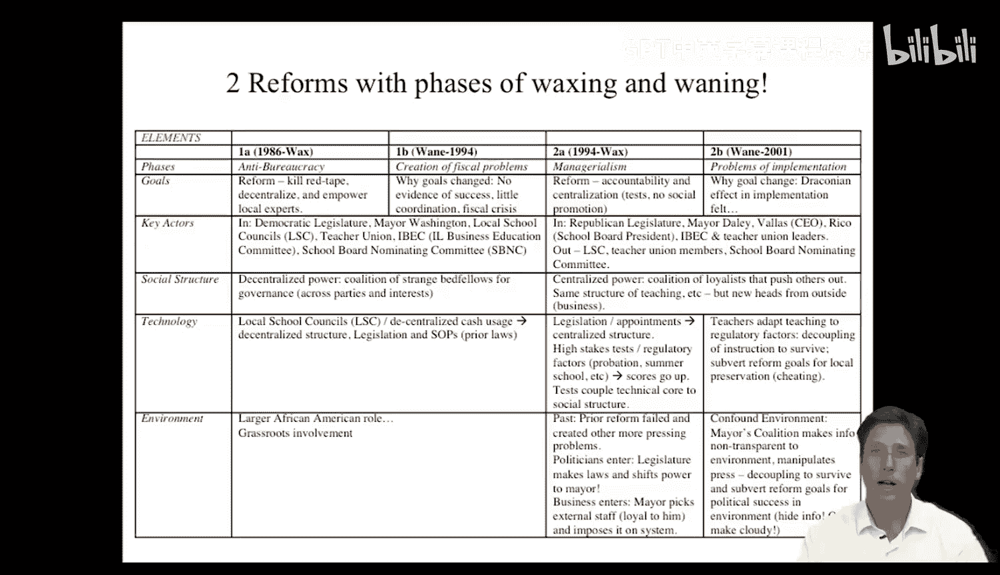
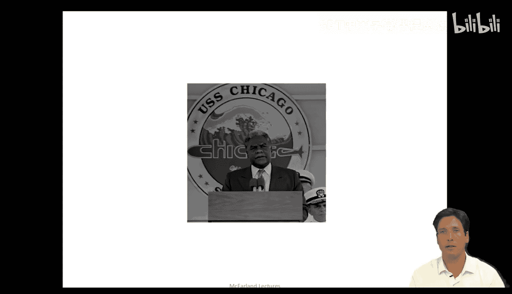
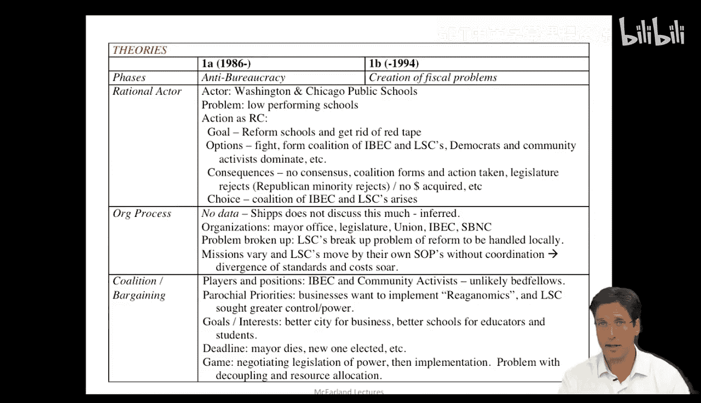
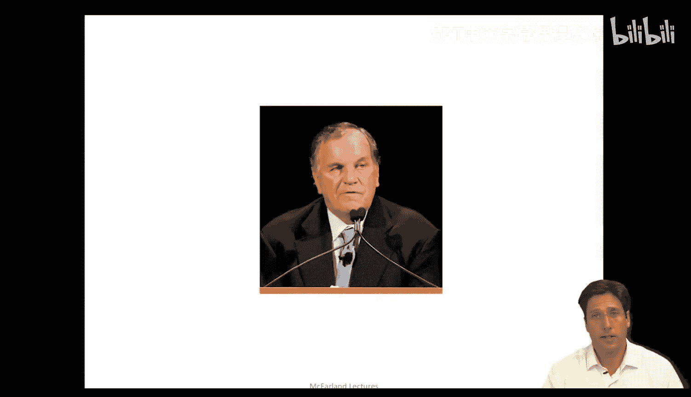
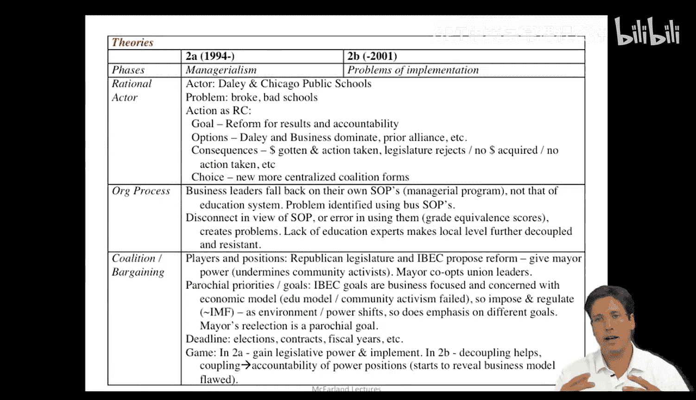
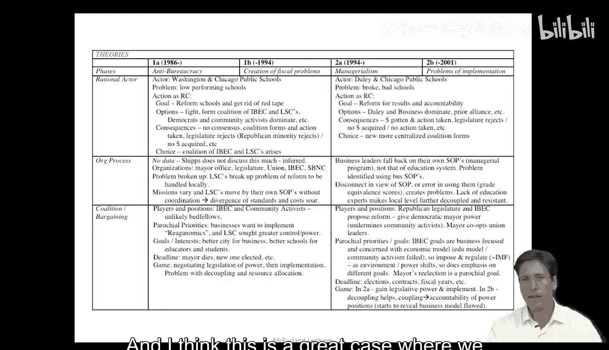
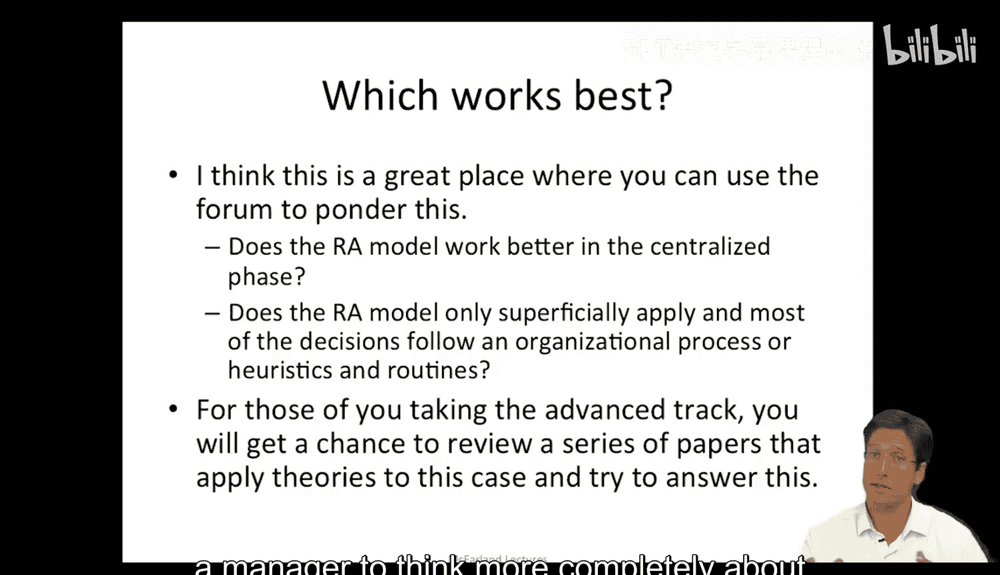

# 斯坦福大学《组织分析｜Organizational Analysis》中英字幕 p18 018_02_07_第六讲-芝加哥公立学校改革-第二部分.zh_en -BV17J4m157qN_p18-

Now that we have all the organizational elements kind of mapped out in some terms for this case。

 let's start to think about the analysis。 So again。

 let's start with the first era of Mayor Washington。

 Let's apply each of our models to the case of Mayor Washington。

And his effort at reform is centralized。Yeah。So the first phase here of anti bureaucracy。

That kind of waxes and wanes。 if we applied the rational actor model。

We would have a focus on particular actors like Washington and the Chicago Public schoolss。

 the core problem would be low performing schools。The action is rational choice would break things down as follows that there's a goal which is to reform the schools and get rid of red tape。

That was regarded as the problem that was preventing achievement and preventing buy in in schools。

The various options that they can consider were oh let's fight this reform effort or fight each other in terms of seeing what kinds of resources are allocated where so like the legislature versus the businesses and whatnot。

 they could form a coalition is another option between IBAC and the local school councils。

 the Democrats could form a coalition with community activists and dominate because the Democrats were in charge。

 but there were clear consequences to each of these options right so if you fight between groups or interests。

 no consensus is had and that just creates a difficult environment for every side。

 if you form a coalition and take action like with the IBAC and local school councils that makes some sense there may be certain kinds of costs to that it may offend the legislature in power don't know。

I don't know what the risks or the probabilities of success are here。

 there's some ambiguity and I'm boundly rational。Another option is the legislature rejects everything。

 so if we don't try to work with the Republican minority， you may not get any money。

 it may not get allocated， there may be a filibuster for all I know and so to some degree we can kind of predict how certain camps will behave depending on the kind of options before them so the choice in using this model if we were to apply it might be that it provides us some insight into why the coalition of IBAC and the local school councils arises that you have this kind of grassroots business and community kind of collaboration and it serves kind of as an antibueaucratic kind of localized effort so it might be the most viable choice that avoids kind of lack of consensus or even kind of domination of one group over another these are the constituents of legislatures after all。

Now if we look at an organizational process model， it's not as clear that this case or their write ups afford much detail。

 they don't discuss standard operating procedures to a great deal so we kind of have to infer some of this Now the organizations involved are things like the mayor office。

 the legislature， the union IBEC SBNC all those features that you saw on that table before and we can imagine that the problem is broken up right so the problem of low- performingform schools or red tape that's in the way offf it's inefficient that the local school councils。

They break up。🤢，The problem and they reform and so they can handle it locally， for example。

 So instead of it being an entire Chicago problem it's actually these little district problems。

 so that's actually kind of how it went down the missions vary and the local school councils move by their own standard operating procedure。

 So what happens when you decentralize a problem and you coordinate locally is that each of these pockets kind of comes up with its own way of dealing with things and you have a divergence of standards and often it's not replicable in another community so costs soar to some degree and the coordination across them grows difficult it appeals to the local context but it doesn't necessarily make for an efficiency solution。

Now， if we apply coalition and bargaining。We have a different perspective as well。

 so we have to think about the players and their positions so IbeEC and community activists have parochial interests right the IbeEC wants business。

 the community activists want their kind of communities to do well so they kind of were unlikely bedfellows in a way because the community activists want to generate their neighborhoods and families and serve the interests of the local schools。

 IbeEC might actually not have such localized interests if you think about them as larger corporations within Chicago but this seemed to be that they had the redevelopment of Chicago in mind as a means of not only making for better schools and trained employees but also for better business so in some ways they kind of even though the community activists might have been。

Very clearly， liberal Democrats and business leaders。

 Republicans formed kind of a set of joint interests that they could form a coalition around。

Now the parochial priorities is that the business leaders wanted to implement reaganomics which was kind of a hot thing back in that day and which was kind of a less government。

 less， et cetera， idea and the local school councils really sought greater control or power they wanted to be the masters of their own destiny in their neighborhoods and their neighborhood schools and so these were kind of of。

Similar but parochial priorities that were somewhat distinct。Goals and interests。

 the goals and interests were a better city for business， better schools for educators。

 students and families， so those were kind of the common goals during this period。

The deadline and again this is all I'm just rattling off things that each model will press you to perceive right or demand that you consider right so in terms of developing that kind of perspective of worldview I'm just kind of listing these off so the deadline of course is in the case of the first period is that mayor Washington dies right it was an untimely death and unexpected and this led to a new election and a shift toward recognizing problems and what have you in addition there were different games going on during this period so there was negotiating legislation of power and implementation we implementing local school councils dealing with who gets to handle the budgets。

These were kind of different concerns。There was a problem。

With the coupling and resource allocation to some extent。

Deupling from power and regulation and then resource allocation of funds right and implementation。

 so there was this kind of series of distinctive games that one might have been more prepared for like power sharing and legislation of power but not prepared for the implementation and the fact of assessing or seeing whether these local school councils。

 the coalition actually was effective in making the schools better performing。

So they seem to be better in that first phase than the latter。

So let's consider mayor dearley's era as well。

So here we have managerialism right so of course Mayor Washington dies and then we have this election and mayor Daley comes into office and the same time the legislature in Illinois turns Republican etc etc ce and all kinds of other problems like a fiscal crisis is occurring in Illinois and for their Chicago at that time and so they had to decide where to put their dimmes and what would be the most effective means so if we took a rational actor view here daily in the Chicago Public School system was centralized so it's much more of a unitary actor the problem was the schools are broke and they're not very good in spite of having these decentralized structures。

So as a rational choice model， the goal is to reform them for results and accountability to make them better right and Daley's options were he could coordinate with business and dominate。

 he could fall back on the prior alliance between local school councils etc and the consequences of each choice or each kind of option。

 it was different so you know if he gets kind of certain options。

 he'll get money he might be able to take action if he falls on the prior alliance with local school councils。

 the legislature might reject his ideas or his efforts in the Chicago schools and no action is taken and without funds。

 so it was clear that he had to do some kind of distinctive coalition or distinct kind of decision here。

And the choice was obvious to go with a more centralized coalition with business leaders and a means of accountability that was more efficient than managerial than a local decentralized school council effort。

Now the organizational process model of course had all kinds of organizations involved so if we apply this kind of model here we start to see things very differently。

 the business leaders of course fell back on their own standard operating procedures that's where they came up with managerialism right they didn't adopt the perspective or the standard operating procedures of the school system instead they adopted the kinds of procedures they used for managing businesses right and so they basically fell back on standard operating procedures they were familiar with。

嗯。There is a disconnect in the view of standard operating procedures or an error in using them。

 so this kind of creates problems so the educators didn't understand the standard operating procedures that business leaders wanted to impose in the education system and in addition the lack of education experts at the top of the managerial system led to kind of decoupling of understandings and familiarity with routines。

 so from an organizational standpoint this later period of mismatch across organizations or organizational routines from different kinds of leaders kind of helps explain the phenomenon。

And then finally， a coalition andbaring perspective also highlights certain things。

 so here we see that certain players and positions matter。

 the Republican legislature and IBAC kind of form they propose the reform and they form a coalition of interest even and the mayor kind of plays into this and is given power。

 this completely undermines the community activists。

 they're pushed out so and the mayor coops the union leaders in various ways as you read the case。

There are parochial priorities going on， so IBC's goals and are for business and they're concerned with an economic model。

 they feel that an educational model and community activism failed so that this new model should work so they impose and regulate but as the environment and powership so does the emphasis on different goals。

 so you know in each phase when there's an election you see the mayor fall back into more parochial interests and then once it's over this kind of other kinds of group's parochial interests come into play so there's a little bit more of a dynamic it's not just an organization as an actor。

 it's an organization as having shifting interests depending on the timing and the parochial interests of those leaders。

So the deadline， of course， here using coalition and bargaining are these different elections。

 contract renewals， fiscal years， when the budgets get done。

 those things kind of have these punctuated effects on relationships and interests， right？

Now the game， and there's various games at foot， like how people will bargain with each other， right？

That's the kind of idea of coalition or the bureaucratic politics model。

 So what we see is in the initial period is that that the game is to gain power。

 that the legislature wants to form this kind of reform that will change the system for the better and centralize authority and if they give money to the mayor that they can hold the mayor accountable and if he fails。

 he can be stopped from reelection etc。 in the later phase， decoupling actually help。

 So instead of linking things closely in the first phase now in the second。

 because if things don't go well， if they don't show results that will。Fit the accountability model。

 they start to hide it and this starts to reveal that the business model is flawed so they try not to show that and through interactions with the media and press reports。

 they try to withhold certain kinds of information that might show that the model was not as effective and this for parochial interests。

 the mayorors trying to get re-elected so are politicians。

And so it's not just a matter of meeting the goals or enacting standard operating procedures that fit different groups。

 now it becomes adapting the kind of implementation for different purposes and the reporting of their accomplishments for different purposes than maybe are the shared goals of all the actors in that coalition or in that group。

 it may fit certain ones at certain times more than others。

 so each model kind of has an applicability here。

And if we line them up again， we can see kind of how they all compare and which one seems to have certain narratives in certain eras over others。

So again， we come to this question of which works best？

And I think this is a great case where we can use the forum of the course to ponder this question。

 you know we can ask things like does the rational actor work better in a centralized phase like dailies or does the rational actor model only superficially apply and most of the decisions followed an organizational process model of heuristics and routines for those of you taking the advanced track of this course。

 you'll get the chance to review a series of papers or grade them？

That actually apply theories to this case， the case in Chicago Public schools。And。

There you'll see the authors trying to answer this question， so rather than me telling you。

What the right answer is， I think it's best to leave it up and see how you guys kind of negotiate。

Trying to implement these theories， two actual cases and seeing evidence for one over the other and possibly arguing that these theories might work either a different phases or circumstances or as compliments in some way to one another to afford a richer understanding of how this Chicago Public school reform manifested and died in each phase and also just how possibly those kind of perspectives might enable you as a manager to think more completely about a problem and plan for the best and worst。

6。