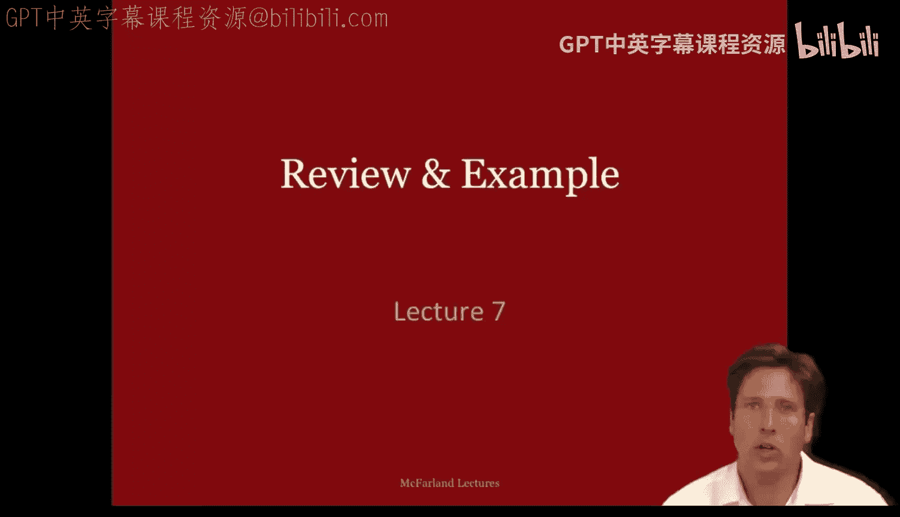
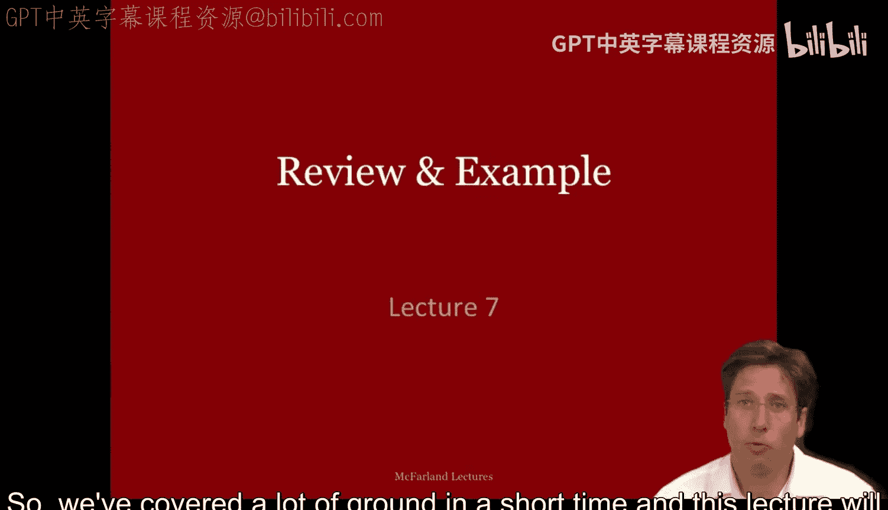
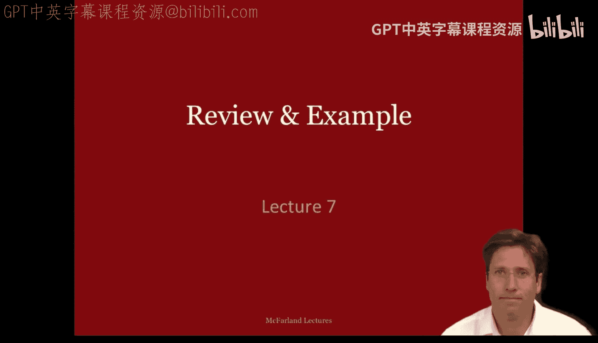
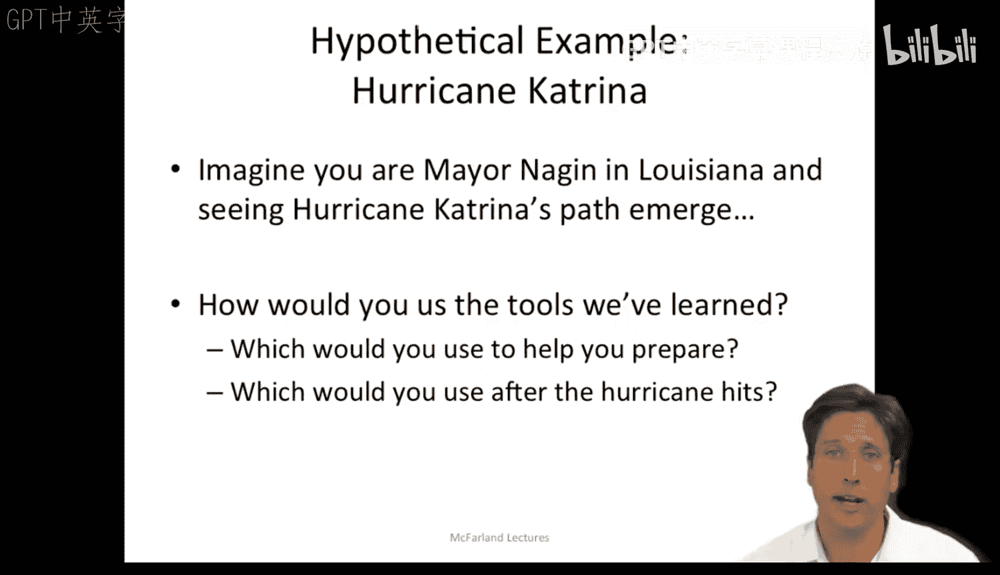

# 斯坦福大学《组织分析｜Organizational Analysis》中英字幕 p23 023_03_01_第七讲-回顾与案例-第一部分.zh_en -BV17J4m157qN_p23-

So we've covered a lot of ground in a short time and this lecture will briefly review the theories we've read so far by applying them to a new example。

Thus far in this course， we've covered three theories。Rational actor model。

Organizational Pro model and the bureaucratic Pol model。

And we've applied these theories to cases like the Adams Avenue School， the Cuban Missile Crisis。

 and the Chicago Public Schools reform efforts in the 1990s。

If we line up these theories side by side， we can see how they compare now in the table next to me。

 much of this is review and covers the last two lectures。I'm not going to review all that here。

 but I want to draw to your attention this kind of handout which you'll repeatedly see over the course of this course in the end hopefully you'll have a summary table that covers all nine theories and shows them in comparison as a quick reference for your kind of work and concerns。

For the purposes of this lecture today I want to highlight how each theory implies certain management strategies。

 so the first column at the bottom there shows what you would do as a rational actor and what you want to do is you want to consider alternatives and their consequences。

 you'll want to improve the quality of information you receive so you can make a wise decision based on the consequences you expect each option to have。

Now as a manager of organizational processes， you'll need to know what organizations are involved。

 what standard operating procedures they have in place。

Then you need to assign the pieces of the problem to those organizations that they are best suited for。

So your job is to match pieces of the problem to organizations capable of addressing them。

Now as a manager of bureaucratic politics， you're more of a negotiator， you'll identify key players。

 learn their interests， points of leverage and weaknesses so you can successfully bargain with them and acquire their support。

 you'll work relationships and alignments to your advantage so each theory implies a different sort of managerial strategy and with that in mind let's consider a new case and use it as a thought experiment for trying out these managerial styles。

With every new example we consider， hopefully we' form a concrete sense for how to apply theories to real world cases in this lecture I want to take the example of Hurricane Katrina。

 which hit the city of New Orleans in 2005。Hurricane Katrina was the costliest natural disaster for the United States。

 it's estimated at $81 billion in damage and in its wake over 1800 people died。

 80% of New Orleans was flooded and lawsuits were filed afterwards against the US Army Corps of Engineer who designed and built the levy systems that failed and there was an investigation into the responses of federal states and local governments and this resulted in the resignation of the federal emergencyency management agency's director。

 FEMma's director Michael Brown and the New Orleans Police Department superintendent E Compass。

 several agencies performed well and were commended such as the U Coast Guard and the National Hurricane Center。

 Now I know it's an event that's already happened and there's been a great deal written about it online。

 I also know we have 2020 vision and hindsight， but it's often hard to acquire adequate amounts of material in a case that reflects the depth of knowledge that leaders and analysts might have on an organization that they're immediately involved。

So the information we can glean on Katrina from reading online materials begins to approach what I think involved participants or experts might have。

 but the point isn't perfection here it's more pedagogical。

 I want you to get used to applying theories as lenses to cases。Let's role play。

Imagine your mayor Nagan， right， what would you do after taking this course you might want to put in your toolkit as many theory techniques as it can hold？

People's lives are at stake and you want to do the best job possible。

 so which theory would you use to help you prepare for the crisis for the hurricane that's coming。

 which would you use to help you manage the situation after it hit？

These are the kinds of questions to ask in preparation as a manager as you confront these kinds of crises。

