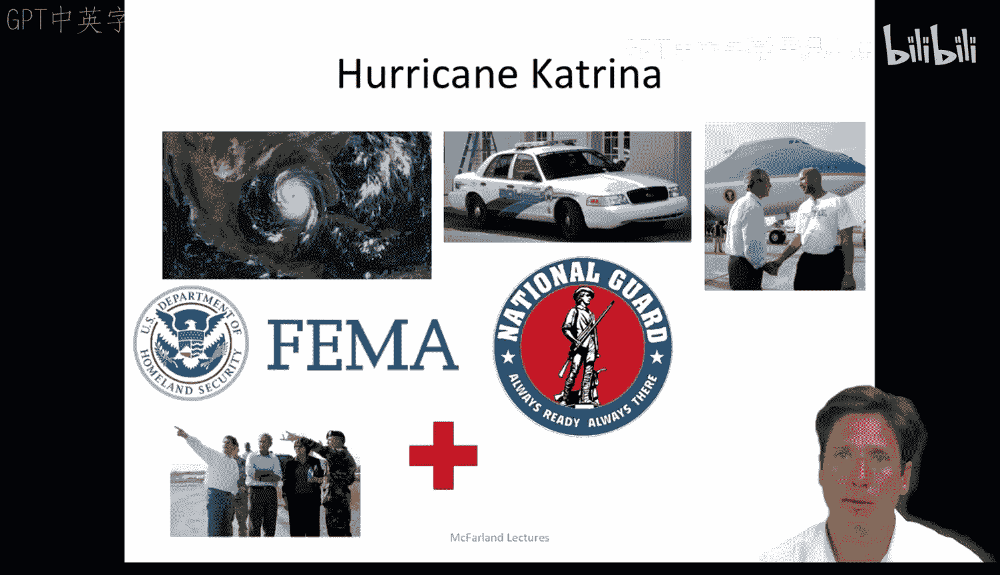
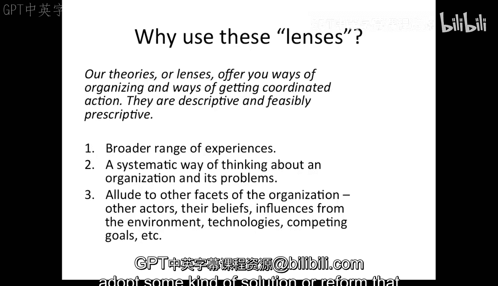

# 斯坦福大学《组织分析｜Organizational Analysis》中英字幕 p24 024_03_02_第七讲-回顾与案例-第二部分.zh_en -BV17J4m157qN_p24-

As a rational actor， I'd consider the problems and my goals with relation to them， for example。

 the storm is coming and will likely flood the city and create problems we can only partially address we have various options。

To treat this problem。 first off， we can do nothing， we can build up the levees better。

 possibly we could evacuate before。 Do we have enough time。 Timing is an issue there。

 We can evacuate after we can serve and protect all the while and drain and rebuild afterwards。

 So I think about all the other actors involved as well。 There's FEMA， the governor。

 the government agencies， Army Corps of Engineers， Red Cross， police， Fire department。

 National Guard， etc ceter。 And as a rational actor。

 I'm going to assume my staff and others are on the same side。

 if I can relate to them the costs or consequences of flooding and lacking a good response。

 something like any death toll is too much。 by relating the consequences of various options or not taking the ones proposed and identifying how the least cost in life is accomplished。

 I should be able to get everyone to mobilize and respond in an optimal way。

But I know people don't always have the same goal nor are they always motivated by consequences。

 some actors and organizations may think the walls will hold。

 others will think 10 or even1 hundred deaths won't need a response at the other extreme they may be so overwhelmed with the flooding that we won't get them to act on instrumental grounds。

 for example， the National Guard may be flooded themselves。

 so we have to invoke identity expectations， notions of duty。

 etc to get standard operating procedures rolling from each of these organizational actors。

From an organizational process standpoint we need to start partitioning the problem up so the appropriate organizations with experience and standard operating procedures are assigned to each part the city has evacuation plans。

 etc， that we can commence and coordinate we know police and fire will assist there。

But will their ability to perform standard operating procedures remain if they're overwhelmed that's a good question what if their homes and families are flooded too。

 will they privilege their family identity so perhaps having police and fire family protection plans sat is a very good idea as well as drills to prepare fire and police for the worst also we might know that some of these standard operating procedures work better in some neighborhoods than others like poor neighborhoods may be more difficult to enact these kind of procedures and we can allocate more where it's needed such as in those neighborhoods that are more lowly and whatnot okay？

That said， we know it's likely we'll be overwhelmed anyway。

 so we need to appeal to other organizational actors who coordinate a wider array of participants and relevant standard operating procedures。

 for example， Governor Blanco Blanco， I'm not sure how to pronounce it。

 the FEA director and the president。We asked them to commence standard operating procedures that are under their jurisdiction。

 we might even explain our reasoning via the rational actor model and costs here we'd hoped to get National Guard support in evacuating remaining citizens with helicopters。

 delivering needed supplies and maintaining order， we'll also need to appeal to the Army Corps of Engineers so as to be ready with equipment to repair any walls after flooding occurs。

But we all know this may not work， actors and organizations have parochial interests。

 hence the National Guard will have its own problems if flooded。

 the Army Corps of Engineers won't want to be blamed for faulty walls。

 FEMA won't want to look inept or totalitarian。And the governor won't want to have her authority circumvented by outside organizations。

Hence， we can bargain with them， but what do we bargain？

Our public claims that they have not worked appropriately or diligently。

 you know or even that they have been neglectful or prejudicial， et cea。

 are kinds of threats and conjoings that might get people to act in those government positions。

 in short， our theories， each one of them offer you ways of organizing and ways of getting coordinated action。

 they're descriptive and possibly and feasibly prescriptive， if you so wish。

All of this is kind of a caricature of course， I mean I don't want you to think this is a wonderfully elaborate case depiction。

 but hopefully it gets you to think more about how to apply theories to cases many of you are welcome to consider this case in greater detail and how our theories might apply there's a multitude of information on hurricane Katrina online and it's a case well worth analyzing and especially since many more hurricanes will hit the Gulf Coast and Eastern seaboard of the United States in years to come the same could be said for earthquakes。

 tornadoes， tsunamis， etc， through the careful study of cases and applications of organizational theories we'd likely improve our management of these recurring problems。

All of this kind of begs the question， if you're a manager or an analyst。

 why would you want to learn these theories and apply them？

And I see at least three huge benefits imagine you're called into an organization to help them with a problem your training in organizational theories gives you a few useful skills first。

You have a broader range of experiences than just the ones you firsthand had。

 you know other histories， you know other examples。

 companies and accounts that are different from your own personal experiences。Second。

You have a systematic way of thinking about an organization and its problems What's likely to happen is that the employer brings you into their office and explains their problem。

We have a problem with how the employees relate to each other。

 and there seems to be a manager who is really trying to drive a wedge between everyone。

 they may say。And you'll hear that and understand that this is a problem with regard to social structure。

And that the current interpretation of this company manager is that the conflict is intentional or driven by a particular actor。

Now you probably don't want to use all our of our academic jargon to relate this to them。

 but you can recognize that this is an issue they see as focused on certain aspects of the organization and has one kind of explanatory logic applied to it。

By relating that back to them， you help them better understand what it is they are seeing and thinking。

 you're paraphrasing in a way they might not have considered before。Third。

As an analyst trained in this class， you're able to allude to other facets of the organization。

 so you don't just see it in one way， you see it in multiple ways。Other actors， their beliefs。

 influences from the environment， technologies， competing goals， and so on。

You can also offer another form of explanation。That actors are just following standard operating procedures。

 and there is a conflict between those emanating from different units of the organization。

In this manner， you help the client see things differently in a different way。

 and most likely in a more useful way as well。Most of you who become analysts will be working in nonprofits and governmental organizations。

 most every organization seldom wants an outsider to come in and tell them what to do。And if they do。

 it will likely fail in implementation。They'll want you to help them figure out what is going on so they can propose solutions on their own。

 you can help with that process and by placing them as central actors in the decision process。

 they're more likely to adopt some kind of solution or reform that resolves at least some of their issues。

