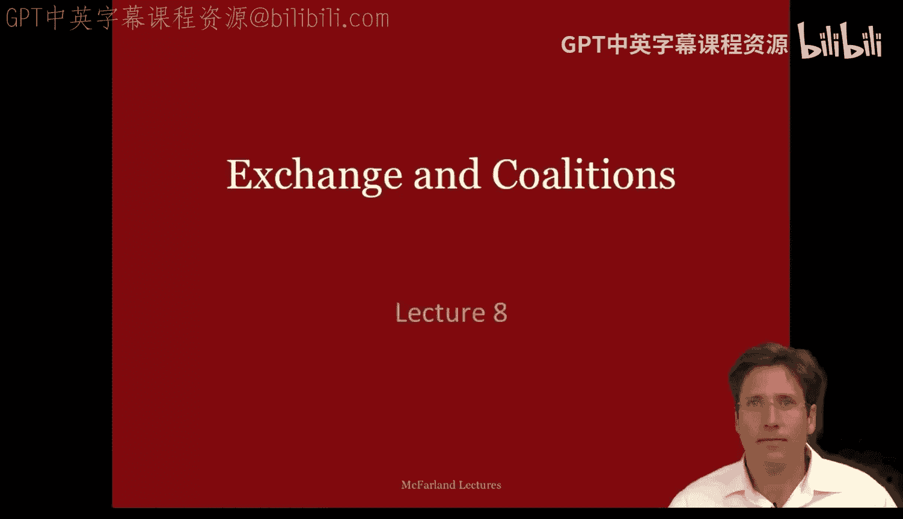
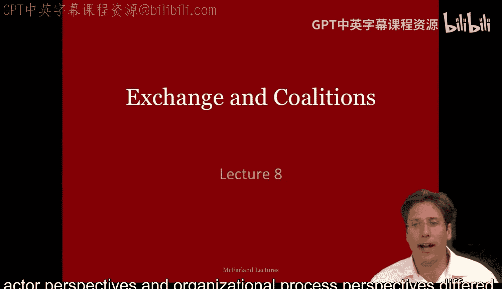
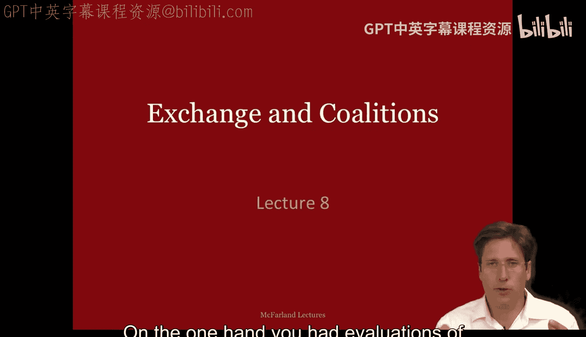
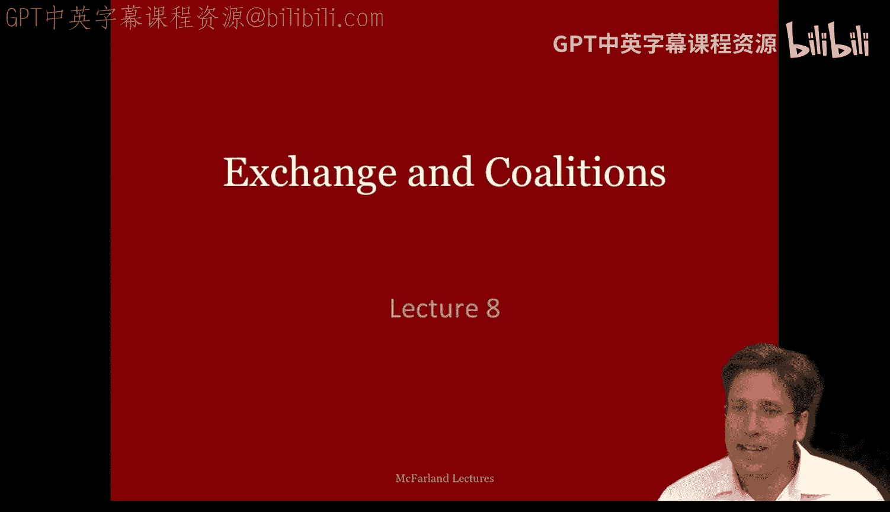
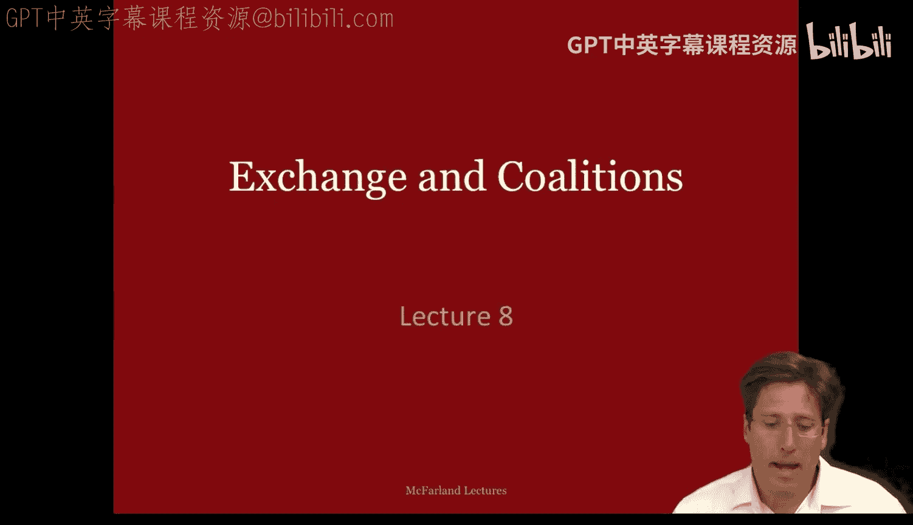
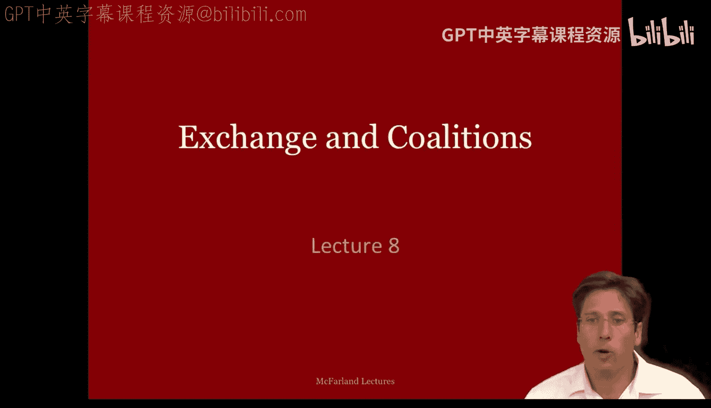
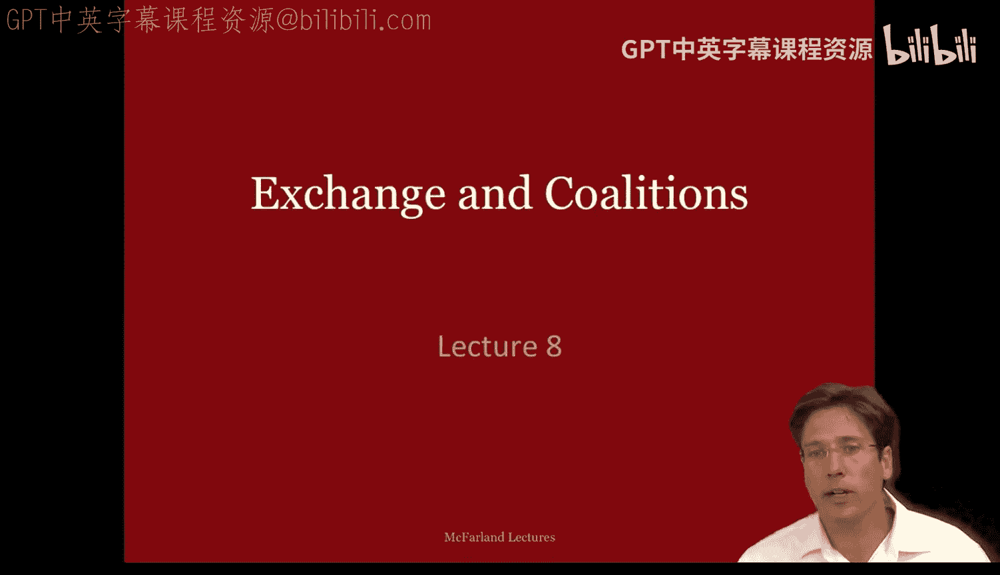
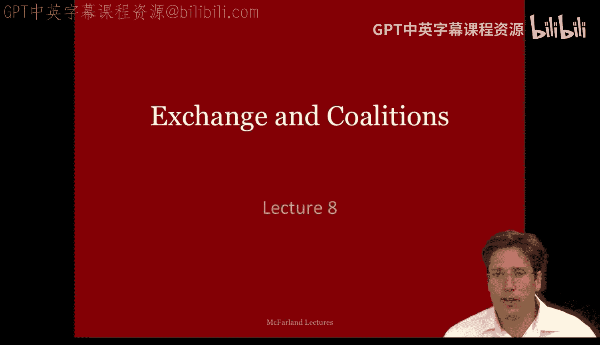
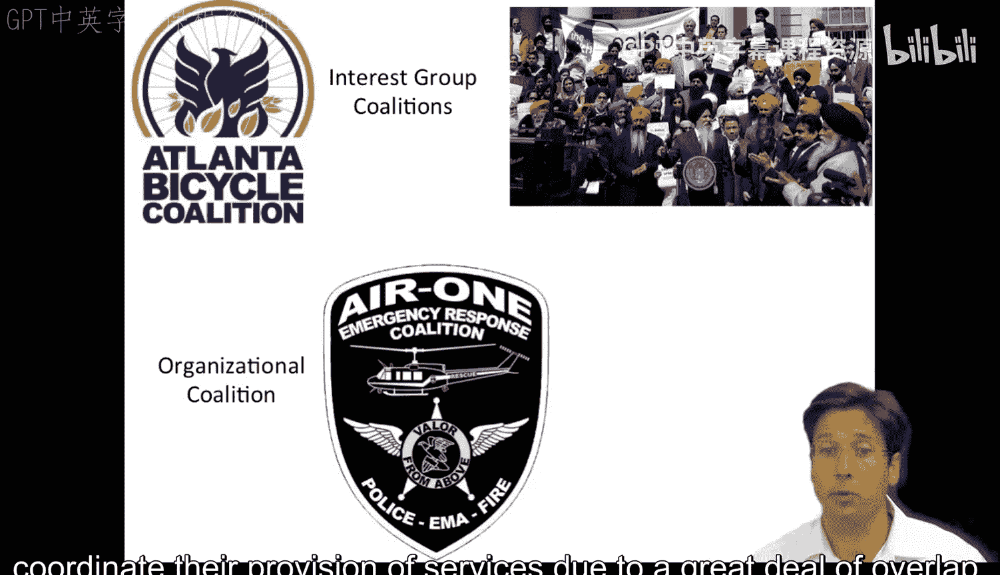
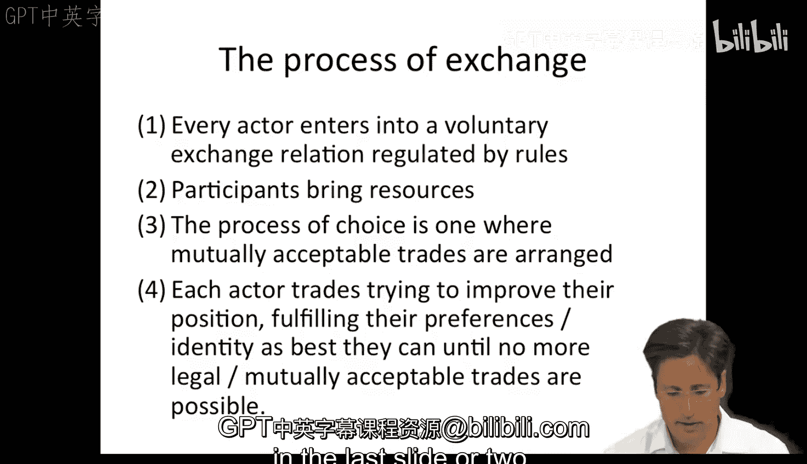

# 斯坦福大学《组织分析｜Organizational Analysis》中英字幕 p25 025_03_03_第八讲-交换与联盟-第一部分.zh_en -BV17J4m157qN_p25-

In the second week of the course， you got a good sense for how rational actor perspectives and organizational process perspectives differed。

Those theories nicely corresponded with Jim March's notions of decisions by the logic of consequence and decisions by the logic of appropriateness。

On the one hand， you had evaluations of judgments on the basis of consequences on the other of matching。

 appropriateness of matching。

You probably have walked away with a less clear sense or understanding of the bureaucratics politics model。

 though。

And this lecture will give a more elaborate depiction of that model。

 it will focus on the core process of exchange and coalition formation。

In organizations， you'll frequently confront coalitions of interest。

 and you'll come to realize that collective action and organizational reforms are impossible if you don't build and manage a coalition to get things done。

 therefore， this is the theory lecture of week three， and it concerns coalition formation。

To this point， we've covered three theories and each one has certain shortcomings， for example。

The rational actor view assumes people have the same goal， and that's seldom the case。

 also many people are not motivated by the consequences of their actions。

This leads us to organizational process or rule following views。

 but this perspective fails to take into account how peripheral organizations can matter and how many of the routines being suggested and enacted have parochial interests behind them。

There's politics and change and rule following is too static and path dependent to catch that。

So finally。We have the bureaucratic politics model。

 and here we see more nitty gritty politics driving decision coalitions。

 but we didn't get too deeply into how interests are negotiated and collective decisions are reached last time。

 so this week we'll concentrate more on this final and third theory。This week。

 we will spend a good deal of time elaborating and explaining how coalitions can be managed。

Will'll zone in on coalition dynamics and its core process of exchange and negotiation。

So let's start with something very simple， what are some examples of coalitions？

The most common examples are those of political and international coalitions。 For example， in Chile。

 there are many political parties as shown in the diagram of circles in the figure next to me。

 some of the parties find mutual interest and gain from working together。

 so they form a political coalition， like the coalition for change。

 which are all the blue-colored circles here。Or a coalition of parties for the democracy。

 and that's mostly the rest aside from the purple and white。

Another example might be seen in this desentry of Christian political parties in New Zealand。

 a coalition here ends up being a temporary alliance into a unified party。

 but it doesn't last very long。So it suggests that coalitions maybe have more of a temporary nature in many organizational contexts。

Other coalitions can be interest group based， where a variety of groups or even distinct religious sects coalesce around an issue of mutual concern。

There are even organizational coalitions where different agencies and organizations coordinate their provision of services due to a great deal of overlap。

We've already read some discussions of coalitions in week two of the course。

Both James March and Graham Allison discussed them in various ways。In most instances。

 coalitions are social systems， led or organized by mutually inconsistent decision makers；

 here it becomes difficult to see the decision makers as a unified team；

 instead we have a power struggle or tenuous coalition that describes the decision processes。

Looking back to our table of Allison's theories and the outline of the bureaucratic politics model。

 we will see that there are multiple players in different positions；

 there are various factors that shape their preferences and stands， for example。

 their particular interests or their stakes specific to them， the goals of someone in their position。

 and the deadlines rushing them to decide each actor has certain resources or power。

 things that people want， and the inner game of exchange or bargaining according to rules。

 the indecision or organizational action is the result of bargaining across these actors。Jim March。

 on the other hand， describes coalitions in a nice way that complements Alison's bureaucratic politics model。

 as well as Kevin Huula's notion of coalitions that you read this week， his focus， however。

 is more on the central organizing process of a coalition。

 the process that creates and sustains a coalition Jim March argues that scholars describe coalitional decisions or coalition formation as following one of two processes among others。

 The first process， which I want to relate as background。

 not as something you really need to learn but has been called kind of a power struggle。

 and it has sometimes been analyzed or operationalized as a simple force model。 a force model。

Is an extension of the expected utility calculations we did for individuals last week。

 except this time we have multiple actors with different preferences or different values placed on the outcome。

 and they're given different weight and making decisions so to calculate the decision。

 a coalition does this in a force model simply by adding up the expected utilities。

 weighting those of more important or powerful actors greater than others。

 so it kind of has this lump sum calculus sort of form。

So take our example of the umbrella and the expected utility of bringing it or not to class。

 or even the dating example of asking someone out or not， if we calculate that for each of us。

 all of us as a group， and then weight our score by the relative power we have to each other。

 then we add everyone up， then we should have our collective decision， right？

The problem with this procedure is that power is depicted as a stable personal trait that we can actually measure。

 but power is not really a personal trait by many theorists out there in academ think for example。

 of triads or dependent notions of rank that I'm only powerful when my best friend is around to support me when I interact with you that changes over time in the context where they're not there I am in a weaker state right it's also tautological as a model this force model an explanation when people get what they want。

 power is seen as explaining why they got it so plus power can refer to many different things persons acquire as such it's kind of kind of hard to measure as one construct that everyone agrees upon so the force idea of just extending our pure rational actor model the sets of people doesn't really work too well。

A better way to study power struggles is through exchange models。

 or at least this is what Jim March is arguing in his text that you had to read this week here。

 collective choices are produced by voluntary exchanges so trading and bargaining。

This is the central organizing process of Allison's bureaucratic politics model。

 as well as Kevin and Huula's incentives theory， or what you and I are just going to call coalition depictions。

The process of exchange is relatively simple。Every actor enters into a voluntary exchange relation regulated by rules。

 and this is essentially Allison's rules of the game that you saw in the bureaucratic politics model。

Second， participants bring resources to the table that is they bring money， property， information。

 skills， access to others， rights， knowledge， etc， and this is similar to Allson's notion of power。

Please also note that Scott described these powers of control or control over resources。

As resting in various roles and positions。Within an organization。So ownership， management。

 like capital， were her expertise。Bridging roles and rule establishment of external actors like re agencies。

 so here we have so far actors enter into voluntary exchanges that follow rules of a game。

 and in addition they bring certain kinds of resources to the table。

 things that people want that they can bargain and negotiate with。

The third feature of an exchange is that the process of choice is one where mutually acceptable trades are arranged。

 so again， here we have mutually acceptable trades by bargaining that you kind of barter back and forth until you find an agreed upon exchange relation。

Then finally， each actor trades trying to improve their position。

 fulfilling their preferences or identity as best they can until no more legal or mutually acceptable trades are possible。

 so in theory this is where academic models we assume there's no time limit。

 but in reality and so when we simulate out these kind of exchange dynamics right。

 but of course in reality as hula and Allison write，The actors often do face time limits。

 so you can actually impose that on your model as well。

 so the exchange process is described here is the core of the bureaucratic politics model and a coalition formation more generally。

 and that's why we want to spend a little bit of time on it in the last slide or two。

