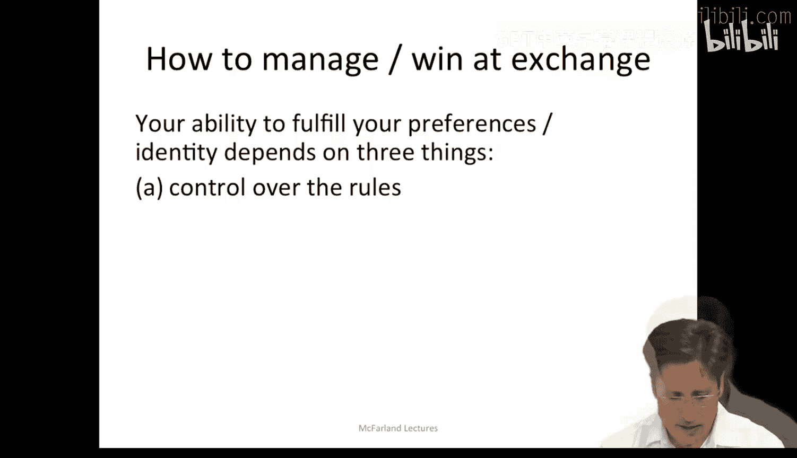
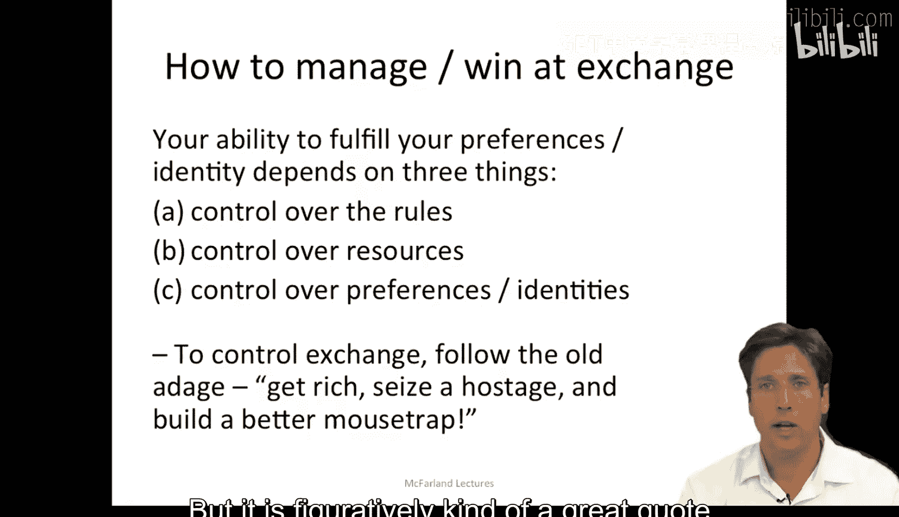
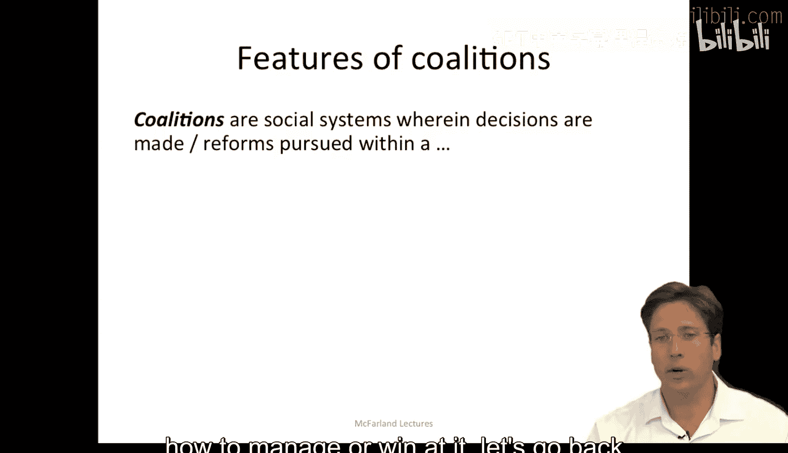
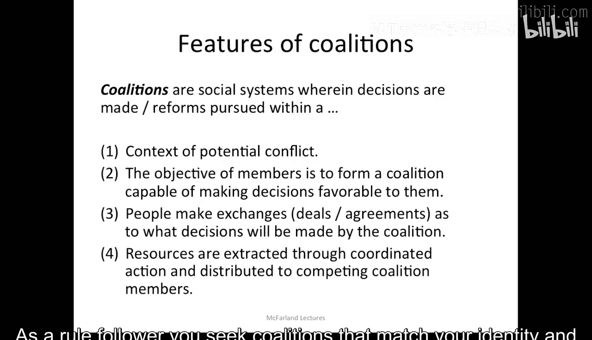
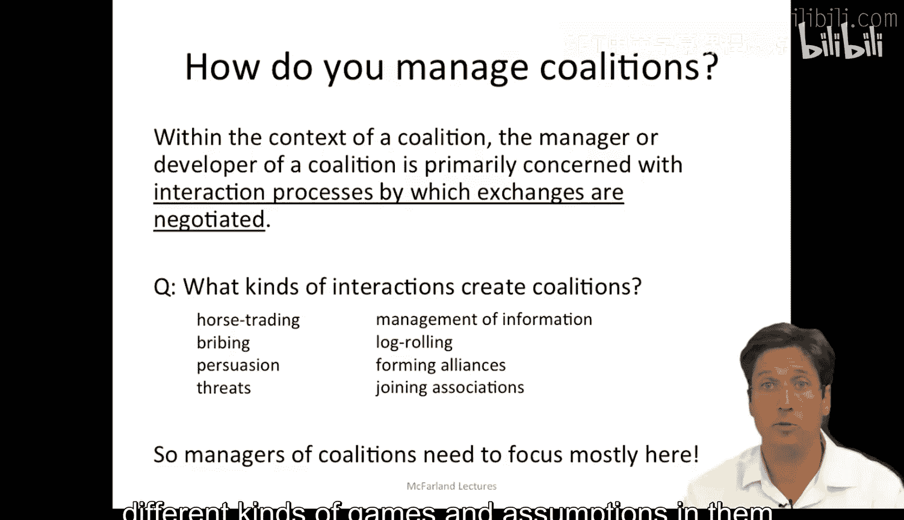
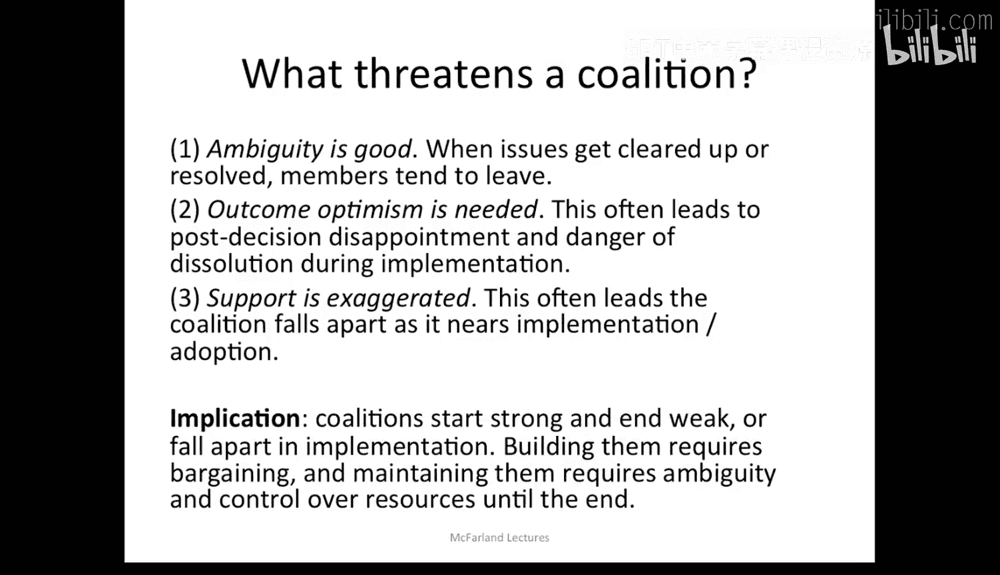
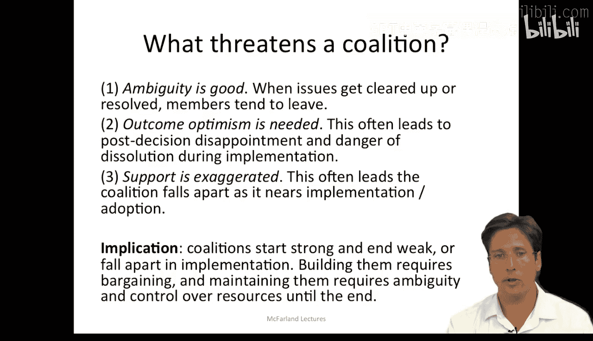

# 斯坦福大学《组织分析｜Organizational Analysis》中英字幕 p26 026_03_04_第八讲-交换与联盟-第二部分.zh_en -BV17J4m157qN_p26-

So how do you manage or win this game of exchange as a participant in exchanges。

 your ability to fulfill your preferences and identity depends on a few things Now first is your ability to control the rules the rules of the game。

 do you write the laws， did you define the boundary or the game rules of exchange and a great example of this is Robert Cararrow's book The Power broker where he describes Robert Moses who is an unelected bureaucrat who ends up controlling the transit construction budgets in New York City and he eventually you controls politicians and he did this by writing himself into the rules or the legislative rules of Bus and through this he elected new officials or helped promote them and he tore up the whole city and made it the kind of landscape it is today in New York and this is a great example of controlling rules？

Example of how to manage and win exchange is to control resources in particular you need to consider whether you have resources everyone needs right and vice versa whether other firms or organizations have resources that you're dependent on and this creates kind of a power dependence relation that you might have to exchange far more for that one thing you really need just to get it and if they have that leverage over you you're kind of at a disadvantage the third thing is control over preferences or identities so you want to transform once so others demand the goods you provide you make others preferences and identities incompatible with core ones so this is like creating demand for the resources you have and controlling an identity and what it means so in a way the aash that people follow when trying to control control exchange is get rich resources。

Seize a hostage right define the game and build a better mousetrap right so this is the kind of idea behind exchange of course I don't want you to follow this literally but it is figuratively kind of a great quote to think about how to manage exchange relations All right now that we have a better sense of the exchange process and how to manage or win at it let's go back to coalitions and explain how they work。

Keep in mind that exchange is still the generative process of coalition formation that hasn't changed all we want to talk about now is the larger context of multiple exchanges or a larger group so here coalitions or social systems where in decisions are made and reforms are pursued within a context of say potential conflict and that means that coalitions entail actors with mixed preferences and identities that don't always align they're juxtaposed so they require this kind of bargaining Second the objective of members is to form a coalition capable of making decisions that are favorable to them it parochial interests still and this is obviously difficult because of all the internal consistencies。

 the fact that others in this loose coalition have other interests。

The third is that people therefore have to make exchanges， deals。

 agreements as to what decisions will be made by the coalition。

 and this kind of follows the core process we described above of exchange。And then， finally。

Resources are extracted through such coordinated action and distributed to competing coalition members this is what members get in return for joining a coalition so the resources hula will cite our strategic incentives。

 information and symbolic benefits， something we'll discuss more in the next lecture so who will be in the coalition how are the spoils divided this can follow both the logic of consequence which seems kind of primary here at times and the logic of appropriateness as an instrumental actor you join minimal winning coalition so you reap the most rewards as a rule follower you seek coalitions that match your identity in the standards that you adhere to。

If we look back at the bureaucratic politics model。

 we'll see that all the same features that I'm relating here were coarsely related there。

 It's just that in this lecture I've tried to elaborate and anchor the description of coalitions more in a process of bargaining in exchange。

Above or in the prior slide I described some of the means we use to control exchange。

 and that can be extended to a coalition， however， most coalitions require negotiation and bargaining that's more extensive。

 so there's a whole variety of moves that managers use。

 so a coalition managers primarily concerned with the interaction processes by which exchanges are negotiated。

Now what exactly do I mean by this， what kinds of interactions or exchanges create coalitions Well。

 there are a variety of forms and they range from horse trading， bribing， persuasion， threats。

 managing information that people see or don't see， log rolling， forming alliances。

 joining associations。Managers of coalitions really primarily focus on these behaviors and they vary I mean log rolling is a good example of an odd kind of exchange where I could be part of a faculty group and sometimes there are issues that arise that I may not care deeply about and I basically go along with them because other people care more about them and vice versa I expect them to go along with things I really care about that maybe they don't care so much about this is called log rolling you kind of exchange acquiescence of sorts and when you violate that suddenly people make a stink over something they don't care about that can create issues of trust and the lack of agreement and all kinds of problems but the point here is that to manage a coalition you need to think about a series of exchange logics that have different kinds of allocations or different kinds of games and assumptions in them。

And here are a variety of them。So coalitions are a dynamic accomplishment through exchange。

 all kinds of wrangling and bargaining。As such， they're often under threat and there's a variety of things that can threaten them。

 for example。Ambiguity is a good thing and Jim March writes about this in his discussion of coalitions。

 he says that when issues get cleared up or resolved members tend to leave。

 so clarity or resolution is not always good for a coalition survival second outcome optimism is often needed and you have to overestimate positive consequences of coordinated action when you're trying to bargain for a coalition and this often leads to post decision。

Disappointment and danger of dissolution。During the actual implementation of a coalition's reform。

And then finally members often exaggerate their support。

 so as the coalition adopts and implement things， it starts to fall apart。

 all these weekly aligned individuals find that once that initial formation is had。

 they no longer care so coalitions have this odd dynamic that they seem to start very strong and full of hope and they kind of end weak or fall apart during implementation。

So building them requires a lot of bargaining and wrangling， horse trading， log rolling。

 all that kind of exchange efforts， and then once you maintain them or accomplish them。

 you're trying to maintain them through ambiguity and control over resources and dependencies so as to maintain them through the process of implementation。

 so it's a long process and it's full of complexities and trials and tribulations along the way。

