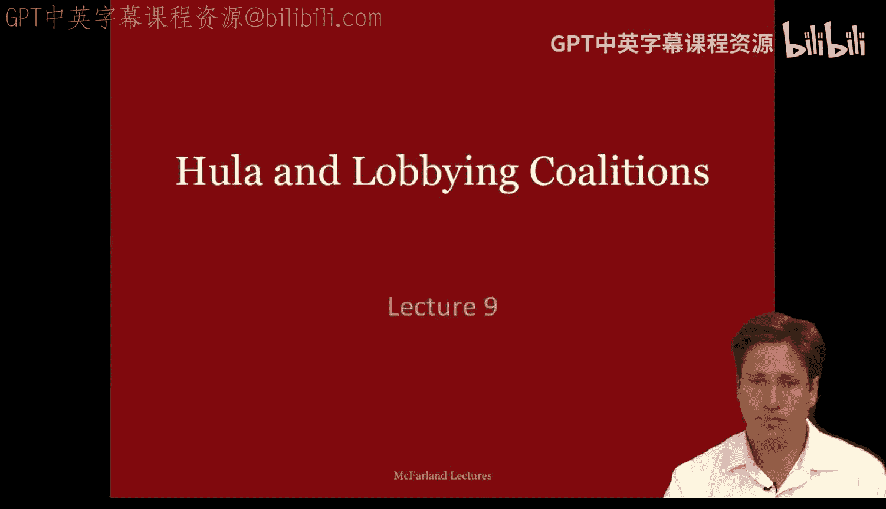
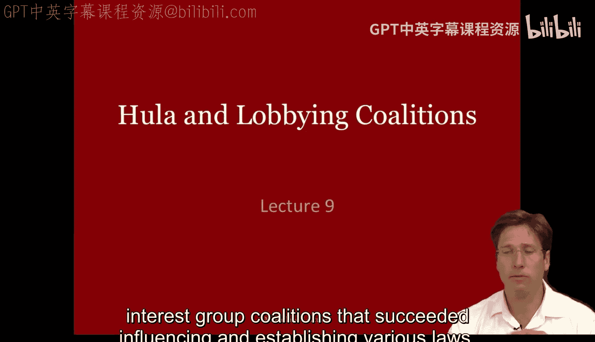
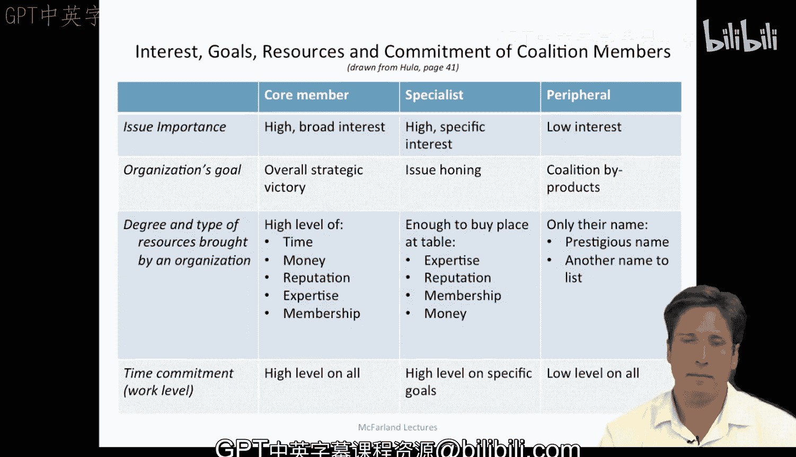

# 斯坦福大学《组织分析｜Organizational Analysis》中英字幕 p27 027_03_05_第九讲-呼啦圈与游说联盟-第一部分.zh_en -BV17J4m157qN_p27-

In this lecture， we will look more closely at Kevin Huula's book on interest group coalitions and their lobbying efforts in the United States Congress。

Why lobbying it's not focused on a single organization or within a single one。

 but it seemed highly salient to those of you wanting to be leaders and social reformers。

 most social reforms in the United States or any democracy requires legislative decisions。

 and much of that starts with lobbying and inter group coalitions that succeed in influencing and establishing various laws。

So in Kevin Huula's book， he uses an exchange model， much like we discussed in the prior lecture。

 and similar to Richard Emerson's notion of social exchange theory。

Participants here in this kind of exchange model engage in exchange for some benefit with lobbyists free writing is less relevant than in other models because the lobbyists have already made the decision to be involved in a cause in some form so they're activists in many cases。

 hence the issue is more about selecting a level and type of involvement。

 not whether they get involved or not，In this context of lobbyists。

 coalition brokers work incentives to get people to participate in different levels and types of ways so as to effectively accomplish their interests。

So why do people join a coalition， let's look at this a little more carefully through Hulu's book。

So hula。Gives multiple reasons why groups would join an organization。Or a coalition。First。

 he argues that groups benefit from being able to reference。

An explicit policy or goal to which they and others agree on and they can say that therefore against this policy so for example in the hula textt he discusses CF the committee for education funding and CF is a coalition with a broad goal and many of the member groups parochial interests can be subsumed under that broad goal and enlist as specific programs by subsuming a more particularistic goal under that of an umbrella goal they can strive toward the larger one partially accomplishing their narrow aims right moreover their narrow focus may turn off others so in a broader coalition's goal they can hide that or be useful or use it to their own ends so in a way it protects their parochial interests and gets them moving in a more legitimate broad umbrella goal second。

By joining a coalition early， organizations can shape an agenda of the coalition and platform。

 so most issues get ironed out earlier in a coalition's formation than later。

 and precedent exists for previously worked out conflicts of interest。

 so people say why open this can of worms again kind of thing"，Third。

 information is a selective benefit of membership， it fits parochial interests。

 members want to know of any future threats to their perceived interests。

 especially valuable to smaller groups with small staffs。

 therefore it helps them to get on committees that make decisions that deal with new issues and know the latest bills going on at Capitol Hill。

And finally there symbolic benefits showing something as an important issue is not the same as making it one many organizations see something as important and join to show that but they don't have the resources to vote core membership activities to it。

 plus it looks good to say you are involved and busy in something that's related。

 so reasons for existing are reinforced it serves higher ups in the organization who are more concerned with company affairs and you can also claim credit when something goes well。

 you know think about co-authoring papers and but the fifth author who doesn't do much。

 you can claim something of that so joining symbolically can be seen as paying off a debt reciprocating something setting an example some kind of symbolic benefit of membership comes from it。

Now that we have some idea why members join a coalition。

 we can start to ask or explore why members vary in their commitment。

So the incentives a particular group responds to enjoin in a coalition strongly influences the ultimate role the group will play in the coalition structure。

So understanding whether a group joins a coalition for strategic reasons or selective benefits helps determine whether it will become a core member。

 a specialist or a player， or a peripheral tag along member of that coalition。

Keep in mind that peripheral groups aren't free writing because all groups have entered into a transaction and the other participants have agreed to the legitimacy of the exchange。

 so here we have a coalition with three rings of concentric levels of commitment and different roles in bargaining。

Let's look at the types of members and how Kevin Huulula describes their level of interest， goals。

 resources， and commitments to the coalition。First。

 let's look at the core members in the first column of the table on my right or left here。

Coalition members view the issue as very important。

And they're interested in a broad range of issues concerning it。

Their goal is an overall strategic victory on this issue。

And they bring to the coalition a high level of time， money， reputation， expertise， and membership。

And they commit to the coalition more than any other member。By contrast。

 if we go to the second column， we see the players and specialists and these individuals or these members of the coalition care about their specific goals and attempt to hone issues toward that。

They usually bring enough resources to get a seat at the negotiating table。

So they often bring expertise on a specific issue as their political capital。

 so they kind of piggyback the effort。So in so long as there' are specific issues at stake。

 they stay involved。Then there's the tagongs， the kind of peripheral members。

 they have the least interest。And their goal is to acquire coalition byproducts。

 they bring few resources but they're willing to let others use their name so notably this model of coalitions ends in almost a Hobian view only the most central。

 powerful actors invest most into the coalition while other less powerful actors invest much less so this is kind of like on the Leviathan cover of that book for Penguin Press。

 you'll see the king as a body composed of citizens where the King invest far more so the point is that core players are interested in getting the bill passed the players won a paragraph and the peripheral groups won a picture for their newsletter。

 each lobbyist defined his or her essential interest and a symbiotic relationships form to hold this coalition together and it's funny I mean when I think about this in my own research studying academic departments and research centers here at Stanford and other universities。

 I see many of the same distinctions。Large interdisciplinary research centers seem to have core members held bent on addressing a broad goal and specific issues within it and they invest everything they have into it but in building the center they need to draw in other adheres。

 many of whom have only specific interests like players and they perform a particular research project that relies on expertise or some subset of faculty in the center because of it they join they lend their name and reputation and even expertise on issues related to that but they do not attend all the events and work hard to forge the larger research community and then there are the taglons or affiliates or tangential to the center and not dependent on it for much of anything but they have related projects and here the center invites them to be an affiliate and uses their name and in some cases this can result in some minor research funds going their way an article and their work in the website or some kind of recognition but these members seldom attend or do much of anything to promote that community nevertheless they give the impression。

of a larger respectable， collective effort and interesting similar process arises when forging a new academic department。

 but even more so as a variety of goals and interests are accomplished to fund faculty positions and develop student programs。

 so we see this kind of coalition formation in a variety of kind of organizations that form as a social movement of sorts that has kind of an interest group basis in its beginnings。

