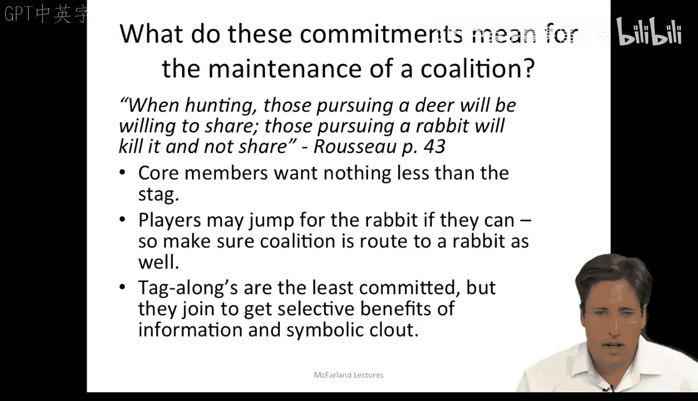
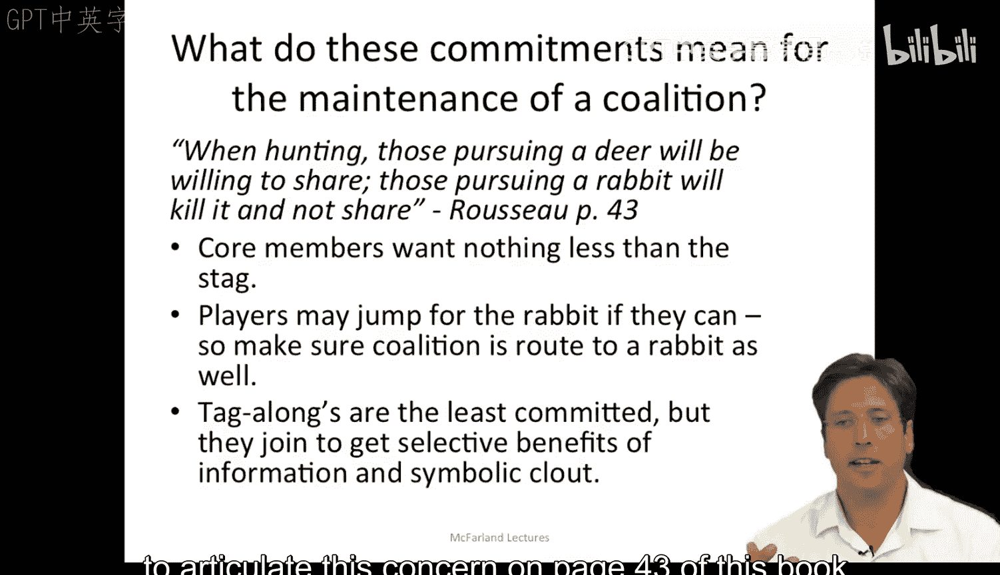
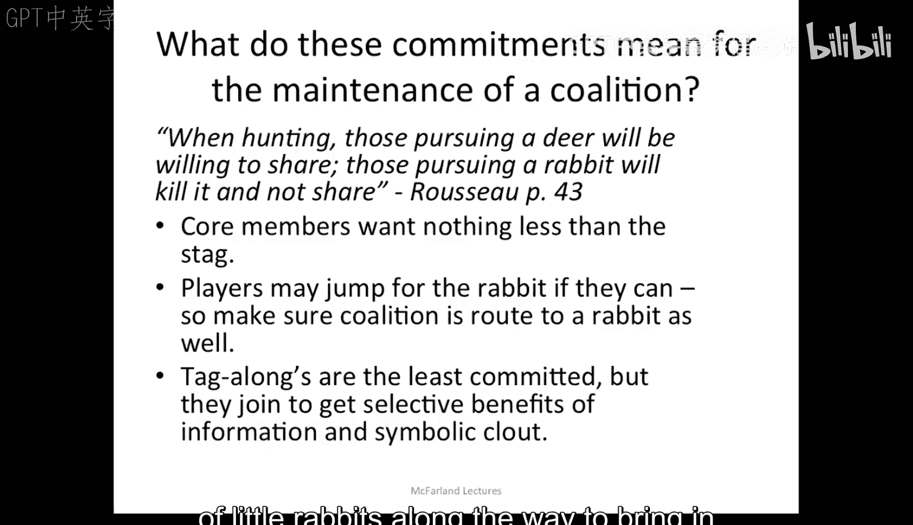
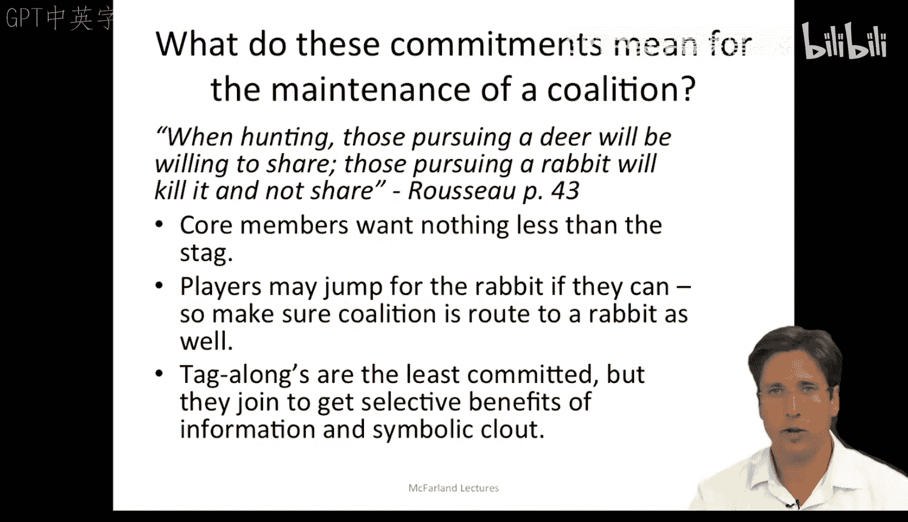
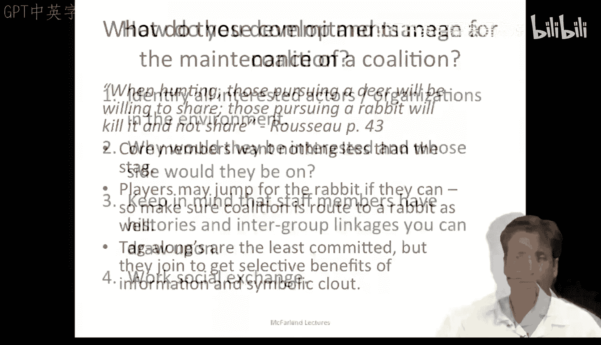
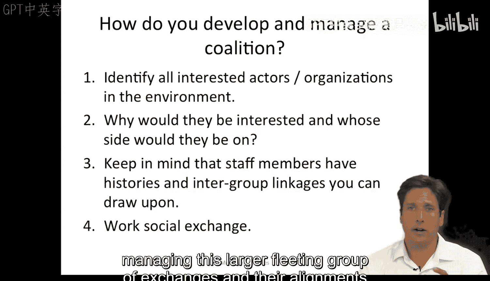
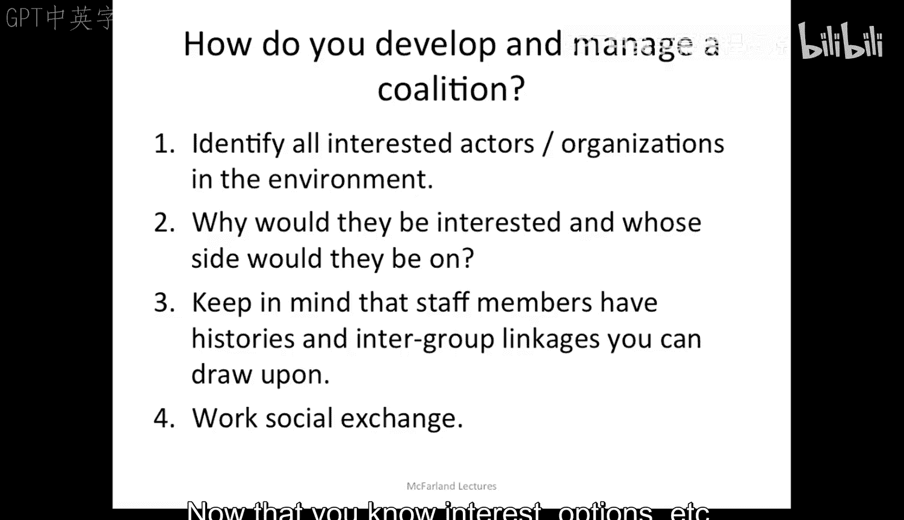
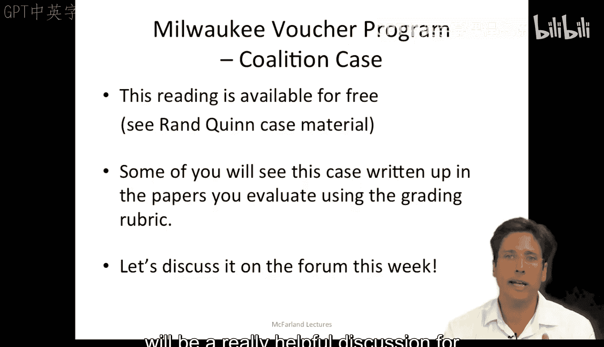

# 斯坦福大学《组织分析｜Organizational Analysis》中英字幕 p28 028_03_06_第九讲-呼啦圈与游说联盟-第二部分.zh_en -BV17J4m157qN_p28-

What do these commitments mean for the maintenance of a coalition？

So hula has this nice rousseau quote to articulate this concern on page 43 of his book so he says when hunting those pursuing a deer will be willing to share those pursuing a rabbit will not share and this is kind of a sly reference to the core members who hunt the deer and the players who hunt a rabbit and the coalition。

 the core members want nothing less than a stag and players will jump for a rabbit if they can。

 so because of this coalition managers need to make sure the broader goal of accomplishing the collection of a stag on the route has all kinds of little rabbits along the way to bring in players to sustain their commitment so for example when I run a large research project focused on a big issue I try to encourage the methodologists and computer scientists or specialists in this case to send off papers to conference proceedings and methodology journals。

Our larger research question isn't methodological， but many of these specialists hope the collaboration on a new topic will help them innovate their methods along the way。

 so hence I'm in running these projects trying to point at rabbits along the way so that they can get off projects and sustain their commitment it's feasible one can view this variation and commitment in another more machiavvellian way though opponents can target less committed individuals and pick them off as members of a coalition I can show you alternative legislation where your issue your specific issue is subsumed like an amendment and pull you off this other coalition and of course tagungs are the least committed and they won't commit much energy to a coalition but they join to get selective benefits of information in symbolic clout so tagungs are the third group in the woods they're kind of like the discount hunters along for the beer in the company。

can have different goals， they have different levels of interests and commitment to the coalition and asymmetries are allowed at different levels because different exchanges are had leaders must be able to welcome tag alongs and differentiate real players willing to go the distance from ones that will jump at the first rabbit and disappear and the danger that tag alongs is that they may feel betrayed in the end or used thereby enacting revolt like in Pro 187 in California in the 1994 passage of a bill on illegal aliens trust was had but it kind of had the result that they try to bring in taglons and this resulted in kind of a sense of betrayal in the end。

So given all of this， how do you develop and manage a coalition Earl in this week。

 I talked about managing exchange now the concern is。

Going outward and managing this larger fleeting group of exchanges and their alignments in some kind of consistent form that meets your kind of interest。

 So first， the thing is a coalition manager as you want to think about and identify all the interested actors and organizations in the environment。

 Consider the related issues。 Who would be interested in this one。 Second。

 ask yourself why they would be interested and whose side they would be on friend and foe kind of stuff。

 And keep in mind a friend of a friend as a friend and the foe of foe may also be your friend。

 You don't want to mobilize opposition Just support。

 And you may want to consider possible responses to oppositions。 For example。

 targeting their specialists and tag alongs and pulling away support from oppositions that way。

Third， keep in mind that staff members have histories of intergroup linkages you can draw upon。

 these can be effective conduits for coordination， for example。

 a former employer might be a better connection than a former employee upchain is better than down chainin。

 some people even belong to multiple coalitions use them as well for information and history and wealth of contexts develop。

 they can identify potential partners and adversaries efficiently and relations serve as points of action and information collection。

 their receptacles。With more linkages， you need not develop lasting coalitions because you always have access to new members and their resources in the field of education there are fewer links and develop networks。

 so long-term coalitions are relied on more heavily， nonetheless。

 the basic rule is one of immediate usage of ties and their cache is now。

 so commitments fleet exaggerated and ambiguous in organizations and your time window is short。Last。

 as the prior lecture made clear， work exchange， work those kinds of bargaining and negotiation。

 now that you know interests， options， et cetera， you can begin a horse trade， log rolling。

 you can negotiate and work the coalition into what you need。

Now that you have some overview of coalition views on organizations。

 we can begin to apply them to a variety of cases。 The Hulu reading was great for this in terms of an application to lobbying examples in Congress。

 but we also have some examples of our own that are offered in this course。 For example。

 the Milwaukee voucher program。 The case readings provided on the Milwaukee voucher program are quick their quickreads。

 and they're available free of cost。 In addition， some of you will read analyses of the Milwaukee voucher program in your peer evaluation training。

 you'll see papers that actually apply coalition theory to that case。 therefore。

 I think it's best to lead the discussion of the Milwaukee voucher program to the larger forum。

 it would be great to hear from students where they found the coalition views on exchange most salient and where it might not apply。

It'd also be great to hear how people think the coalition driving the Milwaukee voucher program could swing in the opposite direction if Democrats retook the legislature and so on can liberal groups form coalitions that support the poor or is this a biased view of liberal reforms becoming co-opted by business and private interests do coalitions always veer。

 right and implementation， what are some examples and where that doesn't happen so thinking about alternatives and possible different trajectories of this coalition and its development or other examples or cases like it would be a really helpful discussion for the use of our online forum this week thank you。

