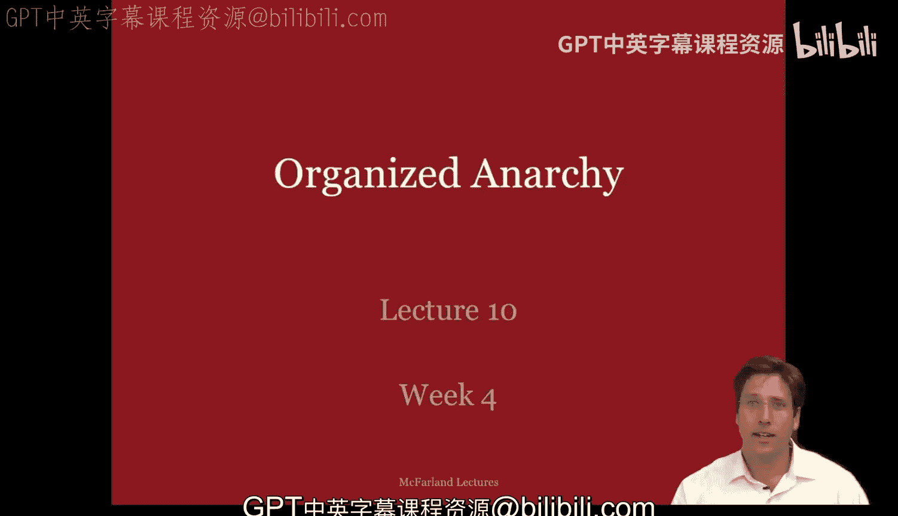
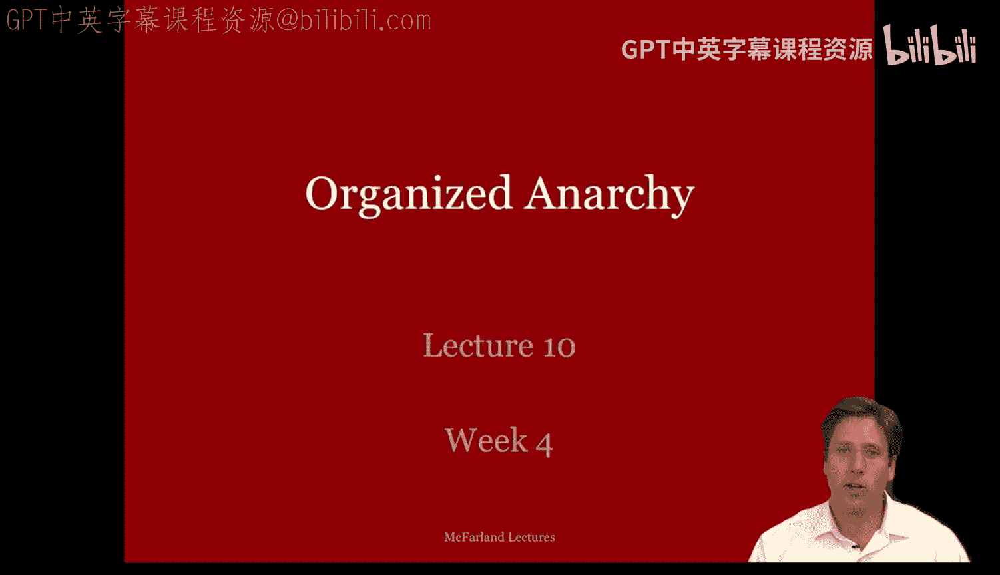
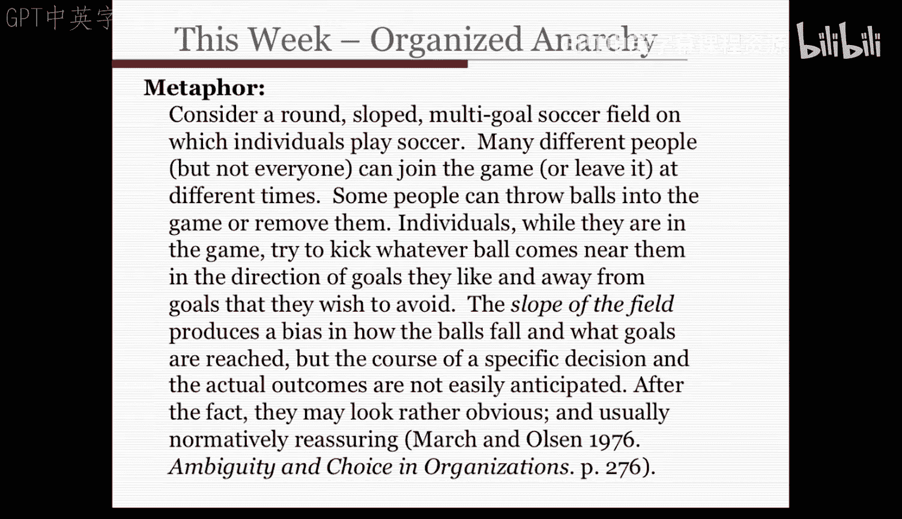

# 斯坦福大学《组织分析｜Organizational Analysis》中英字幕 p34 034_04_01_第十讲-组织化无序-第一部分.zh_en -BV17J4m157qN_p34-

This is the first lecture of week four， it introduces you to the basic features of decision making and organized anarchies。

 or what some will call garbage can theory of organizations。

During the week on coalition theory， I usually ask students in my classroom to assume the role of different organizations who have a contradictory stake and an issue like that of the Milwaukee voucher program。

Then every group has a pairwise encounter with each other where they can apply a variety of exchange techniques so as to try and forge a dominant coalition behind certain solutions like universal vouchers。

 targeted vouchers， magnet schools， more funding， class size reduction， or do nothing。

Every year the student groups do a great job of playing to their organizations parochial interests and manipulating other organizations into joining some sort of collective resolution。

If we look at the slide next to me， we see a variety of stakeholders involved in this process。

From low income parents where vouchers do not cover private school costs。

 middle class African American parents with nearly enough income to afford private school。

To religious school leaders， principals， for example。

 or local business leaders and Milwaukee Secretary of Education and the Teachers Union representativepresents。

 each of these are stakeholders with different parochial interests。

 and then below there we had their kind of solutions of the feasible solutions that they can negotiate over in their pairwise encounters。

As the groups go through this process of a negotiation。

 what they experience actually goes well beyond what coalition and exchange theories of organizing convey。

There is a far more chaotic and dynamic quality to their discussions。

 and decisions that seem more consistent with an organized anarchy model seem to arise。

 What do I mean that the decision process resembled an organized anarchy。 Well， for example。

 some of them have a hard time coming up with their group's platform and identity。 After all。

 what is the platform for lower income parents in Milwaukee。 The case doesn't really convey。

 and it's not always clear what that would be。 Also。

 some of the groups proposed solutions change over the course of bargaining。

 Some initially proposed universal vouchers only to promote targeted vouchers in the end。

 Almost all the groups thought in terms of some kind of identity and prochial interest in what that entailed。

 And they also thought about other identities and interests when trying to manipulate the situation in their favor。

 So they'd bargain for what they thought the other group needed or wanted。Now， in this context。

 problems seem to be brought up in a much more dynamic and contingent manner。

 Some groups brought up problems that fit their interests。

 like problem of choice for Republicans equity for African Americans。

 achievement levels for businesses。 while their groups mentioned several kinds of solutions like the educators。

 and then they presented the problems in different orders。 The same thing occurred for solutions。

 groupss created additional solutions than those presented in the Milwaukee case。 For example。

 some of the students came up with a sliding scale voucher。 and some solutions。

 they never took up actually in the process like doing nothing。

 None of the solutions and problems seemed to arrive as set pairs。 Instead。

 the solutions were matched with multiple problems here and there。

 and that connection was negotiated。 Each group tried to make a case why another group's problems would be addressed by their solution。

 and as such the bargaining was in connecting solutions and problems in a way that convinced other groups or they undermined。

Connections that other groups held。 The debates and decisions also followed a temporal dynamic。

 Some of the students got up and went to the restroom。

 and their voice was lost and pushing for certain problems and solutions。

 Some pairs of groups took longer to finish their exchange and were rushed to make a deal before the time was up。

 and that seemed to affect the kind of decision outcome。

 Some groups even backtracked on prior deals when they saw a better solution and coalition emerged later。

 Many students felt like the ordering of the pairwise meanings greatly affected which bargains arose and which ones were adopted or dropped。

A lot of what I've just described here pertains to organization anarchy and organizational decision making in those contexts this is also what some have called a garbage can model of organizations。

 and this is what I'll talk about today in our lecture。

Most organizational theories underestimate the confusion and complexity surrounding actual decision making。

If we look at an actual context of decision making， we notice that many things happen at once。

 technologiesologies are tasks are uncertain and poorly understood。

 preferences and identities change and are indeterminate problem solutions， opportunities。

 for decisions， ideas and situations and people all are mixed together in ways that make their interpretation uncertain and the connections between them unclear。

 Dec at one time and place have loose relevance to those at others。

 and solutions have only modest connection to the problems presented。Moreover。

 policies that exist often go unimplemented， they aren't even brought up。

 and decision makers wander in and out of decision arenas saying one thing and doing another。

So with all this ambiguity， the story of decision making moves away fromion conceptions of order。

 concerning reality， causality and intentionality to conceptions of meaning。 Here。

 the decisions that occur in organized anarchy are seen as vehicles for constructing meaningful interpretations of fundamentally confusing worlds。

 they aren't outcomes produced by a comprehensible environment。 Hence。

 as we increase the complexity of decision situations So they move closer to reality that become meaningful meaning generators instead of consequence。

 generators。 So we have to ask at this point， given the chaos is there any theory that would help us get beyond interpretive detailed。

 contextualized accounts of etnographies。 and this is where we rely on the theory of Cohen March and Olen that describes organized anarchy in a relatively simple model。

 and it describes a more chaotic reality of organizational decision making。😊。

So if we look here in the slide next to me， from the perspective of organized anarchy。

 an organization is a collection of choices， those are like meetings， looking for problems。

 issues that they're going to deal with， and then issues and feelings。

 the kind of problems are looking for decision situations or choice meetings in which they can be aired。

 and then the solutions within those arenas， are looking for issues for problems they can latch to。

And then decision makers are constantly looking for work。So。

One can view a choice opportunity or meeting with decisions as a garbage can into which various kinds of problems and solutions are dumped by participants as they are generated。

 so here we have the basic idea of Cohen March and Olson， what they call garbage can theory。

 where within the garbage can we throw all these problems， solutions and participants。

 all these flows of things that collide in the can。

 and once that happens at particular junctures under certain deadlines。

 we have certain kinds of decisions or decisions that are making sense of something and meaning making。

Taken in broad perspective， garbage can theory suggests the following possible metaphor for decision making within an organization Now listen to this and follow the quote next to me here。

Because it's very interesting to think in terms of this way， consider a round。

 sloped multi goal soccer field。On which individuals play soccer， many different people。

 but not everyone。Can join the game or leave it at different times。

 some people can throw balls in the game or remove them。

Individuals while they're in the game try to kick whatever ball comes near them。And the direction。

 the goals they like and away from goals they wish to avoid， the slope of the field produces a bias。

And how the balls fall。And what goals are reached， but the course of a specific decision and the actual outcomes are not easily anticipated after the fact？

They may look obvious， right， and usually normatively reassuring。

 so this is basically what Jim March is saying and you can imagine the kind of field distorted in various ways so that we see these shifts into a different kind of game and world full of complexity and dynamics。

