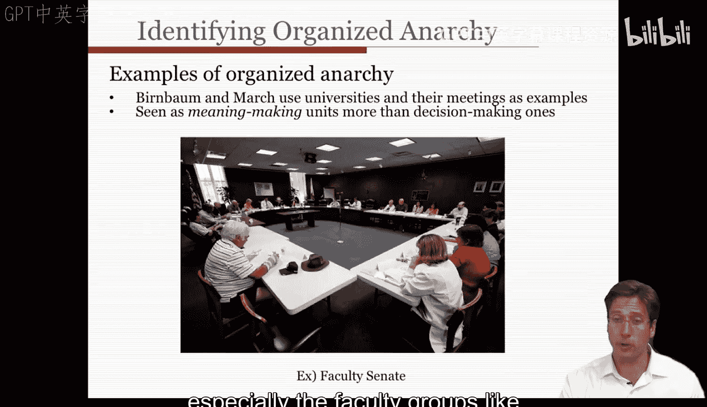
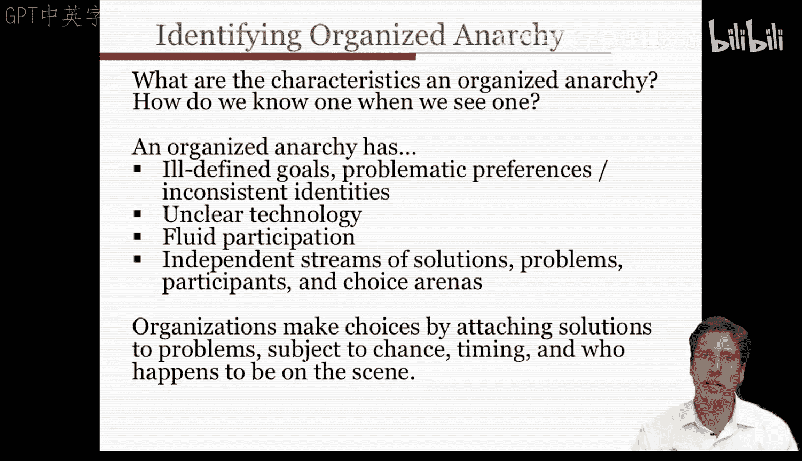
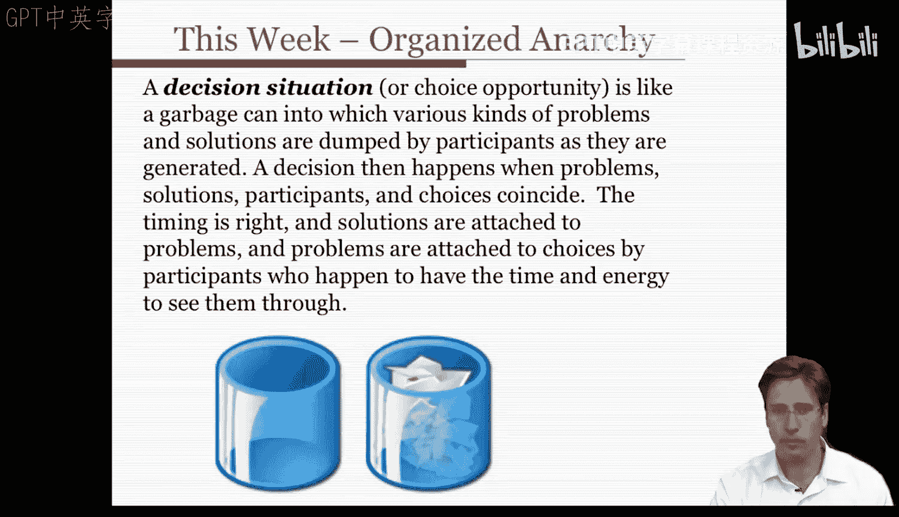
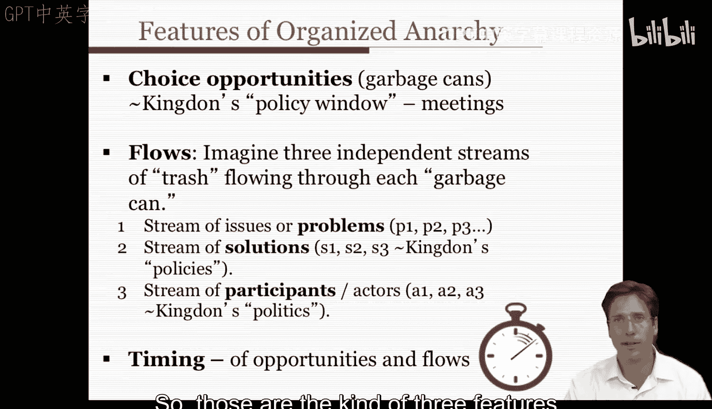
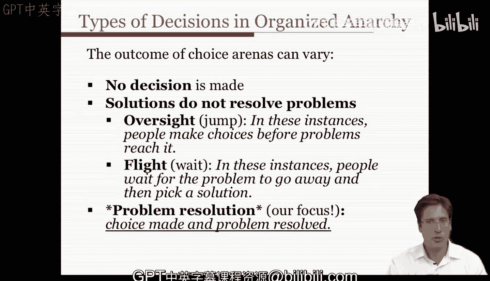

# 斯坦福大学《组织分析｜Organizational Analysis》中英字幕 p35 035_04_02_第十讲-组织化无序-第二部分.zh_en -BV17J4m157qN_p35-

So what is an example of an organized anarchy， Robert Bnbaum uses garbage can theory to describe the American College and university。

 He describes a university as a prototypical organized anarchy。

 and especially the faculty groups like departments and the academic Senate。

 He views them not as decision making organizations， but meaning making ones on page 4。

39 of his paper。 He says organized anarchies need structures and the processes that symbolically reinforce their espoused values that provide opportunities for individuals to assert and confirm their status and then allow people to understand to which of many competing claims on their attention they should respond They require a means through which irrelevant problems and participants can be encouraged to seek alternative ways of expressing themselves so the decision makers can do their jobs。

 They should also be able to keep people busy， Ca entertain them， give them a variety of experiences。

 keep them off the streaks。😊。

Streets and provide pretext of storytelling and allow socializing This is also drawn from We's the social psychology of organizing on page 264 in that book so here we have this understanding that organized anarchies within them are context for meaning making not consequence generators so that's kind of an interesting aspect of organized anarchies that we within organization need these contexts so that we feel like we have reasons and identities for being there and for addressing all kinds of concerns many of which may not be necessarily consequential or important to some groups over others。

 so that's the kind of perspective that we get from organized anarchy and the places we see it are kind of in context like meetings or faculty meetings and those kind of settings。

So now that we have some sense of where organizational anarchy can reside and the kind of general world it is。

 we can ask things like what are the characteristics of organized anarchies。

 how do we know one when we see one？And here we can kind of define an organized anarchy as having certain features。

 And in particular， that the common things that people reference when they talk about organized anarchies。

 is that they have illdefined goals， their contexts where goals aren't very clear。

 where preferences are problematic and inconsistent and there's multiple identities at play。

 So we're unsure what kind of problems matter in these contexts。 Many do。 and people raise them。

 Second， they have an unclear technology， there's unclear consequences of each proposed solution or alternative。

 We don't know how to solve our problems。 A lot of the solutions we propose lack complete evidence。

Third， there's fluid participation。 People come and go。

 There's turn over in terms of who can be part of this choice arena， this arena for decisions。

 And then last， the streams of solutions， problems。

 participantsicipants in choice arenas are constantly turning over and exist quasi independently。

 So those are the features of kind of an organized anarchy context。 And within it。

 organizations make choices by attaching solutions to problems subject to chance and timing and who happens to be on the scene to give them energy and voice。

So you notice I've said in a few cases here， choice arena or choice opportunity。

 and by that I mean a decision situation and a decision situation is like a garbage can。

 that's the metaphor that this theory uses， and it's like a garbage can into which various kinds of problems and solutions are dumped by participants as they're generated。

 a decision then happens when problems， solutions， participants and choices coincide。

 the timing is right and solutions are attached to problems and problems are attached to choices by participants who happen to have the time and energy to see them through。

In short。Garbage can theories about the social construction of meaning that's attached to a choice。

Let's take a little more careful look at each of the particular features within the garbage can theory。

First， an organized anarchy entails what we call choice opportunities and what John King will call policy windows。

These are effectively meetings， but they can also be groups that make decisions or have confluences of these issues occurring。

 and they're basically where the opportunity to make a choice is possible。

 and these choice opportunities in policy windows are often called garbage cans and the meaning of a choice derives from how the trash is organized within that can or the mix of problems。

 solutions and participants，Second we have flows and here there's distinct flows。

 imagine three continual streams of trash flowing through each can。

 it's all chaos within the garbage can， but we derive order or identify a choice in terms of the larger flows in their confluence when they connect so each stream flows relatively independent of each other so problems get generated in public opinion like educational crises of school shootings and exams。

 international exam reports solutions are constantly generated by academics and vetted when their problem isn't even recognized yet like character education or heterogeneous group classwork and participants come and go for other reasons like school boards turnover。

 teachers come and go with tenure or leave or leave the profession。

So let's look at each of these streams， the first stream of issues or is of issues and problems。

 and you don't need them to be real problems or even important ones。

 they just need to be perceived as problems by participants within the choice arena or within the meeting。

Second， we have streams of solutions， king and Col policies， but they really pertain to ideas， bills。

 programs， old and new solutions， standard operating procedures that are revisited and even changed。

 and they don't need to pertain to any existing problem， they can lead or lag problems。Third。

 we have streams of participants or actors and here Kingen calls this stream politics and it's what determine the we ask's what determines the presence of participants in the government arena。

 politics determines what actors show up and what interests are represented even if it is good for you。

 you might pass up due to political concerns on a particular issue。

 so here we have streams of participants， right？Last we have an issue of choice opportunity being guided by timing。

 so often the choice opportunity is just not there， there's no meaning， no access， et cetera。

 where the right confluence of flows just hasn't occurred。

 and this is why timing the right moment matters so much。

So those are the kind of four three features and sub features of garbage can theory。

Now the outcome of choice arenas could vary。In many cases。No decision is made。

 you can hold the meeting and no one agrees on a problem or solution。

 one idea after another is thrown out and under undermined。

 so this is often the case of a lot of meetings， we've all been in those。Second， in other instances。

 solutions that get adopted don't really address a problem， and this can arise in two ways。

 the first is by oversight or what some call oversight。嗯。

Sometimes choice opportunities arrive and no problems are attached to them。

 all problems are attached to other choice arenas so in these instances people make choices and select solutions before even an issue or a problem addresses or reaches that meeting and this is the case of like in the case I'll show you later of where the school board and the administrators are pulled away by other problems besides a desegregation order they get pulled away because of a teacher strike and they're focused on other concerns the second way is by flight and here problems are affixed to choice opportunities for a while and exceed the energy of the decision makers that are attuned to them so hence the original problem may move on to another choice arena like another meeting or department and these instances people wait for the problem to go away in order to make a solution or pick a solution so in these cases you'll see people table a decision or send it off into a subcommittee in both of these instances。

Problems don't get attached to a solution。Now of course。

 the case we are most interested in as managers of meanings and organized anarchies is when a problem actually gets resolved。

 these are instances where problems are brought up in a choice opportunity or meaning and the decision makers attending that meeting bring enough energy and ability to meet the demands of the problems here choice is made and a problem is actually resolved。

