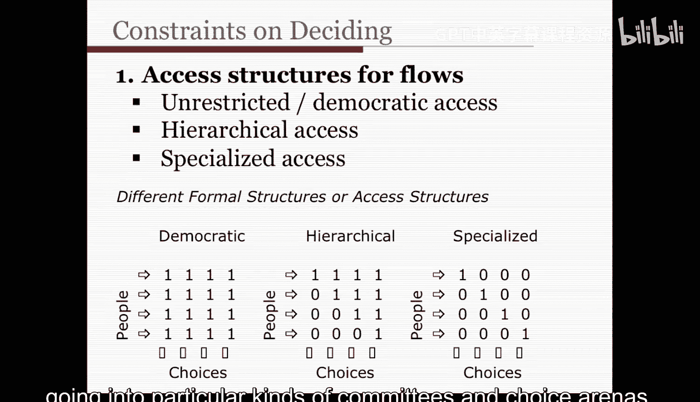
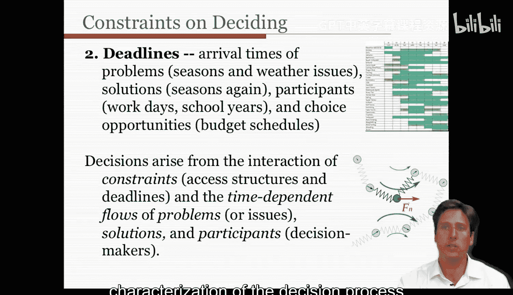
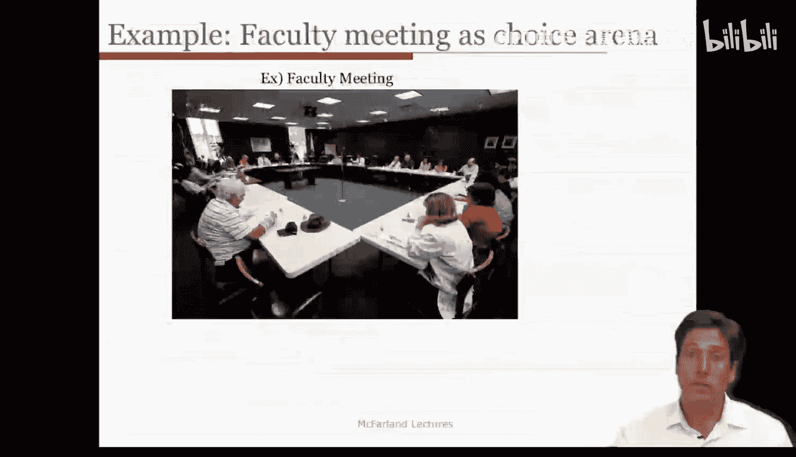
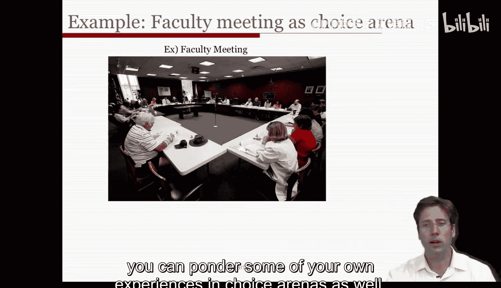
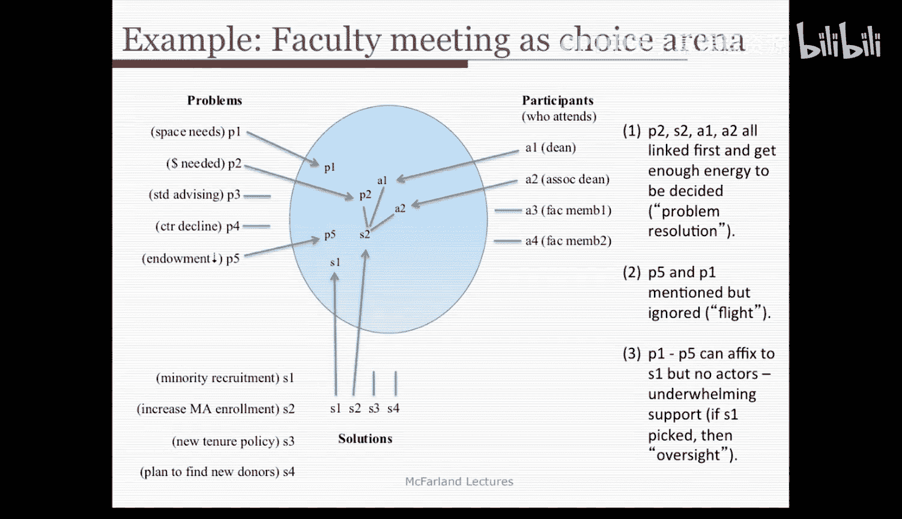
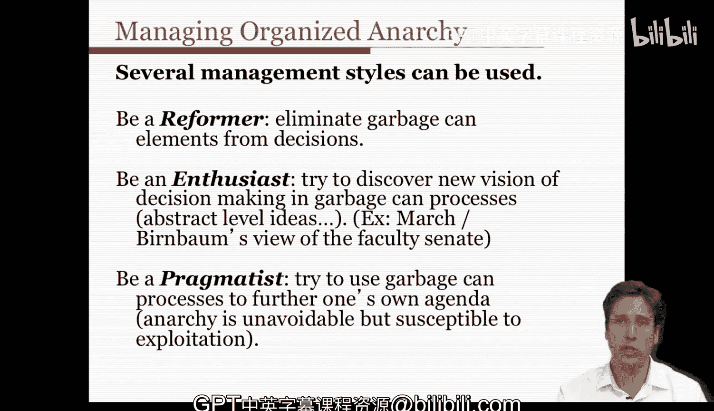

# 斯坦福大学《组织分析｜Organizational Analysis》中英字幕 p36 036_04_03_第十讲-组织化无序-第三部分.zh_en -BV17J4m157qN_p36-

Each garbage can， choice opportunity or meeting。Has different access rules， in particular。

 every choice arena has an access structure or a social boundary of sorts that influences which persons problems or solutions can enter or not。

The most loose structure allows for unrestricted access， all the problems。

 solutions and people are allowed to enter， and this creates more energy。

 but it also allows problems， solutions and participants to interfere with each other which increases conflicts and time devoted to problems so you have greater anarchy and this is kind of the access structure you see at the bottom left a democratic structure where everyone can enter every choice arena。

Another structure entails hierarchical access here important actors。

 problems and solutions are given priority access， for example。

 big decisions may occur in executive meetings， while unimportant issues are addressed by rank and file employees and subcommittees。

This might be the hierarchical image here， the middle one where you see certain people get to access all choice arenas and others don't Finally there's a specialized access structure which can occur when specialized problems and solutions have access to certain meetings like in my school to cost students incur when printing their papers on school printers that may be an issue that goes to the school' technology committee journal costs may be brought up in the library committee so certain specialists have access to certain choices that fit their expertise so engineers get pulled into these technology committees and the diagram at the bottom shows these differing kinds of access structures where in the final image you see specialists going into particular kinds of committees and choice arenas。

Another constraint influencing access to choice arenas are deadlines。

 deadlines characterize temporal boundaries and the timing of decision arenas and flows enter them here there can be constraints in the arrival time of problems。

 for example， seasonal problems like the flu or a cold like what I must sound like right now from a stuffy nose constraints on the arrival of solutions。

 there quite often we run solutions and programs in one and fivey plans。

 constraints in the arrival of participants， the timing of workday， school years。

 tenure cycles determines turnover and even constraints on choice opportunities or meetings like budget schedules。

So all of this compounds to characterize decisions in organized anarchies and decisions arise from the interaction of constraints。

 these access structures and deadlines and the dependent flows of problems or issues。

 solutions and participants or decision makers， so we have this confluence of a variety of features and a more dynamic characterization of the decision process that somewhat resembles more closely the reality of decision making in many of the choice arenas of organizations。

To this point， I've covered a lot of concepts in a short amount of time。

 let's take the example of a faculty meeting again and work through the features I've mentioned and see what they look like。

I think this example will afford you a more concrete sense of what the concepts mean and how to see and apply them in various cases of organizational decision making。

 or rather in this case， an instance of meaning making where a decision might not even be made but people come to a deeper understanding of one another。

 their identities where they stand and what issues they're concerned about。

 and what solutions they're energized about。I'll probably riff some here on my own piecemeal experiences within faculty meetings。

As well as kind of even meetings that I've had with schools and with other organizations or even with my kids kind of schooling。

 but you can ponder some of your own experiences in choice arenas as well。

So here's a massive diagram and let me try to deconstruct what you're seeing let's begin with some of the problems that might flow into an academic environment one problem might concern space usage right so here we have a faculty meeting that's the blue circle a choice arena and we have more people at Stanford then we can situate and this problem of space usage might be relevant or brought up at the meeting so P1 right。

Another problem could be the need for additional money or resources and whether the school has enough grant money to function well。

 this could be P2。Other problems might concern a student advising issue， P3。

 a troublesome student that isn't graduating。Or even a research center losing staff P4 say。

 or concerns about the university endowment and how it lost one/ third of its value in the recession P5 and how that might affect the particular faculty。

 so there are all these potential problems swirling in the environment and which ones enter differ。

The blue circle again is the meeting the arena， and let's say it's an executive committee where access is hierarchical。

 so we see that only the dean and associate dean enter。And finally， we have all these solutions。

 S1 could be a solution concerning minority recruitment。

 S2 could be a plan to increase master student enrollments， S3 might be a new tenure policy。

 and S4 might be an idea to find new donors for the school now not all of them will enter the choice arena and the agenda of the meeting might have a certain order and a particular time frame of say one hour thereby imposing a deadline on the choice。

So let's think about this P1， if we look at P1， it doesn't really seem to go anywhere。

 it enters it's brought up， but it isn't decided on before any solution enters。

 it's decision by flight。P2 on the other hand， connects or is linked to solution 1 A1 A2 all linked and they get enough energy to be decided so the decision is by problem resolution P5 is linked to P2 while they discuss P2 but the actors never see the endowment decline being solved by increasing enrollments so the faculty you attend agree the problem of not enough resources can be solved by increasing master students enrollments thereby increasing the funds gotten via tuition so that's the kind of choice decision that occurs P5 is ultimately unconnected to solution so another decision by flight and then P3 and P4 never even brought up in the meaning before it ends so the deadline affected their discussion P1 through5 could have affixed to the first solution about minority recruitment but it didn't have any kind of support or relevance it wasn't related to that。

It had been picked without connection to a problem， then we'd say it was a decision by oversight。

So hopefully through this， you have some kind of idea of how the streams collide or enter into the garbage can and how their ordering and deadline can matter。

In this case， space needs just don't go anywhere， but the concern about money and the functioning of the school is something that the deans felt like was worthwhile in discussing that day。

 and they saw certain solutions over others like the increase master's enrollment as the most relevant and that's where they went and selected。

 whereas others just didn't go anywhere， particular solutions may have been brought up。

 but not really seen as connected to the problems being discussed and eventually like I said。

 the time runs out and the arena is closed， the window is done。

With all this in mind in the concrete case behind us where we have some sense of how the concepts are applied。

 we come to the question of how do you manage organized anarchies， how do you manage this fluidity。

 this dynamic， how do we approach it？And there's several types of reactions that can emerge in response to a garbage can or an organized anarchy。

 First， a lot of individuals and managers try to be a reformer。

 they try everything they can to eliminate chaotic elements from decisions so they create greater systemity greater order control and in a way this is what a lot of corporations do and it's what daily and vast did in the Chicago school case they centralized rationalized fixed streams and access etc anything to remove those chaotic dynamic elements Second though you can go the opposite direction。

 you can be an enthusiast here you try to discover a new vision of decision making within garbage can processes and this is sort of what march and burn bound argue people should do in choice arenas like of faculty Senate here or even any kind of meeting here the manager needs to realize the plan going。

On is largely symbolic。 It's an excuse for interaction in sense making。

 It's a way to make people feel like they belong and to learn about views and identities of each other。

 Lona is more for sense making and getting observations than making decisions about much。Also。

 the managers and enthusiasts can view temporal sorting as a way to organize attention。

 the order can indicate what's more of concern for collective discussion。

The enthusiasts will also focus on the flows of problems and solutions and regard them as a matching market where energies and connections are mobilized。

 recognizing who's present， where lengths， time and energy are sufficient。

 and then pressing the case is how you would approach this kind of context as an enthusiast。Last。

 the enthusiast would see advantages in flexible implementation， uncoordinated action and confusion。

 it's okay not to decide at times and to make choice arenas into a space of meaning making。

 that's how an enthusiast would view this and those kinds of organized anarchies。

And then there of course is a middle route， you can be a pragmatist you can use garbage can processes to further your agenda。

 The idea here is that organized anarchies are susceptible to exploitation so as a manager here you can time the arrival of solutions knowing attention is scarce as such you can set the meeting agenda and work the order of issues。

 you put ones you want discussed upfront put last the ones you know everybody already agrees they need and needs to be passed but you don't want them discussed to much detail。

 so you put them at the end of the agenda and rush the decision so that it's quickly done Another thing that you can do as a pragmatist is be sensitive to shifting interests and involvement of participants be opportunistic and when certain people aren't at the choice arena press on issues and solutions you care about that they would oppose if they were present because they're not there you can mobilize in that direction。

Third， you can abandon initiatives that are entangled with others if streams get tangled。

 if other problems are affix to your solution。Then the opposition is present， move on。

 view it as an opportunity to go to other issues， and if an agenda arises that doesn't suit your interests。

 overload the system， to protect your interests， bring up other problems and solutions。

 slowing the process and making it complex， demobilize things in that way。

You can also provide other choice opportunities， other meetings to attract decision makers and problems away from choices that interest you。

 in this way， you open up time for the issues you're concerned with。 By that， I mean。

 you just create subcommittees table things and them elsewhere。

 So you have options on how you want to confront organized anarchy situations。

 understanding how these arenas operate afford you different levers to try and hopefully the ones related here give you some sense of how to win。

I hope you find organized anarchy models useful。 I find it especially helpful because it renders pathologies of choice theoretically consistent all too often real choice arenas are messy。

 and this theory embraces that mess and the dynamics and it affords as some kind of framework for making sense of them。

 I find garbage can theory useful， and especially helpful in explaining all sorts of meetings where their ecologies of choice and where problems and solutions are fluidly discussed。

 It fits policy governmentover worlds research and development groups。

 crisis management situations and most any distributed decentralized social system trying to deal with issues like a university department of faculty Senate a partner meeting and so on。

 So I see this is as actually a quite relevant theory in spite of what seems to be a lot of discussion about dynamics。

 ambiguity and meaning making， it does have quite a bit of applicability and relevance to you is both an analyst。

And a manager。