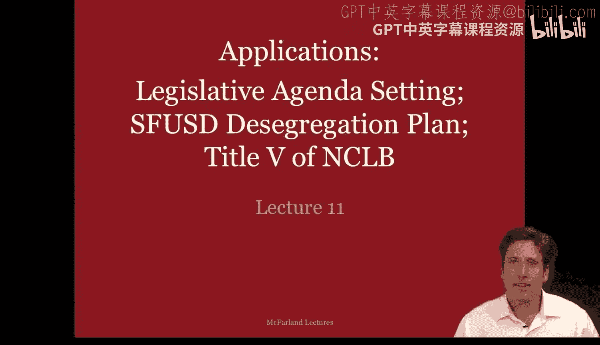
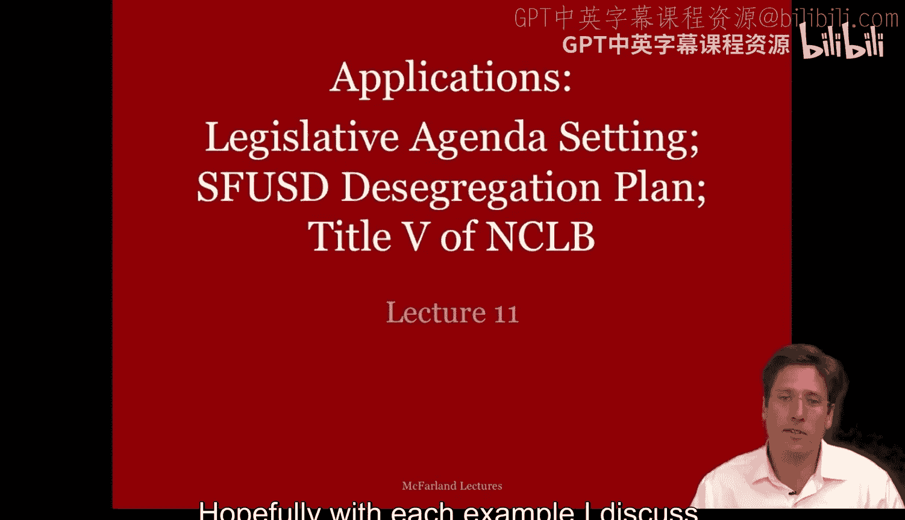
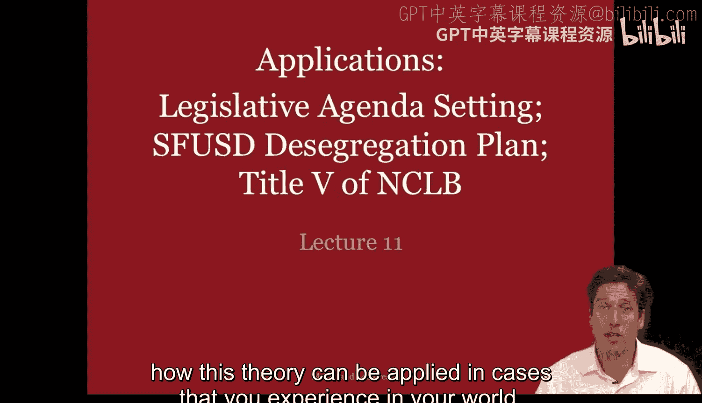
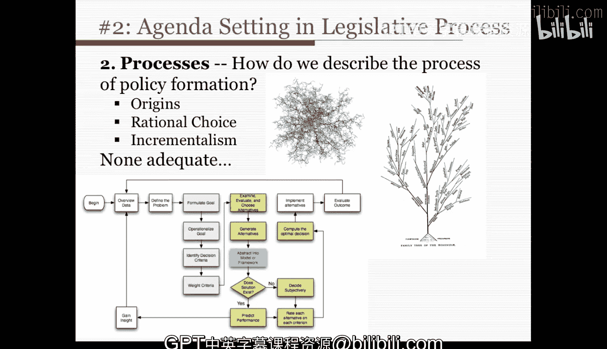

# 斯坦福大学《组织分析｜Organizational Analysis》中英字幕 p37 037_04_04_第十一讲-应用案例-第一部分.zh_en -BV17J4m157qN_p37-

This lecture will cover a series of examples and applications of organized anarchy。

 hopefully with each example I discuss， you'll see greater relevance and form a more concrete understanding for how this theory can be applied in cases that you experience in your world。

I have three examples I want to discuss in this lecture。

 the first concerns the case of San Francisco Unified school district's effort to undergo desegregation in the '70s。

 and it's a story told by Stephen Weiner。I'll list this reading in the slide here in case you want to find it on your own。

 I want to show you how that case can be elaborated using the garbage can framework laid out in the last lecture following that。

I want to discuss John Kingdom's bookAndas， Alernatives and Public Pol John Kingdom writes a very nice summary of garbage can theory and its application to the policy world and how legislative agenda setting is performed。

I think it's a great read that I hope all of you will experience。Last。

 I'm going to discuss the recent case of Title V and the No Child Left Behind Act。

This concerns a federal act to reform the American education primary education system。

I'm going to recount it briefly using materials that most of you can find online。

Now I understand many of you won't be familiar with some of these particular cases I'm relating。

So I'm going to offer a little bit of a review in summary so you get the gist。

 the point of the examples is just to get you thinking as an analyst and manager。

 applying theories to cases， it might be a good exercise for many of you to try applying these theories to cases you're more familiar with in your own context or which interest you。

 just view the ones I relate here in these lectures as models and caricatures that you can apply。

 extend and elaborate further in particular cases of your interest。

The case I want to discuss first was written by Steven Weiner。

 and it concerns San Francisco Unified School district's desegregation plan adopted in the 1970s。

Let me give you the general story so you see an arc of what happened in the 1960s San Francisco Unified experiences white flight at the same time desegregation cases hit the legal courts in southern states and cities and moves north and west throughout the country。

 no actions taken by San Francisco unified during this period and the NAACAP。

 the National Association for the Advancement of Colored people。

 complains and warns the district it is too segregated。

 and during this time San Francisco Unified develops a desegregation plan that's immediately rejected in committee due to crosstown busing fears because they think it would be hard to manage and be unwanted。

 so instead a citizens committee forms and develops a desegregation plan for only two of over 10 elementary schools。

So in 1970， what happens is the NAACAP files a lawsuit demanding all 102 elementary schools of San Francisco Unified be included in the desegregation plan。

 and a US district judge doesn't want to rule on it until the Supreme Court rules arguing that San Francisco unified made a small effort with two schools and therefore is showing good faith。

 so the judge advises San Francisco unified to devise a plan。

 and San Francisco unified appoints one staff member and three kind of weak committees。

 a staff committee， a certified staff committee and the most important a Cizen Advisory Council and the third committee has the most energy and committed members of all three。

And by 1971， the US。 Supreme Court rules， San Francisco Unified must desegregate its elementary schools and it has two months to devise a plan。

 so the case is really a process of a partial decision and little or nothing happening。

 it's a pretty common occurrence when it comes to policy and district reforms。

Why should we think that garbage can theory applies and can help us understand the process of relative indecision here。

 that's basically what we're confronting with San Francisco Unified。So let me。

Deconstruct that a little bit first， this is a case where it'smb。

 ambiguous as to what desegregation means。Problems and preferences are unclear。

 It's ambiguous how to accomplish desegregation。 We don't know what the actual metric is at which you've actually obtained a decent enough desegregation level that would meet the courts。

 Moreover it's unclear what the solutions are and how to accomplish it what technologies and there's a tight deadline Also the participants in this case keeps changing judges turn over different committees form and dissolve the threat of a lawsuit creates this choice opportunity at a particular time。

 so it has these kind of garbage can elements to it。

So let's look at the actual case and identify the problems that Stephen Weiner mentions the key problem is that of desegregating the elementary schools and I've listed this for whatever reason is p6。

And it's down there halfway on the list at the outset the participants aren't sure what integration should look like they eventually adopt a state standard that's pretty strong all the schools have to have racial compositions within 15% of the district average so every school has to kind of resemble the district average within a 15% error a bunch of other problems keep entering the choice arena and they're interrelated somewhat for example keeping the integrity of school complexes and communities community schools right that's a concern in the problem bilingual education is a problem and in dire need busing is considered a problem by whites and this has led to the problem of white flight。

There's a problem of SES integration or socioeconomic levels that would be integrated to in addition。

It's not just desegregating the primary schools， it's the secondary schools。

 the high schools that's also of concern。Meanwhile。

 other problems arise but they aren't really taken up in the choice arena of the CAC we're going to focus on the CAC meetings and those kind of committees。

 for example the teachers and students boycott schools that are in disrepair because of budget problems。

 there's a lawsuit filed by Latin American organizations about bilingual education。

 there's financial problems are apparent with contract disputes and finally the teacher strikes if all these other problems that are occurring at the same time that the courts are demanding San Francisco go through desegregation plan。

A variety of participants are involved around six， but only some of them enter the choice arena again。

 about desegregation。 For example， one group is a community interest group another group。

 the second one consists of federal consultants who are outsiders with little understanding of the constituents' concerns and third is as citizens advisory council which has access to the meetings。

 but only white middle class women stay atho moms actually have time to attend the working men and minorities are unable to make it so it ends up that certain individuals have the most energy and and access to these committee meetings which occur during the day during the workday Finally there's other kinds of actors such as the San Francisco unified consultants administrators but they're drawn away to those other problems the six through ten problems about teacher strikes so they're pulled away to other choice。

Senas and so are working minorities and working manner， which are other kinds of actors。

And so within this choice arena of meetings concerning desegregation。

 only certain participants come and recognize problems。Meetings。

 a variety of solutions are proposed and discussed， actually Weiner discusses 24 of them。

 so there's almost too many to list here in a short summary。

 but only two of which become a point of heavy discussion and are connected closely to the kinds of problems。

 the core problems being discussed in that committee and the first one is a triSt plan。

 which is a threez plan that was written by technocrats。The external consultants。

 which didn't take into account concerns about white flight and the preservation of community schools。

Another solution is called the Hesshoe Plan， it's a sevenzone plan which is less dramatic in terms of its desegregation and it wins because it meets the intersection of flows。

 it meets the problem of preserving community schools as well as kind of dealing with thesegregation to some extent。

 more of it has a lot of energy from the local residents not considered is the simple solution of crosstown busing so not every solution is addressed or considered but a large variety are and the one that's eventually picked is because it connects most to certain problems that are valued and have the greatest amount of participants latched onto them。

So let's put this all together now in a complex diagram， but I think it's effective if we view this。

 certain actors in this context get pulled away and don't ever really enter。

And those are A4 through the San Francisco Unified consultants administrators they're pulled away if you go across the screen there to problem 7。

 eight，9， and 10。The strike， the boycott。They had to deal with all these other things。

Other actors like A5 and A6 just can't make the meeting times they' during the workday。

 so those people just don't enter the choice arena。

Within the arena the CC is composed of mostly white middle class females and their attention and energy is placed on P1。

 the integrity of community schools and this is related to P3 how busing might lead to white flight they also see the solution。

 the second solution， the horsehoees solution as partly addressesing the dissegregation order as well as P1 this integrity of community schools By contrast the dotted lines that I drew here show what the federal consultants saw。

 they saw S1， the Tristar plan as the best solution because it addresses the dissegregation order best but this set of actors don't see it as connected to the other problems of preserving community schools and therefore it's kind of undermined by other members of this choice arena in a way this kind of diagram sums up the decisions that arose and why the timing kind of pressed it and what。

It did and what it meant for the participants within this context， if we had different participants。

 if we had different problems being proposed and connected。

 and if solutions were latched with different energies to other problems then we might have had an entirely different outcome in this context。

 and that's the point of the garbage can model， it's the confluence and the connection between these disparate flows that explains or characterizes the actual choice that arises。

Let's next turn to John Kingdon's text。 Kingdon does a nice job of summarizing some of the major tenets of organized anarchy。

 He does this in his focus on the American health and transportation policies that arose during the 1976- 1980 presidency of Jimmy Carter。

Kingdon asks。A fundamental question， which is， why do certain issues become part of the government's agenda while others do not？

Kingdon's research finds that policy proposals are not necessarily written in response to a particular event。

 Rather， at any given time， there exists a multitude of proposals ready to go and they waiting for the best opportunity for their introduction。

 An idea's time comes via a process of organized anarchy。

 So let's look at how kingdomdon regards federal agenda setting as such a process。

 Kingdon looks at the federal agenda setting as an organized anarchy by first asking who are the participants。

Let's start by identifying the various participants in Washington， D。 C。 within the government。

 there's first Congress， and they have an upper and lower house， the Senate and the House。

 plus congressional staff， they have scheduled election cycles of two and six years。

 So there's some turnover amongst them。 Second we have the president。

 plus his cabinet staff and political appointees， and his presidency has a large say。

 an agenda setting， but less control over alternatives。

 all kinds of other legislation can be proposed conminously。

 And his election cycles every four years and turnover is then even if he is reelected for another four or so among the staff。

 you do see some turnover。Last， there are civil servants。

 and these are bureaucrats who have longevity and expertise and they turn over less frequently。

 the technocrats that have a career in terms of doing this kind of legislative policy work。

Outside the government， there's all sorts of other actors like lobbyists， labor。

 professional societies， public interest advocacy。Organizations。

There are also academics like me and other researchers， there are media outlets。

Voters and constituents and general public， so you have all kinds of other actors and participants that can affect the legislative process and turn over somewhat rathervariably。

Next， what is the process of policy formation in what ways can we consider how a policy originates and develops here Kingdom considers a few different models by which scholars have characterized policy formation first。

Concerns origins。Here， the view of policy formation depends on where the idea and policy came from。

 how did the idea spread， and the assumption here is that it started somewhere and got taken up more and more。

 so we have this kind of idea of the spreading policy that had some kind of initial point and if we just follow that origin。

 we'll have some understanding of how it developed。

Second we have this view of rational choice and we saw this earlier in the course this is actually a great diagram that summarizes that theory here the view is that we define the goals determine alternatives。

 choose the optimal alternative， for example， the policy in question。

 and therefore its adoption is based on predictions of the policy's consequences。

 so the explanation of that policy's arrival and formation and existence。

 it is a process of rational choice and considering the consequences of it as an alternative。

The third view he says， is one of incrementalism rather than starting from scratch。

 new policies actually build on existing policies， changes are made at the margins and what we see today is an adaptation of prior policies。

 so here I put evolutionary tree where the idea being that a policy from before is nothing more than an adaptation of prior ones so Kingden argues that each of these。

Kind of depictions has some value， but they don't adequately describe the process of policy formation as completely as garbage can theory does。

 He proposes these as relatively deficient and inadequate valuable。

 but not as complete as the alternative， which he's going to argue as organized anarchy。

 at least for the process of agenda setting in legislation。

