# 斯坦福大学《组织分析｜Organizational Analysis》中英字幕 p38 038_04_05_第十一讲-应用案例-第二部分.zh_en -BV17J4m157qN_p38-

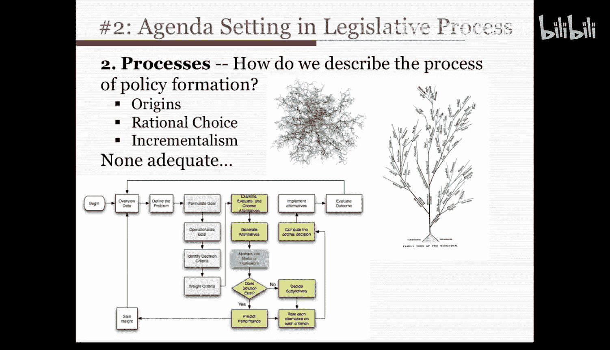

So Kingman argues that an organized anarchy perspective provides a more complete understanding of agenda setting and legislation。

Now let's take a step back and ask， does it actually resemble an organized anarchy。

 does it fit the criterion we set out earlier in the prior lecture about what an organized anarchy entails so first we have to ask。

Is it a context of problematic or inconsistent illdefined preferences and here he says yes。

 of course， action is often taken before identifying preferences。

 participants disagree on preferences and priorities in terms of proposing legislation。

 so the second thing is， is there unclear technology？

How the government attempts to solve problems is really unclear， says kingdom。

There isn't a clearly defined way to desegregate schools。

 eliminate the achievement gap in child poverty and so on， he says， you know。

 it's not like making widgets， these policy prescriptions aren't clear， have clear consequences。

 they don't have that。Third there's fluid participation and there's a good deal of turnover and personnel The importance of participants doesn't match their job description and the executive branch is often involved in legislative processes participants outside the government enter and exit the decisionmaking process all the time so access varies its fluid。

 the federal government would seem to be an organized anarchy as defined by March Olson and Cohen so Kingman's adaptation of garbage can theory conceptualizes them as having three independent streams。

 the problems， policies or solutions and politics or participants they converge at a couple of critical points and it's this process according to kingdom that sets the agenda of legislation and he sees these streams as somewhat independent problems flow in and out of focus in the news and for legislative actors。

 the policies are generated and sit around for years。ing。AndPart come and go。

 and the opportunities for decisions， the choice arenas， the garbage cans， arise at different times。

So according to Kingdom， this case of agenda setting clearly fits un organizedized anarchy kind of model。

The independence of these streams is a key point that I want to reiterate policy solutions can be developed whether or not they respond to an actual problem。

 the political stream is not necessarily dependent on identified problems。

And as Kingdon says on page 88， advocates develop their proposals and then wait for problems to come along to which they can attach their solutions or for a development in the political stream。

 that makes their proposals more likely to be adopted。So。

These three streams must converge when a policy window is open。

 that is only when the conditions are right， will an issue find itself on a policy agenda。

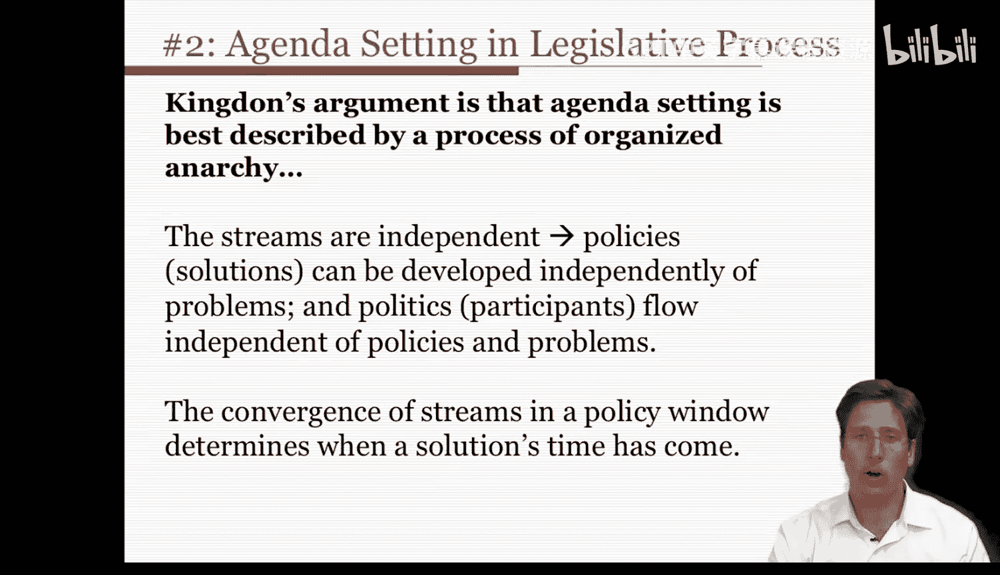

Most of you got to read John Kingdon's text， so I'm not going to rehash his application of the theory to particular instances of agenda setting instead I want to apply garbage can theory to a new case many of you might not be familiar with in this way I can afford you multiple examples so you can see how the theory is applied in many instances not just one In addition I want you to know that when you do the peer evaluation for some of you taking the advanced track。

You're going to see it applied to the Milwaukee voucher program。

 so again you'll have yet another case and another application where this theory is applied。

In this lecture， my last example is going to concern a recent policy decision。

And it's Title V of the No Child Left Behind Act。The promotion of informed parental choice and innovative programs。

Briefly， No Chai Left Be is the name of the 2001 reauthorization of the 1965 Elementary。

And Secondary Education Act， and that was part of Johnson。

 President Johnson's War on povertyover when it was originally passed the primary focus of the Elary and Secondary Education Act was on improving the education for economically disadvantaged students who Me Federal Defitions of Poverty Over time the elementary and Secondary Education Act was expanded to include Bilingual Education education to Indigenous communities。

 education and correctionction facilities， magnet School Foreign Language Programs Mid Bas and even migrant education。

 so the elementary and Secondary Education Act since then has been reauthorized several times。

 so since 1964 it's been reauthorized several times。

 usually for approximately four to sixy periods the one we're talking about was signed by President Bush entitled No Child Left Behind Act of 2001 and it was put into law on January 8 2002。

So Title V provides federal grant support for innovative programs and public charter schools。

 it also adds a new incentive program to help charter schools meet their facility needs included in this section is a provision that provides transportation and other support that allows students attending schools that do not meet what's called adequate yearly progress or standards of improvement that the legislation sets out for two years if they fail that they're able to transfer to a charter school or other public schools。

 so it's a pretty extensive piece of legislation that's greatly affected the American education system。

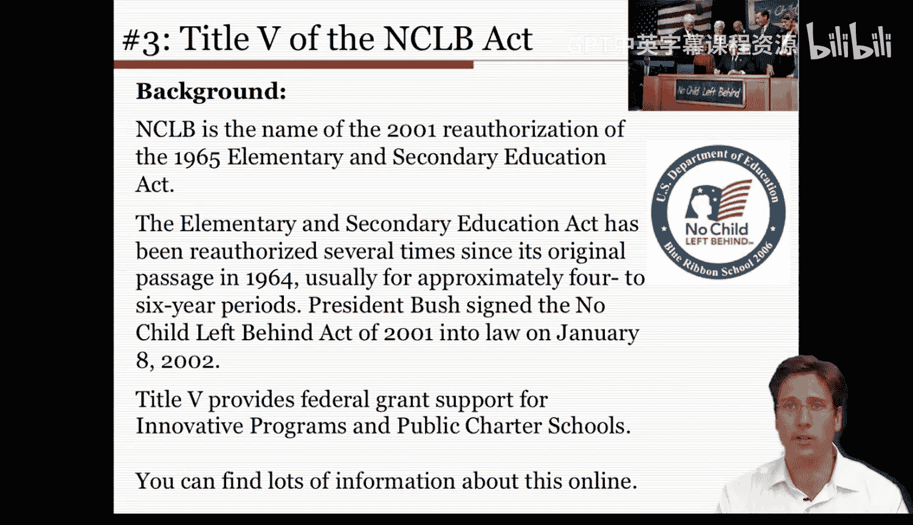

So how would we use kingdom's model to describe how Title  V entered the agenda and ultimately became law。

 Well， first， we'd look at the problem stream at any given time。

 a set of problems may arise in prominence and capture the attention of governments。

 often not because of political pressure， but because of systematic indicators that purport to prove the existence of a problem。

 That is， problems may not necessarily be true problems。

 They merely have to be problems in the minds of some subsection of the public in order to be considered。

 So we have to ask， what problems could Title  V purport to solve。

What are some of the indicators to this problem and what is the public's perception of this problem？

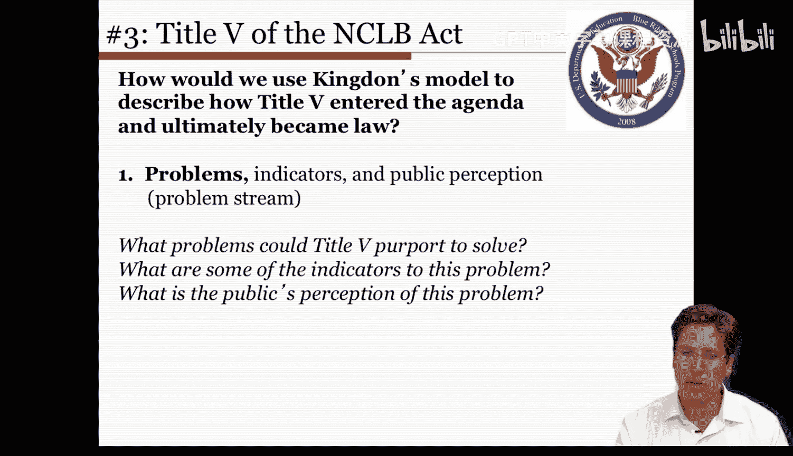

So let's consider each of those questions in turn and try to answer them first。

 what problems could Title V report to solve？Well。We have failing schools with no signs of improvement。

We have public schools that lack innovation。And people perceive charter schools。

To be an incubator of innovation。Third， public schools aren't pressured to improve because there isn't much competition。

Fourth， there's unequal opportunity for lower income children。

 and these families have fewer options because they can't afford private schools and charter schools may be considered to be a free public school of choice。

Finally charter school proponents claim that they receive disproportionate amount of funding or per pupil funding from the state so there's a concern there of a problem now in most cases we would agree that these are probably true however I want you to understand that it doesn't necessarily matter if you think it is what matters is that a subsection of the population that there is energy behind or actors affixed to these kinds of problems Now what are some indicators of this problem or each of them first there are international indicators and comparisons and tests so we all know from comparative assessments between countries and educational attainment levels and achievement levels the United States is somewhat falling behind second we have the achievement gap literature which argues that by race income and urban rural comparisons or urban suburban comparisons that there's disparities third we have government。

valuations and other studies that show quite a few problems in schooling as well and all of these suggest some kind of indicator of the problem existing beyond just our opinion third。

 what's the public's perception of this problem well there are a variety of them kind of flowing in the environment at this time and the public opinion at the time was that the schools in general are failing the constant bombardment of media messages saying so kind of leads people to feel that this is likely true albeit they think their local school is probably a little bit better than schools in general second most Americans at this time had kind of a favorable opinion of market forces and they think like choice is something that's amenable。

And might lead to improvement and third we kind of have at this time a rhetoric that's related by leaders and high profilefi media figures and one of the quotes that's emblematic of this that's characterizing a problem is George Bush President George Bush's characterization that soft bigotry of low expectations is existing in the schools and therefore we need to address this problem。

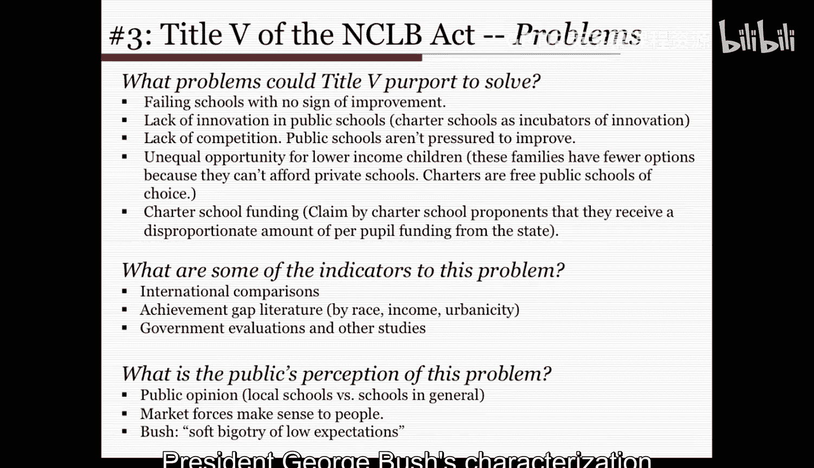

So there are streams of problems in the environment that correspond with no child Left behind。

At the same time， there's also a stream of solutions that are occurring。

 all sorts of alternatives and policies that are being proposed in this environment that are possibly competing alternatives。

And here within governments， specialists， including lawmakers， staffers， advocacy groups。

 researchers and academics all concentrate on developing policy proposals。

 And as Kinggan says on page 117， he says ideas are floated， bills introduced， speech is made。

Proposals are drafted， then amended in response to reaction and floated again。

 so there's a constant stream in the policy world of proposing all sorts of alternative solutions and policies kinds of plans for addressing the problems we've just mentioned。

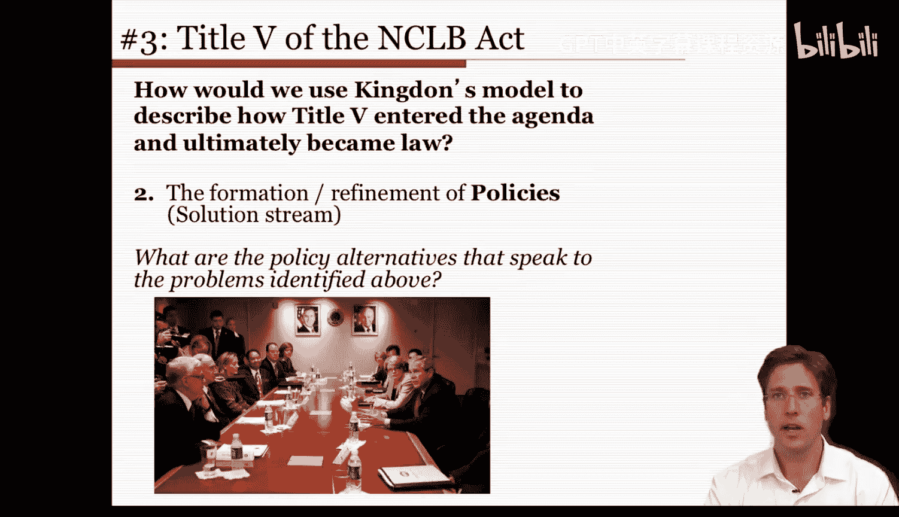

So let's look at this a little more closely， what are the policy alternatives that speak the problems identified above？

One could be school vouchers here a student would get so much money from the state and could get a voucher to go to another school and apply that funds to that school and attend。

 another would be to promote charter schools， which is kind of like vouchers。

 vouchers it affords some degree of choice you can apply to different schools that afford a particular kind of program。

 but there's still public schools， the  voucher itself could be taken even to a private school。Third。

You could view public school improvement as a policy or a solution that's proposed。

 but how here are the issues unclear technology。One could focus on improving instruction like teacher preparation programs。

 professional development programs or even new curricula another way would be to structure the schools better like with ability grouping class size reduction extended class days so on I mean there's quite a few that you could extend just there another would be accountability you can you can assess adequate yearly progress。

 have annual testing with rewards and punishments and this is actually one that no child Left behind adopts another is that you can throw money at the problem you can offer more money to schooling or you can just ignore and play the blame game so it's not the role of the federal government This is the fault of state governments。

 school districts， schools and or teachers so all of these are viable alternatives and you just need to remember in kingdom's model that the policy does not necessarily follow the problems these policy are alternatives in many cases or developed independent of the problems we've identified In fact。

Most of no Ch Left Be， including the accountability provisions， were developed under Bill Clinton。

 his presidency， when a former graduatera School of Education member in my school。

 Dean Mike Smith was the under secretaryecretary of education even and avowed not a rep。

 so even though you have these kinds of differences in politics in terms of turnover。

 the policies itself had been sitting on the shelf and had just been taken up at a different time period under a different set of actors。

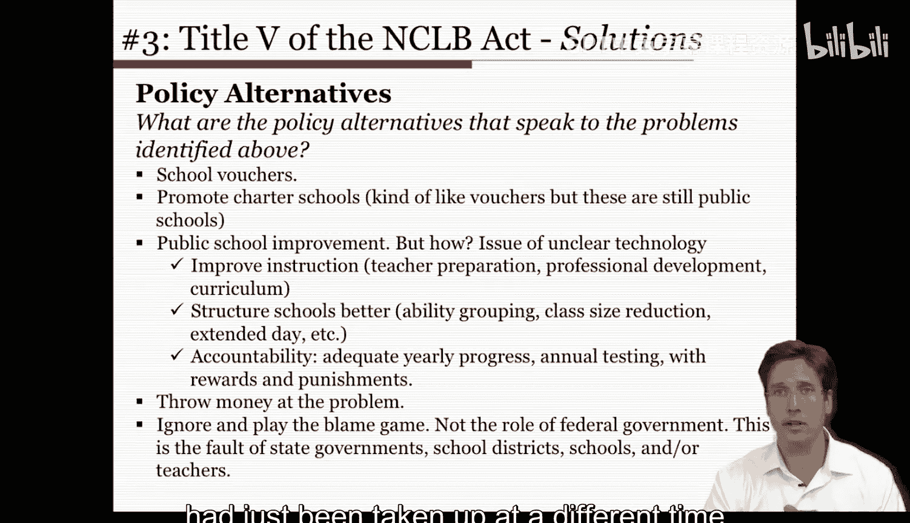

The third feature we look at when we apply organized anarchy to the No Child Left Behind Act is that we look at the politics or the participants involved。

And here， the political stream corresponds to what Cohen March and Olson call the decision maker stream or the participant stream。

Even when a policy solution attaches to a problem， passage isn't guaranteed political factors such as partisan concerns。

 ideological distribution of policymakers and interest group lobbying can work against any proposal。

 no matter how complementary it may be to a policy problem。

 so we have to consider the actors and participants involved。

 and the politics guiding their access and presence to this policy arena。

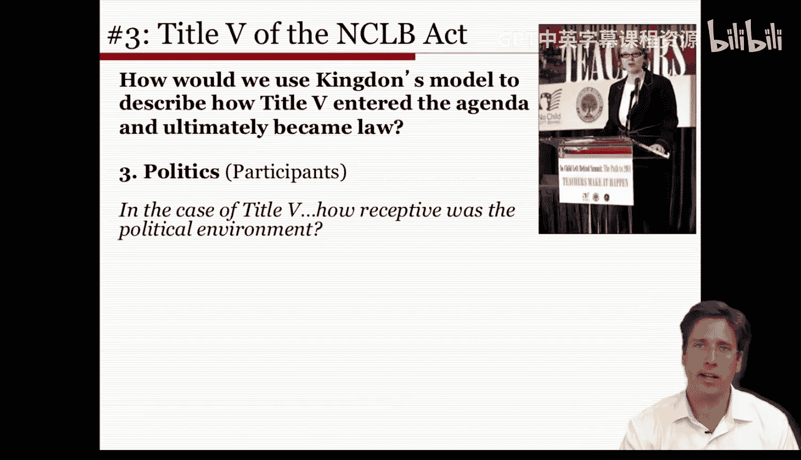

In the case of Title V， the Reauthorization of Elementary and Secondary Education Act。

 it was signed in 1994 and was scheduled to expire in 1999。

 Congress and the Clinton administration began work on the reauthorization process in 1999。

 and in 2000， it failed in both attempts to finish the work。

Education was a central component to candidate George Bush's platform， and when Bush entered office。

 one of his first actions was to send to Congress a broad outline of his education proposal。

 he vowed to leave no child Left behind， which was hard to argue against un rhetorical grounds。

 there was little congressional criticism of the final version of the bill。

 it actually passed 87 to 10 in the Senate and 381 to 41 votes in the House。

 and it received support of even the most liberal members， including representatives George Miller。

 Barbara Lee and Senator Ted Kennedy， so it had great bipartisan support and if you recall from our discussion of solutions or policy alternatives above。

 school vouchers were an alternative， although original versions of no child Left behind contained voucher proposals for private schools。

 this was given up in order to make the necessary concessions for the Democratic support。

requiredqui for passage。 So in other words， the political environment was accepting the provisions of no child Left behind as it was passed。

 It was not accepting in the time of President Bill Clinton。Since that time。

 there's been some criticism mainly around funding issues。

 but the public is still supportive of the general measures of the law。

 so the time was right when the right participants in politics were in place to accept this bill。

 even though it had preexisted in a very similar form in a prior era。

The final feature of an organized anarchy model can be applied here as well。

 and it concerns the policy window and the policy window pertains to deadlines and the convergence of streams we've discussed the three streams of problems policy alternatives and policy but these streams have to converge while a policy window is open in order for legislation to move。

 Think of it this way。 NASA has a launch window， a time period in which a particular rocket must be launched if it's to hit the right orbit to void the cloud cover and storms and what have you if they miss that launch window NASA has to wait for the next one before it can go and they mobilize a whole series of processes to make that launch coordinated and to happen the same is true under kingdom's model there are particular times in which a policy window is open the policy window isn't indefinitely there。

 there are deadlines which constrain。

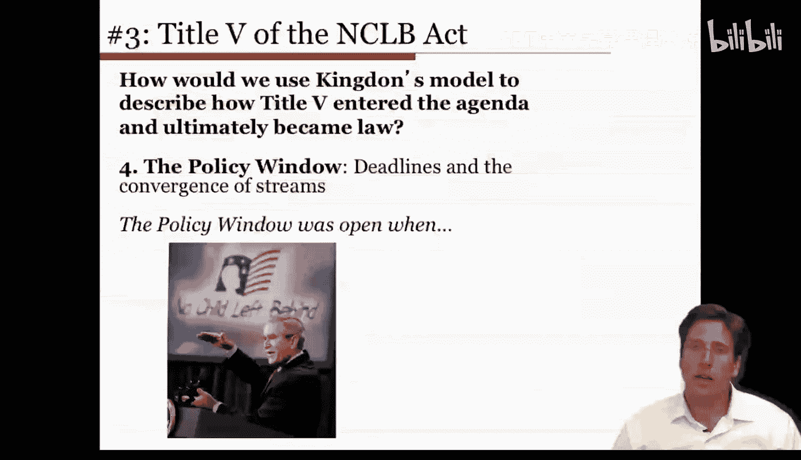

The amount of time that problem alternatives have in order to be implemented， for example。

 decisions typically must be made by the end of the legislative session。

Failure to do so means that the process would have to begin from scratch at the start of the next session。

 In addition， legislatures are systems composed of decision makers that can change from one election to the next。

 A favorable set of decision makers may disappear to be replaced with a new set of decision makers at the start of the next term who may be less willing to support the provisions of Title V。

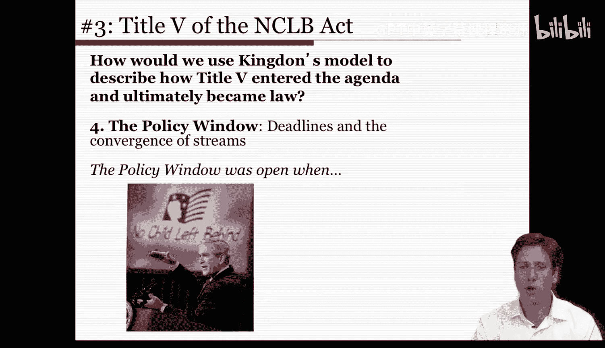

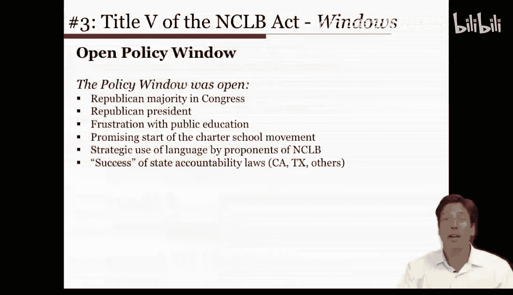

In the case of Title V， the policy window was open when there were a variety of political actors in place。

 For example， there was a Republican majority in Congress and a Republican president in Clinton's reign there toward the end of his era as president。

 we had a Democratic president but then a Republican Congress they weren't a line in addition during Bush's era in 2001 we had frustration with public education that was generally felt in the populace there was a promising start of the charter school movement and there was strategic use of language by proponents of this bill。

 even the title No Child Left Behi was evident of this the success of state accountability laws was also ongoing like California and Texas and others but most of the time the policy window for this act was closed。

 so it was really a brief window。All of these actors could agree and put their support and energy behind this bill and affix it to particular problems of low achievement and achievement gaps。

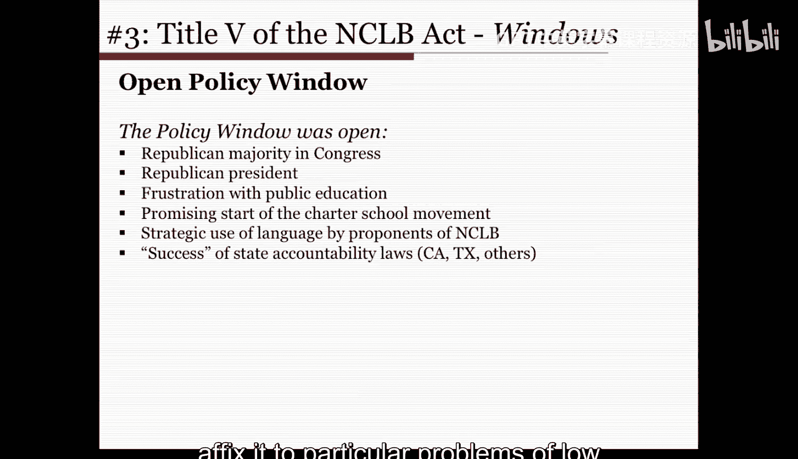

So in the end， if we put all four features of Kingdom's model together， we see the following table。

 it's super dense， I know， but it might be useful to you and it might help you understand better how that legislation's time occurred under the Bush's presidency in its particular form and not well before under a different guysise and during Clinton's era so hopefully this kind of summary of these particular policies and their application and relevance to garbage can theory will help you understand how they are kind of organized anarchies and possibly ways in which you can manage them better。

 hopefully as an enthusiast or at least as a pragmatist in your own affairs。

