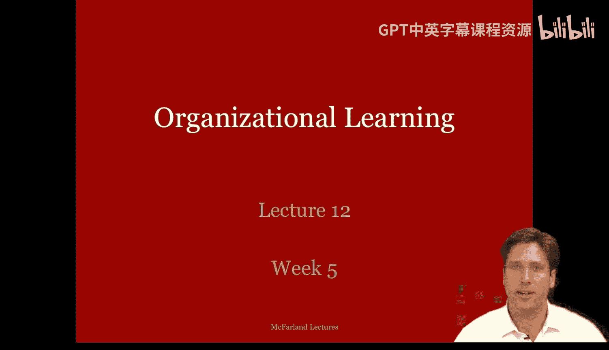
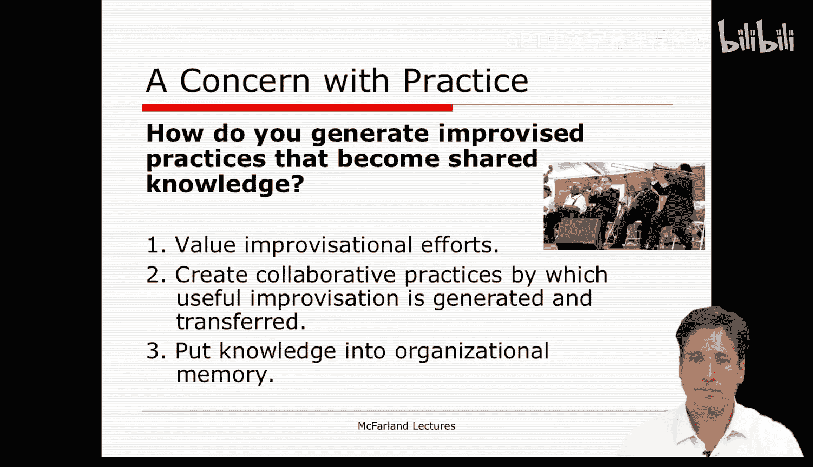

# 斯坦福大学《组织分析｜Organizational Analysis》中英字幕 p42 042_05_01_第十二讲-组织学习-第一部分.zh_en -BV17J4m157qN_p42-

In this week's lecture， I will describe the theory of organizational learning and what it entails。

Before we begin， I want to briefly revisit our theory of organized anarchy by retelling how one of our in class exercises went。

As a capstone experience of organized anarchy， I try to create a garbage can situation for students to experience in my class Every year I call a meeting with the students and ask them to discuss the course in its grading policy。

 I even tell them I will adopt a new class format and grading procedure if they can all agree on one and can convince me that it will improve the learning experience for them and I'm dead serious about this。

 I do adopt the actual changes they propose if they agree on them。Now to help with this process。

 I ask them to identify various problems so I create a problem stream where they do。

 and the problems they identify as follows， there's too much reading。

 lecture materials go by too quickly， not enough time for individualized projects。

 not enough time for group projects and discussion and so on。Anyhow。

 I then asked students to create a list of policy changes they'd like to see in the course。

 so they create a solution stream as well。And often they ask that I allow them to rewrite papers。

 they ask that everyone gets 10 points added to their grade， pretty clever。

 or that my lectures be posted online， or even that exemplary papers be shared with the rest of the class and all too often there's little connection between these two streams。

 so the problems and solutions aren't related， for example。

 the first two solutions of rewriting papers for a better grade and giving everyone10 points。

Don't seem to address any of the problems they listed earlier。 And the last one。

 what does the posting of exemplary paper solve， Only the solution of posting lectures actually addresses a problem they list that my lectures go by too quickly。

Anyhow， the next thing we do is discuss each solution so very quickly we see the energy affix to certain solutions。

 but then in discussion it dissipates as people identify additional problems the solution may occur for example。

 what does the policy of giving everyone 10 points do if they're graded on a curve someone may even notice that if everyone gets an A。

 it creates another problem， how do I write letters of recommendations for students hoping to get an de doctoral programs or to get jobs if everyone gets an A what distinguishes them。

Same thing for other solutions if I give students my lecture notes does it mean they will stop doing the readings if I give them exemplary papers will they merely follow that format and not be creative if I allow for group projects and group grades it may not be fair because some people do more of the work than others and again how do I write those recommendations if they have group grades so with each solution new problems are a fix that render them less feasible In fact that's often the kind of discussion that arises in an organized anarchy it's also a tactic used by people trying to prevent the group from taking up a particular solution。

In many ways， this is why my class has never really seen a drastic change in the grading policy in its format Students。

 not just me， raise new problems with every proposed solution。

 also we only have 20 minutes to make this decision so we never discuss all the solutions and only the most outspoken students concerns are actually voice。

The ambiguous nature of the solutions， their connection to new problems and the lack of time all kind of compound to render ambitious reforms seemingly minor。

 so their amended legislation if you will， and simple solutions can also seem pretty complex in the end the class tends to agree on only minor changes so they agree that students can revise a paper once they can do individualized projects and the lecture notes are posted after I teach the class。

So in the end， most of you have experienced organized anarchy firsthand。

 you just never realized it when you go to your next meeting and you're in there with a bunch of equals。

 look around， watch the process unfold fold and remember your lesson from organizational analysis。

 many of you now have the capacity and the knowledge to manipulate and to kind of experience that setting more fully and guide it in directions that you would so like okay。

Now of course， this lecture isn't about organized anarchy。

 but rather about organizational learning in this lecture we ask what is the organizational learning perspective in the most general terms。

 the organizational learning perspective concerns adaptation and learning from experience。

 but how does an organization learn？Basically， organizations learn by encoding inferences from history into organizational structures。

To people into technologies and culture and these things guide behavior。

 so effectively organizations reflect on what works well or not。

 and then they encode that knowledge into their organizational elements。

 and in that way it remembers so best practices become rules， routines and roles。

 great practices become part of the technology or the curriculum。

 great practices become part of the beliefs and norms。

 and these kind of lead the individuals that are part of this organization to remember and to pass on that knowledge。

Now over the years in teaching organizational learning。

 all too often people think of it as individual learning and it's important to emphasize that it really occurs at the organizational level。

 there's no doubt that individual and team learning are related to this concept of organizational learning。

 but it's the firm in the organization that's trying to encode experiences and to pass them on to their employees in the hopes of constantly improving their performance。

In my discussion of the organizational learning perspective I draw on the writings of many writers from John Cley Brown to Paul Degee to Jim March。

 Linda Agati， Lucy Sechman and even Julian Or and so forth I merely want to afford you a general framework you can get your mind around and apply the organizational settings you participate in in particular I asked you to read the Brown and Degeed writings on practice and learning in that text Brown and Degee contrast organizational learning with an organizational process model and if you recall this is kind of an implicit reference to Alison's organizational process model where organizations are viewed as following routines and standard operating procedures Now Brown and Dugeed described two character of routines or standard operating procedures and want to contrast them on the one hand there are osten rules applied as a guide in a computer program this is kind of the notion of a rule according to the organizational process model it's a script on the other hand。

Rules are kind of enacted practices， the heart of understanding and knowledge resides in these enacted practices of a standard operating procedure。

 so according to Brown and Degeed， a manager of organizational process is going to get a company to streamline their standard operating procedures to those concerned with the core task and then they spell them out so they're clear。

They remove standard operating procedures that are redundant。

 those that are in conflict with each other and those that are pointless a good example of a pointless rule might be what we term blue laws in the United States。

 these are laws created many years ago that are still in the legal text even though no one really applies them anymore。

 for example， in Kansas there's a law saying you can't eat snakes on Sunday in Connecticut they have one that says you can't eat pickles on Sunday and in Massachusetts the cows aren't supposed to graze in the Boston Commons。

sideTo my side here is an example of Sunday laws in 1911 for Ontario， Canada。

 and it just gives you some kind of example of rules and when rules kind of go out of date。

In contrast to the organizational learning perspective。

 it does agree that standard operating procedures matter。

 but it focuses on the practice of these procedures and it argues it's through this practice of them that they have meaning。

 relevance and effect and conversely it's through their lack of practice that make routines irrelevant and forgotten that they're no longer knowledge。

 In fact many organizational procedures can't really even be looked up in a book and even if they can be found in a book merely reading them does not result in understanding and knowledge finding the right ones hard and may not even exist and enacting it well is even harder as each new situation differs from the one before。

 you constantly have to adapt rules and procedures so as to fit changing situations and actual work experiences without practice and experience you have no real knowledge about working。

Let's take the example of self-defense routines they're learned as a routine。

 but they are practiced in bouts and used in relation to other routines。

 that is they aren't just read in a book but are practiced in applied before the student becomes an expert fighter。

 as such， organizational learning differs from the organizational process approach。

 and that it regards experiential learning， learning by doing。

 not learning about as the central means to making complex organizations work。Now arguably。

 learning of this sort may not matter much for simple tasks like procurement， shipping。

 receiving warehousing， and billing， as this band of operations have really well definedfined processes with measurable inputs and outputs。

 but experiential learning will matter dearly for management and research and development where life is less sequential and linear。

 where inputs and outputs are unclear， here， making sense interpreting and understanding our points of contention and highly valued。

 to get at that one needs to look at the actual activity and practice within routines and work processes。

So practice is a route to understanding to shared knowledge and expertise Brown and Degeed give the example of computer helpline and Xerox machine repair experts to illustrate this point and much of this is drawn from the work by Julian Orr and Lucy Seman。

 the line of research that they talk about is that the machine manuals often don't tell you what you need to know no matter how much you codify things。

 it's just not enough， you can write out procedures for every problem a Xerox machine has and it's still terribly inefficient and really painful to ask people to read those manuals as a means to becoming experts on repairing those machines instead a great deal of professional understanding comes from practice。

 actually doing the repairs and work yourself just to give you an example。

 think about how doctors learn through their residency experience， lawyers through internships。

 teachers with student teaching emergency personnel learn through simulations and hopefully many of you are going to learn in this course by applying。

So there' are several characteristics about work practices that distinguish them from ostensive rules that you read in a textbook。

 and it's important to kind of rattle these off and get a sense for them。First。

Practices are collaborative practice entails collaboration that leads to an indivisible product。

 for example， in the case of XerX machines it involves talking to clients。

 interacting with the machines and fixing them so they afford the output desired。Second。

 practices are shared and understood through stories as people perform an activity。

 they develop an account or a story， an understanding of what happened and why。

 and in many cases these are like formalisms which are represented arguments。

 we do this all the time and formalisms， we represent on an argument in a table， a figure， a model。

 something and these stories like that can be readily remembered passed on and accessed by various people。

 they not only tell of specific information but principles of causation and process。

 so that type of knowledge of practice and understanding has a special link to our memory。Third。

 practices entail improvisation and adaptation via use。

 so a central aspect of organizational learning is individual adaptation and learning to apply a rule in particular instances。

When we do that， we improvise them and in this way we can kind of relate particulars of the world to a general schema of organization。

 it's not just some codified abstract thing， it's something we've adapted in particulars。

 even if the organization doesn't recognize this product a process of improvisation。

 it continues to happen the Xerox representatives， for example。

 learn tricks to get by and understand a problem， the same thing for teachers and students。

 they adapt lessons to the situation， they tell a joke。

 the same joke differently in a different context， basically they're endless small forms of practical subversion taken up in the names of getting work done。

If successful practice and knowledge involves improvisation。

 then how do we encourage their occurrence and transfer within an organization？That is。

 how do we engineer an organization that learns？There are many things you can do。

 and I'm just going to rattle off a few。First， you can value improvisational efforts so if an organization ignores or devalues improvisation and rule adaptation。

 then those adaptations will happen anyway and as a form of resistance to the formal organization。

 don't penalize improvisation， but look for decoupling between routines and their improvised enactments。

 where does that occur？Where do the standard operating procedures say one thing and personnel do another。

 and you should focus there and revise those routines， make the improvisation as a means to improve。

Second。Create collaborative practices by which useful improvisation is generated and transferred。

You should embrace improv practices and develop a means of noticing which ones work well and then try to pass them along to others for example。

 in the Xerox case， they had a help desk that took calls from clients struggling with their machines。

Rather than ask the employees to look each question up in a manual。

 they had experts sit next to the novices at the same help desk and in that way they had neighboring seats and cell phone numbers and kind of the capacity to ask each other questions and to get those rules of thumb and implicit knowledge tacit understandings that the experts had and to transfer them and this wasn't in the manual the valuation and learning of successful improvisation like that allows for continual improvement in organizational memory to be passed through the participants they're actually encoded in the participants so this example presages a third means of enabling organizational learning and thats that you can put successful adaptations and knowledge into organizational memory。

So how do you retain the knowledge generated in collaborations。

 how do you pass on the knowledge of how something works well。

 improvisational knowledge has an informal quality。

 a short life and it fades quickly from memory and then people kind of are inefficient theyvent reinvent fixes again and again。

 so it's important to develop a means of passing that knowledge on and remembering it so you don't have redundant efforts。

WhatWhat kind of social organization encourages improvisation in the generation of knowledge and understanding。

 and then make sure it gets shared and stored。An organization that supports collaboration does lateral linkages and opportunities to discuss work practices。

 an organization that develops a practitioner database and in that way it recognizes and values practical knowledge creation and helps members use it so they need not be rediscovered again and again so again Xerox is structuring of the help deskk by placing novices and experts together help pass along knowledge to the new personnel and addition you can imagine with today's technology world we can use listservs and generate practitioner knowledge repositories that can become accessible databases and you can actually find examples of this on Qra。

com where you post any kind of question and get technical and practical solutions to it or for educators you can see some kind of example of this on curricy。

org and that's where people post curriculum lessons and get kind of feedback and evaluations on that so there are ways of kind of。

Creating memory for practitioner knowledge， and if you can kind of develop means of doing that in your firm。

 you've created greater organizational memory of practice。

