# 斯坦福大学《组织分析｜Organizational Analysis》中英字幕 p43 043_05_02_第十二讲-组织学习-第二部分.zh_en -BV17J4m157qN_p43-

In the next part of this lecture I want to discuss various topics that are brought up in the literature on organizational learning。

 the first topic concerns learning curves here， an expert in organizational learning asks how do we know that an organizational learning has occurred？

Let's use a school as an example since a lot of you are familiar with schools。

What are some indicators that schools would use to denote that they improved and accumulated useful knowledge？

Some examples might be test scores gains， attendance。

 office referrals where you're sent to the principal's office for misbehaving。

 we might want to see teachers becoming more efficient at getting students to learn。

 say the time a teacher spends on each pupil per the cumulative gain that that child has or okay now imagine if we put this into a figure。

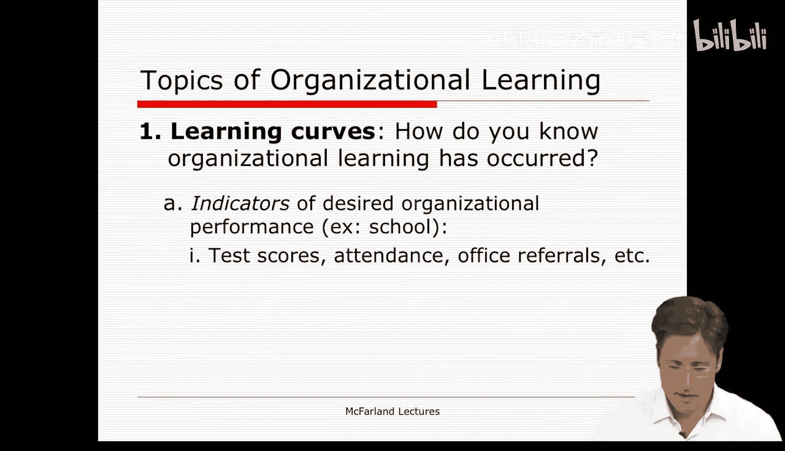

This is sort of what we'd want to see。Notably， teachers might be inefficient at first。

 giving students a lot of time for little test score gains。

 but then they can improve over time they can improve on this effort。

 so what we see is that a learning curve that they get with less time per student they get greater gains on tests so we can imagine this kind of learning curve for a variety of different instructional formats or even curricula。

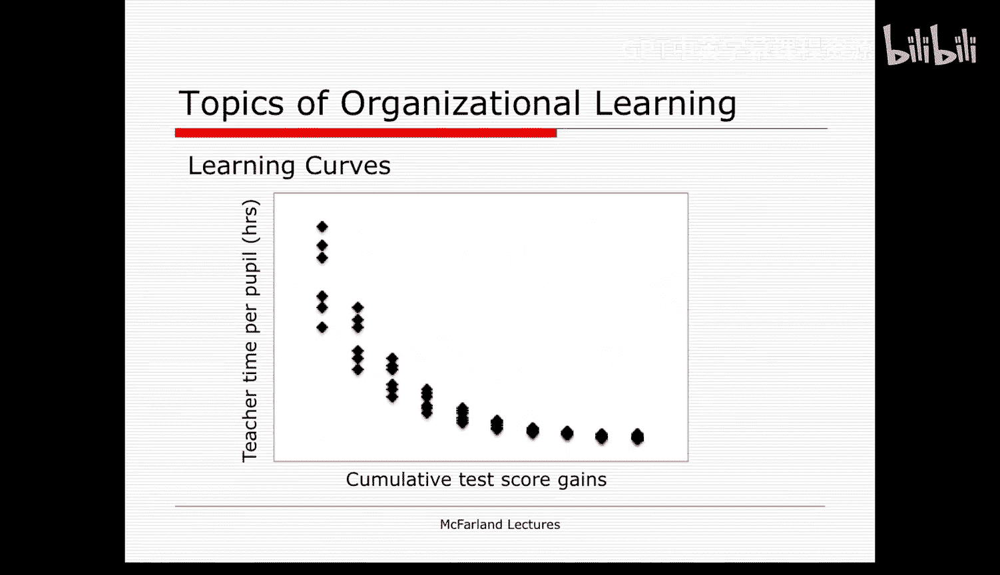

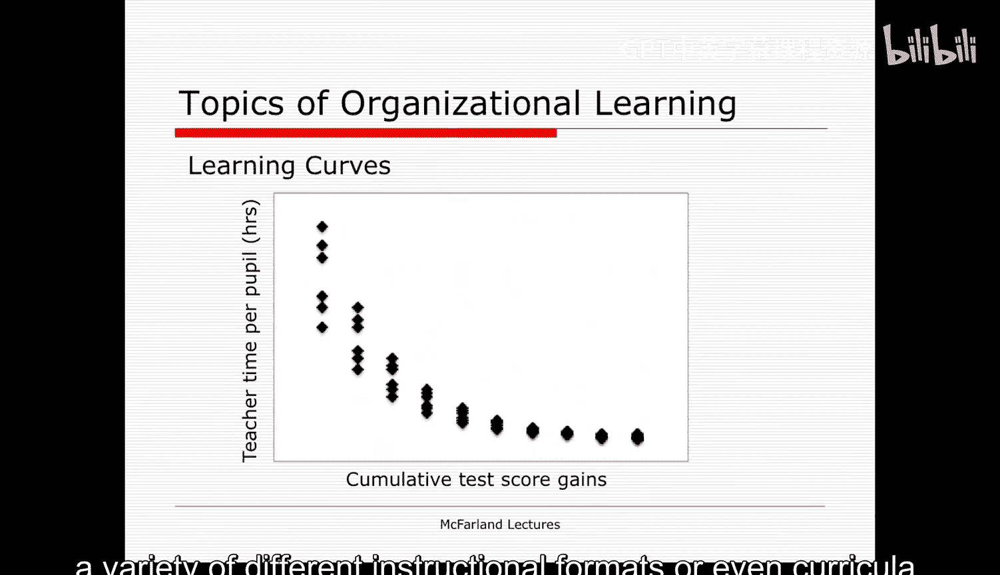

It might be easier to envision this for manufacturing though。

 say for producing cars or airplanes and reducing the number of complaints or recalls。

 this is kind of the set of figures that linda Argati uses in her book。

 but the same could be done for schools again in terms of the number of arrests or office referrals here on the Y axis。

 right？

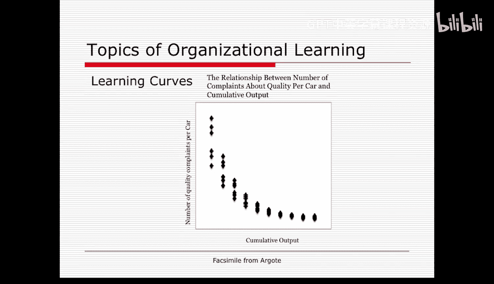

And then one can envision this for multiple firms or schools。

 discerning which has a steeper learning curve， suggesting that the organization is reflecting on its performance and developing means to improve or foster expertise。

 so you know some of these curves are steeper and those seem to be learning more quickly or at least have procedures in place that might be enabling it。

 whereas others that have kind of a flat gain， they may be less of a learning organization or lack organizational memory of what works。

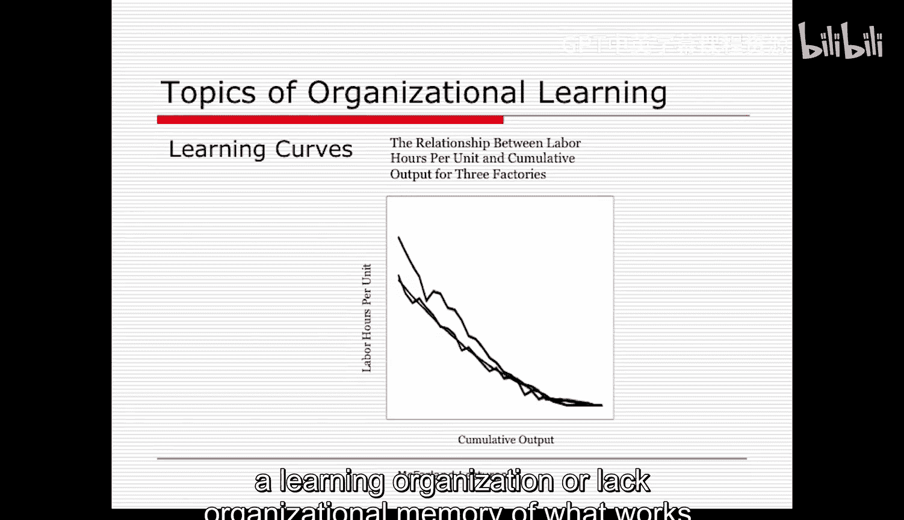

So how do you generate gains in these learning curves。

 what might be some tricks that can generate more effective and efficient ways to teach a class lesson in a school or to produce more output for less time and money I raise this because a manager of organizational learning will need to consider means by which participants learn and improve and indicators that reflect that。

For example， they may want to focus on improving personnel such as getting fresh talent or preventing initial startup costs via mentoring programs with experts or even improving recruitments so as to track better talent now that we have some sense of kinds of learning indicators the question becomes how do you generate gains in those learning curves。

 what might be some tricks that can generate more effective and efficient ways to get gains out of students achievement gains I raise this because as a manager of organizational learning。

 you need to consider means by which the participants will learn and constantly improve their practice。

For example， you might want to focus on improving the personnel， such as getting fresh talent。

 preventing initial startup costs of training them by having some kind of mentoring program between experts and novices。

 or you just improve recruitment and attract better talent in general with the better human capital say the manager may even want to kind of improve the work routines。

 such as getting better design tasks， removing stale ones and efficient ones and allowing those tasks that are new to become familiar and reenacted so they're more efficient。

The manager may also want to afford opportunities to discuss the work routines and to consider what would be an improvement and if there's consensus on that they document it Last you can consider ways of improving technology itself。

 such as getting better design textbooks， having a better physical layout and so on。

So there are means to actually improve gains in organizational learning and the learning curves。

 but even if you do generate gains， it's important to keep in mind that the learning curves will plateau all too often we learn to resolve the simplest problems first and acquire the largest gains for the littlest effort and then the improvements Peterer off after that and we get bogged down in complex issues that have smaller gains。

 hence as a manager of organizational learning， you really want to shift your firm's focus after learning begins to plateau for example。

 a school reformer may want to move from one reform to the next estimating learning curves and deciding when to put in place organizational memory and stable procedures to ensure those gains are retain and remembered。

 but then they want to switch to some other concern。

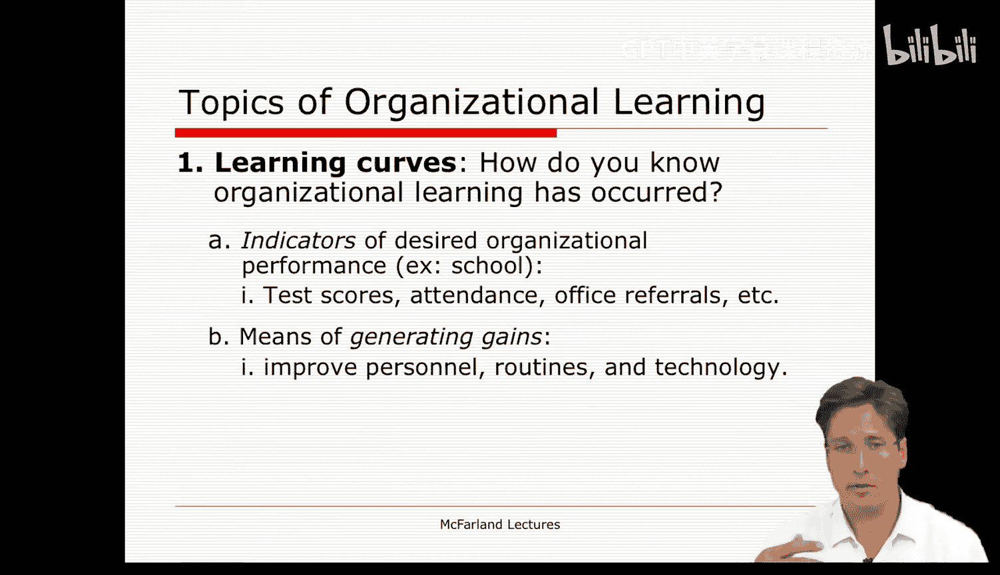

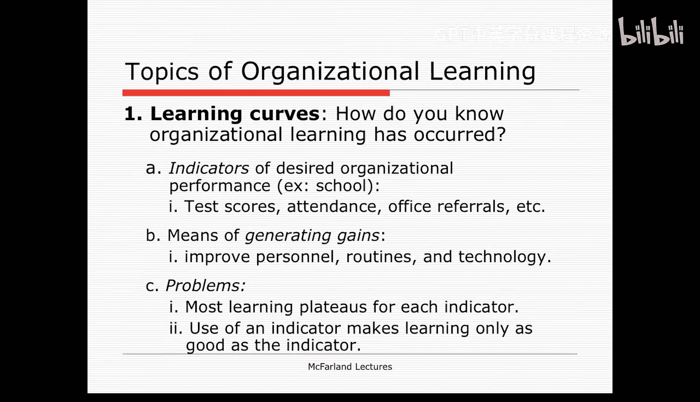

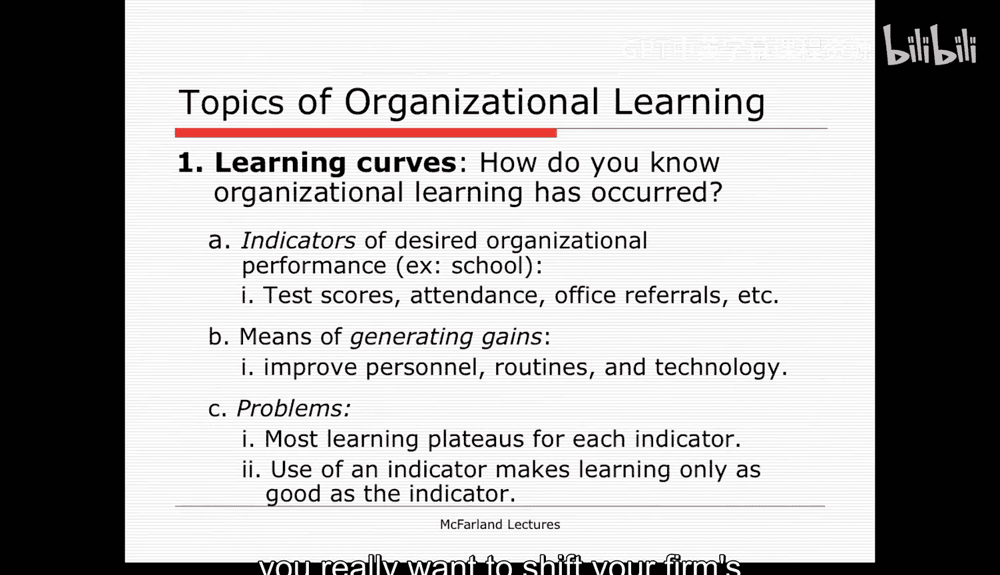

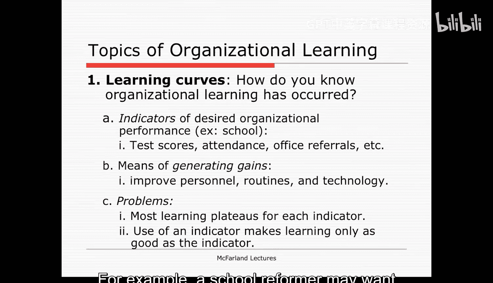

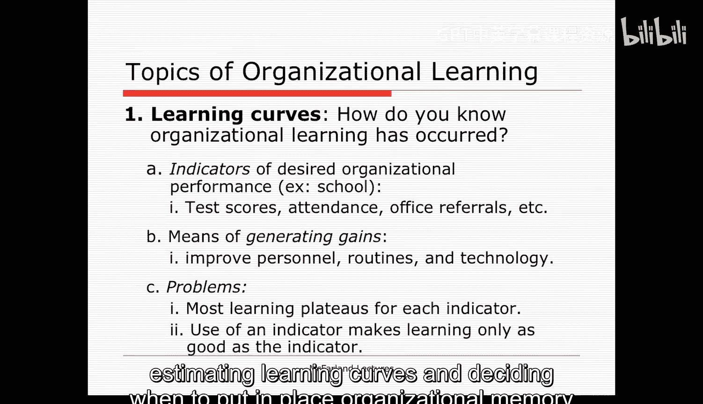

Another problem with the learning curves is that they're only as good as the indicator used and firms tend to improve on the indicator in place and ignore other issues。

 so for example in schools it's common knowledge that with highs stakes testing teachers teach to the test but it's not always clear these tests measure what we hope some tests measure only a narrow kind of band of intellectual development and have too strong a focus on any single exam may kind of correspond with less time on other intellectual endeavors like sports or music or physics those may not be covered by these exams so you have to keep in mind that they're not a panacea and that their problems with these learning curves and that they plateau and by switching around in them we can often optimize learning across a variety of dimensions in so long as we put in place procedures to remember what we've learned。

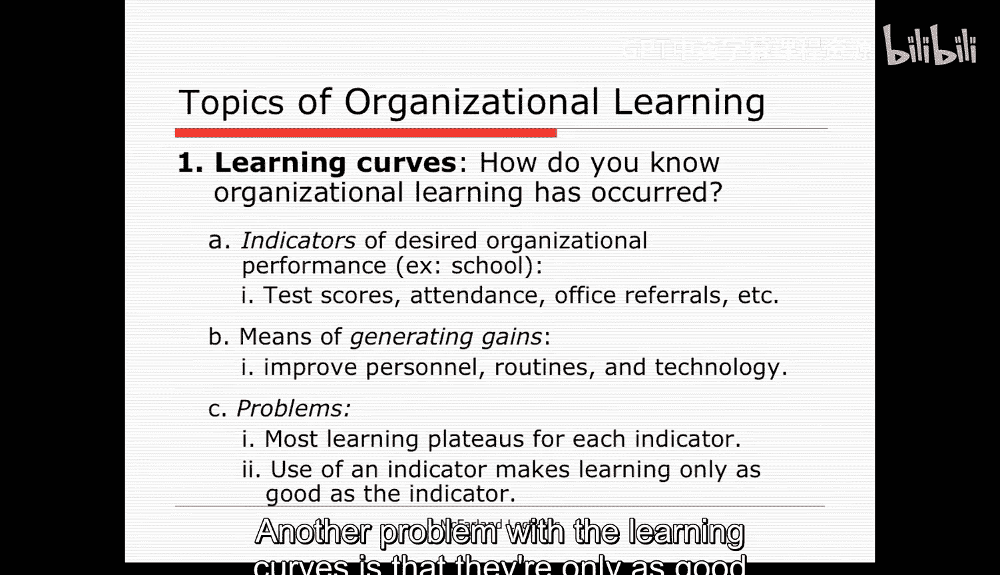

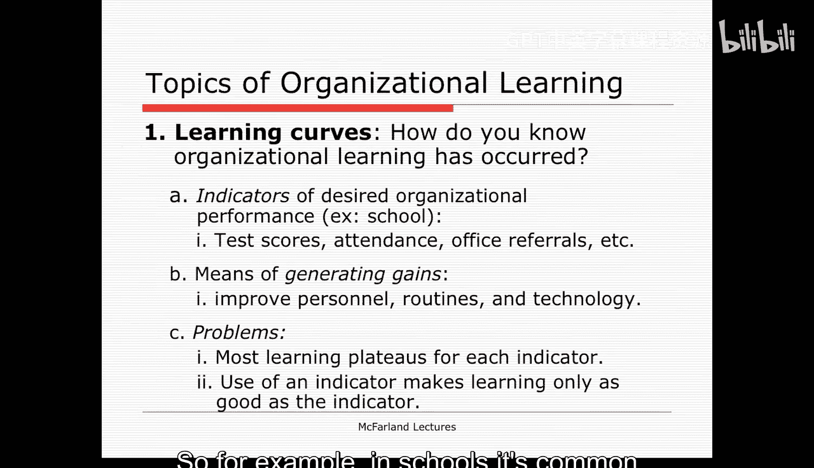

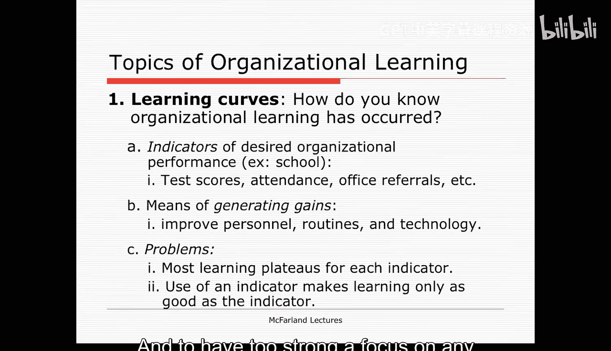

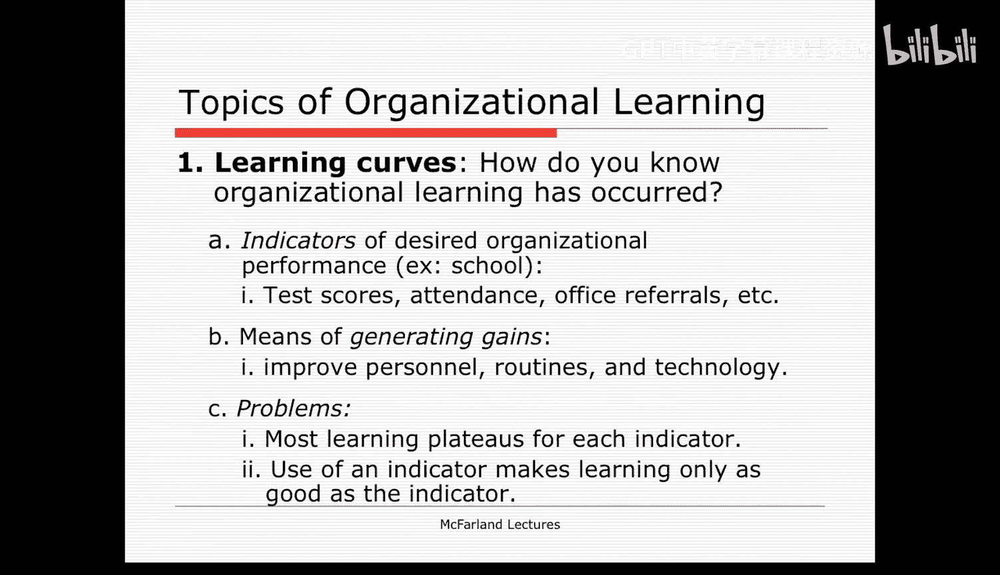

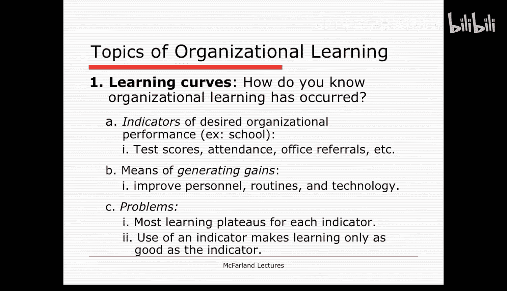

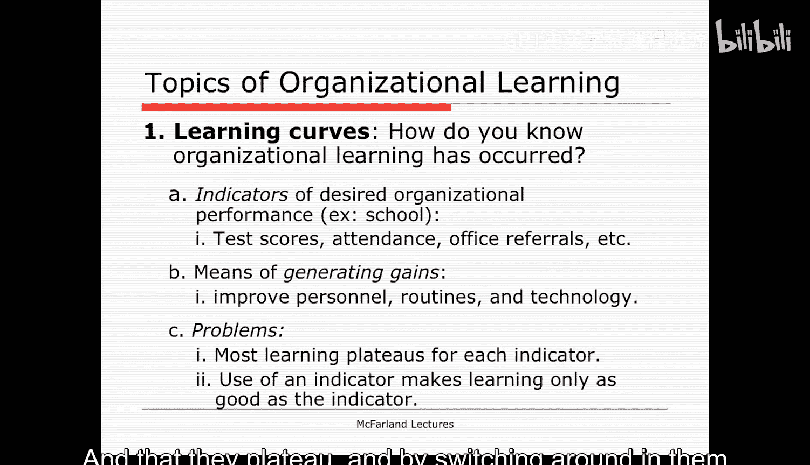

This leads us to another topic of organizational learning。

 and it concerns organizational forgetting and memory。

 why and how does forgetting and remembering happen in organizations。

 what are the conditions of knowledge depreciation and knowledge storage？Basically。

 let's consider schools again because it's clear they're primarily forgetting organizations we have to kind of ask though why。

 why are they forgetting organizations and how do they forget and there's multiple reasons often it's because exogenous factors create distractions and prevent practitioners from recording what works right now we have teacher strikes in Chicago there may be lawsuits。

 odds schedules， odd school days， other events that may get in the way of actually keeping them focused on recording these practices and sharing them with others。

It's also because old knowledge frequently becomes obsolete with new audiences so old tricks no longer apply teachers can get out of date。

 I can't use my lame 90s jokes anymore to get students excited and engaged。

 I need to learn the latest methods in order to stay current in my research I have to constantly retrain myself so that I don't get outdated another big reason schools forget is because their personnel work in relative isolation every teacher gets their own room usually and they have little time to share what works well or doesn't work well with their colleagues。

It might be the case that I do something really well。

 but no one ever hears about it in a neighboring classroom or down the hallway。

 and last personnel turnover is another issue。It can lead to loss of expertise that's been encoded in the participants unfortunately this is kind of prevalent in poor American schools where teacher turnover is dramatic there we have kind of programs like Teach for America that bring in temporary teachers for a year or two。

 but then they too leave， they may be successful in certain ways。

 but the practices that actually are successful are not retained because those people leave again。

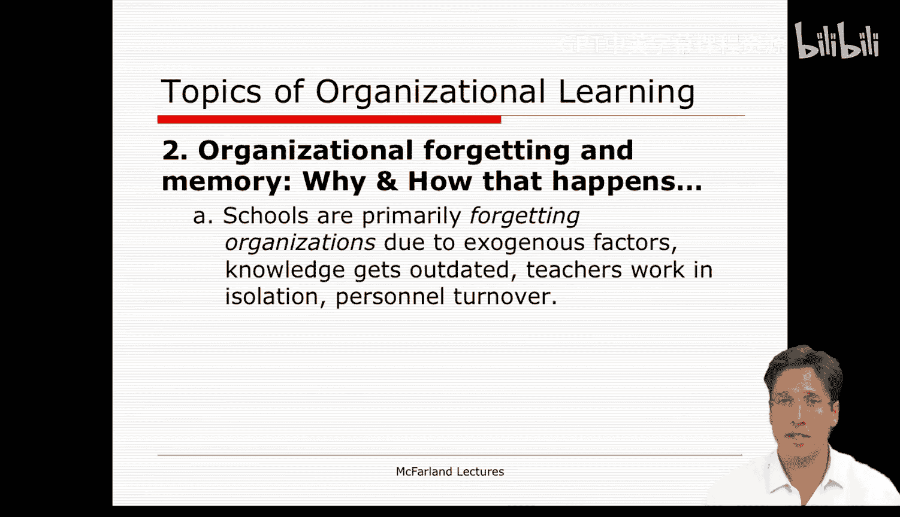

So how can we actually remember or store memory in an organization like a school？

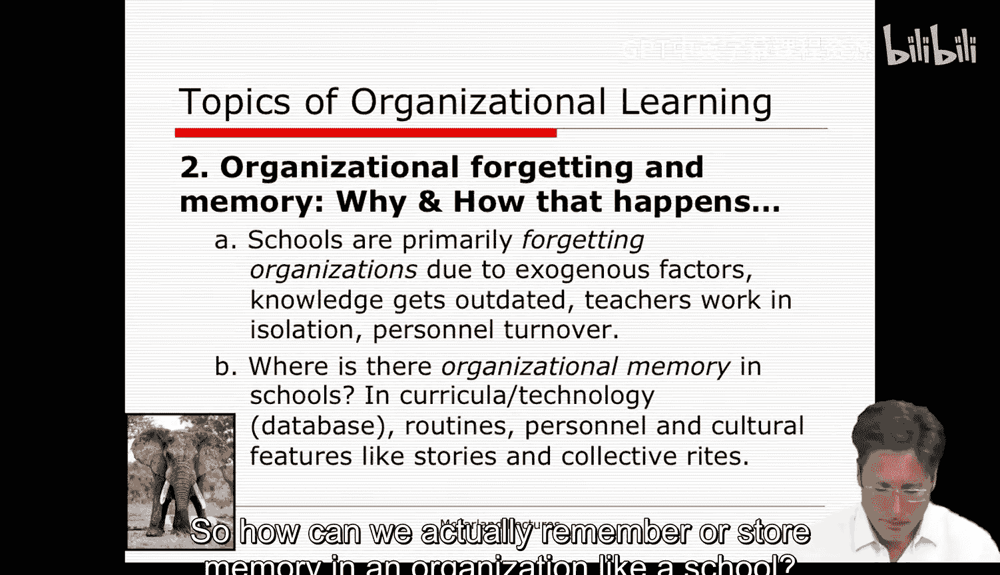

There are a variety of places we can do this， particularly technology or curricicular are great for storing knowledge about successful practice。

 but it's not always easy to access and it tends to remain relatively static wkis and techno reports are a little visible but they don't tend to get picked up or even widespread within an organization another thing might be successful tasks and routines which can be encoded into an organization but they're less stable than curricula。

 for example， team teaching might be a new routine that is great returns in some cases but how it's enacted may vary greatly and the same positive return may not be observed elsewhere in the school。

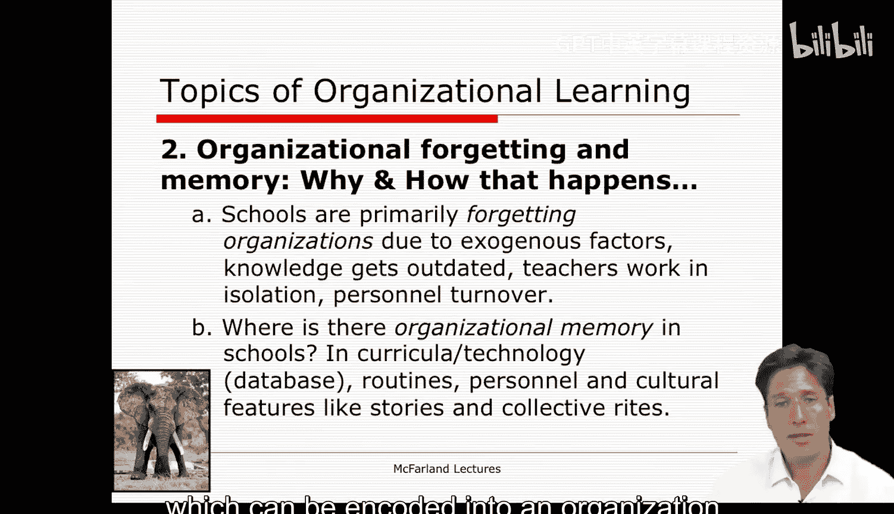

Third， personnel are great for storage of memory and transfer vehicles of knowledge。

 but they leave and they take the knowledge with them if they leave the organization。

 so organizational memory is not just a database of ideas is a database of knowers with experience you need ideas and cultivators of them。

 those people who are in the know， so retaining key personnel who train others is really important means to engineering organizational memory。

 and especially if the sort of knowledge needed is tacit or implicit and hard to codify and make sense of and rule books。

Last。Cultural features like stories and community ceremonies can be great means of preserving an organizational memory。

 but they might be prone to forgetting like an oral culture is and it might focus too much on particular individuals like exemplary people and parias of an organization rather than the situations of practice so you might want a database about practice of people working in practice and the situations that went well or did not and again。

 like I said earlier in this lecture we do have computing means now and internet means for storing kinds of practitioner knowledge and like I said curki。

org for educational institutions would be one kind of option by which to store successful curricula but there are others you can imagine all sorts of listservfs where people post questions that are resolved and rated in terms of being useful or not and that can be searched by practitioners in various organizations。

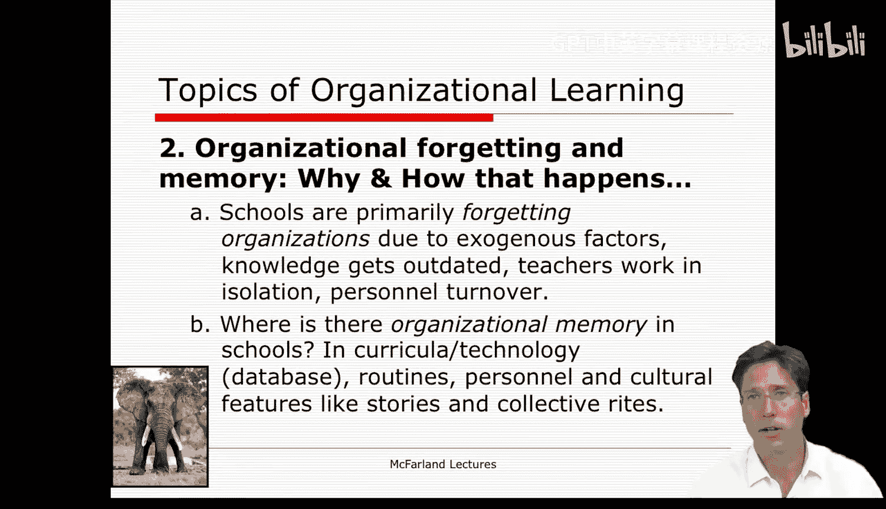

In a community of practice， learning is a demand-dven identity- forming social act。

 so it forms cohesive groups of people who work on the same task and here knowledge travels rapidly and it's assimilated easily but it can also be coordinated or negotiated and then communicated and applied in various ways。

 so it's very versatile， quick and easy to communicate in these contexts by entering the community that participants enter strong reinforcing bonds that generate conformity and some kind of shared identity this means members identify with the organization and it becomes grounds for interpreting and judging and reflecting on and developing notions of understanding within that organization。

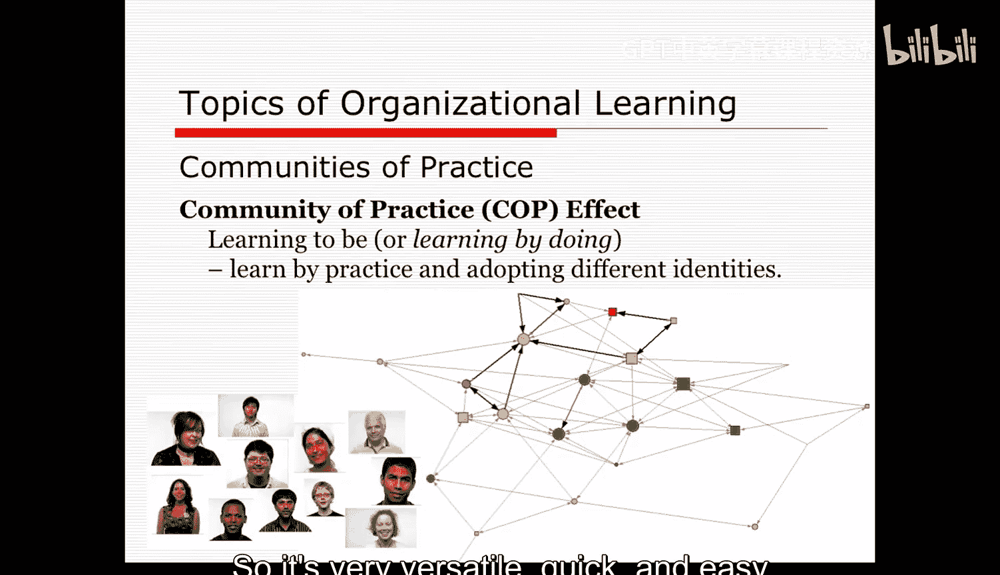

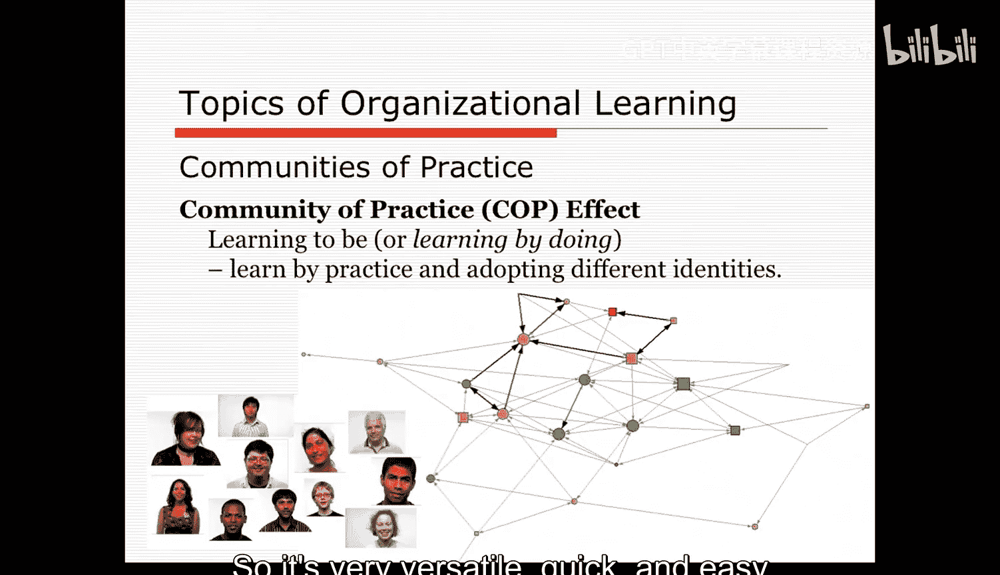

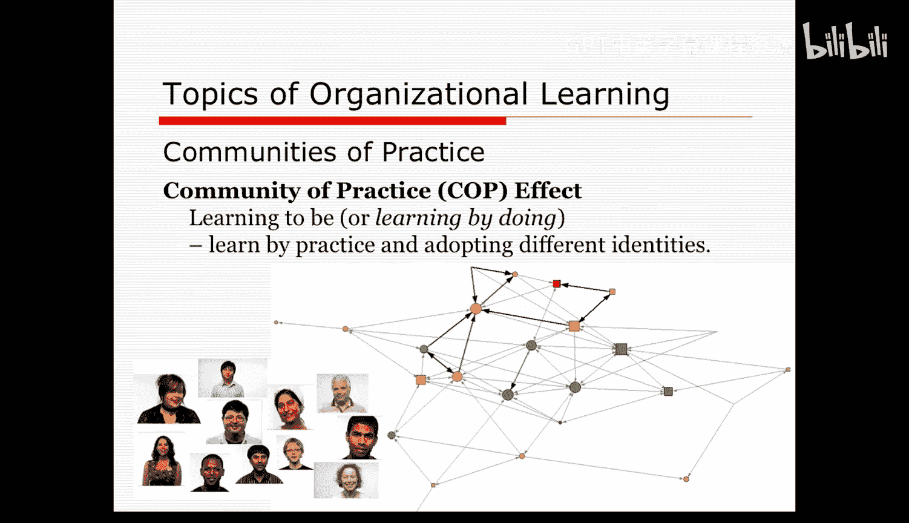

Now let me give you an example of entering a community of reinforcing relationships The example is one of a person learning chess and they become increasingly involved in a chess league okay most of us can't just pick up a chess manual and learn about it from a book we find it much faster and easier to watch chess players play and then we try to play it ourselves with them by assuming the role of the chess player ourselves now let's say over time we enter and play these games repeatedly get better and so on and we start to enter a league and we increase our interactions with other chess players and other experts developing our own expertise further and over time we kind of even become core members and take on the identity of a chess player that's kind of central to ourselves it may even be a profession that we embrace as our own。

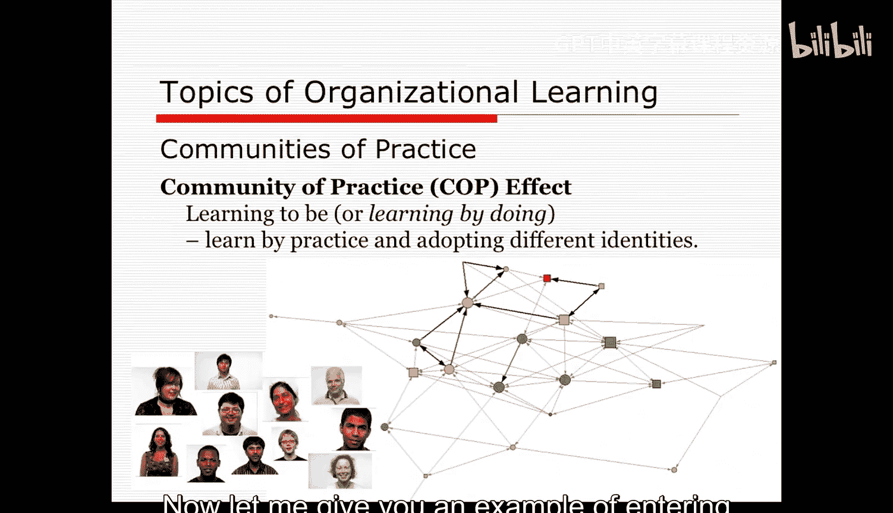

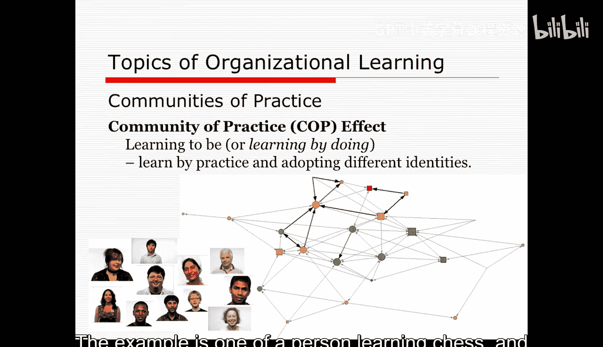

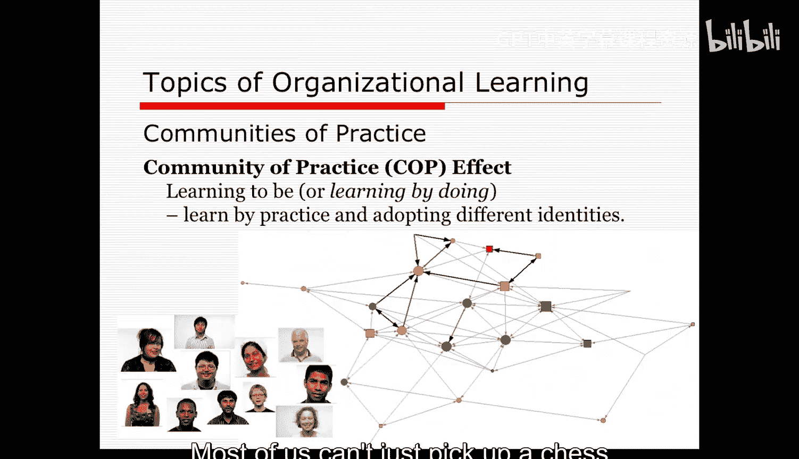

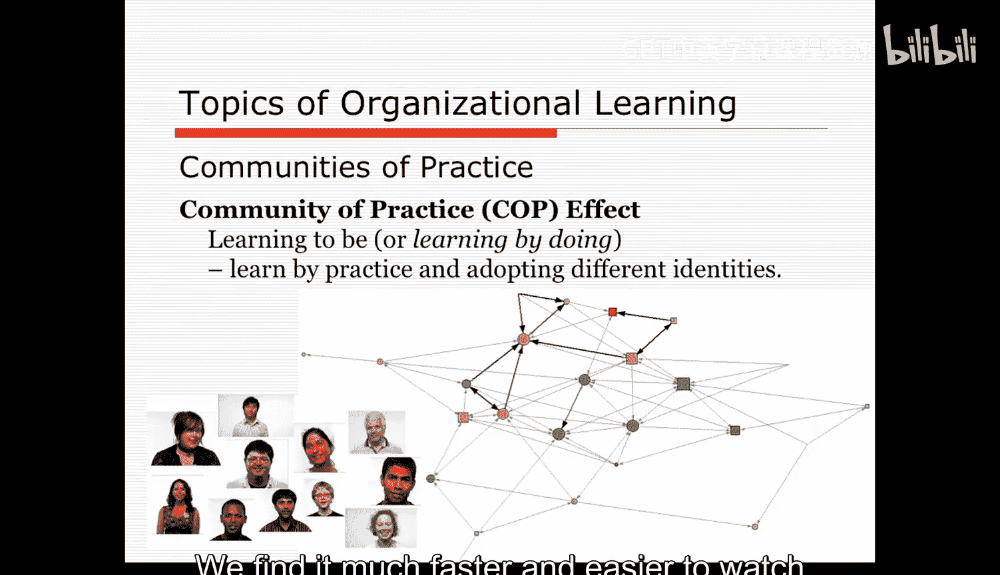

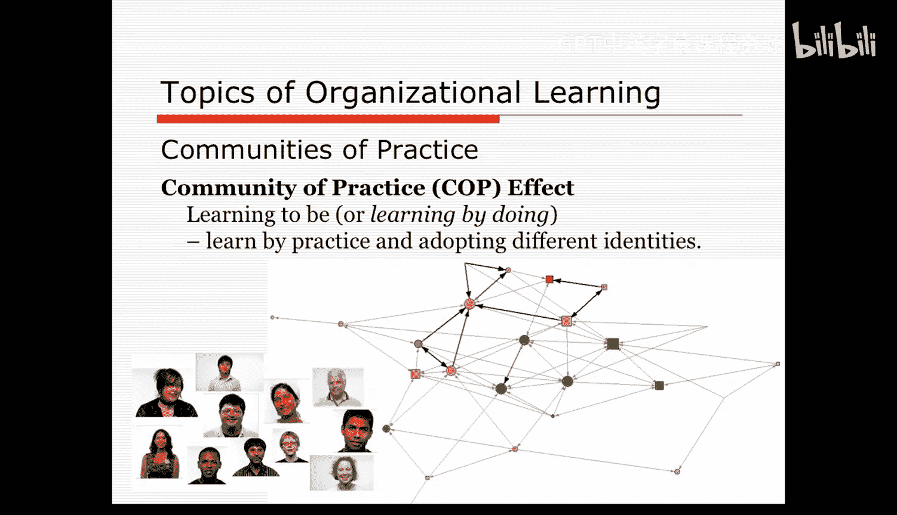

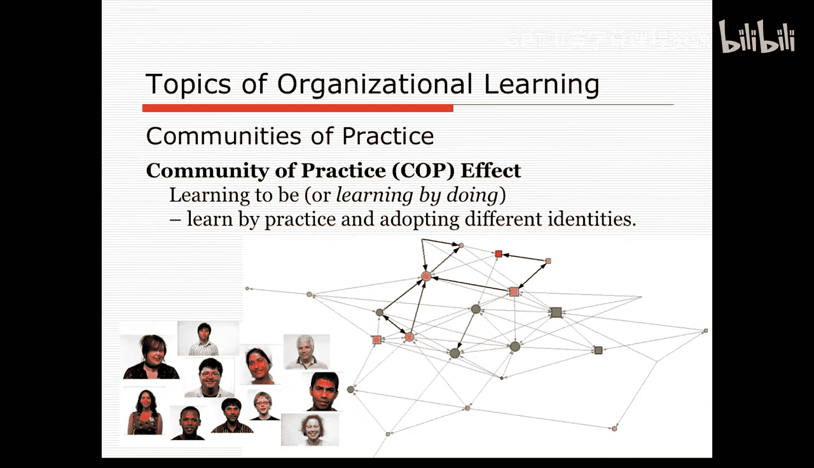

Now the leap you need to take here is in recognizing that the same process can occur for consultants。

 lawyers， faculty people， et cetera， communities of practice are kind of worlds of identities and practicing that are cohesive and reinforcing where people kind of enter that identity and assume it on their own。

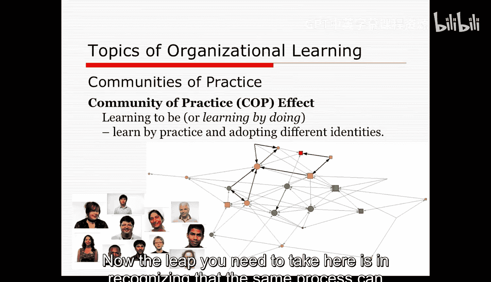

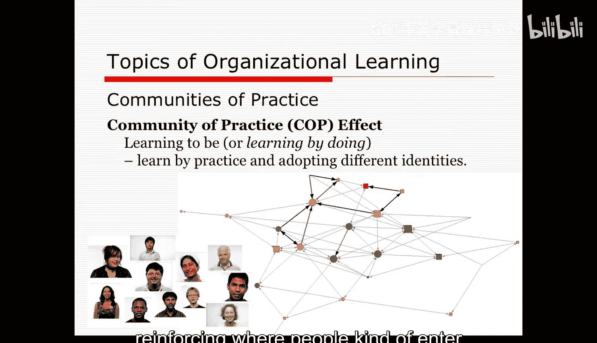

How might we generate a community of practice， Let's take the example of a school again。

And let's assume that our goal is pretty straightforward here。

We want to create a social structure that encourages learning and remembering of what works well。Now。

 to do this， we might want to do a few things。We might want to instill collaboration in a safe environment that allows for people to take risks。

 right for improvisation。Second。We want to provide training to the entire faculty。

 not just part of it， right， we want them to go off and develop expertise in collaborating and in talking about their actual improvement on learning and practice。

Third。We want to encourage meetings thattail sense making without decisions。

 and here you kind of remember garbage can theory。 here we're kind of embracing that model to some extent。

That people will have meetings and constant interactions where they try to make sense of things and。

Understand how that their identity is being developed with regard to them。Next。

 we want to encourage frequent communication。And here standards and procedures can be learned。

 for example， we might want to denote lead teachers and use them as experts in contact with new teacher apprentices。

 we might want to create mentoring and classroom observation opportunities。

We might want to encourage storytelling and cases from individual experience and organizational self appraisal。

 so like presentations reporting out。

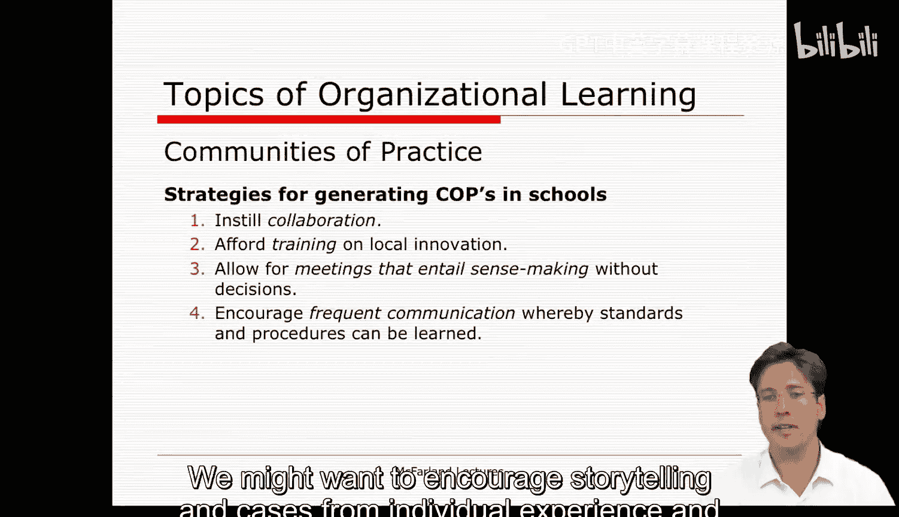

Last， we'd want to think about ways to remember individual and organizational practices， a database。

 let's say， ways to create a knowledge base of what people need to know and to do their work well。

And how such knowledge can be distributed and interpreted。Effectively。

 we need lots of meetings concerning practice， means of storing that。

 we need frequent interaction and training that brings us onto the same page and same kind of identity and understandings and then to kind of have this norm of collaboration and these kind of features are typically what people try to instill when they're generating a community practice in an organization like a school。

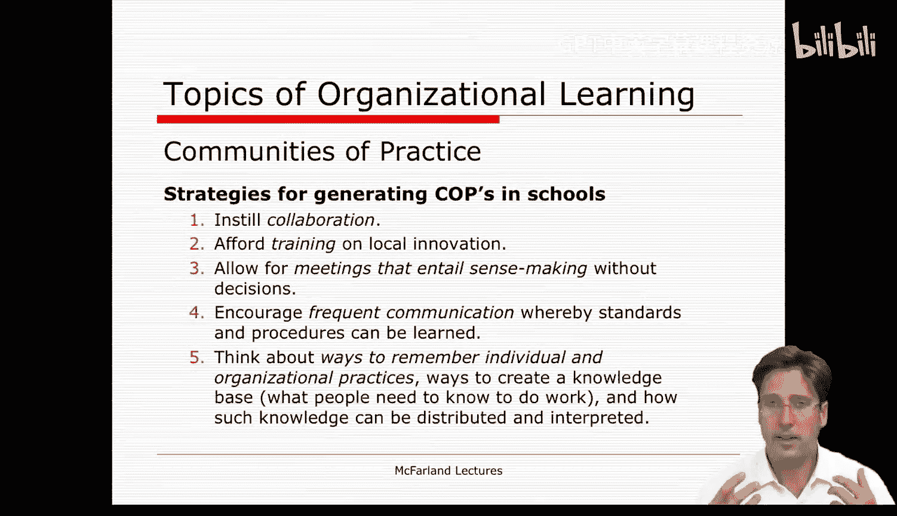

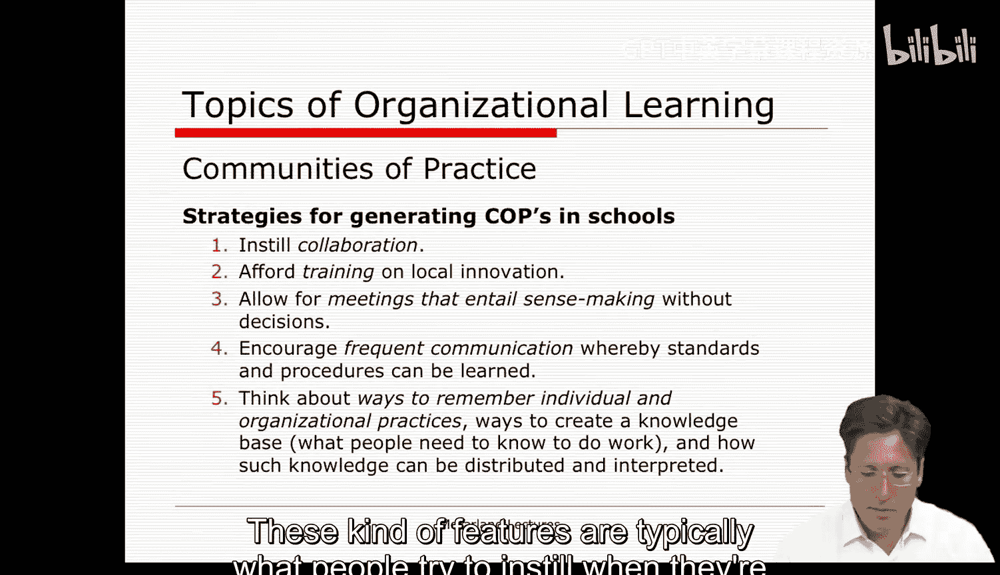

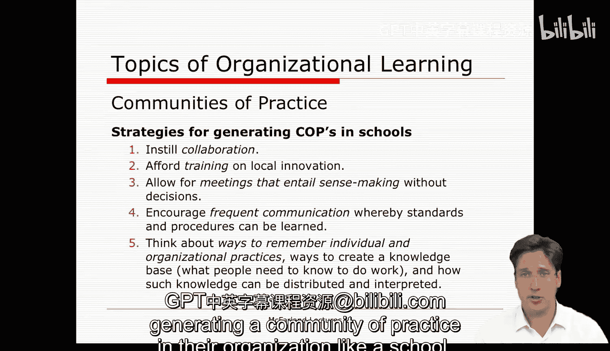