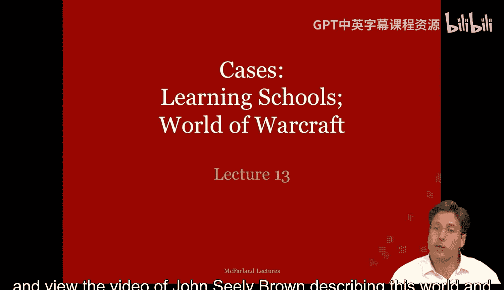
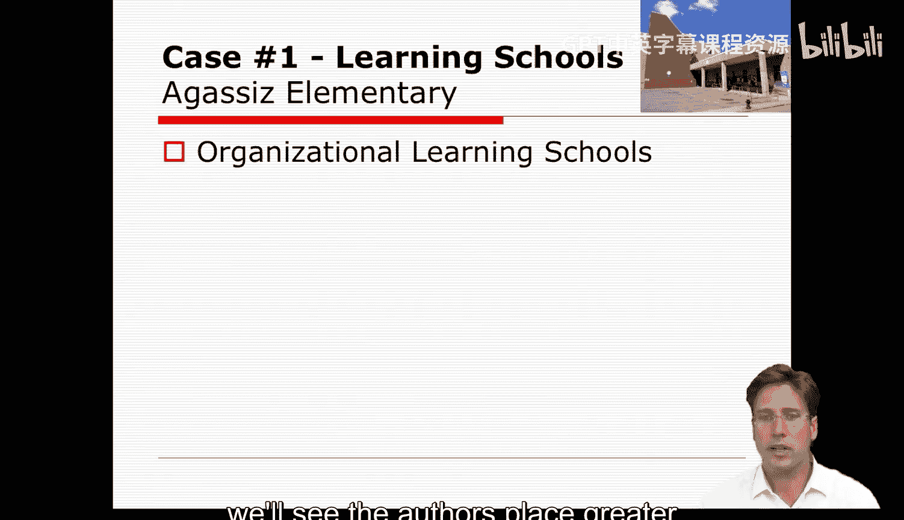

# 斯坦福大学《组织分析｜Organizational Analysis》中英字幕 p45 045_05_04_第十三讲-案例研究-第一部分.zh_en -BV17J4m157qN_p45-

This lecture will briefly review the theory of organizational learning and then introduce an example in a case for you to ponder。

The example concerns the implementation of organizational learning at schools。

 and it can be found in the Lewis and Cru reading of this week。

The case concerns the world of warcraft and how guilds operate in that context。 Here。

 you can read the list of materials on the world of Warcraft in the syllabus and view the video of John Sealey Brown describing this world and how it develops knowledge。

Let's first review the basic features of an organizational learning perspective。When does it apply。

 when does organizational learning apply？Organizational learning is occurring in an organization when the participants are continually concerned with improving their practice。

 Theyre focused on their core technology， how the organization turns an input into an output。

 As such， a constantly monitors， reflects on， adapts and remembers practices that work well。

 In some cases， learning can be suboptimal or even false。 And this， too。

 is of relevance to the study of organizational learning。

The general perspective of organizational learning is to view an organization composed of practices that form the core routines of organization and to zone in on an organization's intelligence or capacity to alter and improve them。

This enriches the participants's identity a role and furthers their commitment to the organization。

From this perspective， the organizational elements are as follows。

 first we have the technology or the means by which organizational learning occurs。

And it's via internal adaptation， where actors alter routines to fit reality。

 What Brown and Dugee call knowledge。The participants are members within the organization that perform the routines and enact the practices。

Their goal is to resolve application problems， to improve their practice so that it better accomplishes defined goals and identities。

Now， the social structure entails mostly informal lateral relations， lots of frequent communication。

Negotiation and dialogue。Identities and roles are key and closely linked or coupled with the practices。

Participants are involved in both a community of practice en tailing local bonding ties and peer pressures。

 as well as networks of practice that span out to other communities and facilitate knowledge transfer。

And the environment， it's a source of inter organizational knowledge， of tricks。

 and of transfer of knowledge。What's the dominant pattern of inference or the mechanism of inducing action。

For organizational learning， action is a result of local actors searching， improvising。

 collaborating and translating and sharing knowledge。Through an organizational learning approach。

 change and improvement occurs because the individuals in the groups inside the organization are able to acquire。

 analyze， understand and plan around information or knowledge that arises in their practice and the wider environment。

 They continually adapt and learn。😊，And finally， the theory affords some managerial implications to garner a learning organization。

 The manager should consider ways of encouraging dialogue。

 continually improving on the core practices and enabling improvisation。😊。

They should find ways to create greater communication within the firm so ideas are past and shared and bridges to outside groups whose knowledge may be distinctive。

They should also find means of creating organizational memory of what works so that it's retained。

Now that we've reviewed the basic features of an organizational learning perspective。

 we can begin to discuss some applications of the theory to real world cases。

The first application is mostly done for us。 Well the second one I'll leave for you to consider on your own and to discuss in the forum。

The first application I want to discuss is Lewis and Cru's description of schools that implement organizational learning。

 In this reading， they describe two exemplary schools doing better than expected。

 They say both schools are learning schools where the faculty reflect and study their practice in an effort to continually learn and improve。

And according to these authors， learning schools share an inventory of prior knowledge about the school。

 its curriculum， instruction structural methodology and students。

 The learning schools know themselves， and they take the time to develop a shared vision and vocabulary with which to discuss issues of teaching and learning。

 The first school Lewis and Cruz discusses Agass Elementary。In Augustis's elementary。

 the faculty learn from each other and engage in a dialogue about their instructional practice and how they can improve it。

The principle， as a manager， tries to stimulate and encourage such dialogue。

She acts like a facilitator of knowledge more than a director。

And the teachers also seek to learn from each other。

 They engage in a dense web of frequent conversations over practice。

 in a way it is a community of practice of sorts。😊。

And we see evidence of this when the teachers frequently interact in weekly grade level meetings。

 they have monthly meetings for K through third grade and4 through sixth grade where the teachers think more broadly。

 and then they have 30 minutes a month of teacher observation。So the teachers have frequent。

 close relations over practice， and this results in a good deal of peer pressure to improve instructional practice and a culture that values constant improvement。

 so much so that teachers even pay to attend conferences and join groups that meet on weekends and evenings so they pay out in their own pocket。

So the school even has kind of a professional development conference that the teachers put on for others。

 so this not only brings in money， it compels the Osse's teachers to assume the identity of knowledge producers and expert educators and this all kind of stimulates further kind of conversation and culture around practice。

So if we take the case and render it into our organizational elements。

 we'll see the authors place greater emphasis on certain elements over others。

So the technology in this instance are the tools used to bring about organizational learning。

 In many ways， these are social structural treatments。

 and they do this through a variety of meetings and theization of authority and greater input from teachers and so on。

 All of the means of engaging in learning are relational and cultural here。

 The participants in this case are members of the school staff and some of the parents。

 students are not really mentioned in the case。The goal of the Ass is to increase learning and to improve teaching。

 and they hope to do this by reflecting on their practice。

The social structure is relatively small and intimate， and the relationships are collaborative。

 The leadership facilitates and mentors more than imposing of a will from outside。 Moreover。

 the focus of the leader is on practice。 So it aligns well with that of the teachers。😊，Last。

 what we know about the environment is related in the setup of the school and its history。

 but the case makes little use of it。So instead， the case owns in on practice and the social relations。

 the culture and the rituals that foster reflection and improvement on it。

 Some of these relations extend into the environment。

 but only as a means to drawing in or sending out knowledge on instructional practice。Now。

 if we focus on management。We see that the school hasstate several routines and institutional arrangements to foster such a learning community。

These， in turn， are feasible managerial strategies to use in other settings and in other schools。

