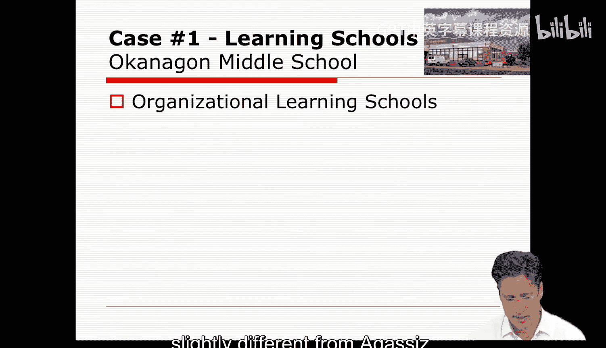
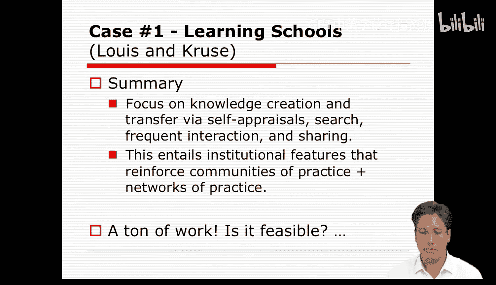
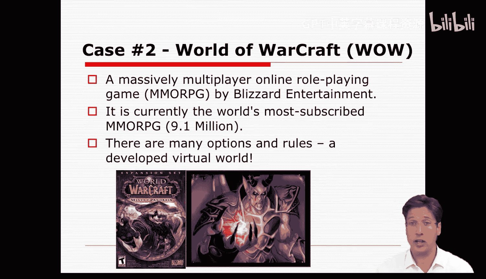
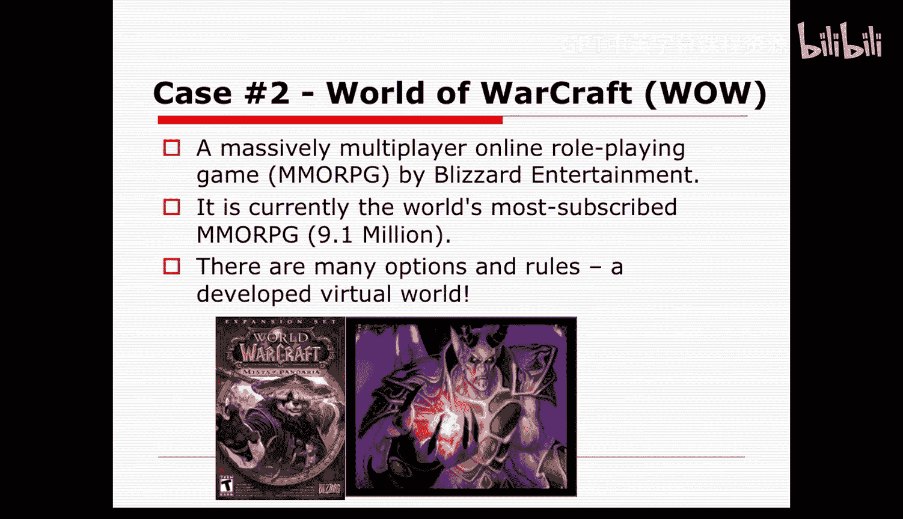
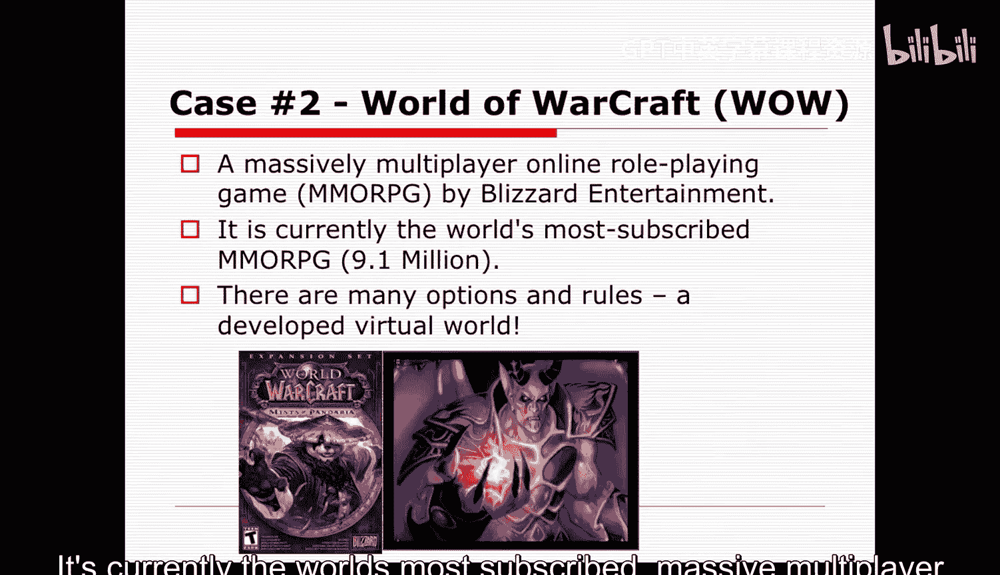
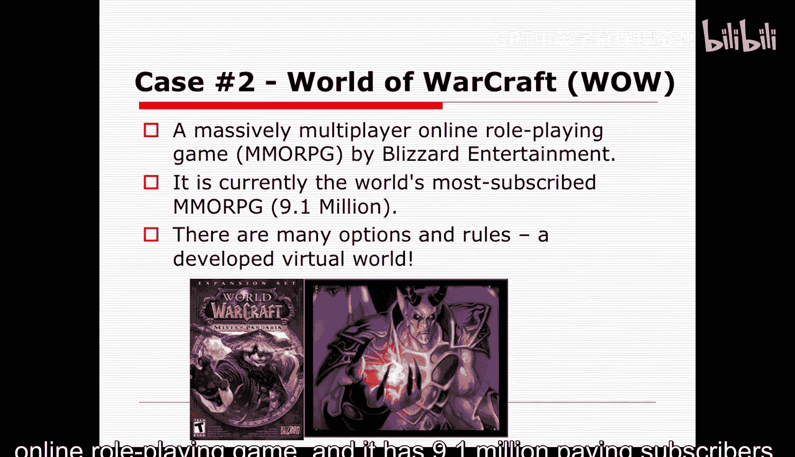
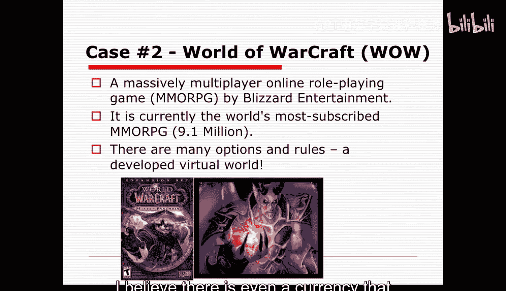
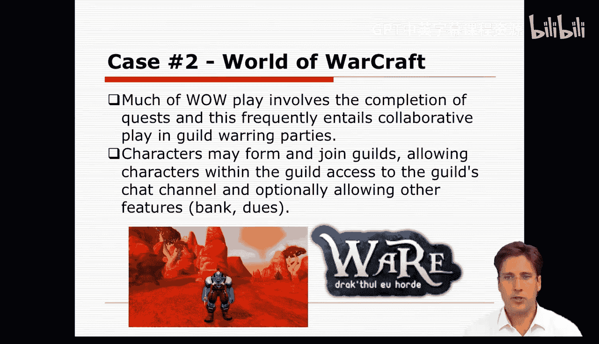
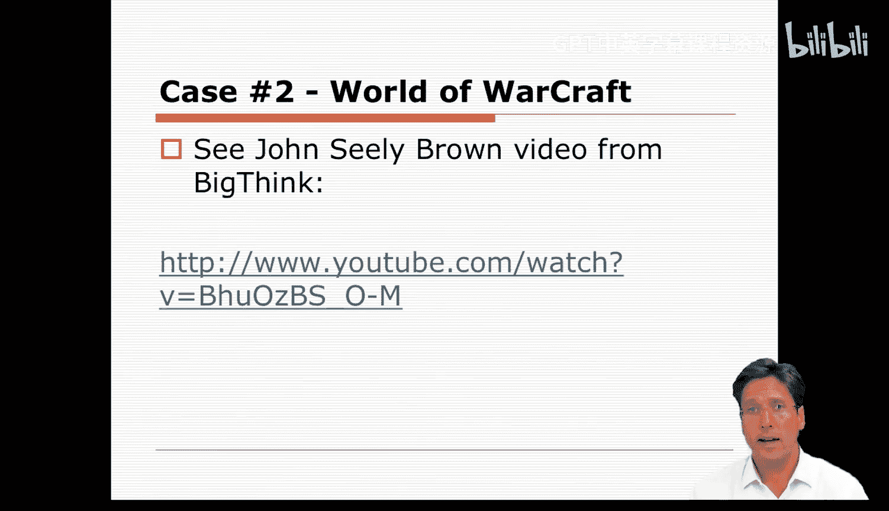

# 斯坦福大学《组织分析｜Organizational Analysis》中英字幕 p46 046_05_05_第十三讲-案例研究-第二部分.zh_en -BV17J4m157qN_p46-

The second school Lewis and Cru discusses a Conneagon middle school。

OConnegan Middle School is a lot larger than the elementary school。

And with just as many disadvantaged students in this population。

 the school is structurally divided in the nine families or small schools。

The students and faculty in these small schools cover the core subjects and they work as kind of a unit。

嗯。The families have wide discretion over what they want to work on and improve upon。

 And each family also has a leader with an expanded teacher role that includes administration and mentoring of other teachers。

All the family leaders get together as a community council with the principal to ponder the school's direction more generally。

The school itself has a strong culture。 It proudly announces it has a dream to level a playing field for the students。

 So it's kind of an activist orientation。And it renders the content of curriculumric more relevant to their students。

The school is very concerned with statewide assessments and the faculty have established。

A variety of powerful school wide committees that perform self assessments。

And they pressured the faculty and other areas to perform well on those exams。

But the schools also has its own standard， and they call this the iconconagon standard where students are called upon to perform community service and to conduct research products。

External ties are important in this context and trips to external conferences are common。

 but the faculty rotate in terms of who actually gets to attend that。

 So none of these kind of trips are centered on particular faculty。 Instead。

 it's kind of spreadr out。 hence information is found elsewhere and presented to the rest of the faculty when they go out to these conferences they come back and report to the rest of the faculty。

 the school， though， has some kinds of issues about coordination across the families and some debate as to where organizational learning should focus and what standards they should pay attention to。

 they have a retreat and the families did find some topics agreement。

 and there's been a push for greater schoolwide coordination。

 but this has also created some kind of tension。 So it seems to be or a relief of the tension between those schools and their different standards。

 So that meeting kind of seems to have helped things along。

But if we look at the organizational elements again for this school。

 we can begin to see how acongon is not only similar but slightly different from Augustss。

So the technology， just as before the technology concerns the tools used to bring about organizational learning and these again are all social structural reforms。

 the schools is divided into smaller family units， they form a variety of different committees and councils that encourage frequent interaction and assessment over practice and achievement。

 all of Oconnegan's means of engaging and learning are relational and cultural。

 just as it was for Aacies。The participants in this case are members of the school staff。

 students and parents aren't really mentioned the goal of a Conagon is slightly different and that it has an equality and social justice concern more than did Asis。

The social structure here is also slightly different。 It's larger。

 and it's divided into smaller units。 The relationships are collaborative。

 and the teachers or families have great influence。

 whereas the principal at Agoss had a little more say。Last。

 what we know about the environment is related in the setup again。

 but the case makes little use of it， instead， just as with Agas。

 the case of a Connaagon zones in on practice and social relations。

 as well as culture and the rituals fostering reflection and improvement on practice。

Some of these relations extend into the environment。

 but only as a means of drawing in or sending out knowledge on instructional practice。

if we look at management， we see that the school andstated several routines and institutional kinds of arrangements to foster a learning community and these kind of encourage constant improvement and features of both community of practice and networks of practice so in a way the two schools have a great deal of resemblance to one another in terms of their focus and the way that the account was developed and related to us。

 we know that it' is primarily a focus on social structural redesign in an effort to reorient practices and a reflection upon practice and to form this deeper culture about that。

So what are the things we see that are kind of consistent across these reputed learning schools？

Theyre though multiple things that kind of stand out。 First。

 the schools frequently seek out internal bases of knowledge among local peers。

 and they go out looking for external bases of knowledge and experts beyond the setting。

They also have processes in place that help transfer individual knowledge and expertise。

 and a good example of this is Ose's Profal development showcase。

 where they send out knowledge to other communities and other professionals。

And both schools create knowledge via a process of self appraisal and self assessment。

 And you see this with a Connegon's focus on state testing and the creation of their own standards。

 right？ But both schools primarily have this kind of constant effort to learn and improve。

 The teachers read， They attend meetings。 They report back what they learn。

 They run seminars all within their school and outside coming back in。

There's this systematic learning that occurs via structures that kind of facilitate constant interaction。

 so for example， Augustsse's grade level meetings， the faculty study committees。

 restructuring roundups， or a Connagon's committees like the Cur Committee Eval committee in the portfolio committee。

 all of these kind of heighten the levels of interaction about practice。And in the end。

 these schools are really cases for how features of both a community of practice and network of practice can be formed。

And thereby heightening the kind of identities the faculty have as practitioners。

 constantly improving their performance， as well as their commitment to that organization。

The funny thing about this model， though， is that it sounds like a ton of work。

 The teachers are not only showing up on weekends， but they stay late into the evening from 4 to 7 PM just to improve their practice。

 And Lewis and Cruz argue that they aren't experiencing burnout from this kind of heightened commitment。

😊，But I kind of wonder， is it sustainable， Will they eventually burn out。

 or is this a model that will sustain commitment and ful identities， Is it just meaningful。

 And therefore we do it late into the evening， kind of like to night， when I go home。

 will I sit at my desk and work late into the night， because it's not really a job。

 It's a lot of fun。 It may be a similar kind of model or situation for teachers through an organizational learning perspective。

😊。

Now that we have some sense of an application to real organizations like schools。

 let's see how organizational learning theory applies to a less traditional case of an organization that maybe is online。

 say the world of Warcraft。

Some of you may have no idea what I'm talking about here， so let me explain a little bit。

 the world of Warcraft is this massive multiplayer online role playing game。

 and it was created by blizzard entertainment。

It's currently the world's most subscribed massive multiplayer online role playing game。

 and it has 9。1 million paying subscribers。

The game itself is pretty intricate with many options and rules。

 The players can pick races for for their avatars。 They can have professions。

 I believe there's even a currency that players pay for with real money。

 The main goal in this game is to interact and to go on quests to acquire wealth。

 power and experience and so on。 Many people play this game。 and they play it often。 In fact。

 people play it so often that a lot of them spend more time on this game than they do at their actual jobs during the day。

 One of the main objectives in the world of warcraft is to complete quests。

 and many of these quests are difficult to accomplish。

 The monsters are too strong for a small band to overcome or the problems to intricate to kind of solve without a large collaborative effort。

So because of this， the characters often form guilds or groups of 100。

 which is a small guild to 200 people， which is a large one， and they're like communities。

 In these communities， the player chat coordinate quest efforts and so on。

 They also develop identities as players and as a team here to my side as a snapshot of what a screenshot looks like for a lonely orrc。

 And here is an emblem of one of the guilds on the world of Warcraft。

 I think John Cley Brown does a nice job of discussing the world of Warcraft。

 As part of our form chat， it would be neat to hear whether you see the world of Warcraft as a successful form of organizational learning。

 and whether you see elements of communities of practice or networks of practice within it。 First。

 though， I want you to look at the video and spend some time viewing it and considering the questions about it。

But I'll look forward to hearing from you on the forum。

