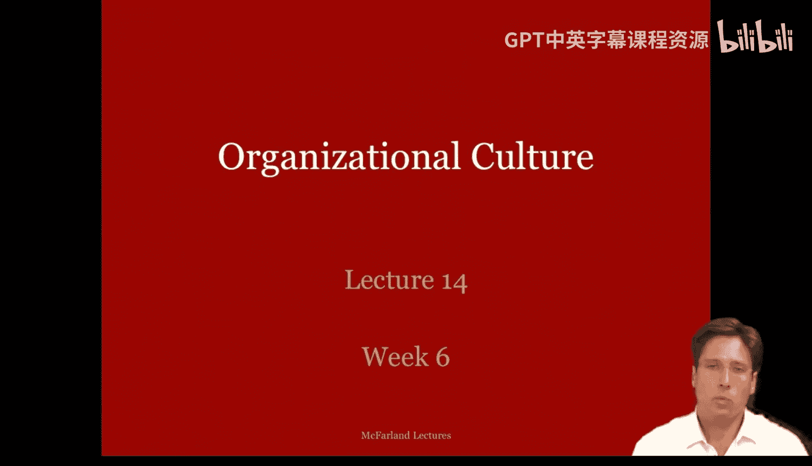
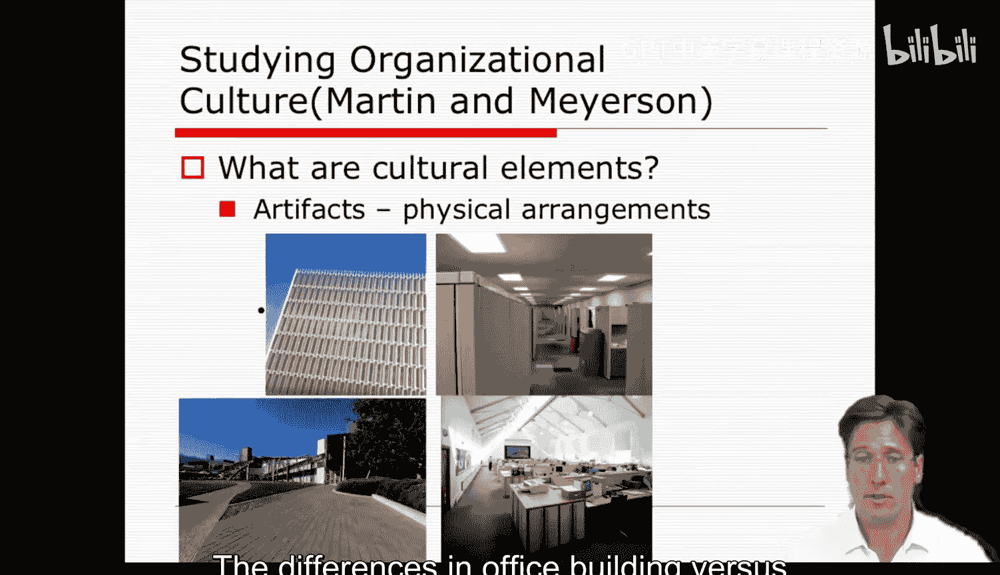

# 斯坦福大学《组织分析｜Organizational Analysis》中英字幕 p54 054_06_01_第十四讲-组织文化-第一部分.zh_en -BV17J4m157qN_p54-

Last week I asked students in my class to perform an exercise where they got together in these small groups and came up with designs for a learning school and each group came up with a different kind of interesting design but there were certain things that were consistent across all of them。

 most of them focused on creating opportunities for discussion about instructional practices。

 so a lot talked about small schools， having grade level and department meetings。

 they also talked about creating opportunities to transfer knowledge through things like speaker series。

 training sessions， rotating teachers through assignments。

 mentoring programs and they even had kind of ideas for how to have an organizational memory occur and this was through like data storage。

 data analysis and having lead teachers that mentored young teachers。

All of these designs suggested means of establishing interactional settings and routines through which the faculty could discuss and study their practice。

 they forged a system wherein they could continually selfasse their performance and make sure their core technology worked well。

But that said， there became a problem it was readily apparent。

 their designs assumed teachers would work extra hours that there were enough resources to fund all this training and where the resources were lacking and was assumed that the stakeholders would all come together and pick up the slackck。

 became clear that a key assumption of the organizational learning model was that everyone shared the same values was willing to work extra hours and was on the same page reform wise。

 and effect， it kind of assumed they shared an organizational culture。

But what is an organizational culture and how do you study it。

 that's what we're going to discuss today。

Most of you recognize an organizational culture when you see one， take Google for example。

 Google' is located here in Silicon Valley and it employs tens of thousands of people。

Some of these people are in my class from year to year。 The company has a clear logo。

 and it's emblazoned on every piece of swag they have， like pens， shirts， cars and even lava lamps。

 Yes， I had a lava lamp with Google on it。 And those of us in the area have heard about the availability of Google's excellent free food cooked by these amazing chefs。

 that the building is full of these play areas in the workspace like ping pong and bowling。

 It has this large campus in a parklike environment and mountain view。

 and even Google bikes are strewn around readily available to the employees to use and share as they move from building to building。

 We also know about the long hours the employees work。

 the great benefits they get the kind of casual atmosphere they have and the seemingly endless commitment many of them show for their firm and working late hours。

 In short， it has this kind of evident culture， and we can see it。😊，Within an organizational culture。

 actors make sense of their existence according to identities and norms and these are often constructs afforded by the organization that they're in。

 think of the culture at firms like Apple， Google or KIP schools and even PhD programs like one at Uica versus one at Stanford。

 all of them have a particular identity and norms surrounding their performance of that identity and as such the motive in an organizational culture is the expression and fulfillment of that actual identity。

 so it's kind of a strong intrinsic motivator to performance。

An organizational culture also entails normative and cognitive aspects of organizational social structures。

 these are deep structural facets that guide our interaction and the argument is that if we could only control and engineer this。

 we'd have these zealous workers we'd have buy- in people that would work for free and so for this week of the course I asked students to review the Gideon Kuna book and Kuna offers more than a simple account of organizational culture in making the organizational culture the focus of engineering。

 he renders it something to control to repress a means of capturing souls。

 it's a managerial kind of effort and so that's what we're going to discuss today。

So what exactly is an organizational culture and what does it mean to engineer it？For managers。

 the culture is a gloss for an extensive definition of membership in the corporation that includes rules for behavior。

Rules for thoughts and feelings， and they add up to be a well defined and shared notion of what it means to be a member。

 the member role， what it means to be a Google employee。

And culture is seen as the vehicle by which to consciously try to influence the behavior and experiences of others。

 something to be engineered via making presentations， sending messages， running boot camps。

 writing papers， giving talks and so on the culture is a mechanism of control and you can't make them do anything in an organization they have to want to and this is the idea of culture so engineering it is the ability to elicit channel and direct the creative energies and activities of employees。

 it's the ability to create membership for the employees that they embrace as their self。

So let's define organizational culture organizational culture in the simplest terms is generally viewed as the shared rules governing our cognitive and effective aspects of membership in an organization and the means whereby those cognitive and effective aspects of membership are shaped and expressed。

The traces of an organizational culture are shared meanings， assumptions， norms。

 and values that govern work behavior， they are the symbolic。

 textual and narrative structures in which norms and values are encoded。

And it's found in the structural causes and consequences of cultural forms and their relationship to organizational effectiveness。

The organizational culture approach affords a kind of conception of management that's distinctive from other approaches in this course。

 the organizational culture from a manager's point of view can be a means to normative control。

 and it can become an attempt to elicit and direct the required efforts of members by controlling their underlying experiences。

 thoughts and feelings and by doing that we can guide their actions， so through normative control。

 members are driven by internal commitment， strong identification with the company goals and an intrinsic satisfaction from their work。

 in short it's the employee' self that's claimed in the name of corporate interest。

Let's spend a little more time discussing observable features of organizational cultures。

 I think this is important because all too often the discussion of culture can quickly seem abstract and kind of fuzzy I want to make sure you see it as some kind of concrete grounded theory and that there's real features you can point to in an organization that you can kind of leverage and engineer。

In particular to do this， I'm going to draw on Martin and Meerson's work concerning organizational culture because I feel like they afford a level of concreteness that's useful。

 and you can find this reading in the syllabus。So。How do you study organizational culture。

 What are the elements of a culture and one thing we can focus on our practices when we consider cultural practices。

 these can be formal scripts or rules of conduct and when we think of societal cultures。

 we might have certain things in mind For example， we think of things like a code of conduct or etiquette or a procedural script like the one here to my side that's for dancing。

 It's like a stepping procedure that a couple will do in order to accomplish a dance we can also have informal customs that emerge and are not planned like customs of style。

Here we have a diagram showing changes in skirt fashions， and it shows that the hemlines have risen。

 thereby showing changes in this kind of emergent custom or style。

So those are formal scripts and informal customs that we might see in art and fashion。

 but what are the parallel practices within organizations？Well within organizations。

 these practices can be formal policies or rules and rules and procedures like job descriptions。

 pay distributions， performance assessments， and so on。

Examples of formal policies can also be found in organizational charts here the rules are about positions in their interrelationship。

But formal policies can also be standard operating procedures like rules for promotion or here rules for processing prisoners。

We can even see this with manuals for operating software or codes of conduct in an organization。

 all of these are our formal policies。Practices within organizations can also be inform formalal customs like norms of communication。

 customs of style and conduct。It can even be about how conflict is managed and habits of interaction。

And some of these habits can circumvent or depart from the formal rules， like when to talk。

How to speak or kinds of arguing styles。Someones to behave hypermasculine or not within some of these companies。

Now。Some concerned dress codes are even styles。In Silicon Valley there was a trend for executives to wear colorful socks or to wear those shoes that look like gorilla feet。

 such behavioral and stylistic norms emerge in aren't planned。

 but they become kind of part of the company culture。

Other cultural elements are artifacts and these manifest in multiple forms， for example。

 cultures often use certain symbols and tools such as the mask here and the bow or rope and so on of a past culture。

The parallel in an organization might be their logos and their tools like computers or this magnetic resonance imaging machine。

 each signifies the organization and what it does， such as technology or medicine。

Cultures also entail rituals like dances， games， activities。

 they en tell stories people tell and even language or jargon like dialect。

 and this can act as a means of differentiating subgroups or populations。

Cultures also entail rituals like dances， games， activities。

 They can also entail stories that people tell or even the jargon or language they use。

 such as a different dialect or slang。 Now all of these act as kind of a code that differentiate subpopulations or groups from one another。

😊，Organizations too have rituals， but they tend to be different activities and encounters within the firm。

 for example， organizations often involve meetings and presentations of work。

 these can be a varying forms and styles reflecting a particular form of collegiality。

 whether they're a strict and hierarchical kind of meeting with rules Robert's rules of order or loose and friendly conversations with overlapping turns。

 those are very distinct kinds of ritual environments。In addition。

 firms have stories and we all know the story told of Facebook and its founding as told by。

 say the movie， The social Network， we also know stories about other founders like Warren Buffett of Berkshire Hathaway。

 but this also extends within the firm to hear out teachers and Praiah Deadbeat teachers。

 so there are a variety of these kinds of stories that we have of individuals as well as the larger culture as a whole of the organization。

Firms even have different jargons， for example， at Google。

 they have a series of terms they use on their campus to refer to various types of employees。

 and the use of special acronyms in a lot of firms are also common。

 such that when you hear people talk about various committees at Stanford。

 the acronyms become kind of incomprehensible to most people from the outside。

Martin and Morriserson also argue that cultures are qualified by physical arrangements。

 such as the architecture and placement of things。One can readily comprehend this when we say compare a cathedral to a Quaker meeting house。

 both of them are Christian religions but of very different architectural styles that suggest different modes of interaction。

And even when we look inside， we see seating is quite different。

 one being kind of hierically arranged and the other much more for a dialogue and a communal kind of experience。

Within an organization we can see much the same the differences in office building versus campus layout is one kind of difference。

 the difference between closed and personal cubicles versus an open desk is another。

 both kind of constitute different environments or kind of cultural experiences of meanings and interactions。

 so the physical arrangement again can reflect distinctions of culture and meaning。

