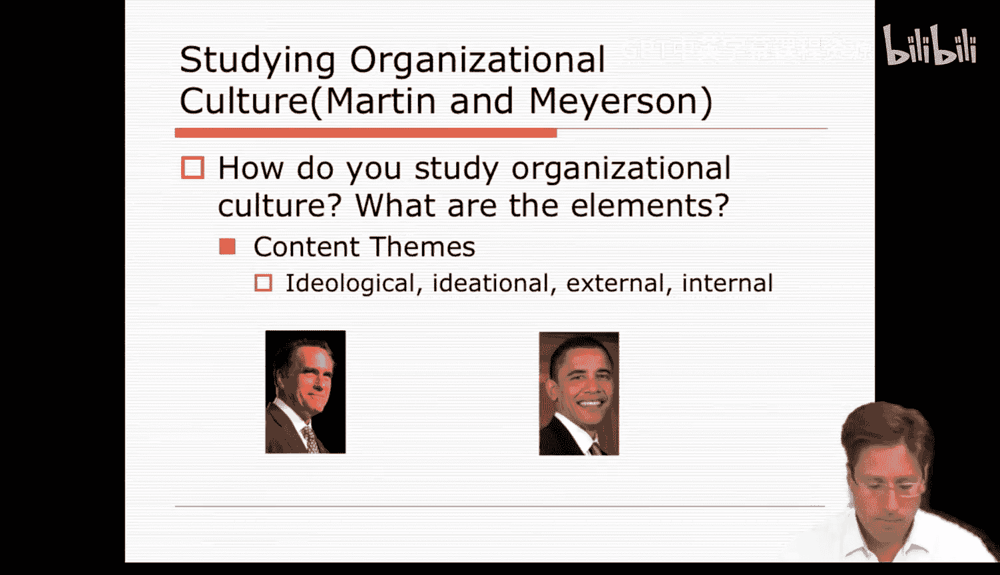
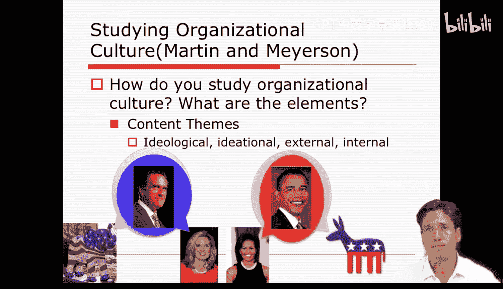
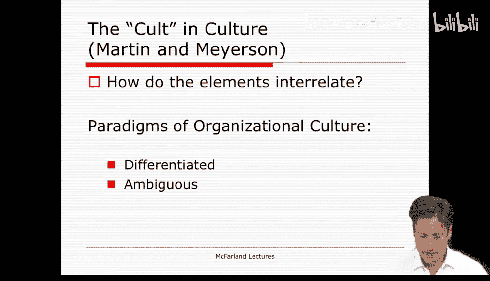
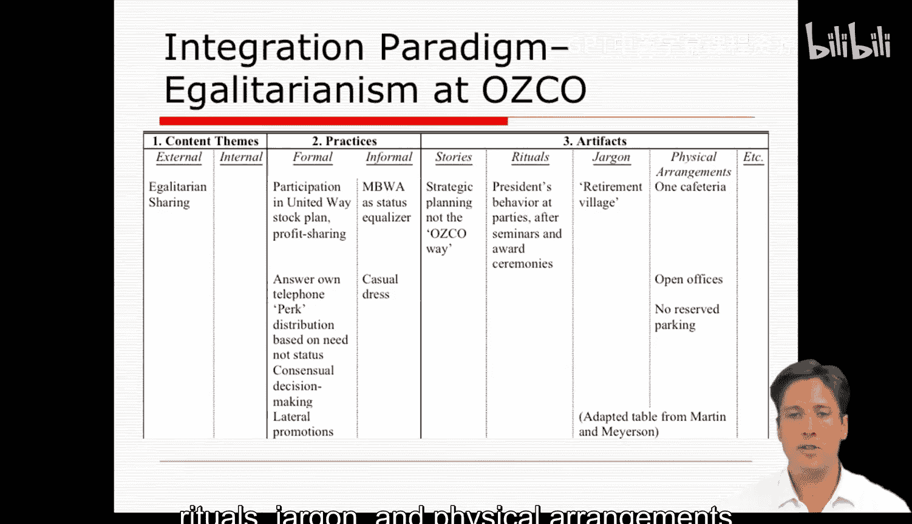
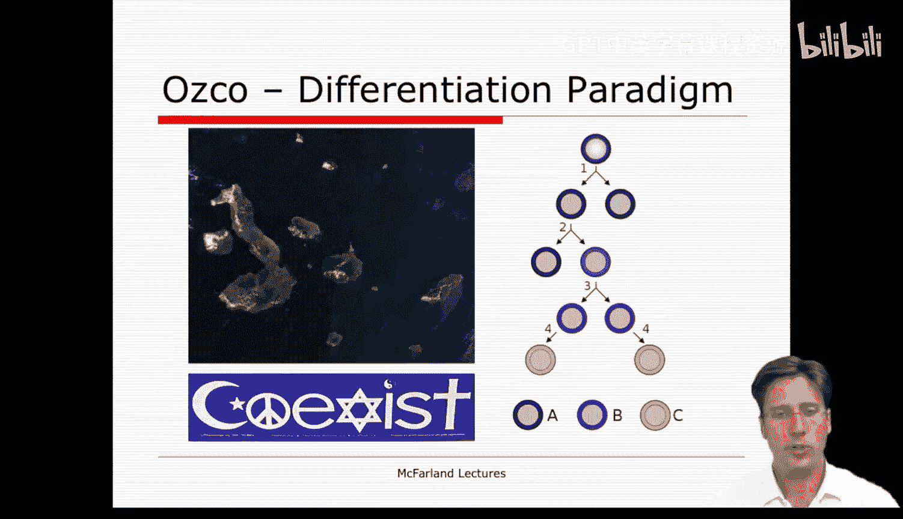
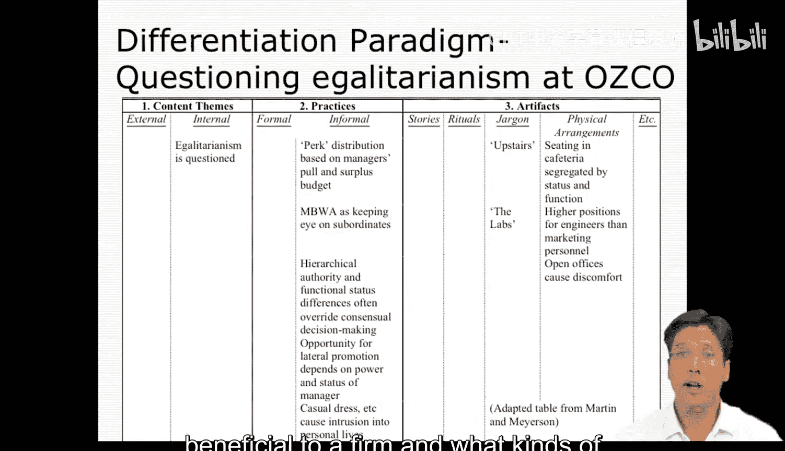
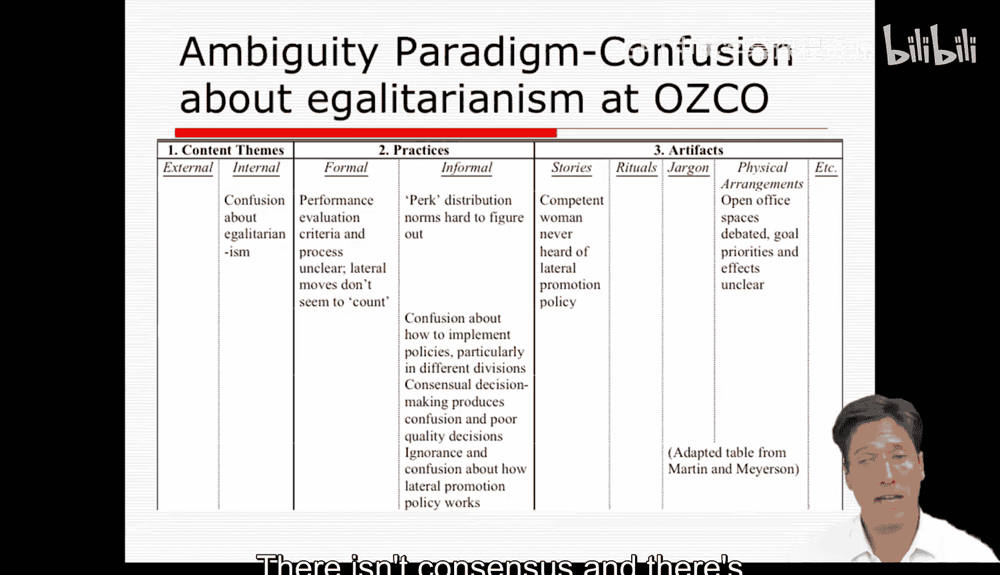
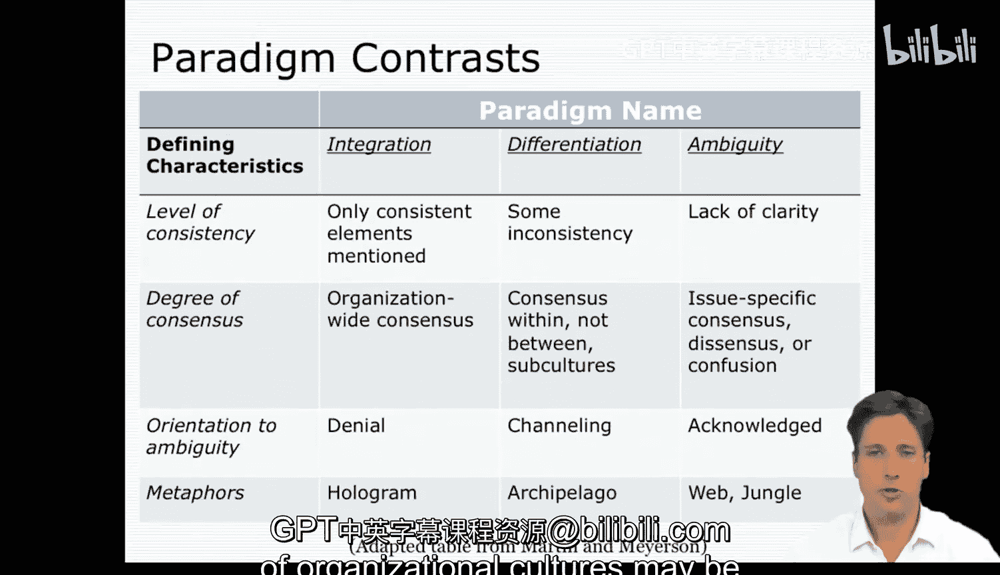

# 斯坦福大学《组织分析｜Organizational Analysis》中英字幕 p55 055_06_02_第十四讲-组织文化-第二部分.zh_en -BV17J4m157qN_p55-

Last， Martin and Myerson argue that cultures differ in the content themes that they highlight by content themes what they mean are abstractions used to organize interpretations of an organization's practices and its artifacts so a good example of this can be seen in the current American presidential election here we have two candidates voicing ideological themes that highlight their different values and beliefs。

 they express normative arguments on the one hand， you have arguments like vote for life and deregulation versus on the other hand we have an effort to express an ideological theme of voting for choice and the middle class they express ideaational themes that concern interpretations about the meaning of events as well。

 For example， the current underemployment is a result of the prior president's economic policies is one argument。

know they're the result of the current president's economic policies。

 another might be that the economic reports are a sign of improvement or that the economic reports are a sign of continued problems。

Recently at each convention， we saw how these content themes are externally presented。

 and this reflects what the members espuse to the public。 It's a public front or face。

 and what's interesting about them is that we can see both of them trying to portray content themes as internally held as well。

 So here you have An Romney arguing that she knows the real Mitt Romney and that he's funny。

 or we have Michelle Obama claiming that she knows the real Barack and that he's the same guy that he was four years ago。

So this is being done in spite of the fact that we have counterimages in the public being shown to us right。

 so this internal image can sometimes be decoupled from the external one within a the internal perspective on content themes is usually kind of an inside view on say what Google's like or what Stanford's like and what it's like to really work and live there and this can be seen as private backstage stuff that can be either reinforcing or somewhat undermining of the external image。

These cultural elements， whether they're practices， roles， procedures， rituals， stories， jargons。

 symbols， tools， or even physical arrangements and content themes。

 all of them begin to form a mosaic of some kind of organizational culture。

 The culture becomes a system of these meanings and affords us a larger。

 holistic sense of what that organization's culture is。 Now。

 Martin Myerson portray organizational cultures as amassing in certain types of paradigms or styles。

 and they call them integrated， differentiated and ambiguous。

The most common assumption is that organizational cultures are integrated。

 that they're recognizable and uniform。This requires reinforcing elements where ideologies and practices and themes all align。

 so you have consistent elements that are being mentioned。

 an organization wide kind of consensus that exists。

Members in these kind of organizations deny there's any ambiguity。

Now the management in public relations offices often espouse such a uniform view。

 but it's seldom present for very long， the integrated culture hides conflict and tensions。

 it has a repressed existence that said it's possible there are some kinds of entrepreneurial firms and where employees are committed to a common vision or purpose and ideology。

 and they may actually have an integrated organizational culture。

In your reading on Martin and Myerson， they explore whether a single firm named Osco has an integrated effort to develop egalitarianism as a culture。

For there to be an integrated culture of egalitarianism。

 they would need to identify a series of cultural elements that reinforce and support this claim。

 Hence， they find that the firm publicly claims to be egalitarian has formal and informal practices in place to encourage it。

 has various stories， rituals， jargon and physical arrangements that all seem to reinforce and support the existence of egalitarianism。

A second perspective of organizational culture is that of differentiation。Here。

 one can regard an organizational culture like an archipelago。

 or having different groups or camps with their own perspective and culture。

 rather than a uniform culture， there's a differentiated one of multiple subcultures。

If we turn to Martin and Myerson again， we see them trying to look for a differentiated organizational culture。

 And when they do so， they look for instances where egalitarianism isn't seen uniformly。

 and there are questions about it。 For example， egalitarianism as an affirmative action ideology doesn't really fit the perks and hiring practices being used。

 In many ways， the differentiated system is conflicted and has countering efforts。

 or at least efforts pulling the organizational culture in different directions toward one subculture versus another。

Schools are actually a great example of a decoupled system or a differentiated culture。

 the administration of a school tends to show the external environment of schools test scores and extracurricular activities。

 but it doesn't really talk about the instructional practices and nor does it talk to teachers about educational process that much。

But on the other hand， internally， it's not the same as the external subcultures can emerge that are different。

 the teachers might talk about instruction and care about it。

 but they don't make it part of the public front， so the external and internal kind of differentiate。

But the question here is whether the differentiated organizational culture is more accurate portrayal of what organizational cultures look like。

 who they exist in harmony or conflict， and another thing to wonder is whether a differentiated organizational culture is beneficial to affirm and what kinds of context and conditions that might be so。

The third way to view organizational cultures is that they can be ambiguous or having unclear and confusing conceptions of meanings。

 In my mind， I see an organizational culture as ambiguous when it gives off mixed signals， So。

 for example， this sign。 I the road closed or is it open for wide loads， not very clear。

 Another way that it can be confusing is it can be regarded in multiple ways like gtalt。

 I it a duck or rabbit， I it a cube that's coming out at me or going back a box。

 right Another way is that a confusing organizational culture is one where people are speaking multiple language and it's hard to make sense of things。

 and the tower of babel is perhaps a silly allegory here。

 but it might help you grasp the concept of ambiguity within a culture。

In an ambiguous organizational culture， the elements are。Typically unclear and confused。

 So if we go back to Martin and Myon and their example of Osco。

 we see that the ideology of egalitarianism is sometimes confusing to some。

 and there are unclear procedures and a lack of clarity about how to implement things。

 There isn't consensus。 And there's confusion of what things mean and how to accomplish them。

By comparing the cultural paradigms to one another。

 we get a sense of how they differ each woman has certain defining characteristics， for example。

 an organizational culture practiced by integration only mentions consistent elements。

 it exhibits consensus across the organization and it denies ambiguity。By contrast。

 cultural differentiation entails some inconsistencies。

 and it exhibits consensus within a sub or subcultures within the firm， but not between them。

 and last it channels ambiguity so that it denies it for its own subculture but attributes it to others。

And then last we have a culture of ambiguity which lacks clarity in general and has issued specific consensus and frequently confuses its members。

 the ambiguity here is fully acknowledged Now if we look across all three kind of start to imagine different kinds of metaphors or analogies that we can have in terms of what these cultures look like and integrated one is like a hologram。

 the differentiated ones like an archipelago and the ambiguous one is like a jungle。

Now it would be easy at this point to think that an integrated culture is the most desirable。

 but I don't think it would be for everything， after all。

 many cults and instances of group think don't really end well。

 and in some way I get the impression that organizational learning from last week presupposes an integrated organizational culture for it to work。

 it often seems to require a cult of sorts。But then again， in other instances。

 organizational learning seems to espouse the need for improvisation。

 and this might require organizational culture to lack clarity and be ambiguous。Perhaps in the forum。

 you can discuss whether you think or agree with this or if another cultural paradigm is possible for organizational learning to arise。

Now， by contrast， there are reasons to believe an ambiguous or differentiated culture may be more useful。

An ambiguous and differentiated culture can be something that creates inconsistencies and confusion on the one hand。

 but it can also afford variation and be a hotbed for innovation。

 so an organization situated in a dramatically changing environment may do well to be differentiated or ambiguous so that it can more readily adapt and survive within that kind of environment。

I also get the impression that an ambiguous organizational culture is the type characterized in the theory of organized anarchy。

 I wonder if you see that。 In many ways， organized anarchy suggests managers should embrace ambiguity。

 as it is kind of there where you can have creativity arise。 Again， Let me know in the forum。

 your thoughts on this。 My point here is that different paradigms of organizational culture may be more or less useful to affirm in its situation。

 I don't think it's clear that an integrated form will be the most desired in every context。 Also。

I think many of you can see that organizational theories that we discussed early in this course may have some kind of proclivity toward one form of organizational culture over another。

 so this may also confuse you a bit and make you wonder how does organizational culture differ from organizational learning right if you recall organizational learning seemed intent on developing a particular set of interactions and practices that led to a self-aware and learning organization。

 it took certain surface structures and sought to implement them so that they would change deeply held beliefs and understandings。

 the deep structure， and that this would result in organizational participants who continually improve their practice？

In contrast， the organizational culture approach is agnostic as to what kind of culture is best it may depend on the context。

 Moreover， it begins with deep structures， the content themes， rituals， symbols， etc。

 and it sees how they kind of influence surface interactions or work relations and company performance so in some ways organizational culture fleshes out what practices are to a richer extent and identifies how they form larger gals or systems of meaning that guide behavior。

 these cultural systems come in many forms， and only some of which may be learning cultures。

 others may be in egalitarian culture or a self-fulfiment culture and so on。

 and it's feasible that ambiguous and differentiated forms of organizational cultures may be advisable under circumstances。

