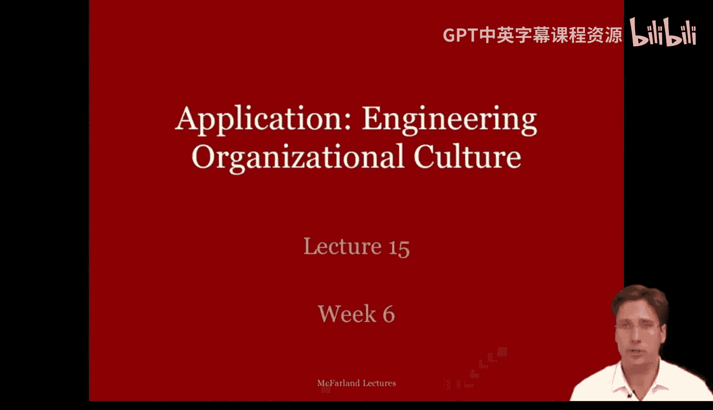
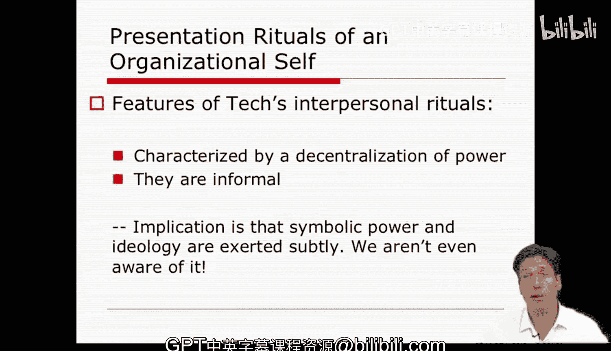

# 斯坦福大学《组织分析｜Organizational Analysis》中英字幕 p56 056_06_03_第十五讲-组织文化构建-第一部分.zh_en -BV17J4m157qN_p56-

In this lecture I'm going to discuss Gideon Kundnda's text。

 engineeringing culture Now before all of you ask me。

 let me tell you at the outset that I don't know which particular technology firm this study is about。

 and I don't know if it really matters the point is that we have this recognizable form of organizational culture and it's a case of a hightech company that seems to influence control and commitment of its members to the corporation Now Kunda approaches organizational culture in many of the same ways as does Martin and Myerson。

Indi though， his primary focus is on the interactions。

 the actual rituals that people perform within the organization， how they talk about it。

 how they present themselves， and his primary tool is that of ethnographic observation in this book Kuns studies the context of normative transactions and by that I mean managerial conceptions of the culture here organizational culture is an ideology。

Kuna focuses on how it's enacted， the rituals by which this ideology is adapted and instilled。

 and he looks at how the members respond to this， how they negotiate the need for distance and embracement of this culture and its rituals。

Kuna regards organizational culture as a means to normative control。

 and by that I mean it's a means to controlling the hearts and minds of employees。

The management in these firms are seen as defining the organizational identity for the members。

 the company， the perspective on the culture is familiar， it's systematic， comprehensive。

 thought out， well articulated， and associated with the company's interest。

This kind of depiction of organizational culture as an ideology is consistent with anthropological conceptions of ideology。

 such as that of Clifford Girtz， where all ideologies are schematic images of social order that's publicly offered in the name of those with a claim to authority as maps of problematic social reality and matrices for the creation of collective conscience。

So what authority gets across in an organizational culture whose image of social order is offered and practiced The inscription of the organizational identity falls into three different categories。

 each of which derives authority from a different source first theres managerial authority。

 which derives his authority and influence from the documented views of senior managers。

 the company philosophy tape speeches of the CEO， company mission statements。

 all of those are kind of framed in terms of morals and ideals。

 a second form of authority is expert authority， and this type of authority emanates from technical papers。

 reports and memos that internal experts right。The third kind of authority comes from objective authority and this type of authority comes from selective representations of materials that are produced by outside observers of the tech of tech。

 right， such as news clippings， TV ads and so forth。

 all of these kinds of authority combined to offer company perspective and ideology。

 the company selects what to represent of this material。

 and their influence is additive and compounding， it's somewhat integrative in terms of how they portray the organizational culture at tech。

Let's look at each of these authorities on the organizational culture one at a time first let's look at the senior management view about tech culture。

 the senior management kind of focuses primarily on the attributes of the collective of the firm at the collective level and it affords these accounts that lend the members some kind of sense of moral significance。

The management does this through all kinds of speeches， interviews， editorials。

 and all of them give kind of a personalized， animated view of the company ideology。

 and they flesh it out in more kind of common sense testimonial ways。

Through these kind of testaments they build a we sense by referencing the past， the mission。

 shared values and identities we all have in this way the membership in the community is presumed to kind of define your social existence and your personal experience you don't just assume a rule you incorporate it and become it because part of your virtual self the image here is that there really is no conflict between the individual and the company。

 there's an integrated paradigm， the organization claims to give employees a place to grow and develop a moral order that they can participate in。

And this moral order is personally meaningful， and it's derived from participating in the company。

A good place you can kind of see elements of this is in the company documents on goals and missions there you see all kinds of catchphrases and abstract ideals mom and Apple pie kind of stuff right they entail things no one would really disagree with and only things you would want to emulate so for example they'll characterized their members as creative hardworking。

 good people out for the common good for example here is the Levi's Gene's mission statement again you saw earlier in the course and as you can see it's related in a moral and normative fashion with mentions of a strong relationship with customers mentions of trust。

 product quality and universality right so what's not to like。

Second we have internal experts who focus more on the requirements and attributes of a member's role so whereas managers focus on the collective as a whole here we have experts who focus on member roles as insiders。

 these experts given aura of independence， practicality and scientific credibility they aren't you know people who've drank the coulid so to say a good example of such an expert view and identity portrayal can be seen in the native anthropologist who is studying the organizational culture here her name is Ellen Cohen in the case her register of speech is often open pragmatic and critical shes seemingly balanced in her portrayal of self her moral tone is not evident and the ideological facade is acknowledged somewhat in her presentations this view is consistent with the managerial perspective but it's less ideal and more real seeming the expert even acknowledges downsideizes and her prescriptions are pragmatic her role performance is more based on。

perersonal success and self-help so the expert is still viewed as partisan though in spite of these accounts。

 she's not giving a critical account that's resistant or counter to the company firm but it's actually more reinforcing from a slightly different angle that seems to complement the managerial views and form a layer on top of the managerial authority that reinforces kind of an integrated perspective on the company culture。

A third view comes from outside the firm from academics， consultants and journalists。

 it's kind of an objective authority that the firm brings in to reinforce an integrated culture。

Organizations typically tend to decide which of these perspectives to relate and share。

And they're mostly positive， the accounts tend to be edited。

 selective reviews of the company from outside that reinforce the culture further。

So popular books tend to get closer to the manager's ideal， but from an external basis。

 academic pieces seem to offer an objective view that the company's members are oriented toward the firm and its culture and journalism is most widely kind of used and people take clippings that are posted often kind of focusing on the CEO giving this kind of heroic imagery of the firm。

 so many similar themes are addressed here， but you see negative critical pieces aren't being really tremendously shown。

 so all three of these views kind of compound form one integrated view of tech。

 and membership and tech entails heavy involvement， strong bonding to the company。

 lots of zeal and this leads to the collapse and the boundary between self and the organization it becomes a cult。

 and this accomplishment is seen as leading to kind of economic success。

And it's accomplished by designing an environment based on individual autonomy， informality。

 and minimal status distinctions and seeming disorgan but in reality it leads to this heightened commitment and process of seeing one's work as a means to self-fulfiment and identity formation and performance so the firm at tech has successfully implemented this integrated culture。

 and the rest of Kundnda's peace starts to focus on whoa what does this do to your sense of self and how you cope in an organization with a strong organizational culture。

So tech has this pretty strong organizational culture and the question then becomes。

 how did they construct it， and the company culture and ideology is actually enacted and instilled in its members via presentation rituals of their organizational self。

And these presentation rituals occur everywhere in the members everyday lives at that firm and the performance of such rituals is really kind of a framing device and by that I mean members act as agents of the corporate interest。

 they attempt to establish a shared definition of the situation。

 within which reality claims derived from the organizational identity are experienced as valid。

 these rituals are used as vehicles for the exertion of symbolic power， and that defines reality。

So I know that may seem like a lot of jargon to some of you。

 but mull it over for a bit what I mean here is that every time a tech employee or manager does a presentation or interacts in a meaning。

 they act as an employee， not as a father or mother， and they act as an agent of the firm。

 even people in the audience that listen and play their role complement to that。

 expect professional behavior and a style of interaction that makes the everyday reality of living in tech seem different from everywhere else。

 and seemingly valid and natural to them as a means to expressing an identity。

If we look at tech we can see presentation rituals everywhere。

 if you recall Martin and Myerson's focus was on cultural elements and if we take that we'll start to see many of the same elements within Kundnda's case。

For example， ritual presentations of self are most often observed in persons behavioral displays at many organizations these are timebound interactions that are specific to a particular audience and setting。

 and these interactions we see people present and attempt to establish positive definitions of their self。

 they wrangle and maneuver so as to do a good job to come off in certain ways。

 we see these displays most frequently in presentations， question and answer sessions and meetings。

 notably all of these are decision arenas that you heard about earlier in the course。

A lot of these contexts are also mundane and they can be private everyday kind of places like the chatter we have at lunch in our back offices or at the water cooler。

 they don't necessarily have to be formal meetings。

Presentation rituals also occur in artifactual displays。

 like when we walk by workspaces or observe someone's dress。

These are standing exhibits of a self meant for passerbys and bystanders at tech。

 these exhibits are found at their desks where they display personal mementos。

 tech stuff and humorous jokes about the company。One can even see a particular artifactual display here at Stanford if I walk down the hallway of the law school or the computer science departments。

 I see very different organizational cultures in terms of the exhibits on display。

At the law school their offices resemble a lawyer's office with cherrry wood， L shapeped desks。

 neat shelves， and so on， and addition all the faculty dress relatively formal in comparison to the rest of campus。

By contrast， if I walk down the hallway of the computer science department。

 the faculty offices are casual， toys and equipment are strewn about。

 and the professors kind of dress in t-shirts， sneakers or flip flobs。

 there's a very different notion of organizational self that exists in these two parts of campuses and one can readily infer it from merely walking by and observing these standing exhibits。

As an analyst。We can capture and record behavior on artifactual displays in a variety of ways。

Through interviews， we get personal accounts of self， through observation and recording。

 we get a record of talk， interpersonal behavior and exhibits。

And through active note taking and involvement， we can even form understandings of these encounters as if we are participants。

As opposed to foreigners， right， all of these devices help us compile evidence on how ritual interactions shape the work' organizational self and form this organizational culture。

Upon observing many such interpersonal rituals and speaking with tech employees。

 Kuna comes to observe a persistent pattern or style to their interactions。

The tech rituals that are everyday kind of interactions have at least two features， first。

 they're characterized by a decentralization of power。

The everyday rituals have kind of a shifting environment of different speakers， reputations。

 projects， teams and so on， and these seem to entail many different speakers。

 changing projects and shifting reputations。 so power isn't very centralized in their everyday affairs。

Second， tech ideology is one of openness， informality， individual initiative and real feelings right。

 hence the symbolic power being exerted on the employees is really subtle it's revealed in brief episodes of social drama like when you have question and answer sessions and talk where or in talks where some individuals seem to establish authority。

 if you recall that can be in several formats like a managerial expert or external kind of authority。

 upon observing many of these interpersonal rituals and speaking with the tech employees。

 Kuna comes to observe a persistent pattern or style of interaction that exists said tech and the tech rituals have at least two features that occur across context first。

The rituals are characterized by a decentralization of power。

It's not in the authority of the role or position that you see power。

 it's actually in everyday rituals where people are interacting in meetings on projects and teams。

 and these interpersonal rituals seem to rotate who speaks and who's in charge and who has a higher or better or worse reputation。

 so power isn't very centralized in these everyday affairs。Second。

 tech ideology is presented as one of openness and formality。

 individual initiative and real feelings， hence the symbolic power of tech is being exerted rather subtly it's revealed in these little social dramas of question and answer sessions and talks where some individuals seem to do better than others's in these minids of control that we see this kind of effort of establishing company norms and ideologies right and the rituals and the dramas have a kind of particular structure where there's a challenge。

 this rising tension and then actors acting on the corporate interest。

 use very various techniques to suppress and redefine the dissent silence to deviance and gain support right so if someone doesn't follow norms of presentation of what kind of self is expected or desired we have these。

Micro rituals and meanings， talks and presentations where there's these minor disagreements and gaffes and people come to exert norms of behavior and guide presentations of self so that they reflect and reinforce this tech culture and its notions of decentralized power and informal kind of informality right so it's through this that everybody starts to exert this kind of sense of self and organizational culture it's distributed and it's informally presented and practice through a myriad of minor dramas。

