# 斯坦福大学《组织分析｜Organizational Analysis》中英字幕 p57 057_06_04_第十五讲-组织文化构建-第二部分.zh_en -BV17J4m157qN_p57-

To this point， we've described how tech culture as a normative culture developed and imposed as a means of control。

 that company engineers this culture to acquire greater worker commitment and to increase worker efficiency。

 and they accomplish this by having members enact the variety of behavioral displays or interpersonal rituals。

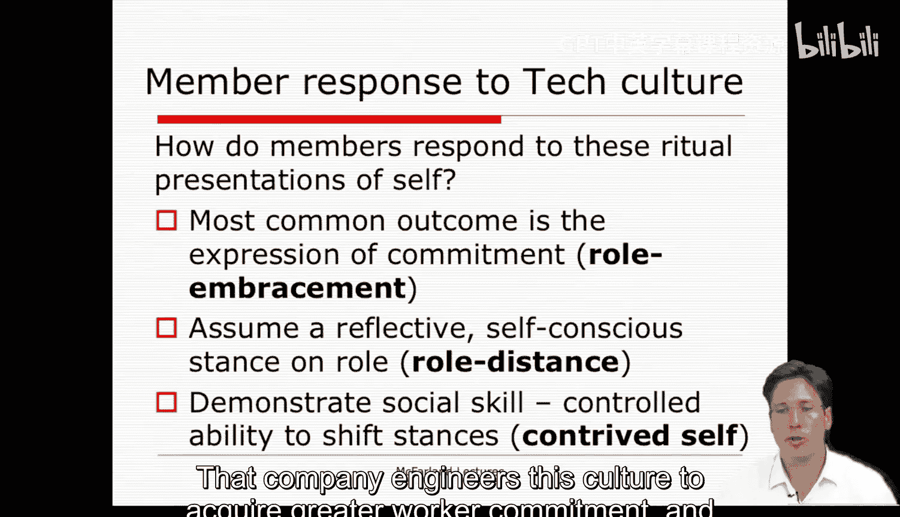

Where in these kind of disagreements and meetings and talks。

 various standards and identities are assessed and redirected in ideological ways of what's more emblematic of a proper employee of this firm in this manner the firm hopes to go deep into the person's psyche and have them embrace the organizational self as a virtual one as their virtual self and from this all sorts of company gains will result in commitment levels rise。

The question becomes how do tech employees react to these presentation rituals of self and the seeping in of an organizational identity。

 are they fine with it， do they dearly value the organizational self they portray。

 or do they feel like a tool or like they're just playing a part， do they resist this self。

 or do they play an ambivalent self， how do they respond to tech culture？

Now Kunna writes that employees respond in several ways。

 he looks at how individuals differ in their response。

 the most common outcome is the expression of role embrace。

Here embracement is expressed wholeheartedly in talks by top level management。

 it's a little more reserved and tentative in training workshops and it's pragmatic andual in work group meetings the participants who do embrace their role like managers experience a little bit of emotional dissonance in those instances their perception of the active role and the experience of an authentic self becomes hard to disentangle they find it hard to have an identity distinct from the one that they have at work so it's hard to have a balanced life to have room for your personal life and things like that we've all heard those kind of arguments。

A second reaction is to engage in roll distance here the tech employees suspends their role embracement in the process of performing their behavioral display Now we've all seen people do this like for example when I teach。

 I drop my teacher role at the beginning or end of class to be more social with students or during transitions and timeouts and so on。

 the brackets intersperse my presentations and our opportunities for role reversals。

 I can talk to you as a peer， I can joke， I can mention my kids I can fall out of my role and be a person that's distinctive right？

At tech， it's not so much a role reversal， though as role distancing。

And this is when members assume a reflective and openly self-conscious stance。

 they comment on their condition and the ritual performance itself when this occurs members temporarily detaach themselves from their performances of the member role and they comment on it and they share with others their awareness of the theatrical nature of the proceedings it's all an act right like this right now is an act right and they put colorful labels on behavioral scenarios they say they're just setting up their talk that they don't want to engage in pissing contests or backstabbing or crucifying or hanging by their shoestrings or engaging in hidden agendas etc。

 we have terms for that。The act of distancing yourself from your presentation or manager role doesn't really invert the hierarchy like my jokes might。

 but rather they confront the meaning of authenticity， who's real。

 who's not they also confront the issue of inclusion who's in and out on this right that's being enacted so this is actually more important than many people realize by enacting role distance and taking a self-aware stance on your talk or your role。

 you show you're a person distinct from it， I'm just a guy playing my part just like you are。

By doing this， we connect and there's a communion among the self aware and talented actors who comment on their roles and performances。

Now， some tech employees are aware of all of this and show a great deal of social skill and elegance at it that is they have a controlled ability to shift stances and frames from being embrace to being distant and this ability to shift stances is key because members evaluate one another on their ability to express both embracement and distancing and knowing when to stop or from going too far in one direction or the other Now Ka calls this a contrived self because participants enact rituals with an explicit awareness of the dramatic mechanisms that underlie the process of framing reality and an open acknowledgement of the manufactured nature of cultural categories and symbols including those that are central to the ritual performance itself and this is really where it gets interesting the selfconsciousness that can be seen as a fatal flaw is now ritualized。

 this creates a potentially。Sttable balance between roll distance and embracement that constantly calls into question the authenticity of experiences associated with the member role。

 especially for members targeted by Norman of control。

So the presentation rituals are vehicles of enacting andforcing and reinforcing the sanction display of member roles and are thus a mechanism mediating normative demands and responses。

 the mediating rich role of rituals is not simple though they can juxtapose a variety of themes and stances。

 for example， they can juxtapose ideology and common sense， notions of obligation and choice。

 of seriousness and humor of affirmation and denial of internal and external viewpoints of participation and withdrawal。

 switching between embracement and distance forms a web of these normative pressures。

And in the end you have to wonder if a strong organizational culture leaves much room for individual freedom and expression。

 what's real and prescribed here about yourself， even the contrived self。

 one that you accomplish by social skill and by switching between embracement and distance is something the organization prescribes and awards you get higher status in the firm by doing that。

 think of all the managers who effectively do this in their presentations， they aren't unique。

 it's sort of like a rebellious kid， sure you're in rebel。

But you rebel much like all the other rebel kids， so you're kind of a social type。

 so it's not that unique and it's the same for the contrived self。

 it's kind of a skilled performance， but one we recognize as we go from firm to firm and particularly across divisions in tech culture。

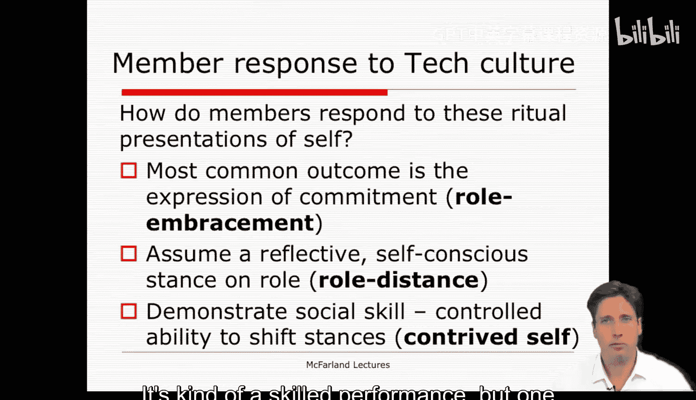

Now not all members are invested equally in tech right。

 you have marginal members like Ts and wage two class workers who are not subject to the same role demands and organizational ideology。

 so they're sort of exempt to a degree because demands on their are reduced。

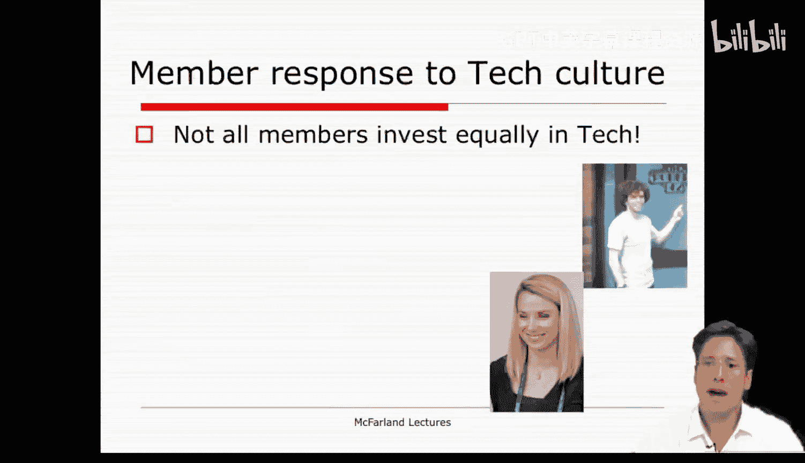

At the same time， it may make some of them feel left out and they develop an estranged view of organizational identity and culture。

Full members though， now these are wage four class employees and up at tech encounter enormous demands of the member role and a fundamental dilemma think of Marissa here and the fact that she's about to be a mother and how that role has kind of been merged with the organizational identity that she's assumed at Yahoo by seeking acceptance and higher status a lot of these actors expose themselves to greater demands of the organizational identity。

 they sell their soul， more of you has to be given up the price of power is submission。

And not to behavior as low status people must， but to prescriptions regarding thoughts and feelings。

 and this can lead to a cynical view as members form a contrived self and performance of self that does this embracement and distance。

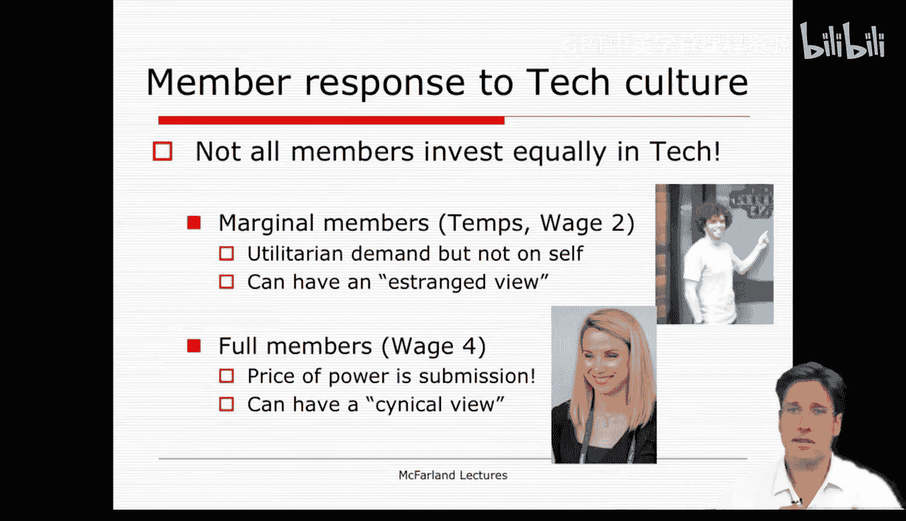

So to this point， you may be thinking the following。

 if I join a firm with a developed organizational culture and I want to get to the top then I may find myself being brainwashedLuckily。

 all is not lost， even if you play the part of a contrived self and are cynical about you and the firm。

 you can do some things that leave room for you and your authentic self。

 what you regard as your authentic self， the organization need not take over all of who you are。

Everybody， including me， has multiple identities themselves。

 I'm one thing at home and I'm another thing at work。

 one thing with my kids and another thing with students， in both instances。

 I am showing role distance and reveal my character by joking about how I am as a father with my kids or joking about how I am as an instructor with my students。

 and in each case it kind of reveals something about me as a person independent of these role identities。

The organizational self for tech managers is one that arises from balancing acceptance and rejection of the organizational ideology and the member role that it prescribes。

 it's that sense of self， that balancing dynamic that's associated with being a full member of the organization。

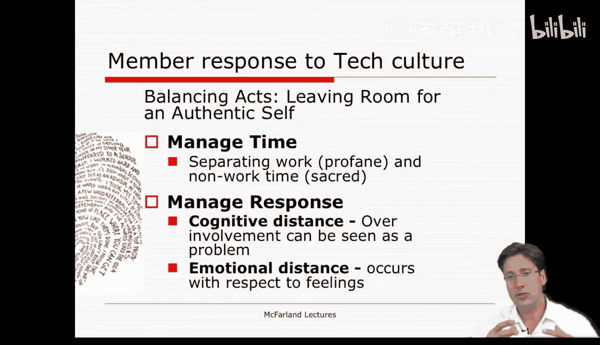

You get what it means to be a member of that organization。

 not by being a zealot or by being an immense critic， it's by balancing those two kinds of things。

Those two kinds of distance and embracement。Now there's certain things that members do to kind of respond to tech culture and preserve some kind of room for their independent of it。

 the first thing that people do is they manage their time tech work takes lots of time and energy and this blurs the distinction between work and non work。

As a response， people create boundaries around their time and their relationships that develop at work。

 nonwork time is regarded as sacred and it's protected， it's kept separate。

 workers can also define their authentic self by what they want to become or in sphere is outside of work as a surfer or as a naturalist or something like that。

 right？Now second you can manage your response to the organizational self Many workers regard overinvolve as a problem they believe that having a fair exchange with the company is desirable and anything else is undignified in fact role distance and disputing popular ideological formulations is viewed as a good idea within the firm you need to be autonomous enough to know what's going on in the company and dignified enough to express such knowledge otherwise you're seen as a zealot or a toolEmploy do this by being cynical complaining by performing detached theoretical observations which is a little more positive you use the lens of a historian or a scientist on the firm a third is that you can adopt a commons sense perspective right it's not like a believer but that you effectively try to view the organization from a frame of reference as well this is just reasonable or practical right。

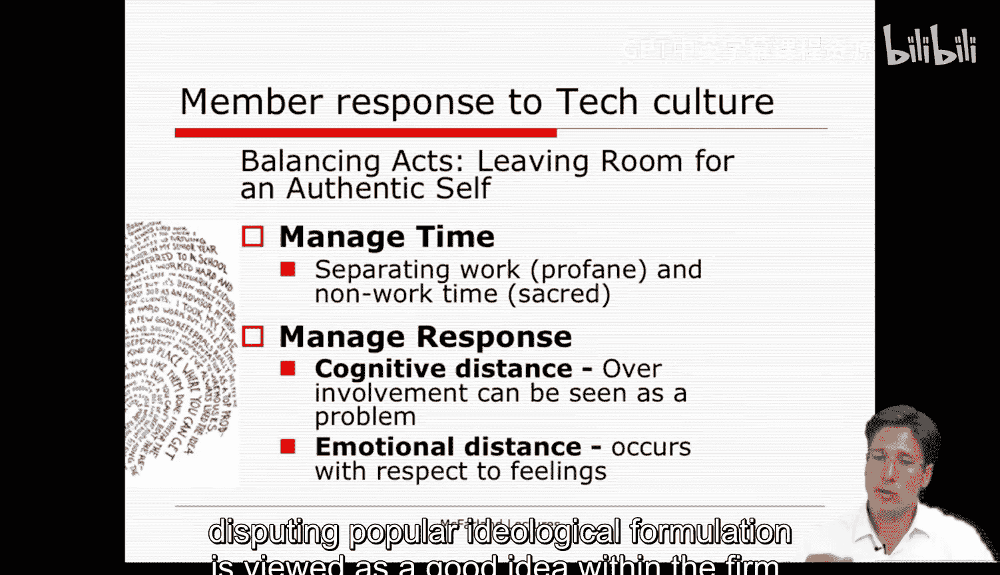

Now， workers can also distance themselves emotionally with respect to their feelings。

 not just cognitively， right？They can do this by denying feelings where they claim their motives for membership are purely instrumental。

 I do this for the money right they deny emotional attachment they can also express emotional distance through depersonalization they can distance themselves from emotions experience at work and they say things like I have a thick skin or they talk about their emotions abstractly as oh my pain or the warm fuzzies they don't take things very personally and that's how they distance Last they can regard their emotions in terms of dramatization and this is where they view emotional expression as strategically driven it's something I use to accomplish goals and therefore suspect of authenticity right so I use drama to get things I want right so in some actors respond to tech culture and organizational selves by engaging in two efforts at self-preservation they attempt to control and stake boundaries to their other。

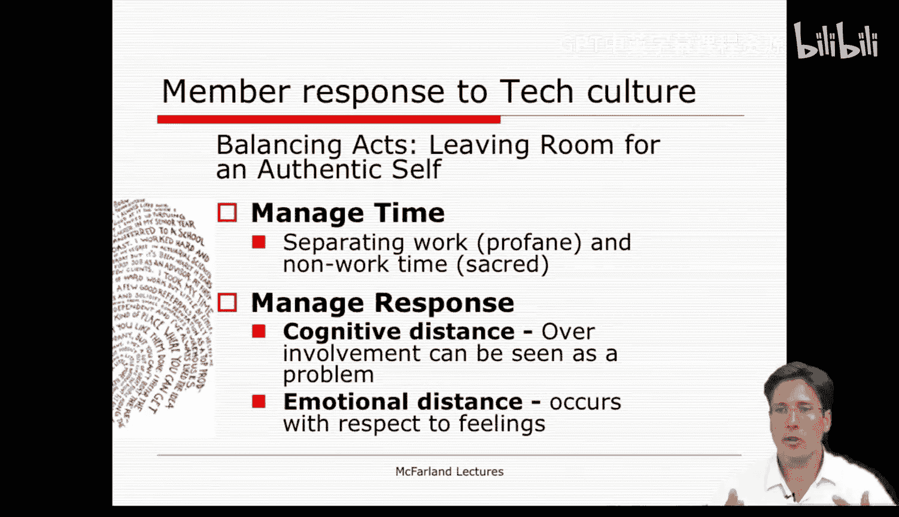

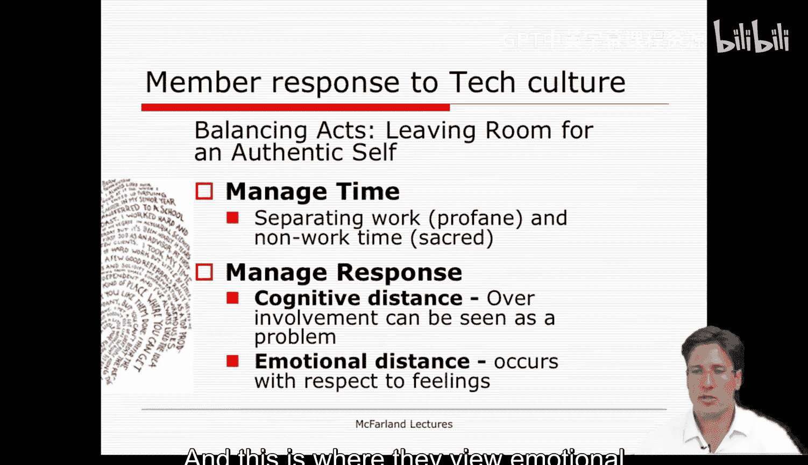

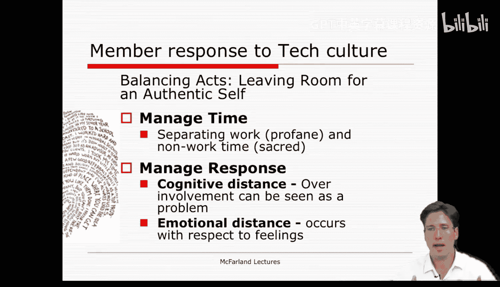

By managing time and separating work from nonwork and they seek to control their cognitive and effective responses at work when they're enacting organizational selves and we see this all the time within our own lives where we try to say that we have thick skins or that we try to separate work life from home life and the like。

 and these are common responses to organizational cultures， it's not just tech。

 but it just seems to be more prevalent in a integrated strong organizational culture that you see these kind of responses。

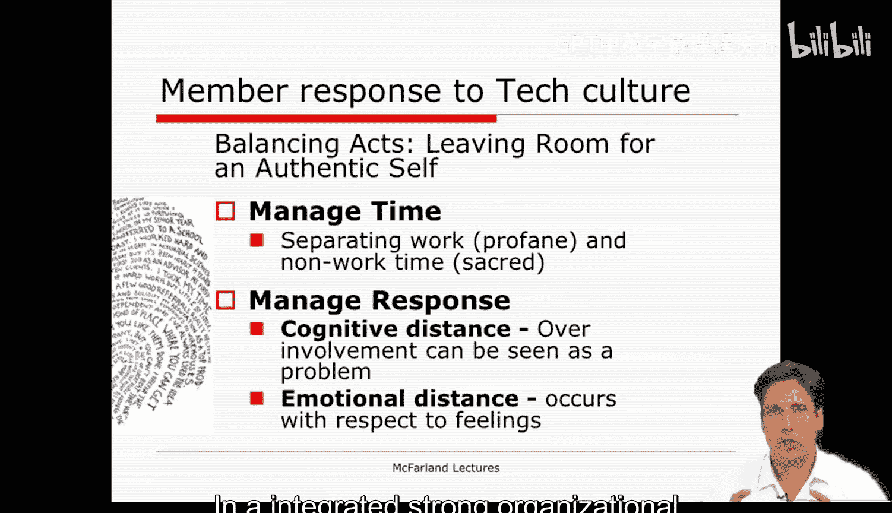

So let's sum up Kundnda's argument。According to KUa。

 organizational cultures are a means to normative control。They are an ideology of sorts。

 and this ideology is enacted and instilled in members via presentation rituals of self。

And these rituals occur in all the meetings and water cooler conversations and where they are minor disagreements where people establish norms and standards Now wage two workers are under only utilitarian control。

 they want pay， but wage four workers on up like managers are under cultural and utilitarian control。

 they sell their souls， their selves to the company。

 now this may be desirable or not and most of every true member of an organization perform some role distancing。

And in so doing， they free up other features of their self that's independent of the company。

But even so， the higher one goes in the status hierarchy。

 the more role embracement is had and the distancing becomes part of a contrived self and enact。

 so for example， Stanford professors that get tenured have to embrace the role fully end up living on campus often and their whole life is work at every point then the notion of a self。

 an organizational self is highly tied up with their personal self。So for the forum， I mean。

 this may be true for many of you and your professions as well。

 but on the forum I'd like you to think about whether it's great to embrace an organizational self as your own and what kind of company would it need to be for you to embrace it that fully to lose yourself within that role。

Also ask yourself if Kuda is viewing this as kind of a cup half empty story。

If I don't embrace my organizational self， then I must be embracing another self and other spheres of my life。

 like being a father。Why is that organizational self more sacred。

 what if my organizational self at Stanford also serves some good。

 is it okay then for me to embrace it， when is it okay， how do we decide these things？

Or is it that Kuna is saying any role embrace has this quality of becoming more and more of our virtual self。

 and that with any role we fully embrace， we eventually assume a self-reential perspective on it。

 like when my wife and I joke about being parents。But then this process is merely descriptive of our being in an organizational world and how we manage ourselves more generally in today's society。

 isn't it， I mean， that's what it actually implies。Now I don't have all the answers。

 I just know that Kundnda in his case has hit on something profound。

 we want organizational culture and its embracement in many of the organizations we want to found and manage。

 right， we want to create this cult and through that we think we'll have a successful organization。

And yet we have this precarious relationship with ourselves when we participate in such a culture。

So hopefully we can discuss this on the forum this week。

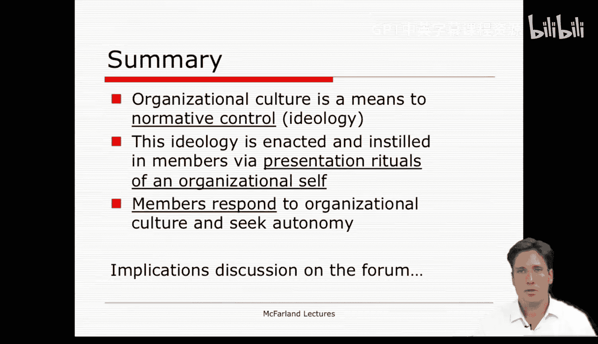