# 斯坦福大学《组织分析｜Organizational Analysis》中英字幕 p65 065_07_01_第十六讲-资源依赖理论-第一部分.zh_en -BV17J4m157qN_p65-

Today， we're going to begin focusing on theories that are primarily concerned with the environment and how they influence organizational effectiveness and survival。

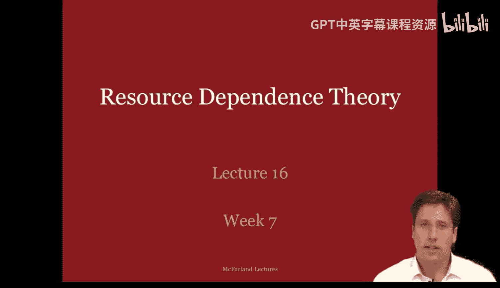

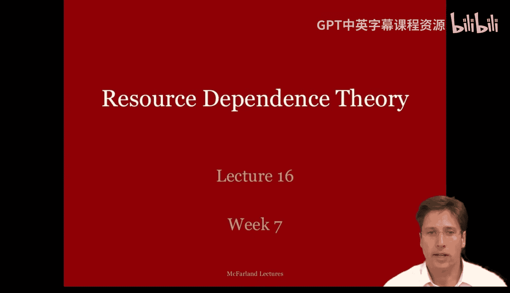

These theories are called resource Depend theoryory， network organization。

 and new institutional theory。

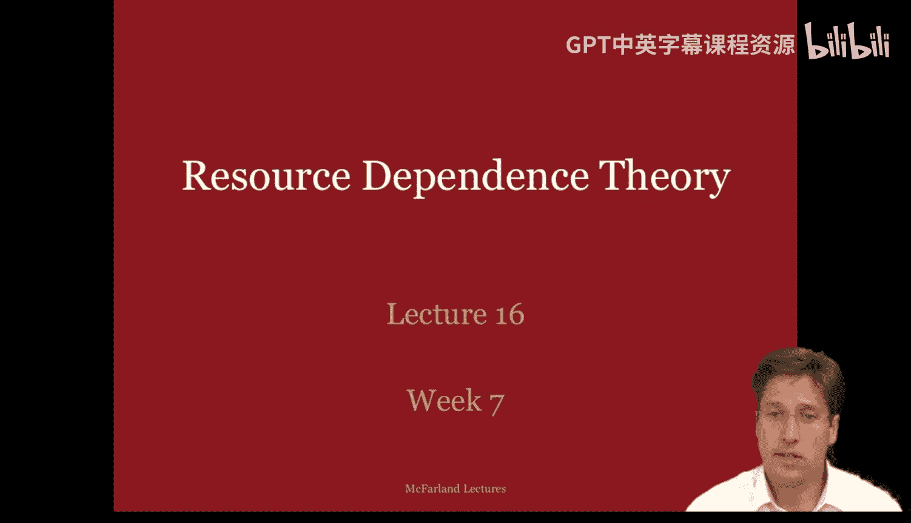

All of these theories and conceptual frameworks are relatively recent contributions to organizations research。

 most of them emerged in the literatures in the 1980s onward。

 and all of these theories provide an open systems perspective on organizations。

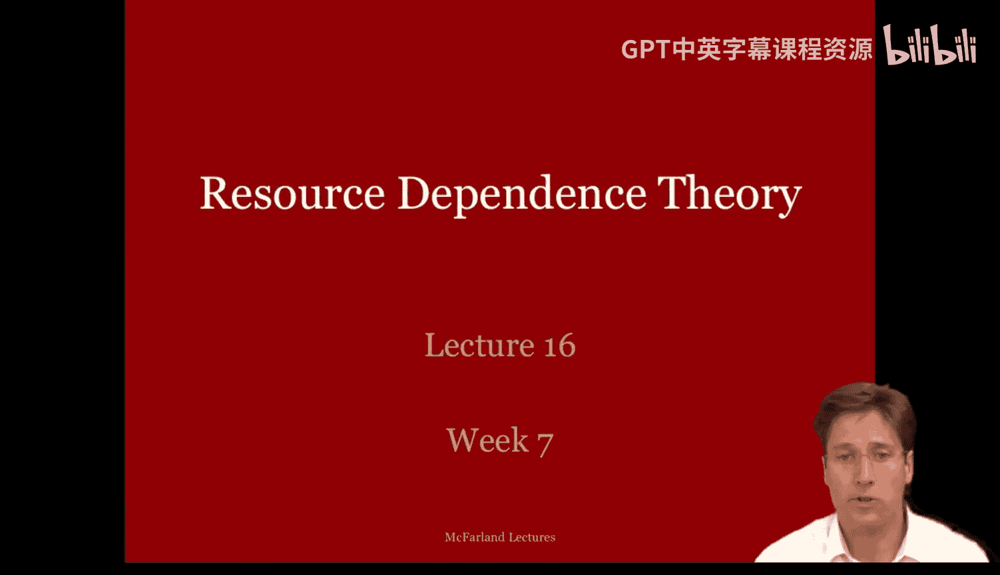

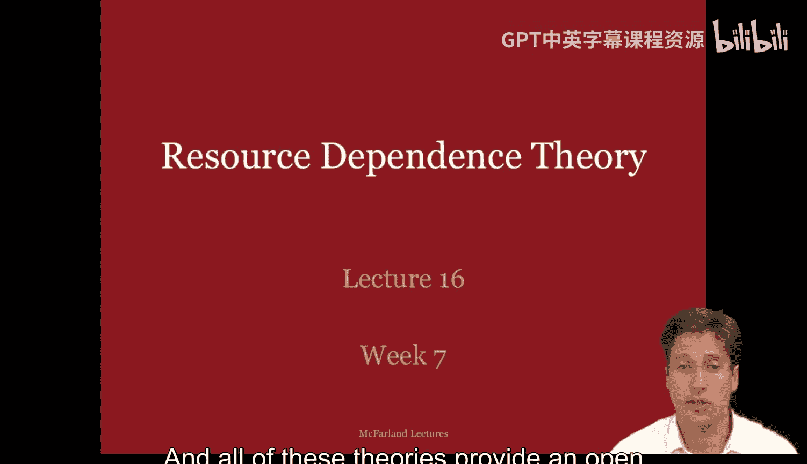

Each one will argue that there's no single best way to organize a corporation or to make decisions the optimal course of action is always contingent or dependent upon external situations for the firm。

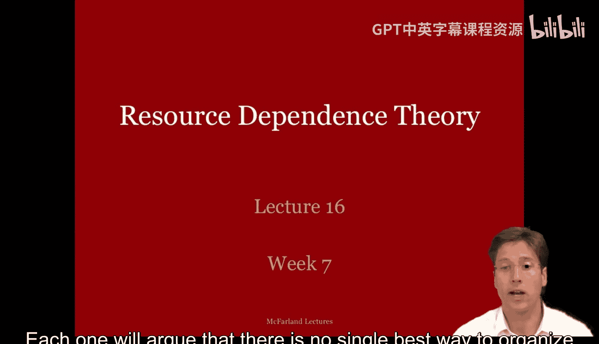

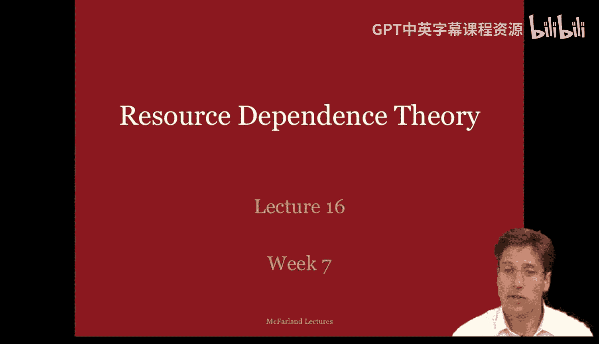

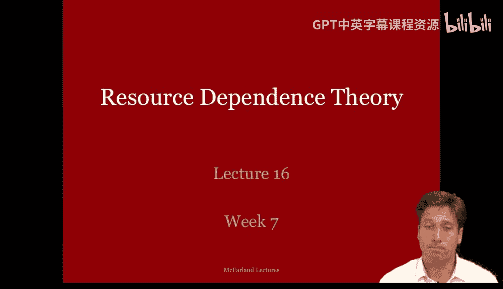

As such， the best way to organize a firm depends on the nature of the environment to which that organization relates。

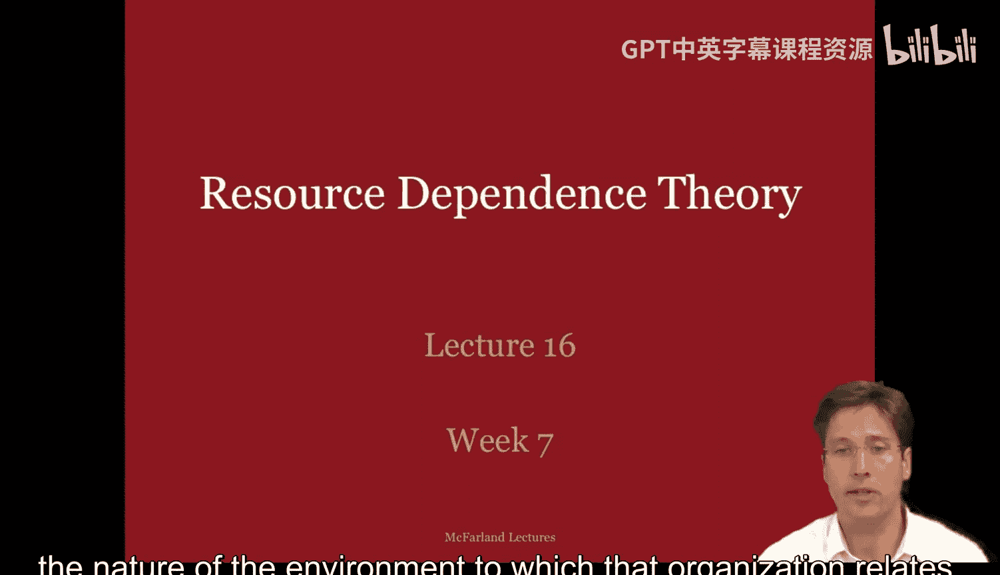

The theory we're going to discuss today is resource dependence theory。

 and it views an organization in terms of its resource dependencies with other firms in the environment。

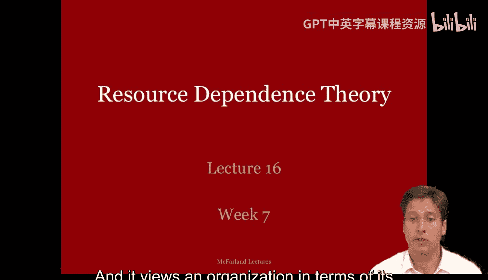

Now we've already covered a series of different theories in the course。

 so it may help to contrast them with the theory of resource dependence。

What I'm going to do next is I'm going to review a few of our theories that we've covered already。

 and I'm going to compare them， we'll look at coalition formation。

 organizational learning and organizational culture。

 and we'll discuss how they differ from the resource dependence perspective。Back in weeks 2 and 3。

 we learned about coalition formation and what it entailed。

 We learned that coalitions arise when multiple actors have inconsistent identities and preferences。

 and none of them can go it alone without the assistance of others。 We read about players。

 having their own interests and stakes and having their own resources。

 We also read about how these players had to negotiate or exchange and bargain until they reach an agreement by which coordinated action could follow。

We also learned that coalitions could be managed and formed through various processes of exchange and bargaining。

 like horse trading and log rolling， these exchanges were all pairwise or dadic。

 and they aggregated within a group to form a shared goal and agreement the timeframe of these exchanges and agreements were narrow because the coalition's agreement was often fleeting resource dependence theory is similar to coalition theory and that it concerns exchange as well as efforts to produce agreements。

 However it differs from coalition theory in at least two important ways。First。

 it shifts the unit of analysis from coalitions of persons to interorganizational relationships of dependence here the concern is with a focal organization and its multiple resource dependencies with other organizations in the environment。

Second， while coalition theory focuses on narrow windows of time specific to each transaction。

 resource dependence theory。Concerns extended forms of exchange or exchange relations。

An organization can informed form a wide variety of buffering or bridging maneuvers used to overcome persistent dependencies in that environment。

 for example， you're going to learn that when a company merges with another company。

 it's often a means of absorbing dependencies and acquiring a degree of autonomy in the environment。

These dependence relations can also be asymmetric， in fact。

 managers of resource dependence actively seek ways to render other firms dependent on them。

 but not vice versa。So with resource dependence theory。

 we have an egocentric view of an organization trying to acquire the best exchange relations it can within an environment of potential partners。

In prior weeks we also discussed organizational learning if you recall organizational learning focused on how organizational participants adapted their practices within the firm as they engaged in process of doing their work。

 this was facilitated by efforts to encode best practices into organizational memory and by communicating about practice in local communities of practice and by communicating outward。

 outwardly in networks of practice beyond the organization。

Managers of organizational learning try to develop employee concern with improving practice and by forging social relationships and interactions that facilitate knowledge。

 implementation and transfer。Most of the emphasis lies in local adaptations of routines， and as such。

 the argument is that internal adaptations learning by doing is the main means to understanding and expertise。

Resource dependence theory has some similarities with organizational learning。

 like organizational learning， resource dependence theory focuses on the technological core of an organization。

 however， rather than describe the internal process of practice improvement and knowledge transfer describes how the technological core of an organization is buffered from the environment resource dependence theory describes how the organization as some sort of unitary actor bridges with firms in the environment so as to garner autonomy and control hence concern is placed on becoming effective in an external environment and by establishing certain standard operating procedures for resource exchanges with other firms。

 so the focus shifts from mostly inward with organizational learning to mostly outward into the environment for resource dependence theory。

Last week， we discussed organizational culture， and there the goal was to create an ideology or culture that members identify with personally and managers used all sorts of strategies or rituals to make that happen。

 Now， of course， it's possible that different paradigms of organizational culture。

 whether integrated， fragmented or ambiguous will apply best to your firm's goals or context。

 but the general argument is somewhat similar to that of organizational learning。

 adaptation is internal to the organization and not focused on external relations outside。

Whereas for organizational learning the effort was to generate relations and practices here the effort is to engineer deeper social structures of cognition and norms。

 here managers worry about internal contingencies like layering on a culture too thick and having organizational members react in a resistant way you all recall Kundnda's worry about generating cynics within the corporation tech right so managers have to balance the effort to prescribe a culture with allowing participants room for their otherwise the participants' relation to the culture will undermine its effect。

So organizational culture is inherently concerned with the process of sense making and ritual performance。

 standard operating procedures are viewed as practices and deeper broader sets of practices than perhaps organizational learning related。

By contrast resource dependence theory is not concerned with sense making but with the selection of standard operating procedures that manages the firm's resource dependencies in the environment in a way resource depend theory is a step back toward organizational process models。

 it brings our theories back up to the surface of ostens rules and routines and away from deeper forms of sense making。

 managers form and select standard operating procedures that concern relations in the environment and they seek relations that create favorable exchanges or favorable consequences。

 so resource dependence theory is a step back toward the logic of consequences in that regards。

We can also discuss the prior theories in this course more generally as natural systems as compared to the open organizational system being characterized and resource dependence theory。

 a good example of this can be found in how prior theories describe organizational uncertainty。

That was something that arose within the firm from inconsistent preferences， identities。

 unclear rules， routines and practices， and so on， resource dependence theory is also concerned with organizational uncertainty。

 but it sees uncertainty as residing in the firm's external relations of interdependence when external dependence relations are not managed or coordinated well。

 they create uncertain conditions， if not unfavorable conditions for the firm's survival。

Prior theories also regard dependence and uncertainty differently from resource dependence theory。

 for example， in coalition theory， dependence is not a problem but something sought after to make the coalition hold and uncertainty or ambiguity is often a reason for why the coalition stays together by contrast and resource dependence theory the firm tries to accomplish autonomy and certain。

 and it does this by freeing itself from dependence on other firms and by forging contracts。

 hence whereas uncertainty and dependence are an asset to coalition formation。

 they seem to prevent firms from acquiring an advantageous resource position so the shift from immediate local exchange conditions within a firm and among individuals to externally sustain exchanges in an environment between organizations seems to have different consequences and implications for our theories。

Let's now briefly discuss the history and core features of the theory of resource dependence Re dependence theory in great part。

 grew out of contingency theory， therefore it helps to understand the core features of contingency theory before we move onward contingency theory was a class of organizational theory from the 1950s through the 1970s that argued a firm's optimal course of action or structure was contingent upon the internal and external situation in which it found itself As such contingency theory offered a natural and open system view of the firm。

Perhaps the most complete characterization of contingency theory can be found in Thompson's work。

 he describes how firms need to buffer and protect their technical core from all sorts of internal and external disturbances that can disrupt the functioning of that technological kind of task core task。

 and he affords several prescriptions in how to minimize these contingent problems， so for example。

 he suggests that managers need to seal off their technological core and buffer it from internal and external influences。

 and he thinks managers can do this and prevent it by distinguishing both the input acquisition functions such as supply and the output disposal functions such as sales from the technological core。

 he also advises on internal strategies of the firm that might include things like stockpiling and smoothing or internalizing uncertainty through growth thereby absorbing uncertainty。

He even suggests external strategies like maintaining alternatives and minimizing dependence。

 and specific examples of this are cooping， contracting， and joint ventures。

So we see a lot of characteristics within contingency theory that are going to hold on into resource dependence theory。

Resource dependence theory builds off contingency theory and greatly elaborates on maneuvers that firms can use to manage disturbances in the external environment。

Resource dependency theory was founded by Gerey Feffer and Gerald Sallanic。

 and according to Feffer and Sallanic， organizations modify their boundary so as to manage disturbances in the external environment。

 so in this case， the firm's central goal is effectiveness and a context or environment。

 so its survival and effectiveness in this context。

So this is different from organizational learning where internal efficiency and improvement is the focus resource dependence theory is primarily focused on relations with the external environment rather than on ones within the firm。

 and as such resource dependence theory views organizational conditions in a particular way it presumes there's an environmental determinism。

 which means that an organization's behavior can be explained by looking at the organization's context such as external constraints and controls。

嗯。It also assumes that an organization's specific goals are contingent on dependence relations that keep it alive。

 so these are the relationships that secure its necessary resources。

Within this context of resource dependencies， the firm's general goal is to find greater certainty。

 so relationships that persist and are clear and advantageous， as well as autonomy。

 so they're looking for relations that render them independent or in control。Last。

 organizations are viewed as responding to resource dependencies in at least two ways。

 they can either comply and adapt to these dependencies or they can avoid and manage them。

So what are the core features of resource dependence theory。

 One of the most important features of the theory concerns the resources involved and how they establish dependencies to identify resource dependencies。

 it helps to ask what are the key resources in an environment。

 who controls the resources in question。Resources come in a variety of forms。

 and they're valued differently depending on their importance and availability。

 and they differ in terms of who has discretion and control over them。

There are various types of resources that firms depend on， such as physical materials。

 these might be actual materials the organization builds a product from。

But firms may also depend on technical resources like information or knowledge as well。And last。

 they may depend on social resources like prestige and reputation that enable them to survive。

All these resources can vary in value。 On the one hand。

 their value can differ by the importance of the resource。 Is it in demand， Is it valued。

 Does the firm need the resources to survive。 Is there a critical resource， For example。

 What does Stanford need to survive， Does it absolutely need students。

 Does it require a physical location， books， teachers， money， heating， food。

 What can it live without， What can't it live without。Is there a demand for safety， healthy food。

 expert teachers and awards， for example， what do Stanford alumni most want to see， high SAT scores。

 winning state championships and national championships， what is it。

 what resources are considered most and least important？On the other hand。

 does the availability or supply of the resource influence its value。 Is the resource scarce。

 Do only some of the other organizations have it。 How concentrated is the resource。

 Are there alternatives to this resource， Can another kind of resource be substituted for it。

Who else has it？Let's consider Stanford again， what does it offer。

 what does Stanford offer that is unique that no one else can provide？It's an open question。

 leave it for the forum。Discretion over a resource also defines relations of resource dependence。

 Disccretion is defined in at least two ways。 First， who controls the resource。

 Can the exchange partner dictate how you use the resource is the resource regulated by the government。

 so changing districting to increase the resource or pool of available students for a particular school。

Is your firm dependent on the supplier for materials and funds？

Or is it dependent on consumers like students and families？Second。What controls dependencies。

 what laws are in place， what are the copyrights or contracts and licenses that exist that prevent us from sharing certain curricula。

 so for example， in this course I can only afford youth images from the creativeative Commons so I'm limited to what I can show。

 so there's certain kinds of regulation over what kinds of information can be shared。

So resource dependence varies from a variety of factors， there are different types of resources。

 and they can vary in value due to their importance and availability。

 and then certain actors and institutions can control discretion over those resources。Now clearly。

 important rare resources are of greater value， moreover。

 actors and institutions that have the greatest discretion over these resources and the least amount of dependence will be the most autonomous and capable for forging certain relations with other firms in the environment。

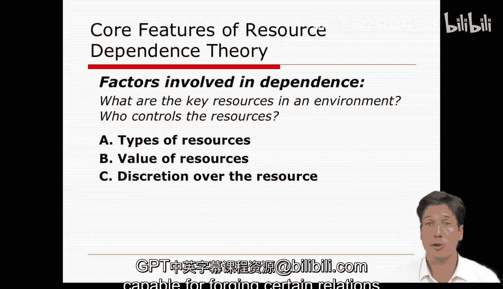