# 斯坦福大学《组织分析｜Organizational Analysis》中英字幕 p66 066_07_02_第十六讲-资源依赖理论-第二部分.zh_en -BV17J4m157qN_p66-

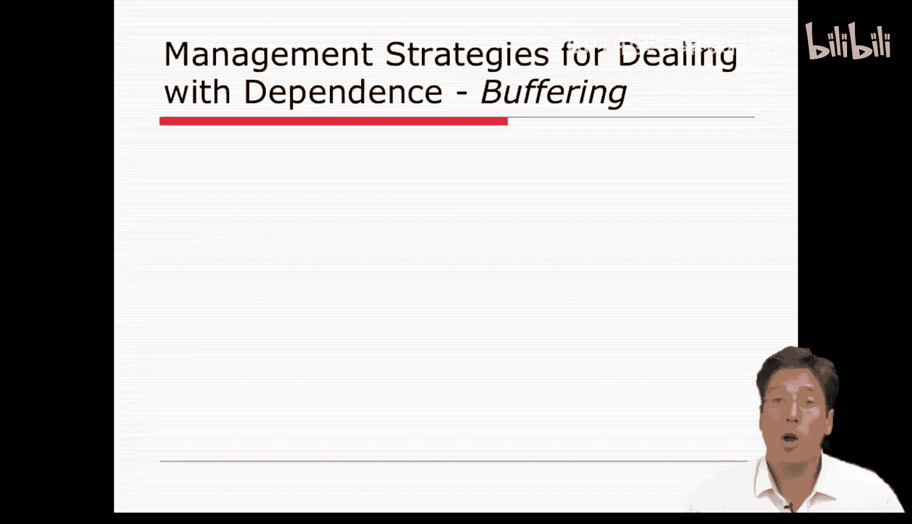

Once you understand the value attributed to a resource and the game of resource dependence。

 which is to be autonomous and establish beneficial resource relations with the environment。

 and especially ones of important resources that you control。

 what happens is a variety of managerial strategies follow。

 and some of the first managerial strategies， echo contingency theory。

 which was to protect the technical core from the environment via buffering strategies。

 and if you recall those were things like coding， stockpiling。

 downsizing or what some might call removing slackck， or the use of advertising。

 which showcases strengths and so on。Now， none of these buffering strategies change the core task and technology of a firm。

 they're more concerned with putting standard operating procedures in place to manage the organization's boundary。

Let's take a look at each strategy one at a time。First。

 firms can form coding and coding occurs when an organization classifies inputs before inserting them into the technical core。

s as preprocess right so this kind of preprocess facilitates proper routing and if necessary proper exclusion。

 so in schools， for example， they track and stream students often and this classification of inputs of students into homogeneous ability groups helps buffer instruction from uncertainty so when you have students of wide ability。

 your technology or curriculum in this case may bevariably received and have uncertain effects。

 but if you kind of preprocess you can overcome some of that。

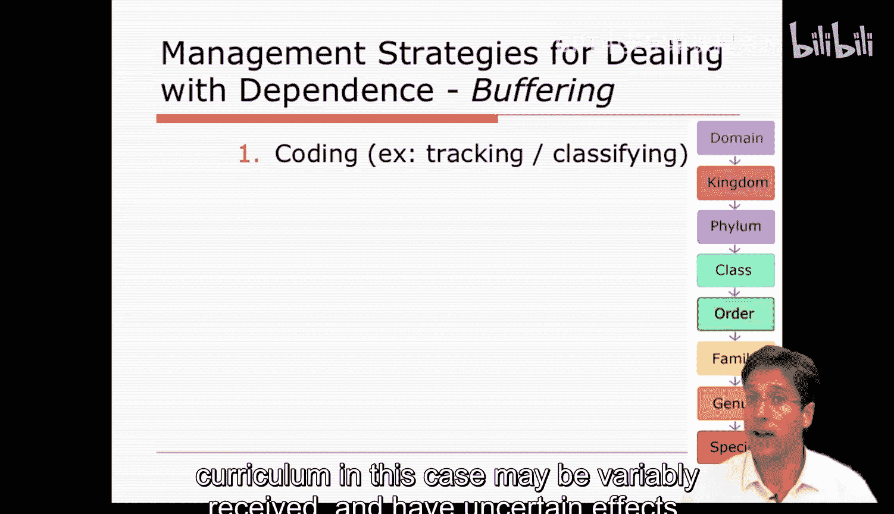

Second， firms can buffer their core tasks by stockpiling and organizations basically here collect raw materials or products。

 thereby controlling the rate at which inputs are inserted into the technical core where outputs are released to the environment now it's easy to imagine what this looks like with raw materials of wood needed for furniture making but another example of this might be found in universities a good portion of universities's budget is dependent on grants。

 but granting agencies can change the amount of funding they make available and some years faculty fail to secure those funds。

 so you have these cycles of feast and famine， and this is partly why universities are increasingly concerned with securing endowments and gift funds universities with large endowments and gift funds can dip into them during difficult times and maintain the same number of students in their programs。

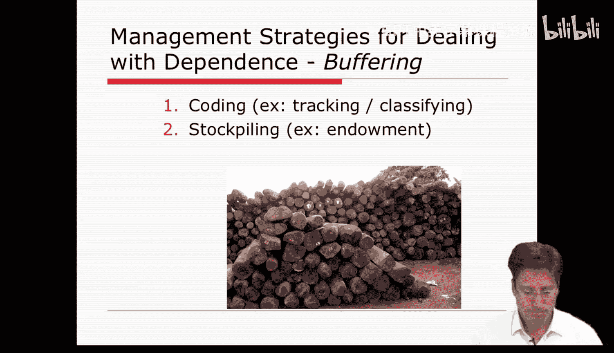

A third strategy entails leveling or smoothing Now leveling is an attempt by the organization to reduce fluctuations in input or output just like it is for stockpiling。

 but whereas stockpiling is a passive response， leveling entails more of an active attempt to reach out into the environment so as to motivate suppliers of inputs or to stimulate demand for its outputs so here an example might be where a university again advertises its strengths so that enrollments and housing values in the area stay high so by creating demand。

 they sustain inputs in a recession。

A fourth maneuver entails forecasting if environmental fluctuations cannot be handled by stockpiling or leveling。

 organizations may have to anticipate changes and attempt to adapt to them right so for example。

 a university may foresee that their school will lack funds in the future and look to identify alternative funding and private industry or private foundations。

 For example a Republican candidate may be expected to become president and slash the National Science Foundation budget or the National Institute of Health budget。

 and then universities like that have to develop relations with private foundations and industry partners as a means to buffer research and student training from these resource constraints。

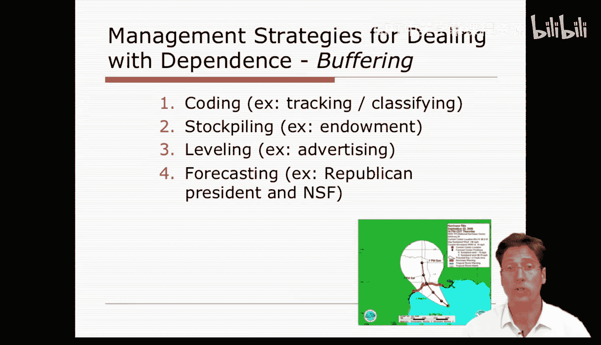

The final buffering strategy involves adjusting scale。

 and here the firm changes the scale of its technical core in response to information provided by forecasting。

 or for other reasons， a good example of this occurs when firms downsize programs or when school districts get rid of performing arts and foreign languages but retain a focus on math and science and core subjects。

 it's a drastic move but it does not involve changing the nature of the technical core usually rather just its size。

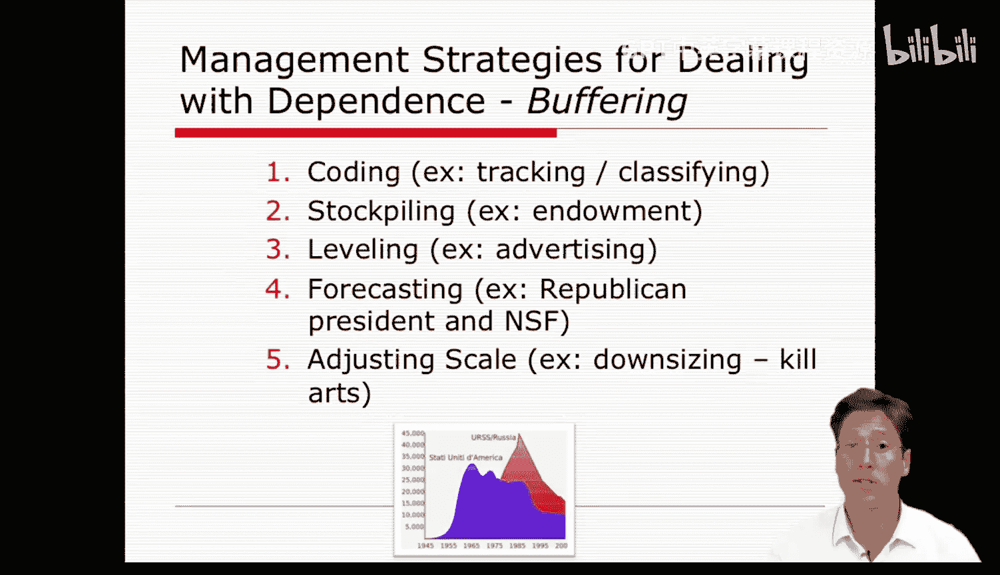

In addition to buffering the technical core from the environment。

 an organization can protect itself via bridging strategies。

 The goal of bridging strategies is to shape dependence relations in the environment。

 and one can do this by negotiating with other firms by selectively exchanging certain resources with them by pooling resources across them or partially absorbing other firms。

 or by performing mergers and totally absorbing another firm。

 These are all increasingly greater efforts at bridging。

 So what I want to do is take each in turn and describe them more carefully。

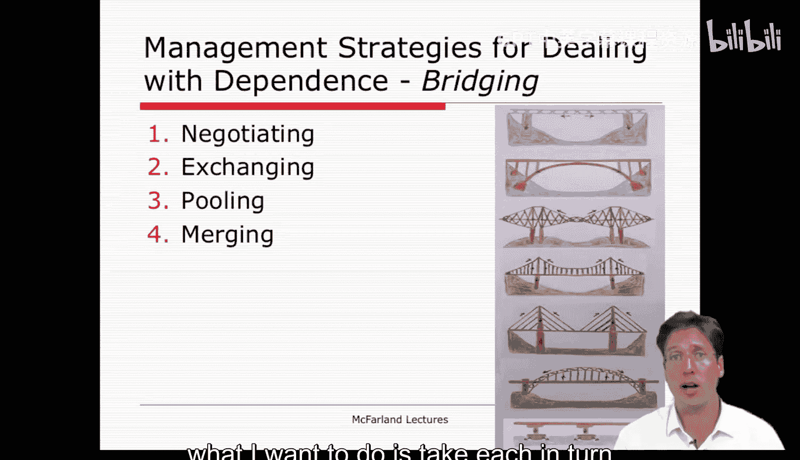

The most minor bridging efforts。Or rather， prebridging efforts arise in negotiation。

And the least costly means we have at our disposal is to negotiate with other firms and evoke normative coordination。

 and here behavior is regulated by common informal expectations that reduce uncertainty。

In Fffer and selanic writings， they give a nice story of a teacher union relating their demands to a school board and the union gives a list of six demands。

 the first five of which concern the quality of education like smaller class sizes more preparation time etc。

 but the last one concerns their salary and the school board approves the first five but not the six since they regard that last one to be a private demand cloaked in socially legitimate trappings so the norm evoked here is one of informal expectations about trust and honesty and the management's job is to note where normative constraints affect dependence relations noting whether their beneficial and if not。

 so that they seek ways to change them via persuasion and that's kind of what happened here when the school board rejected the teacher' six demand unfortunately normative coordination is pretty weak it doesn't always work and free writing and opportunism can kind of burn an organization。

You kind of assume that teachers won't strike during the school year， but that doesn't always happen。

 So that's why additional bridging efforts are typically sought。

A second prebridging tactic is to bargain and here the manager uses a family of tactics to ward off impending dependence relations here the firm negotiates and exchanges an attempt to prevent the resource relation from becoming more imbalanced and we saw this type of bargaining occur in the week on coalitions。

 so I'm going to gloss over it quickly here。A more serious form of bridging involves exchange or the mutual giving up of autonomy through exchange of resources。

And firms can do this in a variety of ways， the easiest perhaps is through a contract。

 and there the firm attempts to reduce uncertainty by coordinating their future behavior in a limited specific set of ways。

 they define the rules of interorganizational contact and exchange so for example。

 this kind of contract is beneficial， if you think about teachers having routine negotiations or teacher unions having routine negotiations with school districts so as to avoid strikes。

Another form of exchange can arise via the creation of interlocking directorates or various forms of co-opation。

 And here， members of competing organizations are given a position within a central organization that oversees all of them。

 so like a board of interlocking directorates， right by being on each other's board of directors firms trade away some sovereignty in exchange for some mutual support and information by giving external members a role in these boards。

 the organization accomplishes the partial co-opation of an external organization interests as their own。

 but it also gives up some of its control， So a focal organization may become more effective in an environment because they've co-opated external members that might have control over resources that affect its functioning。

 So， for example， I had a student write up a case on the committee of undergraduate education here at Stanford when it was formed several years back。

 and the committee was trying to reform undergraduate curricula and it encountered a good deal of resistance from the environment and its。

Stakeholder organizations like the student council in response。

 they created kind of a NOAA Arc model for that that committee where they had environmental stakeholders were given kind of representation one from each organization and this kind of opened up and coopted their disscent and opened up them to the kind of contributing information but also kind of giving up some of their disscent。

Another form of resource exchange can arise in hierarchical contracts and these are contracts developed to manage dependencies via conditional clauses evoking hierarchical mechanisms to handle disputes。

 so an example of this is one that a contract that preserves that defines the rights of parties in case some problem of contingency arises like a clause in a subcon ensuring that if a subcontractor doesn't come through on it。

 a job that they still get paid， and so this is kind of a more involved kind of bridging effort。

 a more extensive means of bridging with other firms can entail the pooling of resources across them。

One means of accomplishing this is to engage in a joint venture。

 and here two or more organizations create a new organization in order to pursue a common purpose。

 so for example， two private schools can pool their resources to create a single daycare that serves teachers and their children across those two schools。

 and this might reduce uncertainty of say teacher attrition and retention。

Firms can also enter strategic alliances as a means of pooling resources。

 these are usually agreements between two or more organizations to pursue joint objectives through the coordination of activities or the sharing of resources and a good example of this is between Berkeley and Stanford we have a courtesy program where students can take courses at one another's universities so in a way we share the resource of knowledge in that way。

Last， firms can join associations and cars， and that's another way of pooling resources。

 then education an example of an association might be the National Association of Independent Schools or the American Educational Research Association。

 and these associations standardize information and become a clearinghouse for it。Cartels。

 on the other hand， entail more pooling and loss of autonomy。 They're also pretty rare。

 cartels are things like OPEC， and they go above and beyond informal norms and have actual means of sanctioning members for not following their decrees。

 They effectively act as a block of organizations。 It turns out that cartels are illegal in the United States and partly for this kind of monopolistic kind of joint behavior that pushes out competition。

Now firms can perform a complete pooling of their resources as well。

 and resource dependence theory calls this total absorption or basically a merger。

 and this can arise in several forms。First， firms can perform a vertical merger。

 and here the firm extends control over exchanges vital to its operation。

 so a high school might merge with a middle school， or a manufacturer。

 producer would buy out a supplier to get control and to create a certainty of supply。

Firms can also perform horizontal mergers， they can accomplish this by taking over their competition。

 and in this way they reduce uncertainty and increase organizational power in their exchange relationships。

 so the example of this would be when one high school takes over another one so that it can benefit from economies of scale and pull resources。

 so is actually something that arises in rural areas in the United States when they pull multiple rural high schools into township high school。

Last one can engage in diversification and this is a method for decreasing dependence by acquiring entirely different types of businesses。

 for example， I once observed the school actually that took over a nonprofit dedicated to art so the school became a museum and a high school I also saw a school that expanded into a private daycare so they can have multiple functions so a firm can merge all its resources in several ways to bring about greater autonomy and control over resources in the environment。

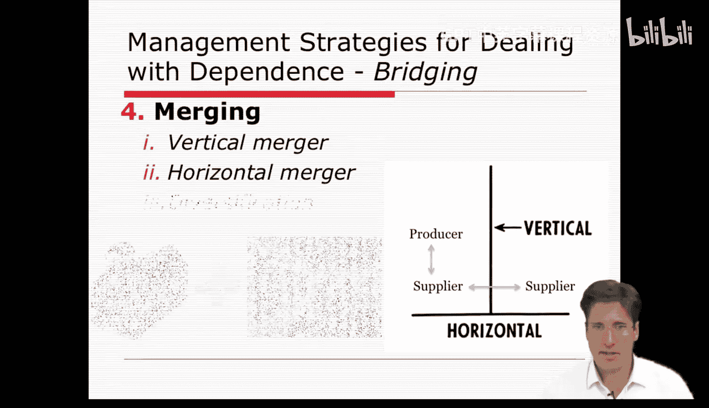

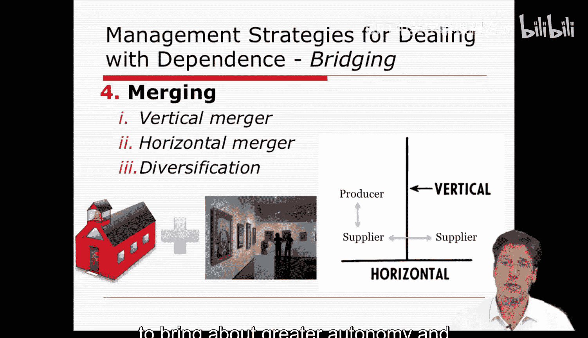

So that's a lot of managerial strategies and they move from simple negotiation to exchanges to pooling and partial absorption to complete mergers。

I think it helps at this point to take a step back and ask what are some general managerial strategies one can take away from the resource dependence approach。

 And I think there's basically two kinds of prescriptions。

 The first general strategy is to avoid resource dependencies on other firms。

 and this can be done by a variety of means I just described by using buffering strategies like stockpiling。

 engaging in long term contracts that buffer your output。

You can also try and change the legal rules and set regulations so as to manage competitive markets around you。

It also makes sense to diversify and to find substitutable exchanges or backups。

A second strategy is to break your firm's dependence on other firms and possibly create their dependence on you。

So here you can use things that are a little more awkward and undious like secrecy of information。

 restrict your information， you can even begin an antitrust suit， co-op the controlling firm。

 acquire control over the input or controlling organization by something like a vertical merger。

 or you can even set up the rules of regulation， so there are a variety of means that we've articulated here that you can both avoid dependencies with as well as break up dependencies that may be debilitating your firm。

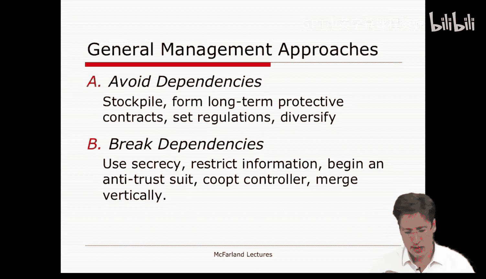

So we now have two general approaches and a variety of particular managerial strategies we can use to work our firm's resource relations in the environment。

Can we predict certain forms of dependence will arise if some of these strategies are used over others？

Well， scholars like Richard Scott think we can， and he predicts that certain managerial strategies will kind of result in certain resource dependence relationships。

 so for example， some firms tend to assume a symbiotic interdependence。

 and this occurs when two or more kinds of organizations exchange different resources。

 this can give rise to power differences if the resources exchanged are not of equal importance and value。

An example of this might occur through subcontracting where money is exchanged for expertise。

 this kind of symbiotic dependence corresponds with normative forms of coordination。

 contracts and their clauses， so hierarchical contracts。

 as well as joint ventures and vertical mergers。

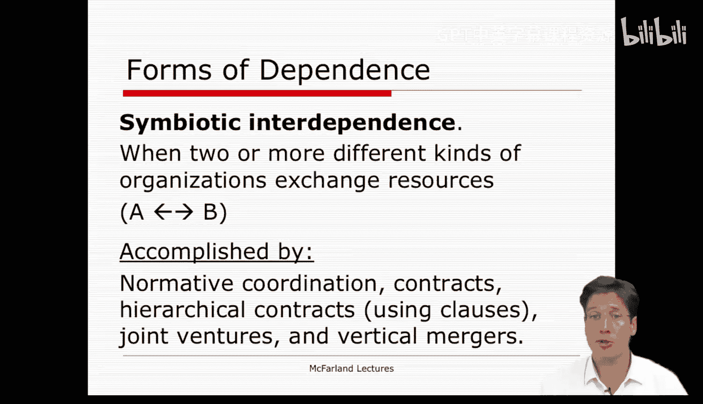

Another form of dependence is commensalistic or competitive and this occurs when two or more organizations compete for the resources of a third party and this is often resolved by differentiation where one specializes and becomes a supplier so there's kind of a division of labor and interdependence and an example of this might arise when multiple consulting firms compete for the same contracts and they start to differentiate into types of specialists According to Scott。

 competitive dependences arises under normative coordination or co-ation and the forming of interlocking boards of directors when you have trade associations。

 joint ventures and horizontal mergers when competitors kind of merge the argument is that these kinds of strategies correspond with particular kinds of resource dependence relations。

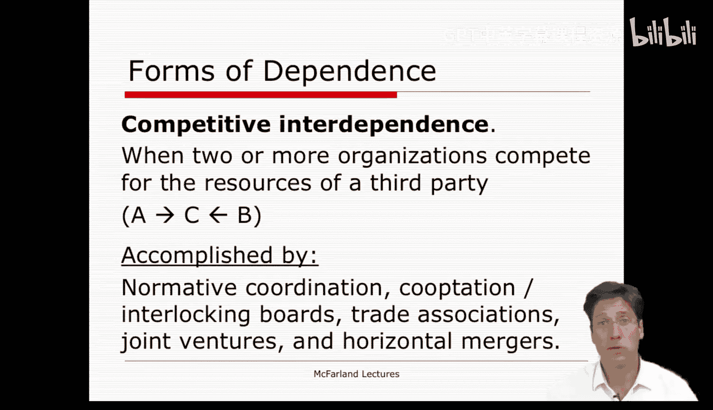

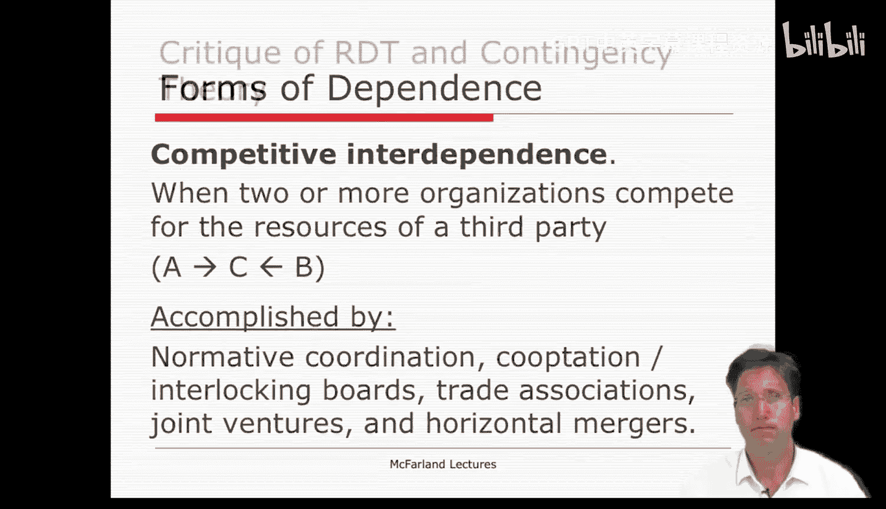

Just like all the theories we've reviewed in the course so far， resource dependence theory is flawed。

 it's not perfect， it's not a panacea， and it has certain shortcomings and I want to discuss a few of those right now。

First。Resource dependence theory。Has an assumption built in that all organizations are more or less similar。

 they approach the environment in the same way， they acquire resources in an uncertain world。

 those firms are staffed by boundly rational managers who are seeking to optimize both their own in their organization's interests。

But you kind of have to ask yourself， is that accurate。

 do some organizations live outside the issues of resource dependence。

 are they more about identity and matching， it's not clear here。

 Another thing to consider is whether the notion of certainty and uncertainty are relatively clear with resource depend theory。

Is dependence on social resources and knowledge clear whereas dependence on money and materials are less clear or more clear。

 resource depend theory is purely resource exchange base and it assumes there's clarity of value and importance。

 but all too often the value of a resource is unclear until well after the fact。

 so meaning making and sense making are lost by resource dependency theory and we kind of ignore all that。

Also， we kind of wonder with resource theory as to what happened to culture and mission。

 it talks about normative coordination， but it doesn't thoroughly describe it。

 and we find far stronger characterizations of that process and theories like organizational culture。

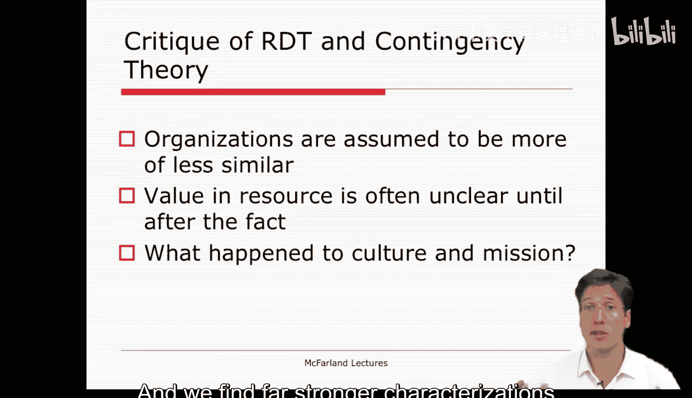

Last， all of the dependencies are described in pairwise fashion。

 And we have to kind of wonder with resource dependency。 what about the larger network。

 Can the larger network pattern define opportunities and constraints。

 Can the network define norms and pressures better than relations of dependence。

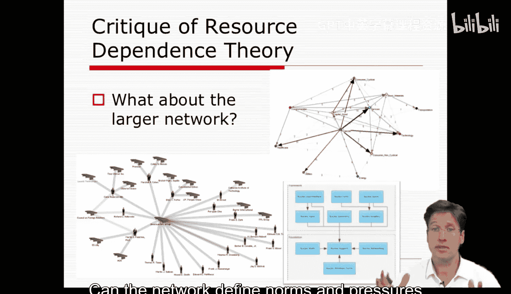

We have to wait until next week to see， but it's kind of clear to many of us that perhaps this larger arrangement。

 the network， the environment as a network might be greatly influencing the kinds of resource dependencies as well as the kind of meaning making and sense making that go on between firms in that environment。

