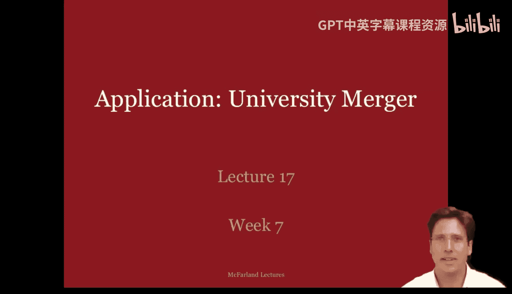
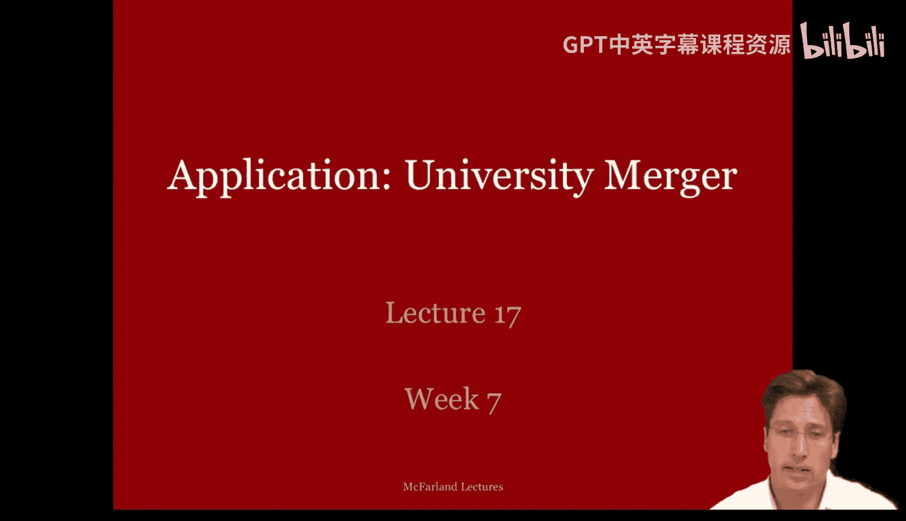
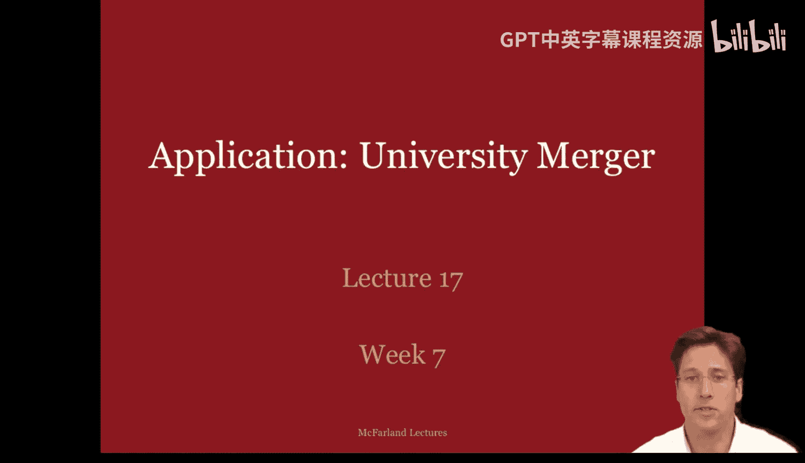
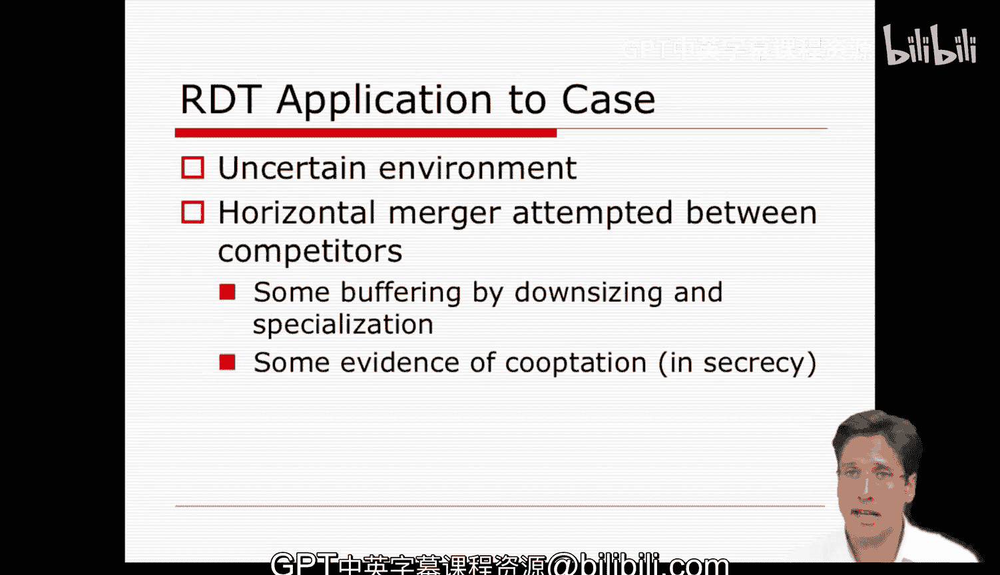

# 斯坦福大学《组织分析｜Organizational Analysis》中英字幕 p67 067_07_03_第十七讲-案例应用-第一部分.zh_en -BV17J4m157qN_p67-

In this lecture I'm going to describe a case where two universities tried to perform a merger and failed。

 in the process of relating the case we'll review the main features of resource dependence theory and see how they apply to the case。

 in this manner I hope you'll get a better sense for how to apply the theory and recognizes strengths and limitations。

The case we will describe this week was written by a historian Sarah Barnes。

 she gives a nice account of the failed 1933 merger between the University of Chicago and Northwestern University。

 or what might have been the world's first super university。

The merger effort arose during the Great Depression when both universities were undergoing deep financial crises。

 in many ways the two universities were competitors in the city of Chicago for students， recognition。

 funding and so on。Northwestern。Wass situated on the north side of Chicago in a bucolic area overing Lake Michigan was a large undergraduate institution that mostly recruited locally。

 and it placed a strong emphasis on applied programs such as journalism and medicine。And like I said。

 Northwestern is an abucolic setting， it's very pretty and the students seem to have a lot of fun and even so today。

In contrast， on the south side of Chicago， in an urban neighborhood was the University of Chicago。

 a large graduate institution with an elite national reputation and a strong emphasis on the pursuit of truth and theory。

Now the University of Chicago is where actually I studied and my recollection of the place even in the 1990s was that it was still kind of a leading graduate school and a very serious intellectual place to learn it was wonderful intellectually and I tremendously benefited from being there but it was also often very somber and so I think that's the kind of a culture it had even well into the current era。

 but now back in 1933 the contrast between these institutions was quite stark Northwestern had tax exempt status Chicago did not Northwestern was in a safe neighborhood Chicago was in an urban setting。

 Chicago had prestige and reputation， Northwestern had a local reputation Chicago was considered innovative。

 Northwestern not so much， Chicago was an international institution Northwestern was local。

 Chicago was focused on theory， Northwestern was focused on applied research so together the two could benefit from each other。

From their strengthsIn addition， the merger had some financial gain pending。

 such the merger would say them 1。7 million in annual upkeep and afford better economies of scale and both institutions seemed to recognize this and the negotiation was moving swimmingly along until they broadened representation on the Northwesterns review panel so as to begin vetting the merger with larger constituents and that's when alumni and resistant groups were now included and they saw things as too rushed when the two schools got down to brass tax and details the merger began to unravel Chicago wanted to keep its college and that would compete with Northwestern university's undergraduate program and neither wanted to lose their medical school or their education schools so the merger also fell apart because a key proponent on the Northwestern Board of Trustees died also when the Northwestern University Review panel expanded。

 damaging news and gossip leaked into the press that upset alumni like the merger was already decided that it was a takeover。

It was a last ditch effort by Hutchins to save his failed presidency that Northwestern would lose its identity and more and more partisan kind of a support occurred rather than support for the reasons for the merger。

 the mutual gains to be had from it。So what can resource dependence theory tell us about this case let's briefly review resource dependence theory again when does resource dependence theory apply well it has relevance to a case when there are focal organizations interested in decreasing competition。

 increasing autonomy。Increasing their power and possibly even increasing efficiency。

And the main mode of organizing action。In the resource dependency theory perspective is to scan the environment for resource opportunities and threats。

And to attempt to strike favorable bargains so as to minimize dependence and maximize autonomy and certainty。

So so far， this seems to capture the Northwestern and Chicago case a bit。

Resource dependence theory also characterizes organizational elements in certain ways。

 the technology or what brings about changes in dependence is focused on external adaptations in order to increase autonomy and to decrease dependence。

The participants here are focal organizations and the organizations that have resource interdependence with it。

 the goal of a firm is survival through external adaptation。

 and this is accomplished by establishing certain relationships that place the focal organization in control or with greater autonomy。

The social structure focuses on interorganizational relationships and the effort is to manage standard operating procedures and to perform bargaining in politics on these external relations and finally the environment is central。

 the focus is on exchange partners and external relations more than internal dynamics so it's also characterized by competition or threat from the environment and a desire to have this greater certainty in it。

 so all of these character of organizational elements seem applicable to our case of the Chicago Northwestern merger。

Last， a manager that's guided by resource dependence theory would perform some buffering strategies like the stockpiling of resources。

 leveling with advertisements that showcase strengths and create demand。

 forecasting where their needs will be in the future and adjusting the scale of their core technology。

 managers will also perform bridging with other firms to bring security to the organization within a competitive environment。

 so the bridging strategies they'll use entail negotiation of long- longterm contracts。

 partial absorption and sharing of resources such as informing joint ventures and alliances or even total absorptions via company mergers。

 and here too we see aspects of merger co and adjustments of scale in the case of the Chicago Northwestern merger。

So let's apply resource dependence theory to the case the Chicago Northwestern merger is clearly a case where the environment is uncertain and problematic for both universities they're both in financial straits it's also a case where two universities explore a horizontal merger or in secrecy an effort to co-op one another like Chicago did and it's a merger between competitors in theory the merger would entail some buffering where each university downsizes their core technology losing their worst programs but keeping their best but then they combine in a complementary form that would have an improved economy of scale the merger would have some kind of formation of an unparalleled super university probably one can only imagine what combining the strengths of those two campuses would have done so why didn't it happen though does resource dependency theory give us an explanation so let's next apply our concepts of organizational？

ments to the case more specifically and within each school and see what we learn。

