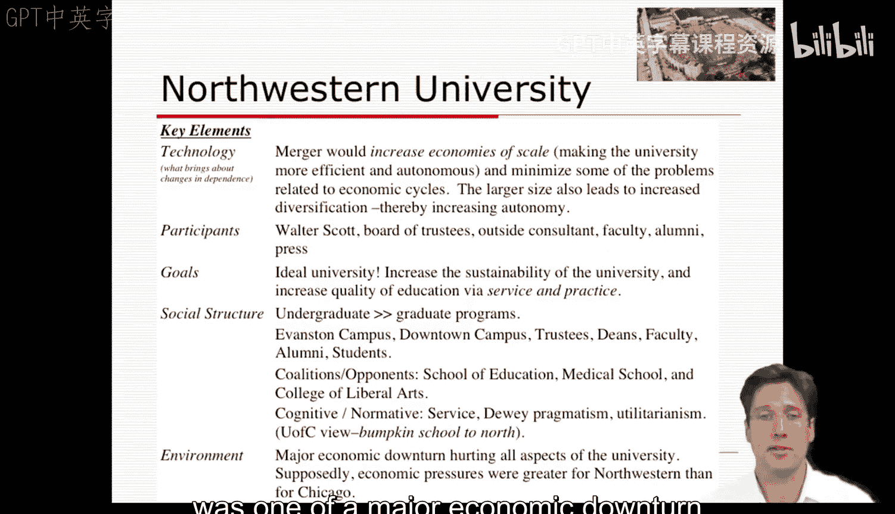
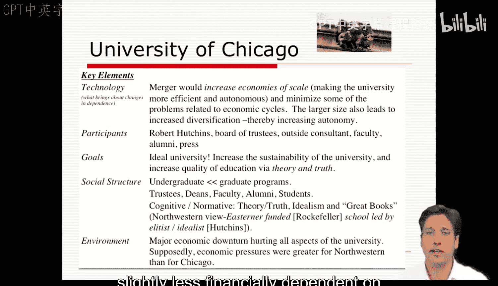
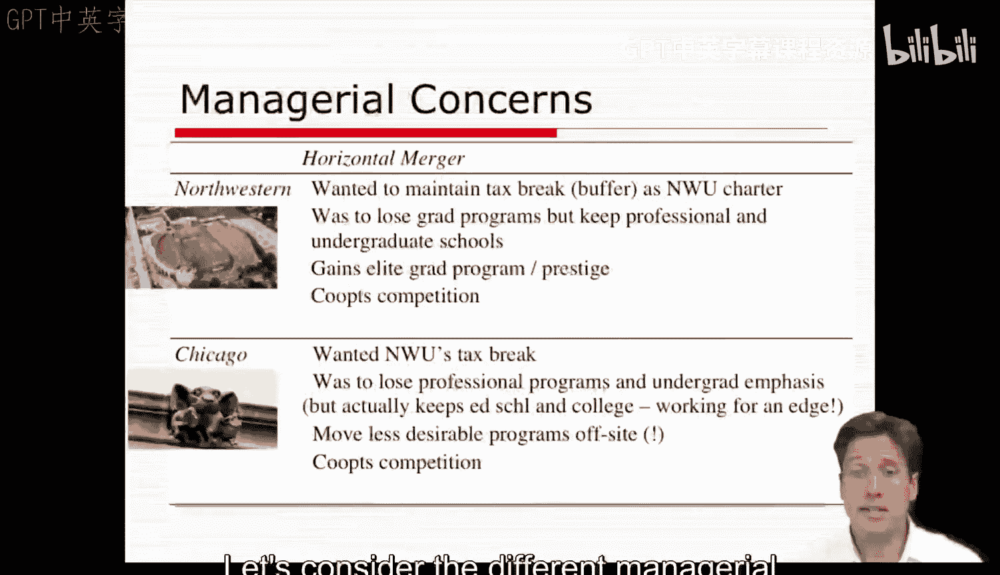
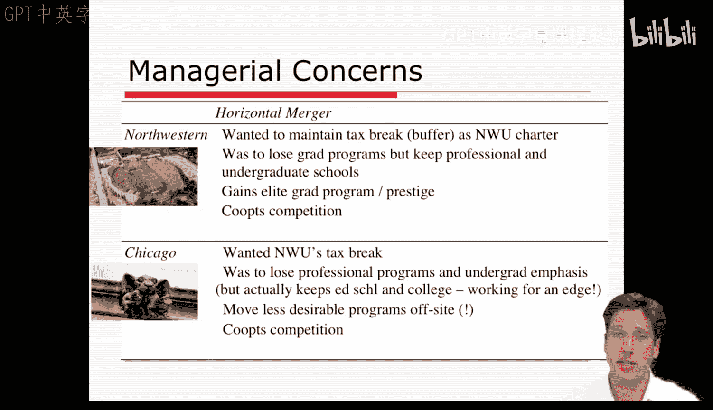
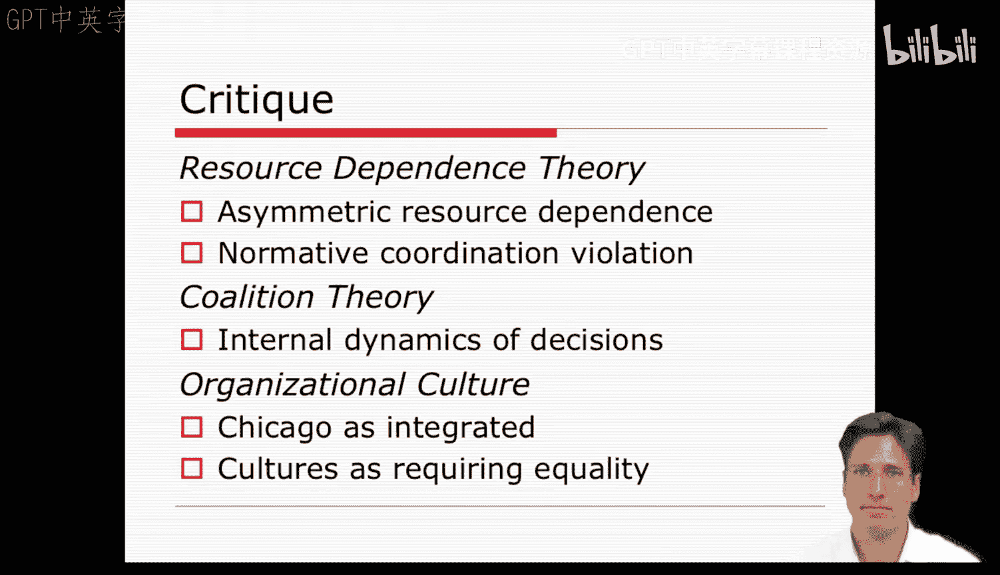

# 斯坦福大学《组织分析｜Organizational Analysis》中英字幕 p68 068_07_04_第十七讲-案例应用-第二部分.zh_en -BV17J4m157qN_p68-

For Northwestern， the proposed technology of organizational change was the merger and how it might increase economies of scale so making the university more efficient and autonomous in that environment and minimizing some problems related to the Great Depression right the larger size of the combined university could also lead to increase diversification so in that way they would increase autonomy the participants mentioned in the case on the Northwestern side were Walter Scott。

 the Board of trustees， particular actors that were trustees， outside consultants， faculty。

 alumni and the press the goal of Northwestern was to become an ideal university where they increase their positioning and quality of education via improving their applied programs and professional and community service and practice the social structure was such that undergraduate programs were more valued than graduate programs and the network of supporters kind of centered on the press。

President Scott and key board of trustees members， but then the opponents emerged in the School of Education。

 the Medical School and their College of Libal Arts。

 all of whom wanted to get a fair deal from the merger。

 other stakeholders entered later in the case due to the press leaks and whatnot so alumni emerged and theyre mostly opposed the deeper belief structure at Northwestern sought to promote service or social pragmatism and utilitarianism and these were a stark contrast with the University of Chicago as you'll see next the environment in which Northwestern found itself was one of a major economic downturn that hurt all aspects of the university。

Let's next look at the University of Chicago。Chicago， like Northwestern。

 saw the merger as a means of increasing economies of scale and minimizing some of the problems related to the Great Depression。

It saw the larger size as kind of diversifying the university and making it kind of better to weather the environment The participants here were many of the same types of actors as we saw at Northwestern the University of Chicago president Robert Maynard Hutchins。

 their board of trustees， outside consultant， faculty。

 alumni and the press Chicago's goal like Northwesterns was to develop an ideal university but here the goal was to increase the sustainability of the university by increasing the quality of education and that was done through the pursuit of theory and truth Moreoverover Chicago had an elite focus instead of an applied one Chicago's mission was more developed and frequently voiced by the charismatic president Robert Maynard Hutchins as well。

The social structure and values of Chicago were also pretty different from Northwestern Hutins was a very strong leader in a way so it was more of a centralized decision structure in addition Chicago valued graduate training far more than undergraduate training and last its professed beliefs rested in the pursuit of theory and truth and an idealization of the great books so Northwestern kind of viewed Chicago as an Easterner led school Rockefeller funded it and it was led by an elite idealist Robert Maynard Hutchins so the fact that that had clear goals aligned with its social structure kind of made Chicago into an integrated organizational culture of sorts the environment for Chicago was much like that for Northwestern and it was experiencing this horrible economic woe but the economic pressures on Chicago were supposedly less than for Northwestern。

So in sum， simply identifying the organizational elements and how they're characterized in the case reveals how two organizations differed。

 they had really very different social structures and goals。

 and Chicago was slightly less financially dependent on the environment than Northwestern。

Let's consider the different managerial concerns these two schools had For Northwestern there was much to be gained from the horizontal merger but also something to lose。

 there were certain resources it wanted to retain it wanted to retain the tax break it got so that's buffering right as part of its charter it was willing to lose its graduate programs if it could retain its applied professional schools and its undergraduate program in exchange it would get this elite graduate program and international prestige in addition it would co-op its regional competition for students。

 faculty and funding by joining forces with Chicago。

Now on the other hand， Chicago wanted the benefit of Northwestern's tax break。

 but it wasn't very willing to lose its professional programs and its undergraduate college。

 so it wanted to keep its school of education， medical school and college so Chicago was kind of working for an edge in this deal and in some regards Chicago saw the merger as an opportunity to move its less desirable programs off site like the applied kinds of areas of training and last it saw this is a chance to co-op its competition and formal world leadinging super university。

Resource dependence theory would approach this case with a focus on the different levels of dependence。

 and it would cite those levels as a reason for Chicago's more aggressive approach and the merger's failure。

It would note that Chicago tried to change the rules of the merger toward a more asymmetric contract and that Northwestern saw this as a violation of normative forms of coordination。

Other theories seem to help with the details within this case。

 the internal workings of each school's deciding bodies seem to be better characterized by coalition theory；

 there we can see how the buildup to a contract and the merger required a good deal of political wrangling。

 also the death of a key player at Northwestern seems central to the story。

 at least to the story presented by Barnes。However。

 coalition theory can help us make sense of all the camps for and against the merger at either school。

 so it helps us explain how the internal mobilization efforts fell apart。

 in contrast resource dependence theory helps explain why the two universities approach the merger differently and incompatibly for a merger。

Now there is a contradiction here of sorts because mergers are often somewhat asymmetric so the issue becomes how asymmetry got in the way my sense is that neither resource dependence theory。

 nor coalition nor coalition theory are well tuneed to the deeper cultural differences in the two universities that likely played a huge role the distinctive highly valued cultures of each university made it imperative for the merger to proceed in an equal form or a long-ter contract。

 even though Chicago may have had the greater resource advantage， Moreover。

 Chicago had a more pronounced and integrated intellectual culture at that time。

 and it may have made Hutchins in the Chicago camp overvalue their notion of a university and make them approach the merger more as a takeover than as a pooled effort so in this manner the two sides maybe never came together to an agreement on the forum this week it would be very interesting to hear your take on the case and what theories you think best apply。

Sarah Barnes does a wonderful job of affording kind of an elaborate history。

 and we can see multiple theories being， at least their elements being expressed throughout this case。

