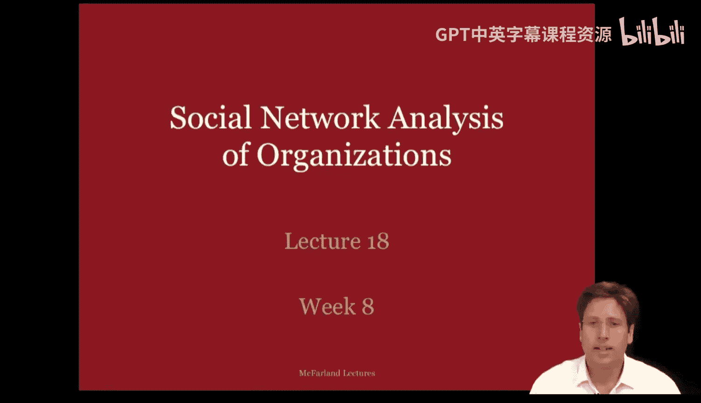
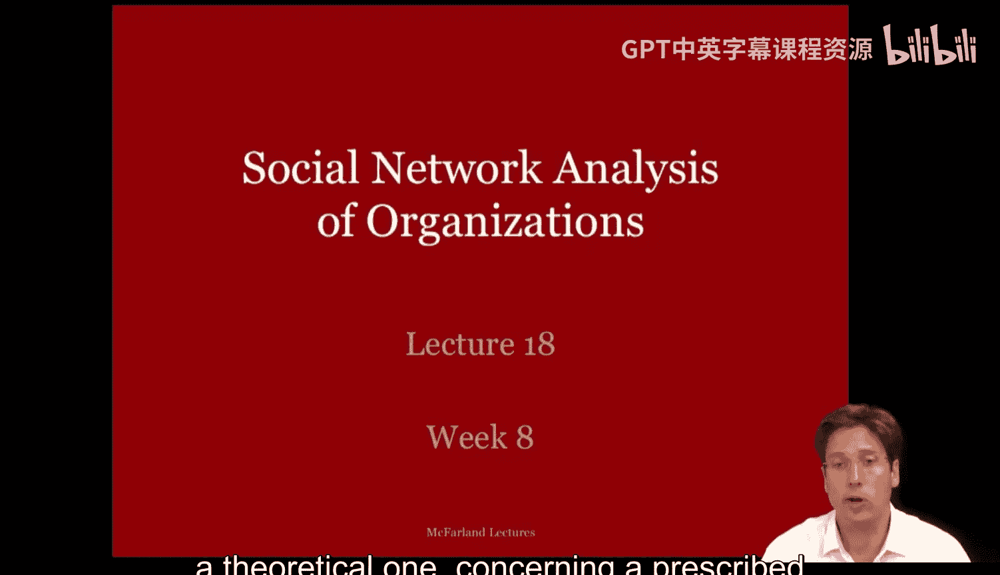
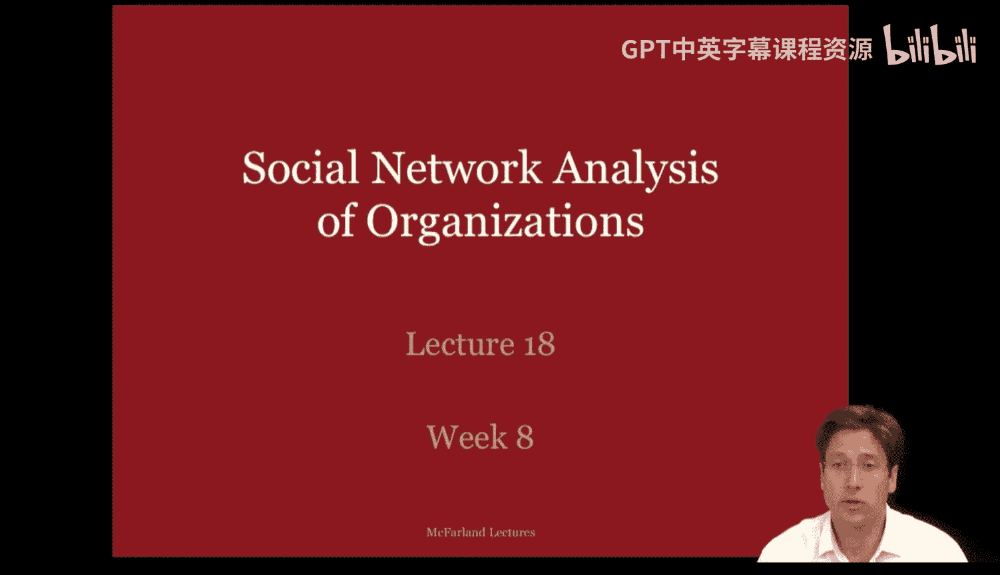
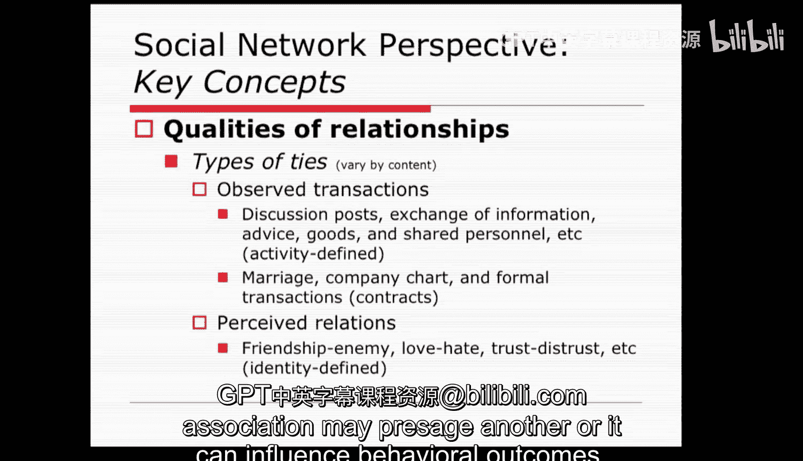

# 斯坦福大学《组织分析｜Organizational Analysis》中英字幕 p76 076_08_01_第十八讲-组织网络分析-第一部分.zh_en -BV17J4m157qN_p76-

In this week's lecture， I'm going to describe how organizations researchers look at social networks within organizations。

 In addition， I will describe how some theorists contend there's a network form of organization that's distinct from hierarchical organizations and markets so this week I'll relate to perspectives of purely analytic one that describes networks within organizations and a theoretical one concerning a prescribed form of interorganal association that can result in better organizational outputs。

 Let's start with the social network perspective。 The social network perspective embraces the notion of social embeddedness and this is a notion that Mark Granovvetter wrote about in 1985。

 Grannavetter argues on the one hand， how economics and market accounts of behavior are under socialized in these accounts actors behave as if their actions are unfettered by social contexts。

On the other hand， sociologists and institutional accounts of behavior are over socialized and they relate social action as socially deterministic and as devoid of choice。

So as a middle ground， Grannovetter posits the notion of embeddedness。

And here social action is embedded in transactional networks。

 this embedding applies even to economic transactions in markets。

 so the idea is that within structures we decide and act in intentional ways。Now。

 if you look to the side here， there's a depiction of the global trade network and the products that are related or at least proximate to each other in these transactions。

Notably， you'll see that it isn't random。So some products are far more related to others。

 and it suggests that the transactions are embedded in a structure that they're socially patterned。

Now， this kind of structure is actually often the focus of the social network analyst。

 and the analyst seeks to understand the context of association in which organizational actors are embedded。

And from that， the analyst learns how it constrains and enables actors' decisions。

A social network analyst studies embeddedness by focusing on the social structure within a firm。

And or the web of relations across many firms in the environment。

These contexts of association differ in pattern and they represent different contexts for action。

Where an organizational actor is located can also differ。

 and it affords the manager and firm different opportunities and constraints on their action。

So to my side here we have a network that looks like in the far figure looks like a spanning tree and it has lots of reach you also note that the actors do not have many interconnections and that there are key bottlenecks or cut points in the network that could undermine the transfer of resources if we took those key players out the network would fall apart it just wouldn't work in the second network that's closer to me here on the side we see some dense hubs of interconnected actors and there we could pull several of those players out without concern for the network's persistence there are actually kind of redundant ties and individuals to some extent。

We also see actors far out on the periphery who seem to be well out of the way of the core transactions in this network so each of these positions。

Represents a different context for action and information。

But the key thing to also think about is not just the overall form。

 but also where your firm or you as a manager are located， and that greatly matters。

How do opportunities and constraints change for an organizational actor or a firm that's located here。

 so here at this bottleneck or here in the periphery？

Or here within this cluster in the middle of the network。

 or here in kind of another bottleneck between clusters。

So the social network approach confronts these questions about network form or pattern overall and about network positioning within those networks。

Networks of association not only influence social action， but the result of decisions。Therefore。

 social structures and network environments are really actually dynamic and evolving。

 and by this I mean that they change。So social network scholars have only just begun to develop tools to help us understand how to engineer and develop different social structures within and between firms。

To my side here we see a schema of a set of ties that grow more interconnected and eventually form a quasi independent set of groups that you see in the figure here。

 so in the first stage they have a disparate fraction kind of state of dads and maybe a triad or two。

 and then the stage two they start to form somewhat of a clusters and then in stage three you have two distinct groups that are kind of bridged between them。

In this lecture I will present to you some basic concepts used by social network scholars studying organizations。

 and so doing， I hope you come to see it as a distinct empirical approach that you could apply and the organizations you're involved with。

A network analyst typically asks and answers a series of questions when they study a firm first。

 they ask about the unit of analysis and the boundary of a network。

 they try to define what the network is and where it begins and ends。

Many network analysts will focus on the individuals within a firm and how they associate。However。

 it's not always possible to study everyone in a firm， for example， when studying schools。

Network analysts may only study teachers and students within the classroom or within the larger school。

 then as such they recognize natural boundaries to the core work environment。

 but they kind of forego studying support staff like custodians or cafeteria workers。

 they forego studying counselors and even the parents who are key stakeholders。

So the same occurs when an analyst studies a firm。They may focus only on managers and employees who are in the building or a particular division and they'll ignore the client support staff and so on in these cases of exclusion。

 the analyst is defining a nominal boundary to the organization。

 and it's important they consider whether that boundary is sensible given the phenomenon they want to study。

So for example， a focus on teachers at the exclusion of students may be an acceptable boundary to define if the concern is with how managers exchange information on instruction and pedagogy。

If you think managers learn most of their pedagogy from students telling them what other teachers do。

Then this could be a problem for your study and the conclusions you draw。

Analysts also look at the larger units of analysis。

Like sets of firms and their relations with each other。

 here they study a field of organizations and the transactions they mutually recognize。

As most relevant to their firm's functioning， for example。

 Woody Powell's 2005 paper in the American Journal of Sociology describes the field of technology and when he's looking at the field of biotechnology。

 he includes in his sample， universities， biotech companies， banks。

 venture capital firms and government granting agencies that all co-partnered patents。

Shared commerce relations， transferred experts across their boundaries and so on。As such。

 his work tries to capture the boundary around an entire organizational field as seen by the participants of that field。

 so that's kind of neat， that's often hard to do however。

 so many analysts will focus on one type of firm and their core transactions and ignore the others。

 for example， for example there have been ample studies of venture capital firms and their networks of co-parting on inventions。

The next question a network analyst asks and it's often implicit is what is the unit of a time and when does the network begin and end that issue here is the temporal boundary to the social structure in question。

Most analysts confront the issue of temporal boundaries by considering which relationships are most important to the organization are they transactions on a discussion forum like we have。

 are they exchanges done each quarter of the year？Are they yearly contracts that have relative permanence。

 notice that the unit of time there greatly shifts in terms of when the transaction occurs from seconds to quarters to years。

And then they have to ask during which time period will they study the firm。

 what point do you start looking at it and what point do you stop？

Will they look at exchanges occurring only in the first week of a new technology being rolled out。

 the span of a project like this whole course， or over multiple years。

 these are all questions an analyst has to decide in determining when is a network。

The unit of time issue matters since it has implications for how transactions aggregate into different patterns。

 take the simple case of a classroom。If we look at interactions by the minute we'll see sequences of dadic or pairwise exchanges。

 so you can see this in the figure on my side here。

 if we look at interactions aggregated over five minutes。

 we see the network structure change from one activity of say lecture to another of say group work and then if we aggregate all transactions across 35 minutes。

 we start to see the general interactome of the classroom as a central tendencyancy of association。

So your unit of time presumes different notions of social structure from the structure of momentary interactions。

To activities and practices as network configurations。

 to larger social norms and central tendencies in the group。As an analyst。

 you need to ask yourself if you're trying to understand the structure of microroutines。

 larger tasks， or group norms， and from that， you can decide the unit of time to adopt。

Once a social network analyst has a sense of where and when important relations occur and when and where the network begins and ends。

 they can start to study the quality of relations and analyze the larger network。

Now there are many kinds of transactions that occur within and between firms。

 some of which are veryconsequential and minor， right。

 so a good analyst will go to the heart of the matter。

 they'll listen to the client's concerns and seek out the most relevant types of transaction these relations are typically observed behaviors or their ones that the subjects perceive。

Now observedserved relations can be identified in company records， observations and even reports。

 you can even videotape or audiotape or collect them in online forums perceived relations are typically reported by the subjects and those require surveys or interviews。

Clearly， the focus on a perceived relation implies that the worker perceptions of their relationships matter more for organizational behavior。

 and the focus on observed behavior assumes that one type of observed association may presage another or it can influence behavioral outcomes。

