# 斯坦福大学《组织分析｜Organizational Analysis》中英字幕 p77 077_08_02_第十八讲-组织网络分析-第二部分.zh_en -BV17J4m157qN_p77-

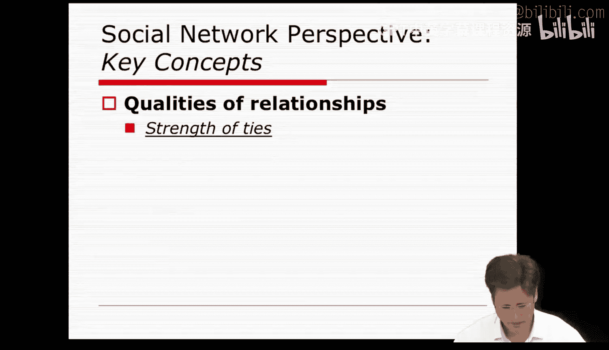

The quality of a tie need not only be defined by the content of interactions or the type of association。

 it can also be defined by its forum or strength。

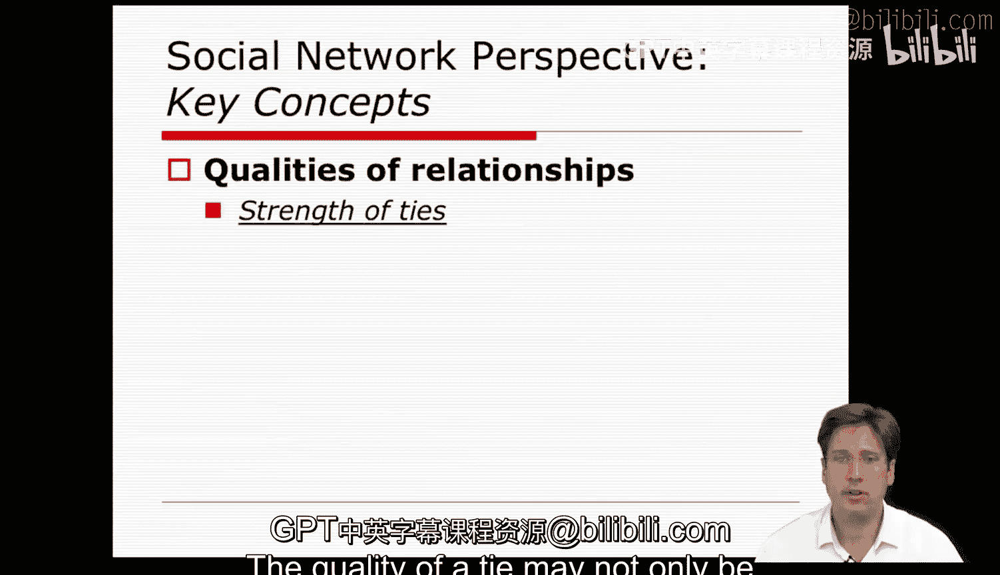

Strong ties are generally considered to be influential ties。

 they're your close friends and for example， when close friends pressure you。

 it has greater influence on you than when say， a total stranger or an acquaintance pressures you。

Strong ties entail frequent interaction， they entail positive liking or affect。

 and it's typically mutual， and they have a history to them。And in network research。

 we characterize strong ties as having bonding capital or a cohesive pull on people that guides their action。

 and we frequently refer to these relations。

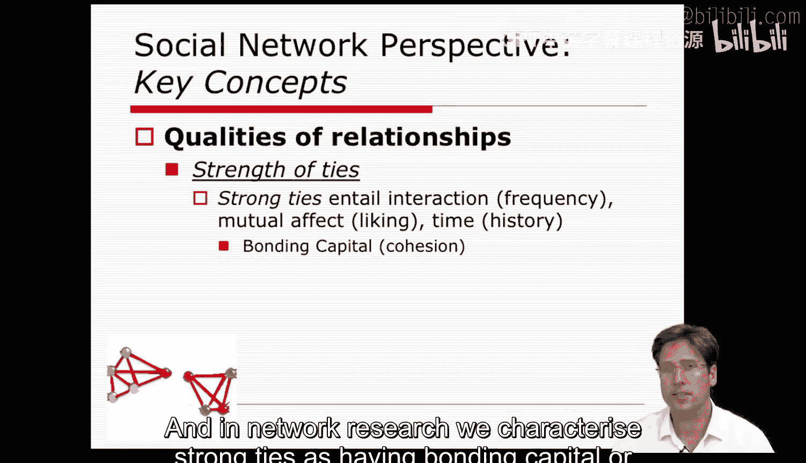

As ones of friendship， mutual support， liking love。

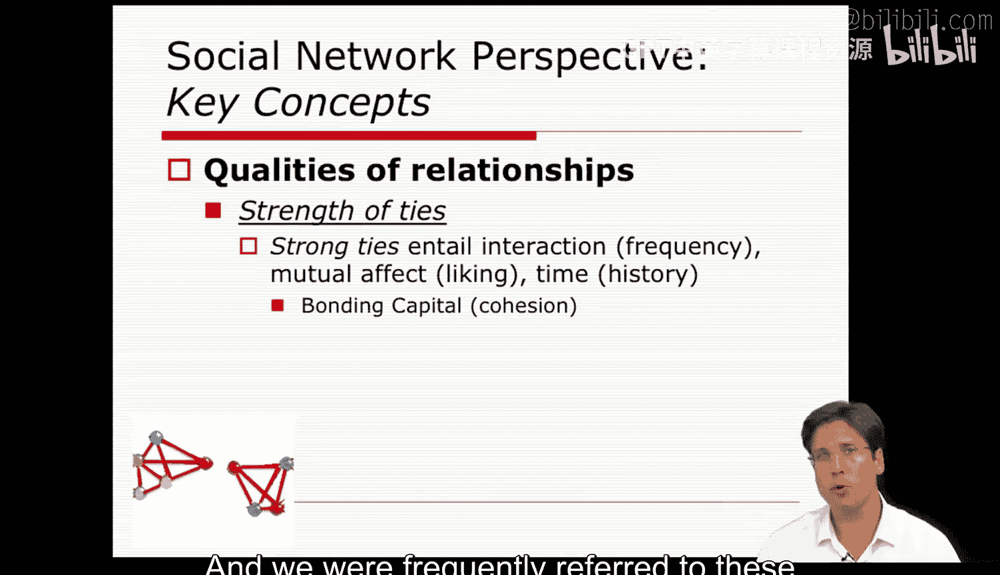

Enemies， things like that in the opposite direction。

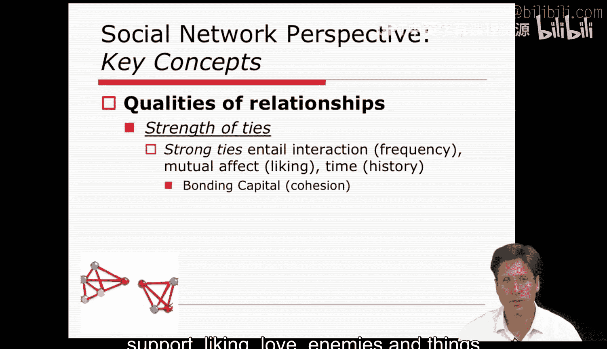

In contrast， weak ties are more infrequent their casual interactions between acquaintances。

 whereas strong ties have bonding capital and bring local persons into greater contact。

 weak ties have bridging capital， and they typically bring distant persons into contact across groups。

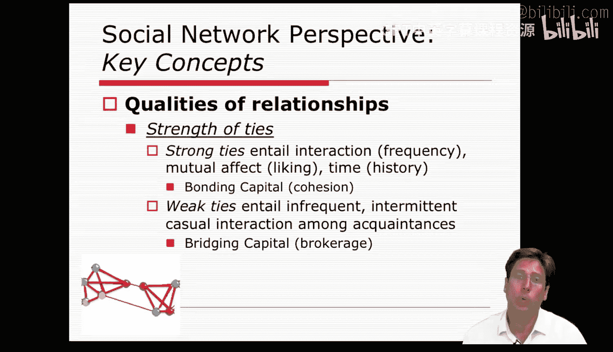

So in certain regards， these two types of association reflect the ties that we saw in the community of practice。

 the strong ties for that， and within a network of practice。

 those are the weak bridges across groups， and we saw those in organizational learning theory。

 so in some ways this kind of depiction this distinction is somewhat consistent with that theory that we had in week five of the course。

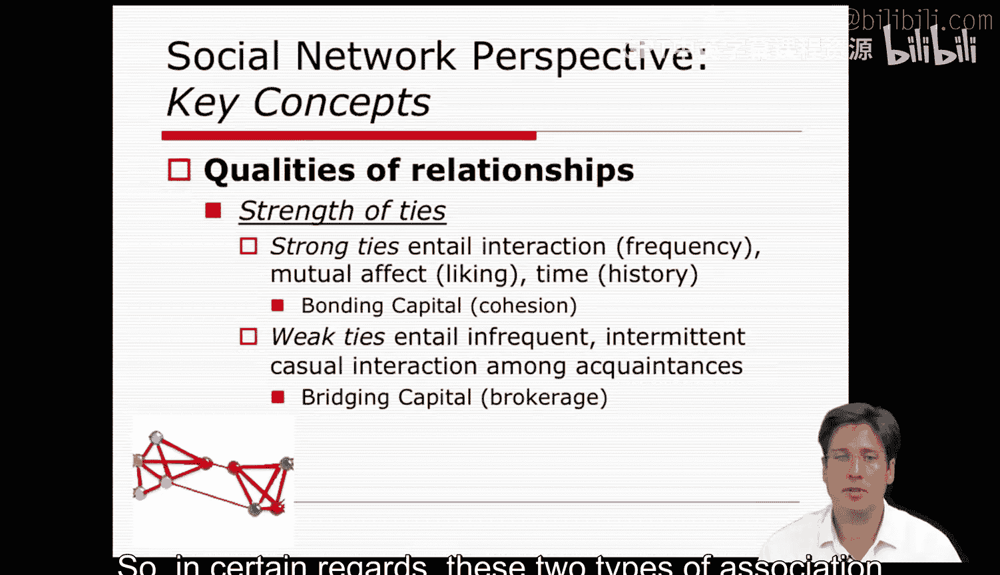

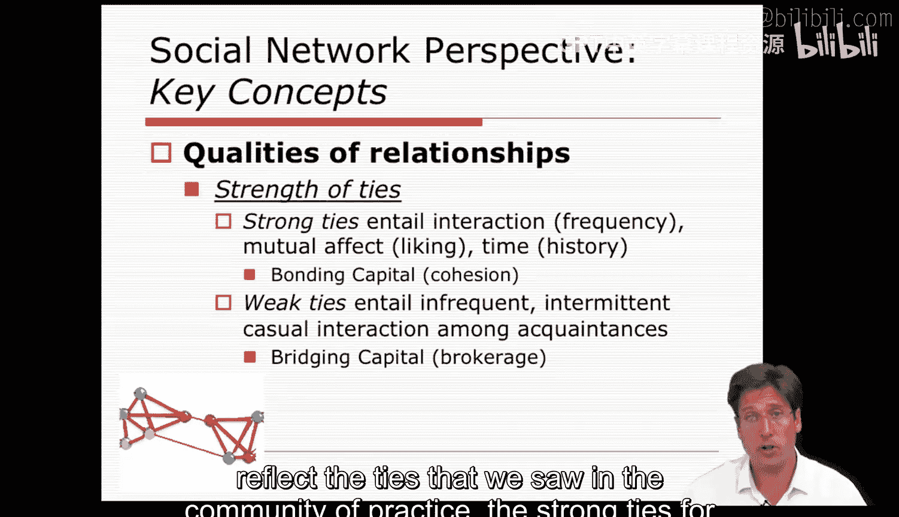

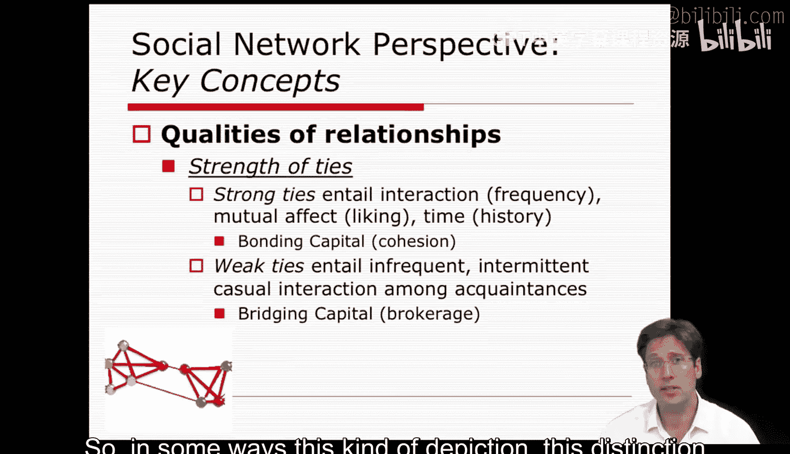

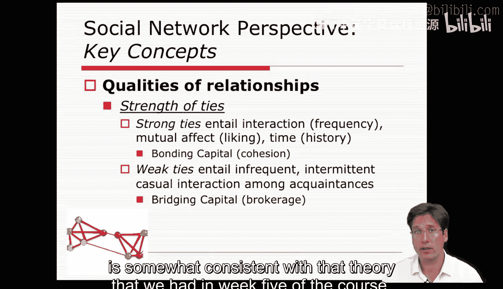

Social network research has identified a consistent set of mechanisms that form interpersonal relations in firms and other settings。

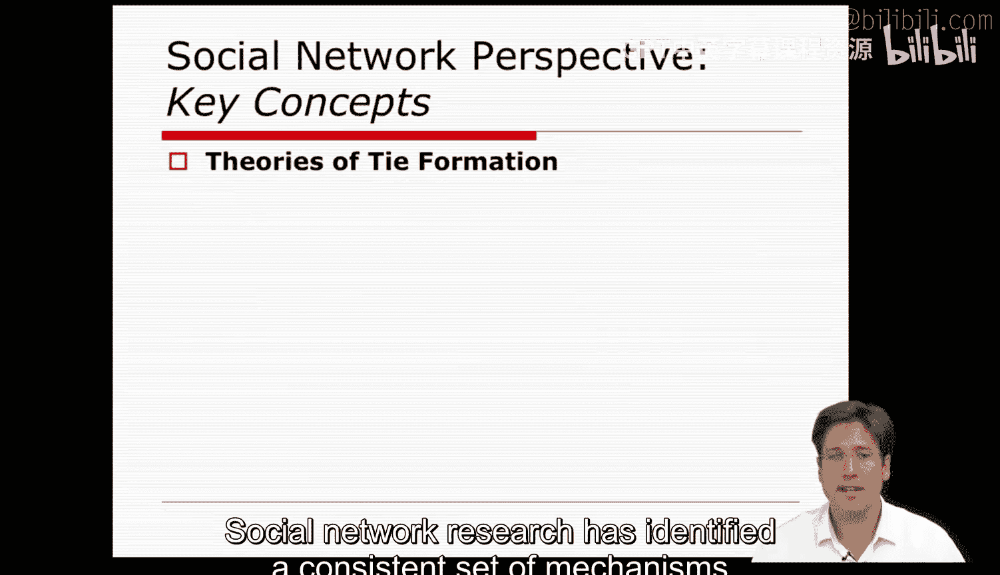

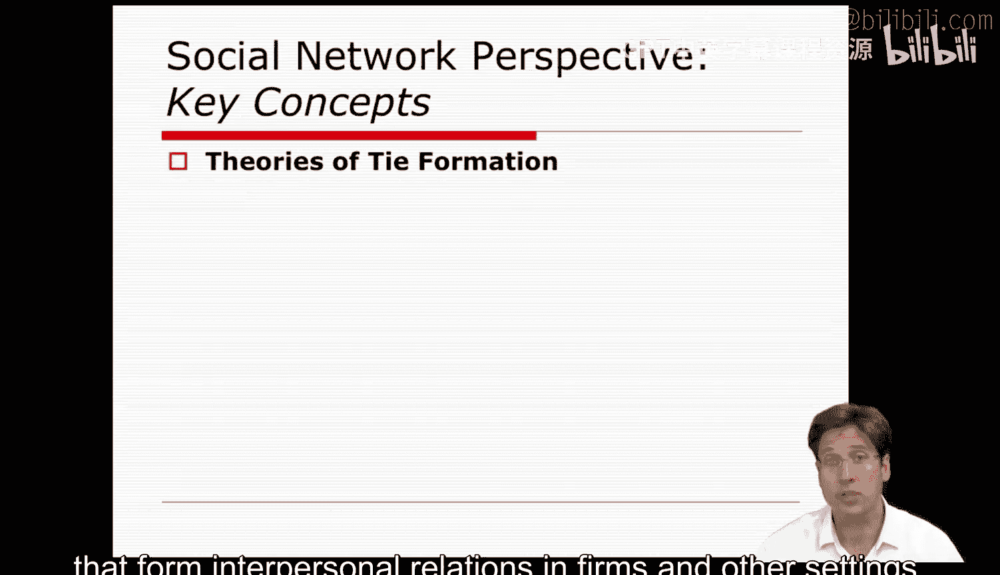

Most of these findings concern strong ties， but they afford analysts and managers some sense for how Thai creation could be facilitated。

 so that's why I want to take some time to relate those theories or those mechanisms here。

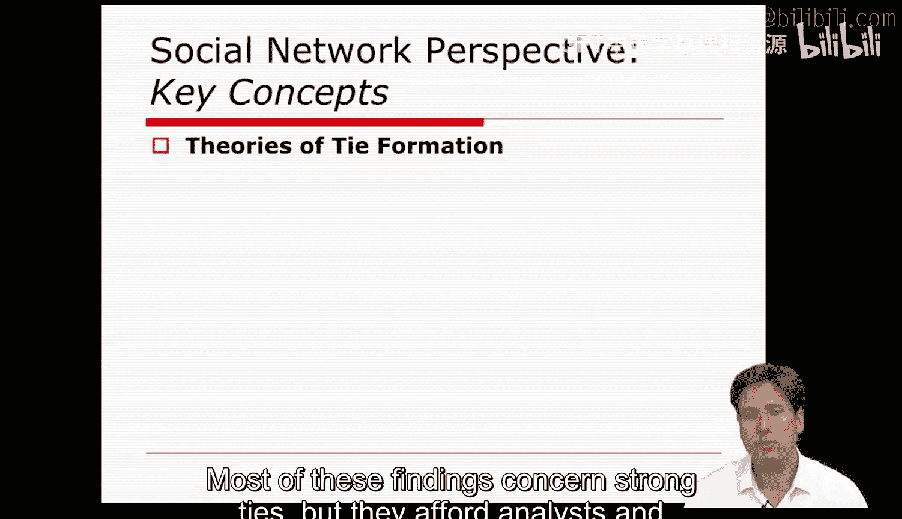

The first mechanism concerns how people naturally form close ties when they're in the same proximity of one another。

 so here， you know proximity breeds ties， we often a lot of our relationships are a matter of convenience and contact the opportunity for contact is key to developing a friendship。

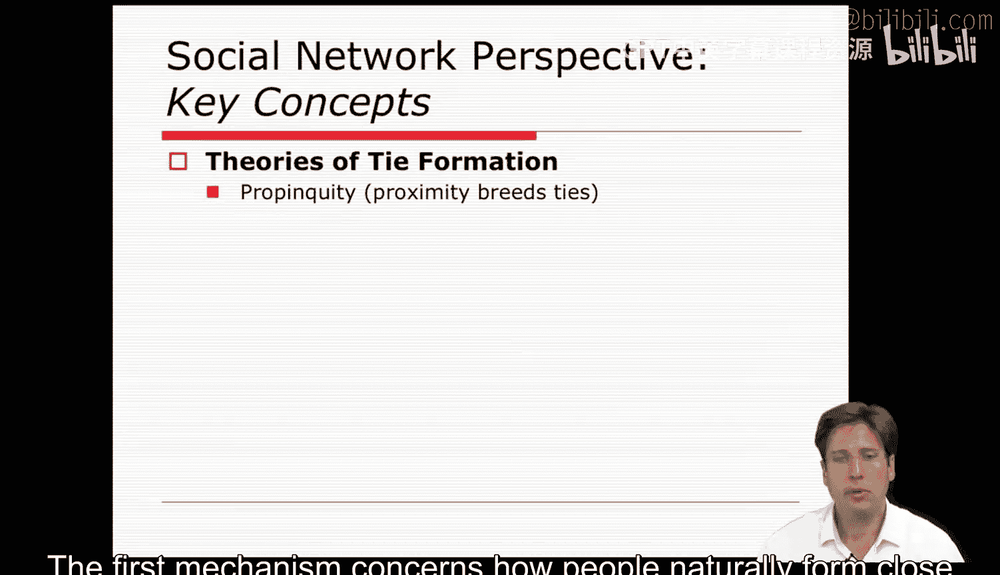

Now。Another theory concerns how similar two persons are。

 and here what we call homophily happens or what the saying says is when birds of a feather flock together。

 we seek out people like ourselves， and that builds greater certainty and knowledge about one another。

Another source of ties comes from exchange or rational choices concerning them。

 so we look for something in the other and they look for something in us and we exchange that and forming kind of a relationship。

Another kind of mechanism driving relation formation is the norm of reciprocity a long time ago anthropologists found that gift giving induces a sense of obligated reciprocation across individuals and this holds across societies so for a lot of you out there this is a great excuse or reason for why you should be the one to buy the first drink when you meet everyone else。

Next is a theory about control， other theories like that of status attainment and control or dominance suggest that people seek out interpersonal advantages and control。

 so this kind of tendency you see with all kinds of primates and the like where they form rank ordered hierarchies。

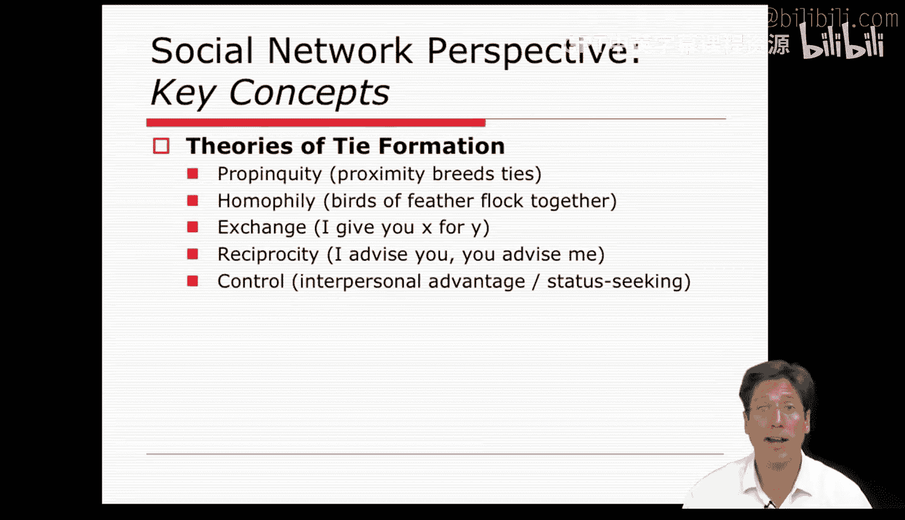

嗯。And then we have a theory of balance where people seek consistency in their relationships more generally。

 for example most of us feel at unease when our friends befriend our enemy。

 we have to either sever our tie from our friend or our friend has to make my enemy their enemy and if they do that we can stay friends so there is this kind of transitivity or balance that we have in relationships that extend beyond the dyad to the triad。

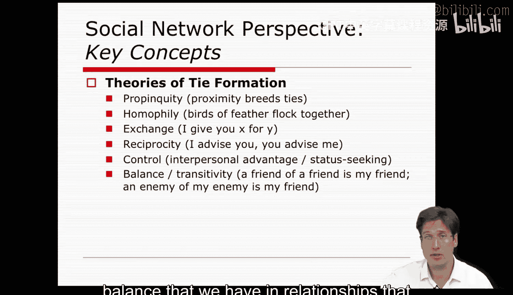

Last， an underemphasized mechanism of Tformation concerns。

 practices and identities in most organizational contexts we cue routines and they oblige us to assume different interaction roles like one of listener。

 hearer， inquisitor， speaker， co-author and so on the same goes for cud identities。

 we frequently cu notions of a storied tie and what that entails so for example when I make gestures of friendship I assume that entails reciprocation。

 frequent contact， supportive interactions and so on when I evoke the identity of professor that cues other expected role relations and their interactions so all of these micro mechanismschan have been studied and related to Tformation and they suggest pathways by which we can create networks within organizations。

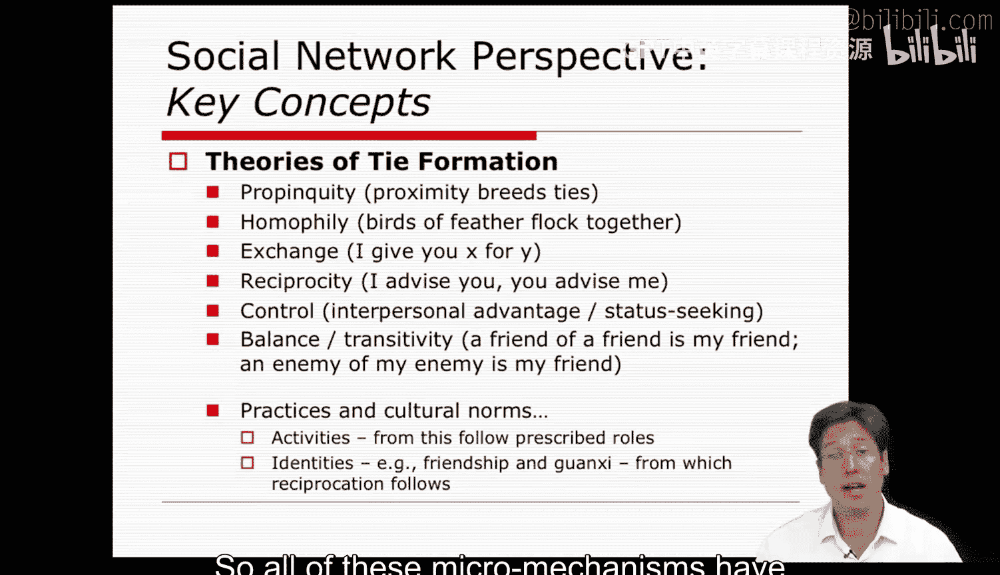

So we have multiple types of networks and a variety of mechanisms have been found to kind of generate these networks。

Now， what about positioning within them， though？Social network scholars love to study the positioning of actors and networks。

 and they love to do this because it's not just the overall form of a network that defines action potentials。

 it's also your location within them that does。Now the two kind of combine in interesting ways。

 after all it's a very different situation to be a central actor in a centralized network than it is to be a central actor and a fractured one。

 nevertheless being a central actor in any kind of network should have certain advantages so when a network analyst speaks of positions they're really referring to the notion of centrality and centrality can refer to positions of both prominence or to positions of mediation and brokerage there's of course other notions of central positioning that we talk about in social network analysis。

 but I'm going to limit it to these two for the purposes of this course。

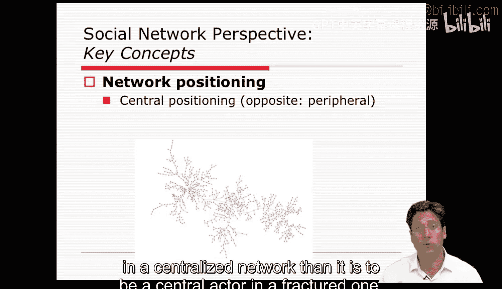

And the network here that you see in the figure， you can see the prominent persons and the peripheral ones readily。

 I mean it's not too hard， you look for the ones with the most ties as prominent and the ones with the least as being peripheral。

 but then there's these individuals who are on the path of others。

 and if we took them out of the network it would fall apart。

These are key mediators between different parts of the organizational structure and identifying these central players can be useful to affirm。

 and especially when it comes to understanding information flows and bottlenecks in the transfer of firm resources。

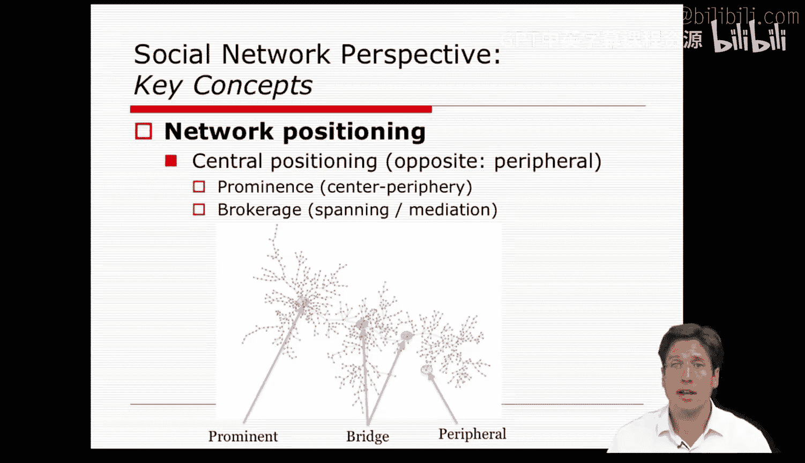

Another type of network position or location is more group based。

 and it concerns the location of a hub of interconnectivity when looking at networks。

 analysts frequently try to identify these sets of actors and clusters of ties since they reflect locations within the network where conformity and social influence likely arises。

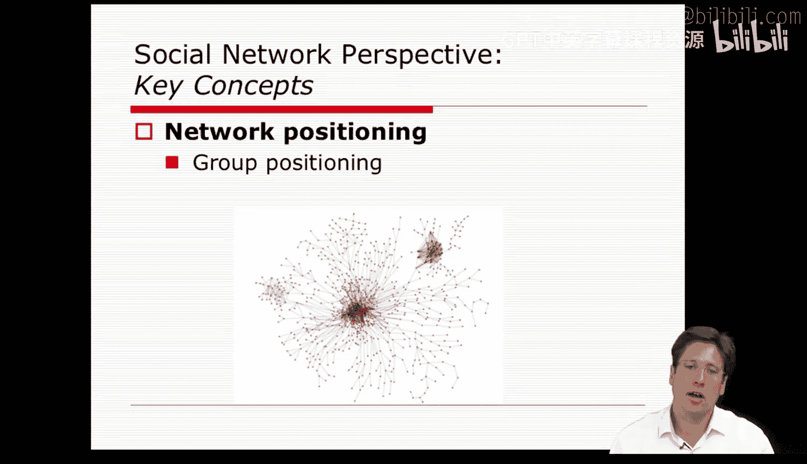

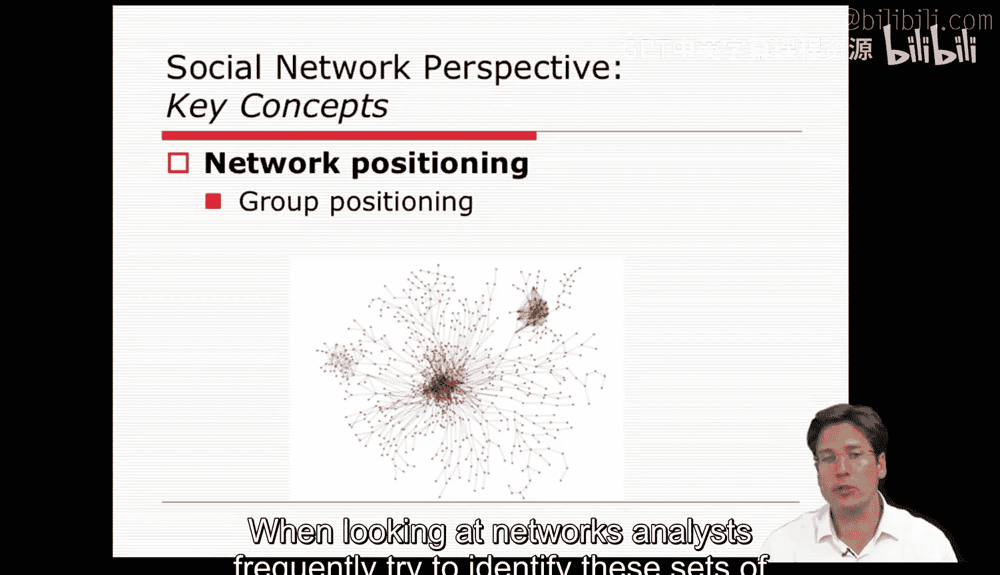

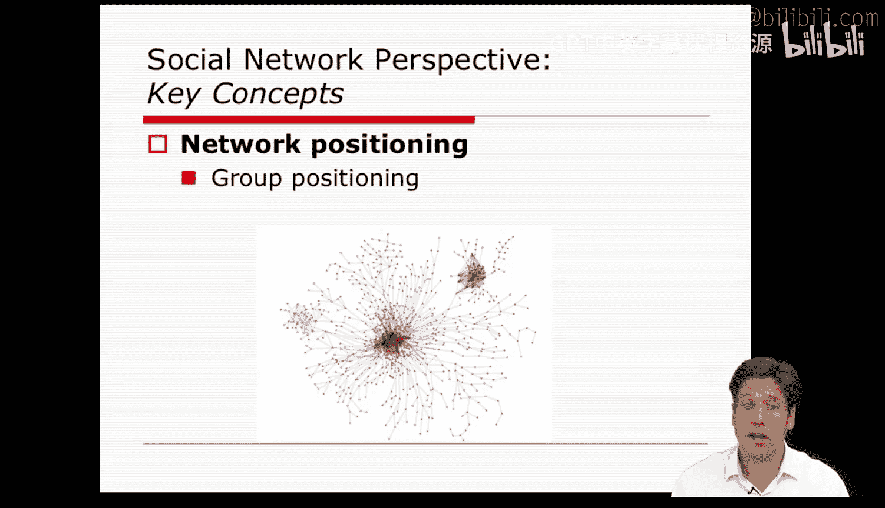

There are also spaces of redundant information， so clusters and groups of interconnected actors are important to the study of firm social structures because they often influence firm outputs and behaviors。

 I'll show you more of this in the next lecture when I talk about how groups or clicks of interconnected actors greatly shape the behaviors that they exhibit within the work setting。

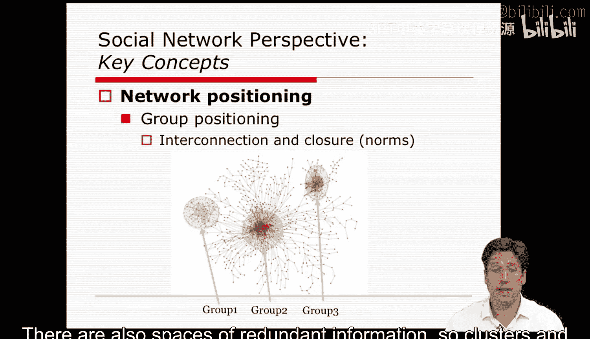

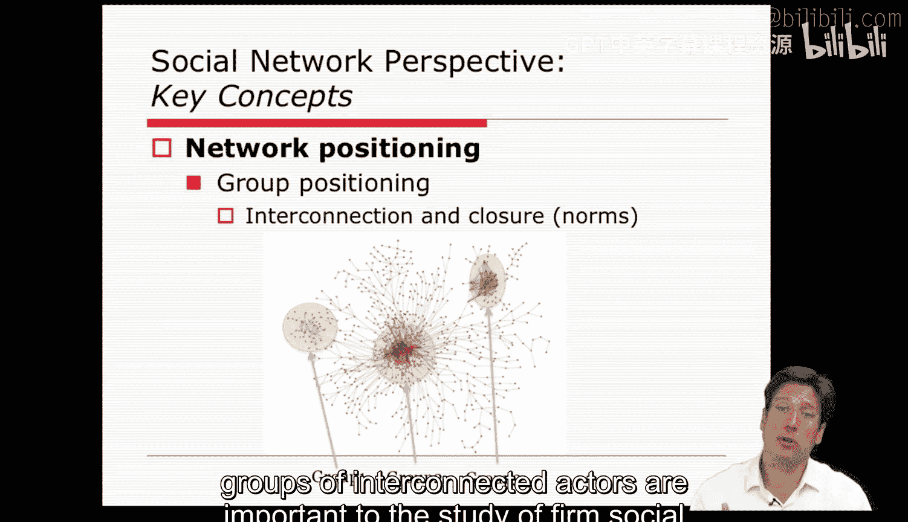

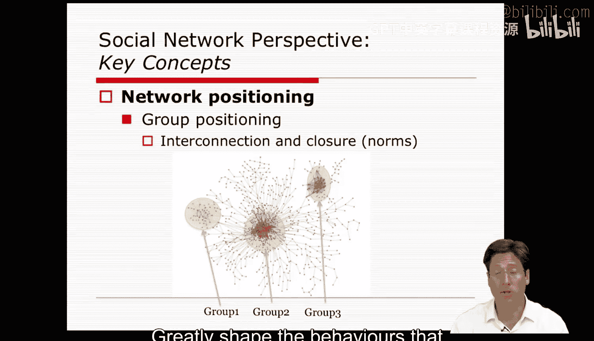

To this point， we've described organizations as webs of transactions and actors as occupying different positions or groups within those networks。

This can be complicated further if we consider that social realities are such that organizational actors are actually embedded in multiple networks。

 this is where things get both more interesting and more complex。

 so let's take the example of something some of you may be familiar with which are trade associations in most fields of business trade associations assume a position central to information exchange but they're peripheral to the networks' exchanging financial resources。

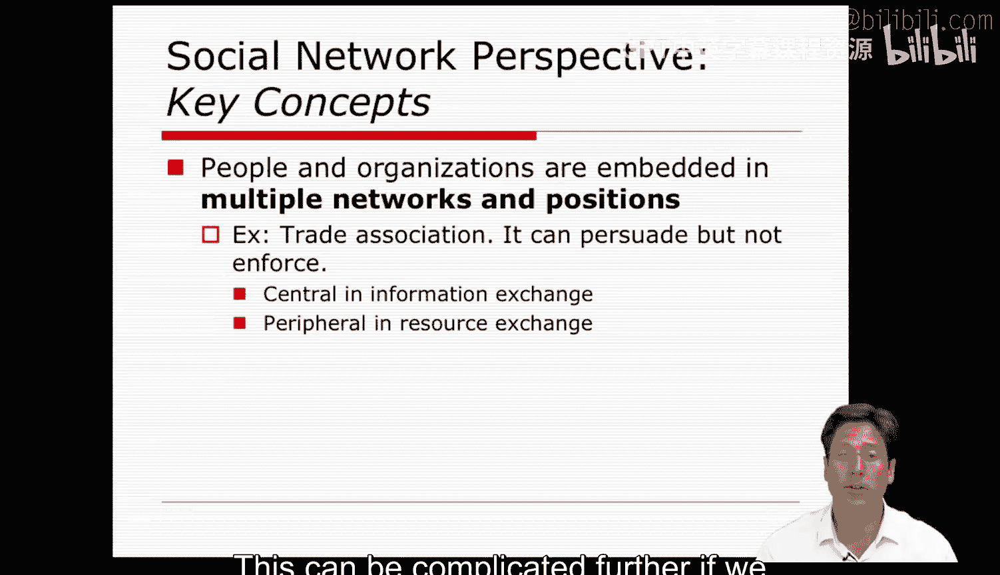

Because of this， they can persuade other organizations within their fields via the use of information as a resource。

 but they can't really enforce other firms to conform to their demands because they lack hard financial resources within firms。

 it's a similar situation where there can be multiple types of relationships and actors can assume different positions across them。

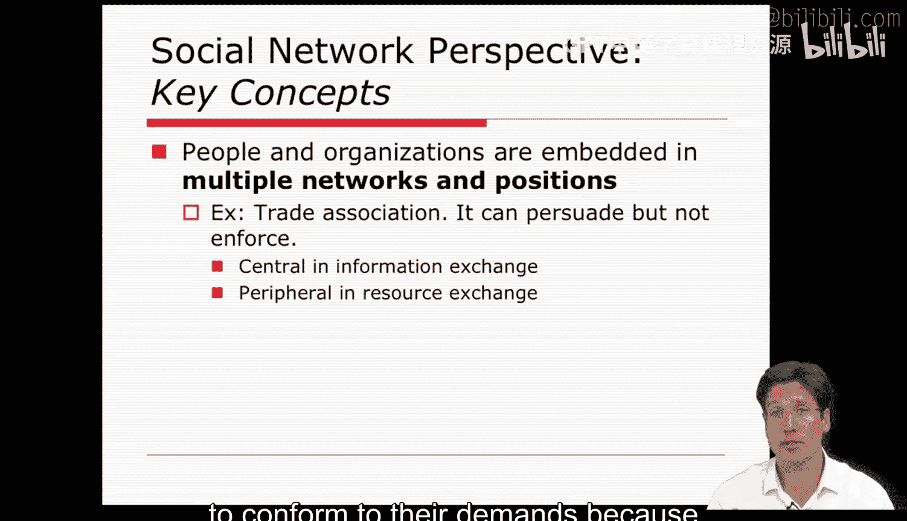

So let's look at a faculty in a West Coast research university from 1993 to 2000。

 the school has around 1，500 faculty。That range in status from some being clinical faculty engage in the hospital and patient care to others being assistant professors that aren't tenured yet to those that are fully tenured so in addition。

 these faculty come from different divisions of the university， some come from the humanities。

 others from the social sciences， the orange， some from law and education， which I believe is white。

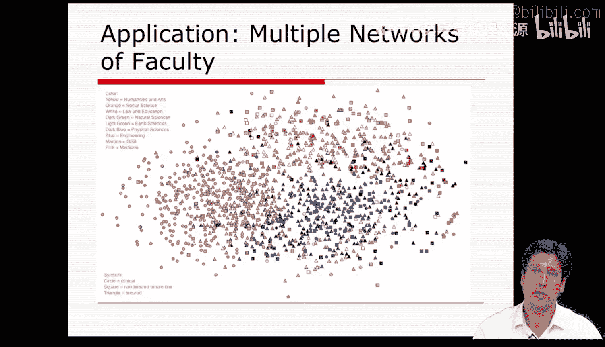

And others are from the natural sciences， which I'm going to make dark green and Earth sciences。

 which is a light green here。And then finally， the physical sciences in engineering and medicine。

So we have all these different divisions and within a university there's multiple types of association that can arise。

 whether it's through the training of students and advising of doctoral students。

 whether it's through the collaboration on grants， whether it's through collaborations on publications and so on。

 there's a variety of these different kinds of association。

 and different divisions of the university assume different positions in those networks。

So let's impose the network of collaborations on these actors in particular let's look at where coauthoring of publications happens。

 they happen mostly in medicine， as well as the hard sciences and engineering。

Notably those two fields collaborate more within them themselves and then between them。

 and there's a good deal of crossover， but still you see more clustering within by contrast。

 social scientists and humanists mostly publish alone at least within this period of 1993 to 2000。

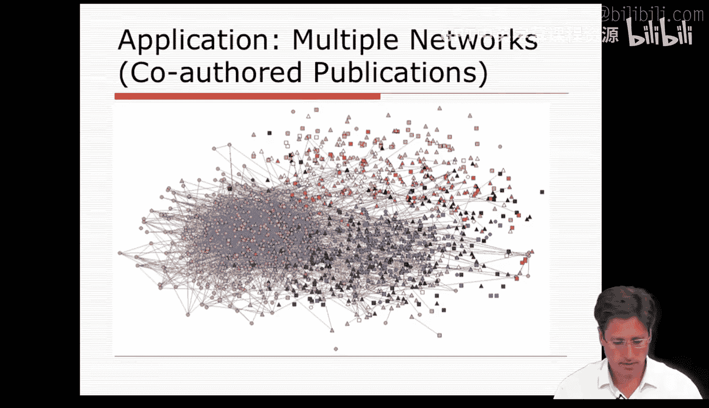

Now let's look at grant collaborations， notice how the network shifts and we get a second hub of dense collaboration within engineering。

 but again there's a clear clustering within medicine and engineering and a little bit of interfield collaboration across engineering and medicine。

 however the hard sciences or physical sciences are mostly kind of collaborating with engineering at this point。

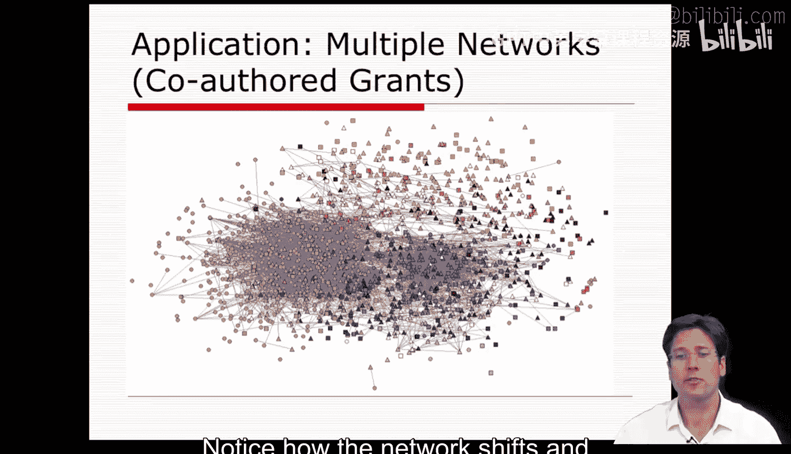

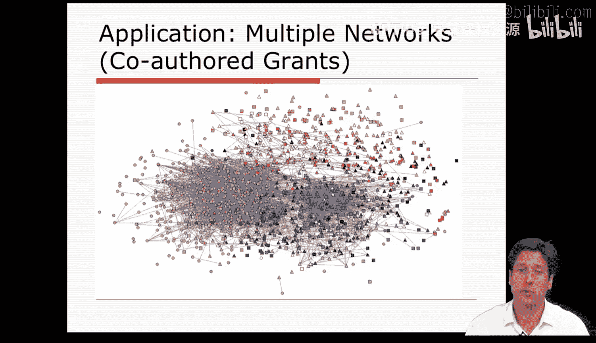

Now let's look at student training and how faculty work together to provide that here we see faculty who are linked when they co-advised doctoral students。

 notice how the network disappears over medicine and it forms over the social sciences and humanities and notice how the collaborating medical faculty are mostly tenured they're not clinical line。

 so the clinical line or the circles， the tenured faculty are the pink triangles。

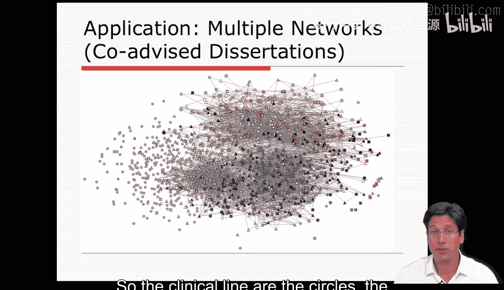

So what do we learn from all this？We learn that each field is embedded in multiple types of activities and networks of collaboration。

 but they assume different positions across them， and this likely results in greater cumulative advantages to each field。

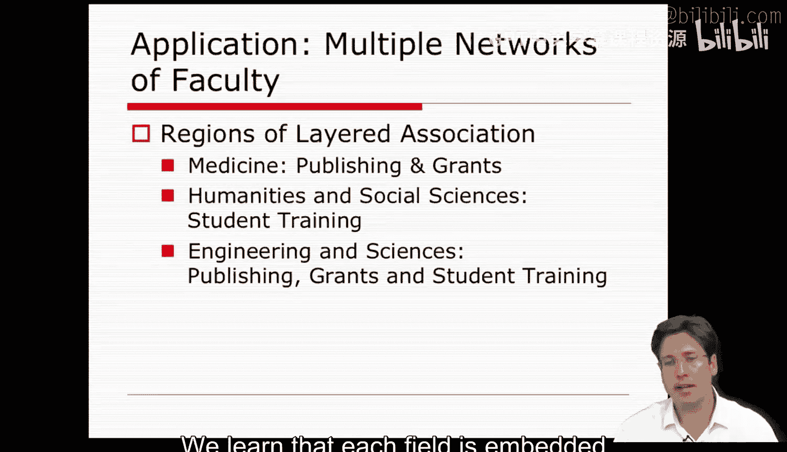

So on the one hand， we have the medical faculty which collaborate on mostly publications and grants。

 but not necessarily on the training of doctoral students。

 it's more through the medical students which aren't represented in these images。

The social science and Humanities faculty collaborate over student training of doctoral students。

 they also publish and write an occasional grant， but it's not a point of collaboration。

 they solo author a lot of that。Last， engineers and scientists collaborate in everything they do。

 moreover they frequently interact with medicine。So from this we see a differentiated collaboration structure in the university。

 the implication is that the social sciences and humanities mostly transfer knowledge via the mutual efforts at training students。

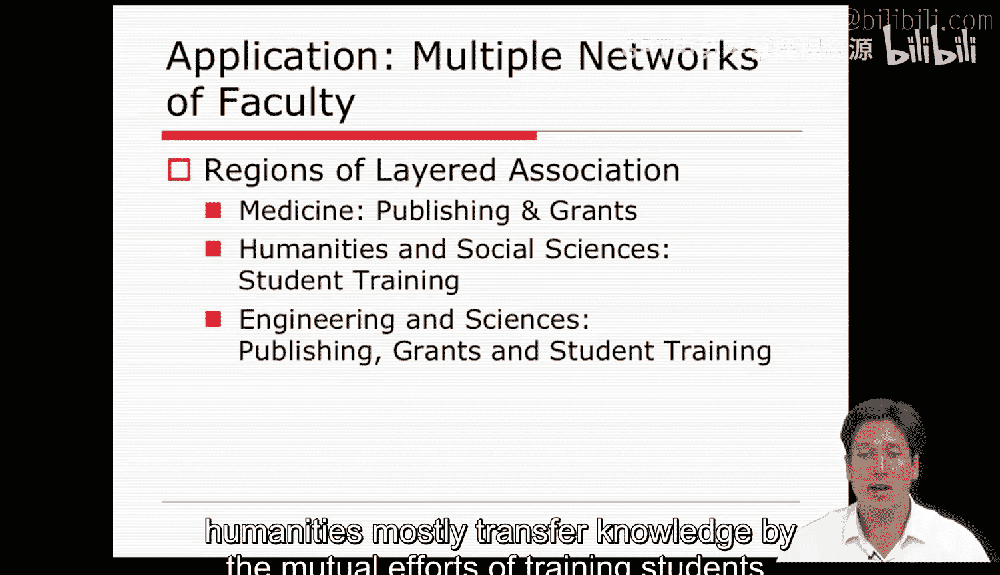

In contrast， medicine transfers knowledge mostly over the conducting of research or team science。

 and it probably has a lot of contact with postdocs as opposed to predoc students。

And yet other fields are high speed thoroughfares for knowledge transfer via collaboration and everything they do。

 so engineering and the hard sciences are very much a linchpin in this university。

 bringing together high powered domains of research， training and publication。

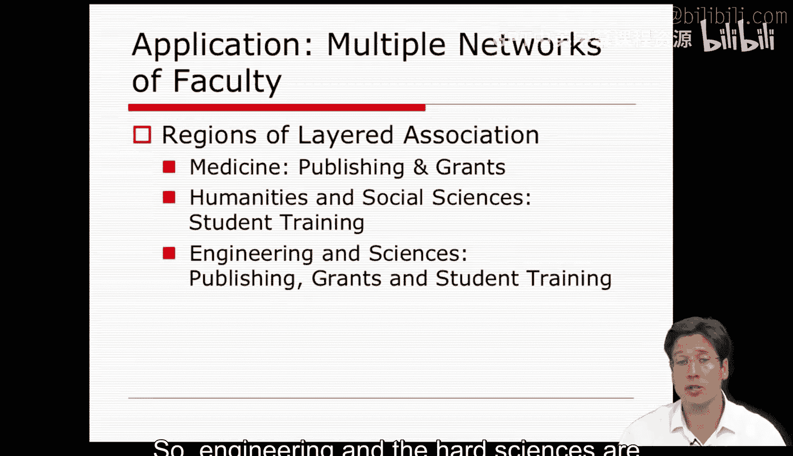

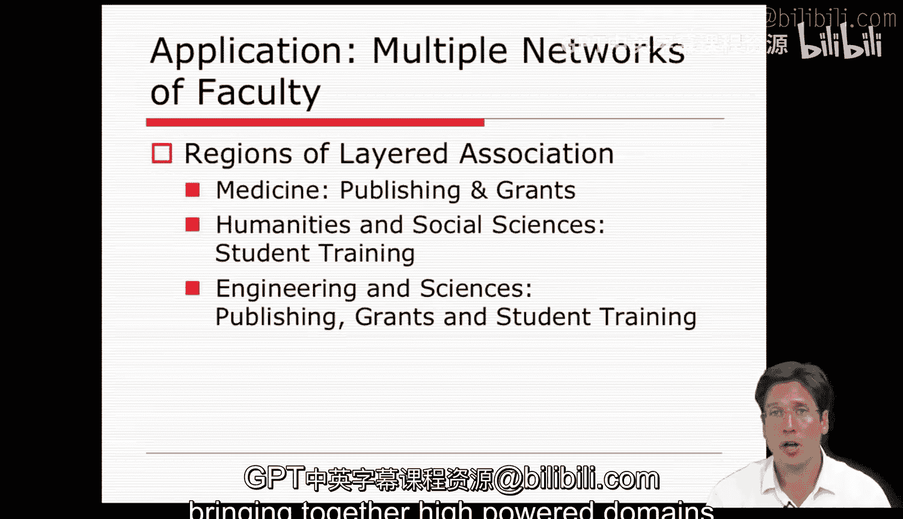