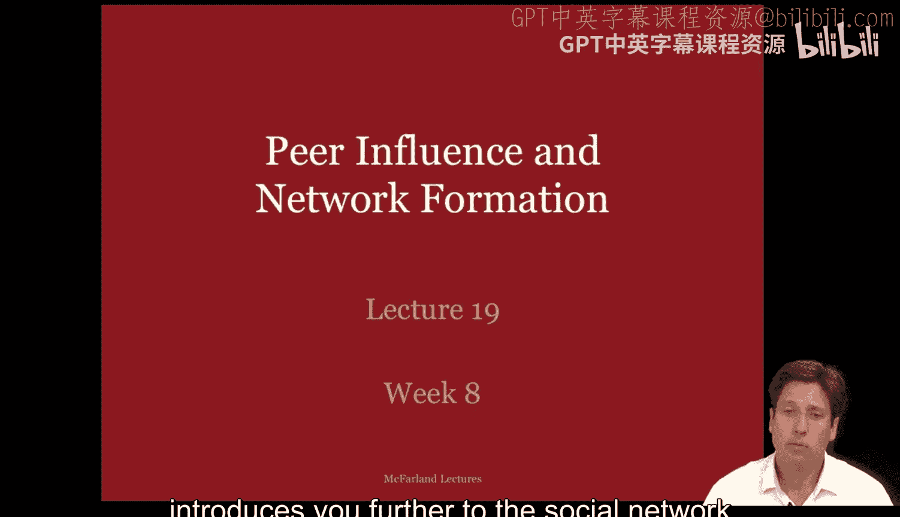
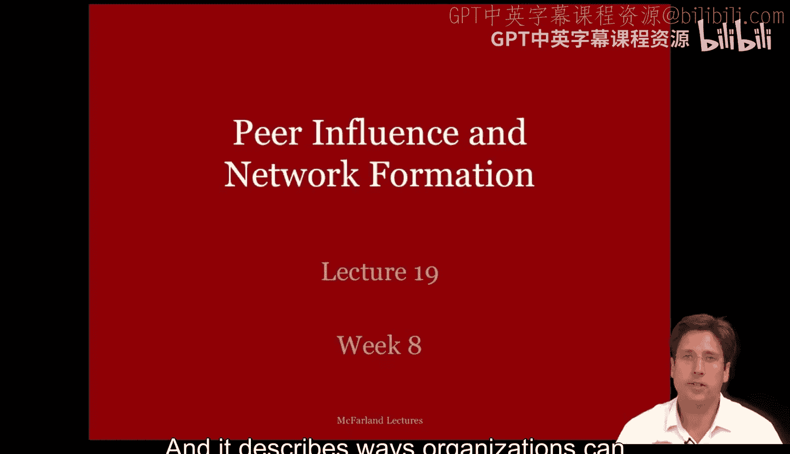
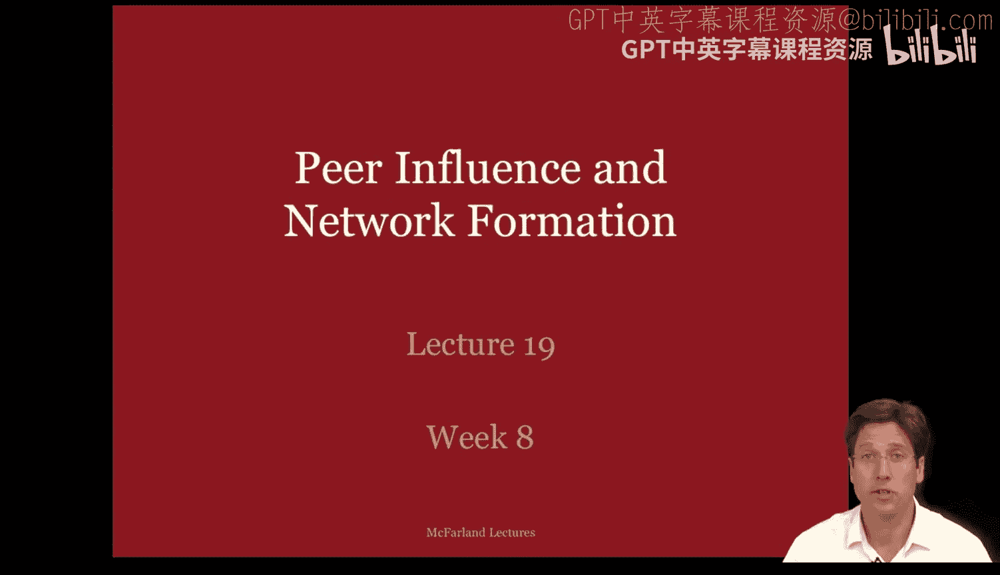
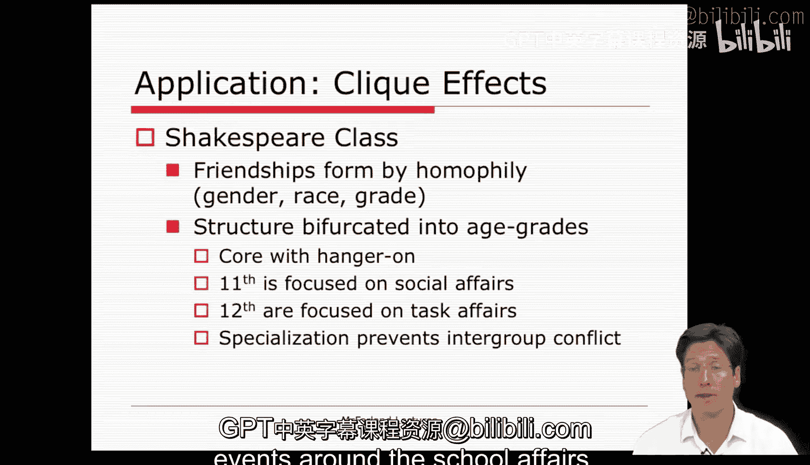

# 斯坦福大学《组织分析｜Organizational Analysis》中英字幕 p78 078_08_03_第十九讲-同伴影响与网络形成-第一部分.zh_en -BV17J4m157qN_p78-

This lecture introduces you further to the social network perspective on organizations。

 but it elaborates how networks influence organizational behavior and outcomes。

 and it describes ways organizations can create different network patterns and positioning when we study the effects of networks on organizational behavior。

 we view social relations and a or positioning as an independent variable shaping outcomes。

 We consider whether people influence one another and diffuse their motivations through their friendships。

 or if being in key locations of the network have certain returns or advantages for the worker and the firm。

When we consider network formation， we look at the network as an outcome or as a dependent variable here we want to know the factors that lead persons to form relations and factors that lead a network to assume a particular shape and perhaps even a pattern that you as a manager or as an analyst desire to bring about。

So let's look at these using examples in the slides that follow。First。

 let's consider how relations influence behavior or what we call pure influence。

The general argument of peer influence is that people we associate with change us， they affect us。

 and they lead us to act in ways we wouldn't normally act if we were out on our own。

 so in organization's research these studies often focus on the process of social diffusion and the adoption of organizational innovations。

Some research studies whether collaborating with productive colleagues increases your productivity。

 so a test of whether a particular mentoring program has solid returns。But in most of these studies。

 researchers find that close ties are a great means to diffusing attitudes and behaviors。

At the inter organizational level， scholars find that the adoption of organizational innovations。

Often flows through associations like interlocking boards of directors or alliance networks。

 for example， a string of papers。Found that the use of poison pills in corporate takeovers was an organizational innovation that spread via interlocking boards of directorates。

 the poison pill for those of you wondering was a strategy that many firms would use to prevent takeovers in the 1980s and 1990s it was a way of making the firms seem like an expensive low-profi gamble whenever they were being put under a takeover and so because of those kind of moves they were seen as not worth taking over so that the takeover would quickly disappear within the context of a single university Craig Rolllings and I have studied how faculty productivity diffuses through collaboration networks we found that a university could improve its grant record by getting successful grant seekers to collaborate with novice grant seekers those kind of collaborations improved application rates。

 success rates and the amounts awarded， the diffusion of expertise was even greater when these collaborations were repeated more than once。

thereby ensuring that novices learned how to get grants on their own and with others in the university。

 so persons who did not collaborate actually struggled to win awards in comparison with their collaborative peers。

 so we think about this in the context of the larger university and the prior lecture where we ended the prior lecture。

 you could imagine how engineering faculty collaborating with those in the social and humanistic sciences or fields would benefit from those kinds of collaborations and induce them to become more of a grant seeker or funding of doctoral research projects。

In other work， the conduit of influence is not a strong tie but a weak one Mark Grannovavetter has written some seminal work on social networks and in particular he has made a strong case for the importance and usefulness of weak ties and his research on job seeking he finds that most people learn about a job and acquire it through weak ties or indirect ties of friends of friends rather than their close friends and he argues this is because weak ties often bridge groups and bring people into contact with more unique information persons that rely purely on strong ties and cliques mostly find redundant information so persons with weak ties have more access to new knowledge about job openings and therefore successfully acquire jobs strong and weak ties are often characterized as bonding and bridging forms of social capital or types of association that bring social advantages strong ties and bonding capital generate social control and conformity as well as socialization。

diffusion while weak ties in bridging capital often extends a person's reach into pools of useful information。

 so strong and weak ties imply the creation of certain network configurations and network positions。

 and therefore I want to turn to next the effect of positions on outcomes。

A common finding within organizations is that persons occupy certain positions within a network。

 and those positions afford them all kinds of advantages， for example。

 like the access to recognition and information。And this kind of positioning with those kind of advantages enables the occupant to be more successful in their careers。

The same can be said of interorganizational networks organizations assuming prominent or brokerage positions tend to survive。

 grow and have greater control and influence on the field of organizations in which they're embedded David Crackart offers us a nice illustrative example of the effects of network positioning on firm behavior and firm outcomes he describes the case of a technology firm that is the subject of a unionization effort。

According to Krrackart， the unionization effort fails because union proponents do not coop the informal leaders of the Str Thai network。

I find Krrackhart's case to be simple and elegant， he first describes the organizational chart of who reports to whom and he identifies the collective bargaining unit that the Union tries to establish。

Then he goes on to show how the key union proponents are neither central to the advice network of experts。

Nor are they central to the friendship network of trusted relations。

Here's the organizational chart and you can see the potential bargaining unit circled by the dotted line。

In it， I've highlighted the three leaders of the unionization effort， Howal， OVId and Jack。

 the anti- unionion members are outside the unit， Robin and Mel。

 and the key experts or advisors of work related tasks are outside as well， and that's Evan Steve。

 only the informal leader or the popular friend named Chris is in the unit。

 but he's not very interested as you'll see。Here's the advice Network Krackcker gave the employees a survey to get this sort of information and then he entered the information into social network software to generate the network graph the pro-union leaders are highlighted in red and they're notably very peripheral to this network the anti-union members are highlighted in blue and they're notably more involved in the advice network the last the two key players I've highlighted in green and that's Evan and Steve and from this we can see that the unionization leaders won't put a stop to the expertise network that's for sure。

The next image is of the Friendship network， and again the three pro union players are highlighted in red and they're peripheral。

At the center is the informal leader in popular pal Chris。

 and notably the anti-union members are closer to Chris and likely have greater sway over his opinions in sum。

 the case study uses interviews， surveys and observational records to retell the story of how a unionization effort failed because the pro-union players were peripheral to the informal organization。

They neither cooped the experts nor the popular individuals in attempting to create a bargaining unit。

Had they known to check the network and coop Chris and his close friends。

 then they might have received the social support they needed to successfully unionize the firm。

So David Crackard's case focuses on the effects of network positioning。

What about clicks or social groups and their effects on workers？Long ago in 1939。

 Rothlisberger and Dixon studied a bank wiring room where workers essentially created circuit boards。

There， Roalth Esberger and Dixon found that the friendship groups of these workers altered their rates of work output and normed those rates so that they stayed within a particular output level that worked for the set of friends now subsequent scholars have remarked on how peer groups or clusters of strong tide individuals can be a strong force in organizations and in terms of influencing their outcomes。

I see this in my own work on American high schools and their classrooms。

 their youth act with their friends in mind， in most classrooms。

 youth form friendship groups or cliques and those clickiques and lead the students to conform their behavior within them。

Here's an example of one such high school English composition class that I observed as a graduate student。

 it was composed of 11th and 12th grade students equally well equipped to read。

 comprehend the course material that concerned William Shakespeare's written works the teacher Sophia liked to encourage dialogue and frequently called on students nonetheless the students formed clusters of association based on gender race and age。

 and these groups were rank ordered within those grades。

 as such there was a popular core group in a hangeron group and this arose for each grade level。

Interestingly， the 11th grade group and the core 12th grade group did not compete on the same stage。

 instead they specialized in distinct conversational arenas and topics。

 so the seniors dominated the public stage of academic discussions and the juniors dominated the backstage of social discussions about parties and events around the school affairs。

