# 斯坦福大学《组织分析｜Organizational Analysis》中英字幕 p79 079_08_04_第十九讲-同伴影响与网络形成-第二部分.zh_en -BV17J4m157qN_p79-

In this matrix， you can see the friendship relations during the semester in which I observed them I used various network analytic software packages to identify the groupings and how they broke down and particularly there's four clicks or four clusters and you can read the ties within and between these clusters by following the row column relationships or along the row as a from two relationship hence the value of one from student number 16 to student number 15 do is a one and there's a dot from 15 to 16 and that suggests that 15 thought she was friends with 16 but 16 did not reciprocate that sentiment so notably most of the groups are homoophillus by grade gender and race so they follow the saying of birds of a feather flock together Moreoverover many of them have reciprocated ties at least more so than by chance while it's not shown。

It's also the case that many of these friends sit by one another， so propinquity is also an effect。

In the matrix you can see the smaller secondary peer groups underneath the larger core grade level groups and you can see that they're hangeronss by looking at the off diagonal relationships between those two clusters。

 these secondary clicks seem to want to be friends with the larger core click within their grade level。

 but it's not always reciprocated and because of this there's kind of a rank ordering to their clustering of clicks within the class。

We can render these relationships into a network image where the Y axis is the prominence or popularity of the individuals。

 and then the shaded circles reflect general boundaries of each clique。

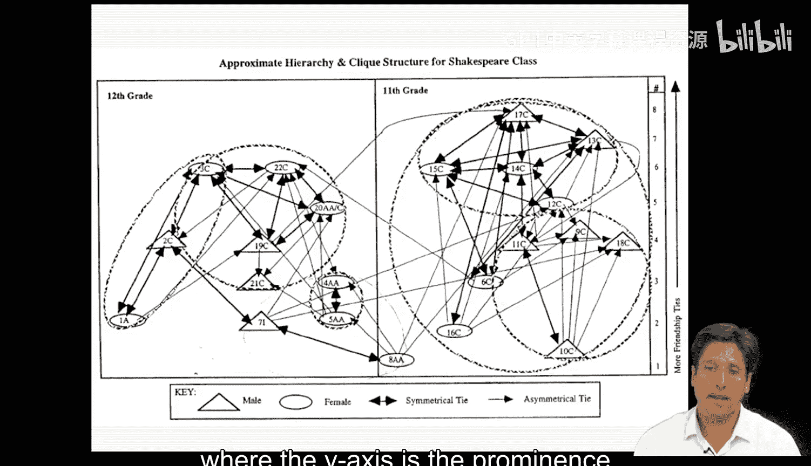

Notably， we see that the two grades are somewhat disconnected and each having a core click with a hanger on。

 just like I described earlier， in other analyses I tested whether observed interaction patterns conform to these cliques over and above the seeing and homophily effects。

 and they strongly do。

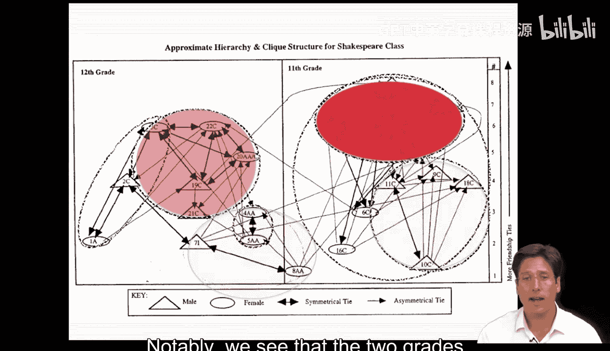

For ease of interpretation， I'm just going to superimpose the observed behavior's interactions on these groups from doing so we learn a few things。

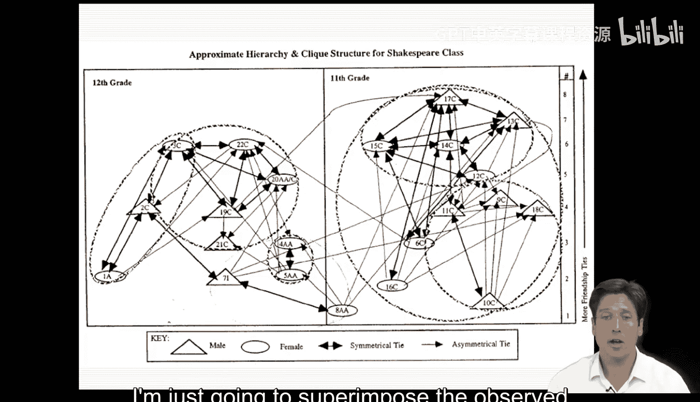

First， we learn that most the interaction is directed within the cliques。

 second we notice that the cliques specialize their behavior。

 so here I'm using red to denote where task or academically focused interactions emanate。

 I render the red color boer where the rates and densities of that kind of interaction are higher。

And here it clearly shows that the core senior click dominates such an interaction and the core clique in either grade is slightly stronger so that status is important as well as the kind of group。

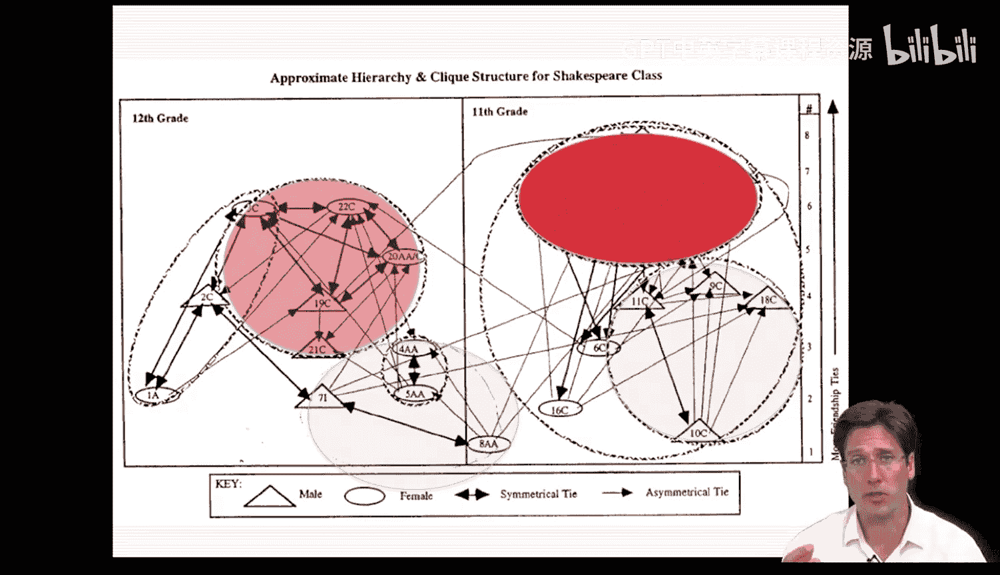

Next。I use blue to denote where social or non academiccademic interactions emanate like play joking around。

 things like that I render the blue boulder where the rates and density of such interaction is highest。

 hence the junior core group dominates that kind of interaction and the core clique within each grade actually dominates that interaction so you can see that the transition here。

 the senior group dominates tasks。

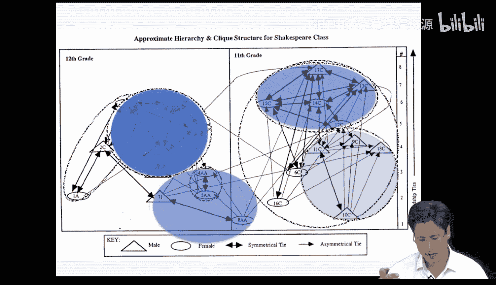

And then the junior group focuses on social affairs。

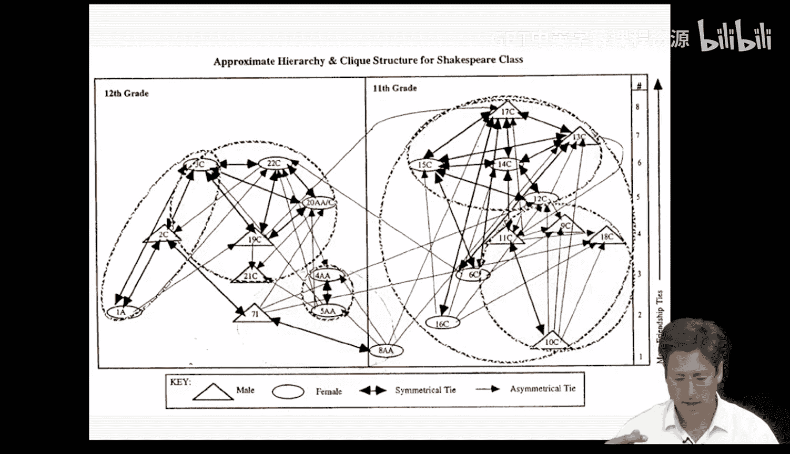

A slew of statistics can accompany these images and further the argument。

 however the point for this lecture is more conceptual and schematic。

 the structure of the informal network and its cliques strongly guide behaviors。

 that's the point moreover the cliques arise from a variety of T formation mechanisms of say homophily reciprocity。

 status seeking and even an effort at specialization so that they avoid competition across the groups so sum of this is that it's not just single relationships that influence workers and their firms but also network positioning and the groups within them that shape kind of outcomes and worker behavior。

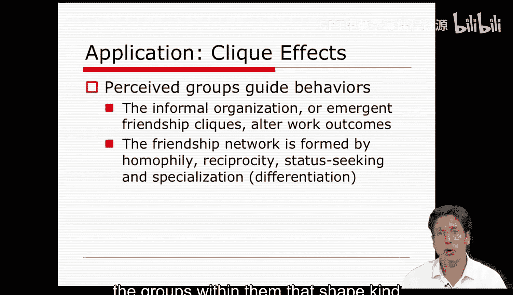

But what of network formation？In the introduction， I spoke of how analysts often view networks as an outcome。

 or as having a desired structure that managers want to achieve。

How do we accomplish and engineer different structures of association？

In my own work on high school adolescent networks， I found that they vary in macro structure from school to school。

And from classroom to classroom。Some of these settings entail hierarchical worlds like the first image here to the side。

 and others that are heavily segregated and clustered like the second image。Nevertheless。

 friendship networks are all shaped by the same sorts of tie mechanisms and those mechanisms I related earlier as homophily。

 birds of a feather flocked together， propinquity， you know friends of convenience。

 reciprocity I give you something you give me something back and hierarchicalization a sense of dominance and control。

 this kind of raises a conundrum if the same micro mechanismschan apply to every friendship network then how is it that their patterns vary。

 how is it that we see these very macro structural environments。

 the potential answers are interesting， it turns out that certain types of ties usually correspond with a type of network form or patterns。

 and the case of our schools the ties are friendships and friendships tend to be reciprocated in local so they accent clustering more than they do rank ordering。

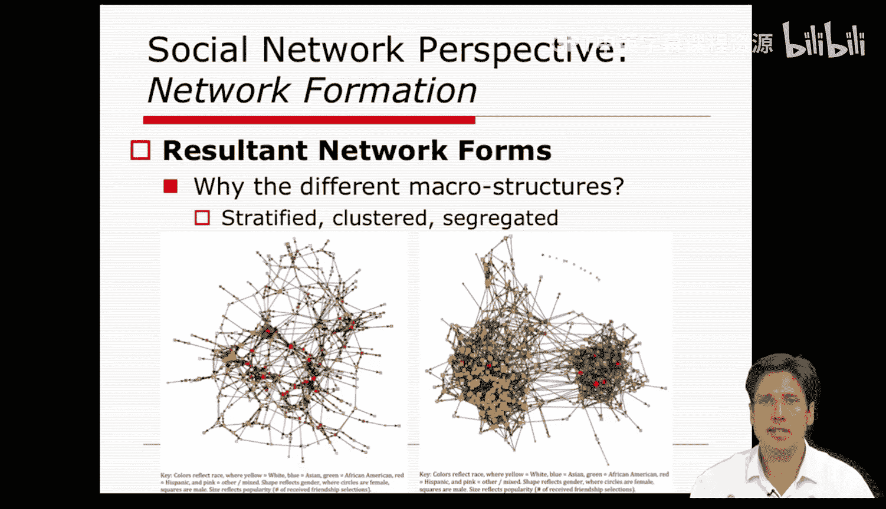

And this closure and reciprocity of friendship ties happens to be the strongest feature driving high school friendship network formation。

By contrast， if the， the ties actually weren't friendship but weak ties。

 then it's likely the structure would entail more spanning trees， rank ordering， and fewer groups。

 acquaintance ties have greater imbalance and looseness to them。

 and they enable different network patterns to arise， so depending on the type of tie。

 we might expect different kinds of network forms。

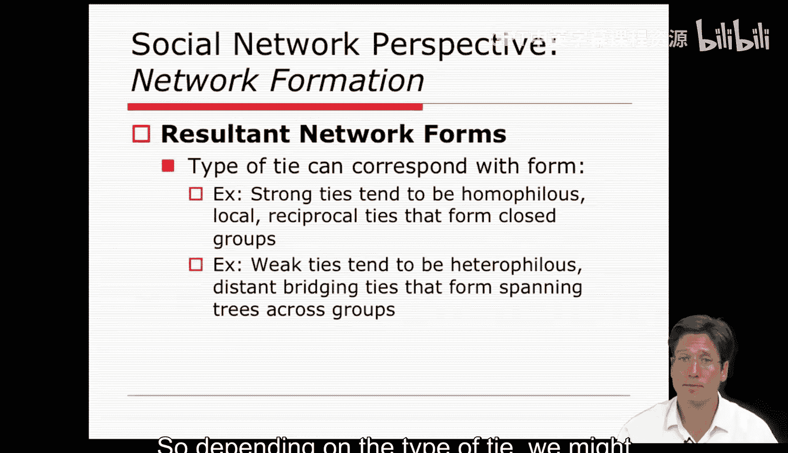

But this doesn't explain how friendship networks differ across contexts。

In my work at high schools we find that the friendship networks vary from school to school because the organizational context amplifies and dampens the salience of certain micromechans。

 what this means is that the composition of participants and the utilized organizational rules moderate natural bases of association。

Take the case of a large heterogeneous population of say multiple equally present races in a school and one where contact is by choice and this means that the students aren't sorted into ability groups by the school in these kind of cases we find the pattern of association is the most highly segregated by homophily。

 they have ample opportunity and ample variation and traits to do this。

Now in large schools with no organizational sorting and lots of choice there also tends to arise rankordered clicks。

 so not only in those large organizations do they form clusters of certainty and trust but also some degree of ranking the only time we see random dense associations are when organizations have homogeneous populations and they place members in small interactive settings and they sort them beforehand so that the differential characteristics of these students are already kind of sorted out and in these contexts we see if we just induce kind of greater interaction that they have kind of a random mixing the same occurs with small settings like classrooms where you introduce rotating group memberships with frequent interaction of these individuals what happens is that you can induce a kind of collaboration structure that's highly dense but doesn't have these kind of clickish hierarchical structures in addition if you keep people focused on。

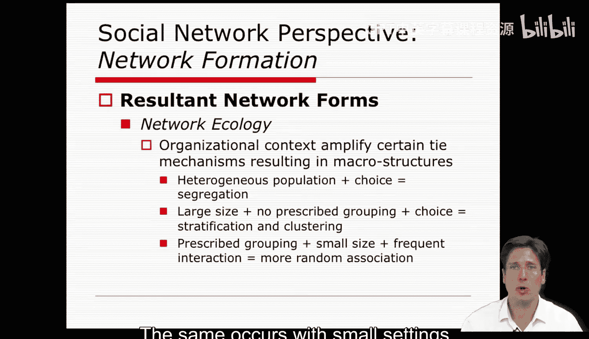

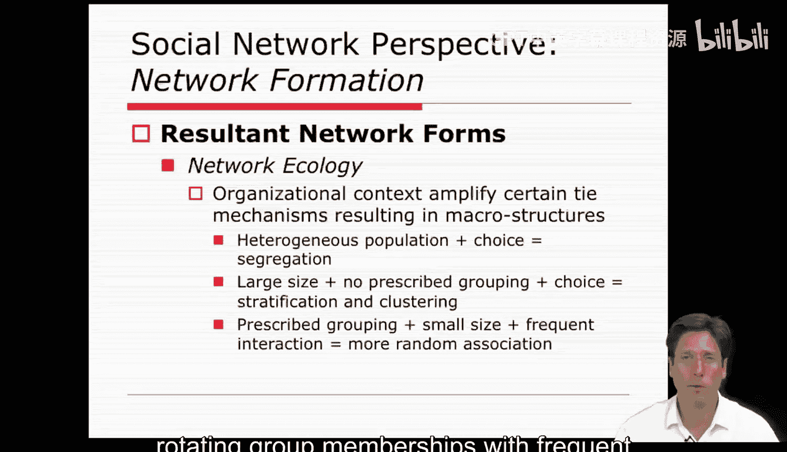

about tasks or the materials at hand like organizational analysis。

 they'll form relationships on the basis of those contents and so already we have some sense from these kind of dynamic these models of network formation of what kinds of treatments would induce the networks we'd like to see in organizations once analysts have a good description of a network and once they have some sense of the key influence processes。

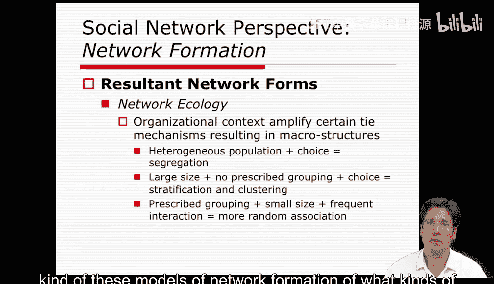

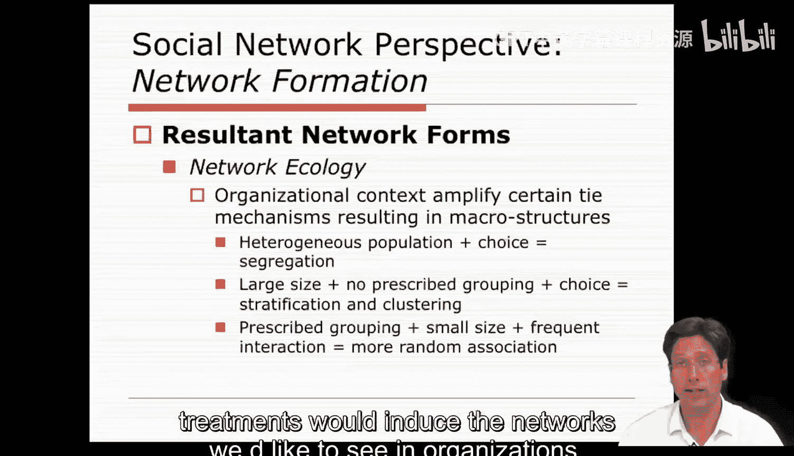

On worker outcomes。And once they know the key mechanisms that drive tie formation to assume certain patterns。

The analyst can begin to prescribe all sorts of treatments。

Now it's going to differ by context and by question for many of you。

 but I hope a lot of you inferred what these treatments might be from the prior slides of this lecture。

Nonetheless， what I can do is tell you what many firms will probably ask you for。

 they're going to want to facilitate the creation of efficient network patterns and for example many of them will want interactive。

 dense networks of positive work related collaborations as opposed to positive sociable collaborations that don't relate to work and they're going to want those networks to span groups so good ideas can travel around in the firm and across them and many companies will also want to forge teams composed of differently skilled persons who are going to rely on each other's strengths so they're going to want to organic whole that's greater than the sum of their parts and this will supposedly make a product or solve a complex problem so they're going to want and seek these kind of things in addition to facilitating the creation of ideal network forms。

 companies will also want the analysts to perform network corrections or to solve coordination problems that are endemic to the networks already in place Now within schools we have many instances。

This occurring where students assume positions or they form groups that drive behaviors in negative directions an underperforming group。

 for example， in many classrooms， certain kids dominate and take up all the teachers time and attention。

 thereby making achievement games or gains less equal。

To offset this researchers have suggested positional treatments， to offset in equal access。

 the tasks are designed to involve decentralized formats like group work， so more people can talk。

 and then they call for differentiated roles so everyone has a job to do， no one's left out。

 and this type of treatment equalizes status within the group and it renders participation more active and even so that knowledge。

 acquisition and attainment is similar。Another problem in schools though concerns group norms and peer influence through cliques to offset this。

 scholars suggest propinquity changes such as rotating groups and seating assignments。

 things that we've all seen before， but which we haven't managed manually enough to overcome those kind of suboptimal solutions。

 so these are kind of simple solutions in certain way。

 but I hope they help you think about how networks not only can be formed。

 but also how they can be redirected through various managerial efforts。

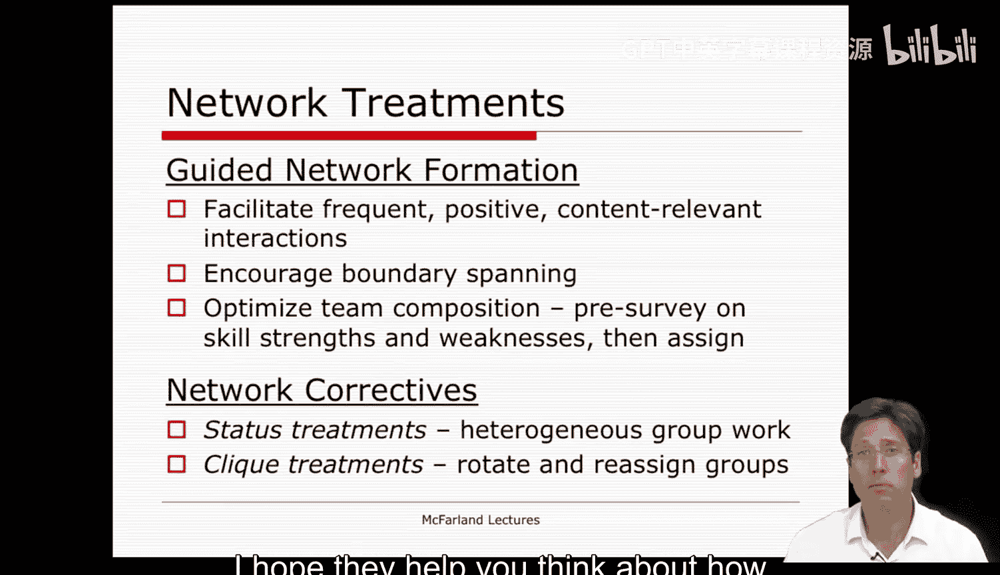