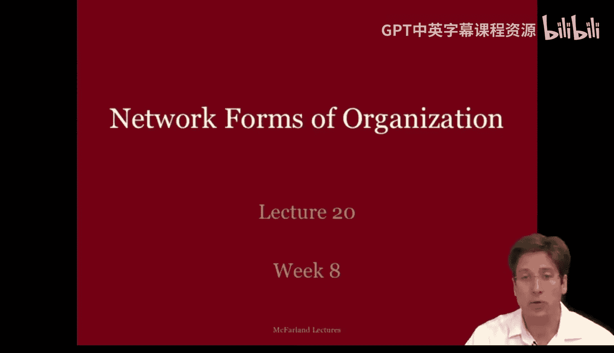
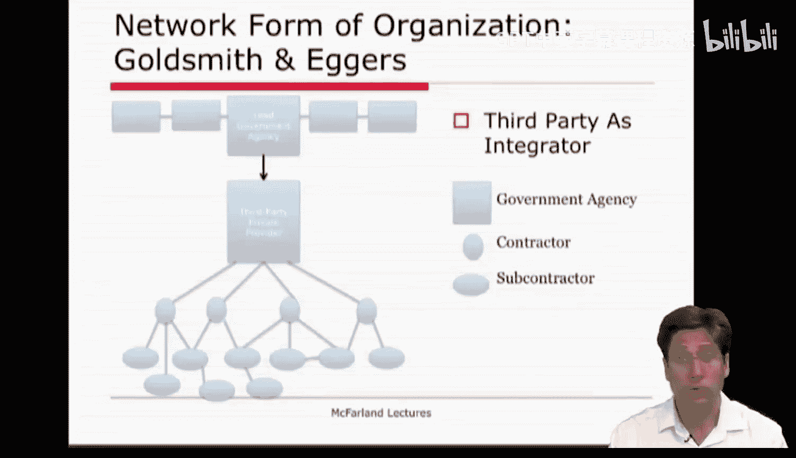

# 斯坦福大学《组织分析｜Organizational Analysis》中英字幕 p80 080_08_05_第二十讲-网络型组织-第一部分.zh_en -BV17J4m157qN_p80-

Last week we discussed resource dependence theory， and we described how that theory concerned a firms power dependence relationships in the environment。

This week， a variety of networks are described in the readings。

 and if we inspect them a little closer， we see they are built up by some of the bridging efforts discussed last week in resource dependence theory。

 such as joint ventures， associations， interlocking boards of directors， strategic alliances。

 and partnerships。

For example。This week， several authors describe projectbased networks or issue networks where the effort is to organize around a specific project or to work together to push a single issue now if you recall last week in resource dependence theory we discussed how this arose in pairs of firms through joint ventures。

Some of the authors this week discuss professional networks and trade associations。

 as well as interlocking boards of directors that bring firms into greater communication with one another in resource dependence theory。

 these were seen as a means of cooping other firms and sharing resources like information。This week。

 Smith and Wosteadutter describe organizations as forming a group affiliation or where sets of organizations form a family and they work together voluntarily。

In resource dependence theory， these were pairwise efforts similar to this。

 and they were called strategic alliances or agreements。

 and they were performed to secure and or prevent advantages or to pull resources together for a group。

Last， Goldsmith and Eers discuss external partnering。

 such as when governmental agencies contract out particular tasks to private companies and nonprofits。

 and the belief that coordinating providers will enable government agencies to serve citizens more efficiently。

It's important to note that these sorts of partnerships aren't mergers where total absorption of one firmmin into another occurs。

 instead they are all partial absorptions and strategic alliances。

 so the readings this week describe networks formed by bridging efforts that resource dependency theory discussed。

Nonetheless， the focus shifts from pairwise relations to the entire network at issue for network organizations is how to coordinate and manage organizations that handle different facets of provision If I had to put my finger on one key difference between resource dependence theory and network organization。

 I'd say an important one is their unit of focus resource dependence theory considers the egocentric view of an organization and its immediate relations By contrast network organizations consider the global。

 sociocentric view of both direct and indirect relationships network forms of organizations see the network as constraining and enabling action and that the wider network of organizations is a source of stability and change for the focal organization。

The reading by Davis and Powell describes the difference between resource dependence theory and network organizations best。

 they argue resource dependence theory views a traffic jam of cars from your own car while network organization views the traffic jam from helicopter。

 from which perspective do you think you get the best understanding of your car's movement in that situation？

So if we schematize this， we can see resource dependence theories view of a firm in the far image。

 the direct egocentric network is in focus。In contrast。

 network organization looks at the broader array of indirect ties beyond the focal firm。

And depending on how broadly one looks into that network， the situation can change。

Hear from one being of a peripheral to a group to one of brokering groups。

One can also consider similarities between network organization and coalition theory。If you recall。

 coalitions were like an interest network or a temporary alliance， by contrast。

 network forms of organizing reflect a persistent structural property or a particular coordination pattern that's maintained over time。

In short， the network form of organization is neither a coalition nor a resource dependent set。

Network organization even has similarities with organizational learning theories description of communities of practice and networks of practice。

 many of you will recall this image。For organizational learning。

 the focus was on practice and the individual relations between participants employing those practices。

 each cluster resembles a community wherein discussions of practice occurred。

 if we stopped there each group would come to their own optimal solution or a local optima。

The linkages across communities reflect the network of practice。

 and that enables the transfer of solutions across groups and thereby facilitates their reaching a global optimum。

 as such， organizational learning focuses on individual actors and their relations within and between organizations。

By contrast。Network organization focuses on organizations as the unit of analysis and discusses the patterns of interconnections across firms or the interorganizational network。

 hence if we aggregated the FAR image we'd require some sense of how network organization views the same situation。

 but it's also important to note that it considers multiple types of relations across firms。

 not just ones about practice。So network organization has some similarity to prior theories。

 but it also differs， let's look more closely at how organizational theorists have related the details of this theory。

In the list of additional readings， there's an article by Burggati and Fo that relates a brief history of network organization。

 they argue that at the turn of the 20th century network organization was a fashionable description for repetitive exchanges among semi-autonomous organizations relying on trust and embedded social relations to protect their transactions and a lower costs。

At the time， proponents of network organization argued that markets and hierarchical structures had become inefficient as commerce grew more global。

 hypercompetitive， turbulent， and technologically dynamic。

 and their stead rose a network form of organization that balanced the flexibility of markets with the predictability and stability of hierarchy。

 and this brought intelligence， flexibility and speed of response to organizations adopting the model。

 network organizations had more enduring and diffuse connections than did markets。

 and they had more reciprocal and egalitarian arrangements than hierarchies。

 as such they were sort of a middle ground， distinct from markets and hierarchical forms of organization。

The network form of organization entailed interdependent firms that competed successfully with larger corporations。

 network organizations had become possible because many organizations had become increasingly specialized and information technologies like phone。

 fax， email， teleconferencing， computing， and so on made it feasible for them to coordinate delivery of services across multiple firms。

Wooy Powell was one of the first to describe network organization as an intermediary form between hierarchies and markets。

 and he elaborated its distinct logic of exchange。You can find his paper in the additional readings of the week there。

 Powell argues that network organizations are neither market nor hierarchy。

 they entail more enduring diffuse connections than markets。

 but more reciprocal and egalitarian arrangements than hierarchies。

So let's look at an adapted table from Powell's 1990 article where these forms of organizing are compared。

I've reordered and slightly edited the table for ease of presentation here。

 but Pawell goes through a variety of organizational features and processes and constraints。

 and then he contrasts them for each type。So you'll see market。

Network form of organization and hierarchical forms of organization。

Most of you recall what a hierarchical form of organization is。

 it's a centralized organizational chart with levels of reporting that winnow down like a pyramid from the top。

 and in these systems the normative basis of association is an employment relation of reporting。

And the means of communicating and tail established routines。

Conflict is resolved by administrative oversight and there's little flexibility in procedures in these contexts。

 worker commitment to the firm is medium to high， the tone of the climate is formal and bureaucratic。

 and actor preferences are dependent on the firm and its centralized actors。At the opposite spectrum。

 we have a market form of organization and there associations are guided by formal contracts and transactions。

 the means of communication consist of pricing and prices。

 conflict is resolved by bargaining and haggling。Here， flexibility is very high。

 but commitment is low， everyone is out for themselves without constraint after all。

And the tone here is based on precision and suspicion of competition。

 and actor preferences are independent of each other， just as you would expect in a free market。

Many scholars in economics view organizational fields in this way。

 and they have models following these logics。Between the two polls here is network organization。

 it has characteristics that distinguish it from market and hierarchical forms of organization。

Through network organization， firms seek out complementary strengths in forming collaborations。

 they communicate through their network of relationships。

 and they resolve conflicts by norms of reciprocity。In network organizations。

 flexibility is moderate as the actors are constrained by their preexistent ties。

 but they're not more fully determined as in the hierarchical organization。

So participants of network organization experience moderate to high levels of commitment。

 they find that climate to be one where mutual benefits are sought and where most of the firm preferences are interdependent。

 if not complementary。So you have this kind of interdependence that occurs within the network form of organization that creates a sense of integration。

Different forms of network organization are feasible and each form can address different kinds of problems。

Rob Cross has a nice article describing different network forms of organization and the sorts of problems theyre best suited for Cross discusses networks within and between firms。

 but I think you can imagine sets of firms， even small firms forming similar patterns of collaboration so as to compete with larger firms adopting this sort of internal patterning。

The first firm and network form is on the far side here and it's a core periphery structure where there are dense internal ties and extensions into the environment for novel information。

 these networks are like those proposed in organizational learning there's central hub where it can process and transfer information and the external ties reach out into the environment。

 looking for novel information， this type of network is arguably well suited to addressing ambiguous problems in need of innovative solutions and finding ways to implement them in local conditions。

 one can imagine a network of organizations arranged in a similar way to address ambiguous problems。

The second form of network is in the middle and it has linked cliques that afford a modular response to problems here a complex problem can be broken into components addressed by each unit or cluster and they can be dealt with in a sequence。

Again， a set of organizations can arrange their relationships in this manner to do the same。

The final network here is closest to the edge of the screen on my side。

 the final network is a simple chain format and there the network organization can deal with familiar problems with known responses it's a format you might see in a streamlined organizational process model where efficiency is really an issue in the goal Now clearly the first two forms are more in line with what scholars mean by network organization。

 they have clusters they have kind of interdependencies that exist cross actors however。

 it's helpful to consider the fact that even between the first two forms of network organization there is some variance in form that might influence coordination and delivery within that kind of context。

In addition to Powell's theoretical exposition on network organization。

 we have Goldsmith and Egar's applied look at network organizing。

Goldsmith and Eers discuss US government agencies and again I know this is a recurring case in the course to focus on US government agencies。

 however I think you'll find this sort of network organization may be relevant to many other governments around the world as well as kind of small firms around the world and perhaps they're especially salient as a form of organizing for markets at the margin such as alliance networks on environmental sustainability now when I say markets at the margin what I mean is that most firms see environmental issues as secondary to their main interest in profit and survival so altruistic goals per se。

 maybe more at the margin for a lot of firms so it's a minor interest where other firms like a government agency or lab try to foster a network that facilitates change on this issue within firms so they create an alliance that has kind of norms and exchange of information about energysaving device。

That they wouldn't find otherwise， and through that alliance， they pressured change。

In the United States， all too often the agencies adopting network forms of organization are ones that have fewer resources and work to become more efficient。

 or they're agencies that find themselves unable to perform the task required。

 or they want to distance themselves from the work they need performed。As such。

 the agency coordinates the web of service providers where they hire a coordinator to do it for them。

Now many US。S。 government agencies have adopted the network form of organizing。

 government agencies contract out more and more tasked private companies for profit and not for profit。

 and the belief that competition among providers will increase efficiency。Today。

 public agencies find themselves working in a world of partnerships and networks。

 they form alliances that include mixtures of agencies， large and small organizations and so on。

 and this sort of network form of organization is seen as a viable alternative to large scale corporations and large- scale hierarchical public bureaucracies。

Goldsmith and Agerers describe how government agencies hire contractors and they hire subcontractors in an effort to provide a service in those instances the agency integrates and coordinates the web of service providers。

 but in other instances， the government agency either wants more distance with the service or they find a thirdparty provider who can coordinate better than they can。

And here we see a slightly different structure where the government is one step removed。

So government organizations find themselves working in a context of partnerships and alliances in short they're engaged in networks of smaller and larger organizations that span public and private sectors。

 and this is widely seen as an alternative form of organizing particularly in comparison to largescale corporations and public bureaucracies now many of you can probably relate a variety of examples of network forms of organizing that you've observed in your respective industries and parts of the world。

 I'd love to hear about them on the forum， so I'll post probably a question asking people to kind of list some that they've been involved in but here I'm going to give you a few examples。

 Goldsmith and Eers describe the Golden Gate national recreation area and how it heavily relies on partners to take care of the parks services。

 only 18% of park services rely on Forest Service employees。

And the rest of it is done by partners that are contracted and subcontracted out as a way of providing efficient。

 cheaper service for the parks， which is arguably again a market at the margin for a lot of government agencies。

