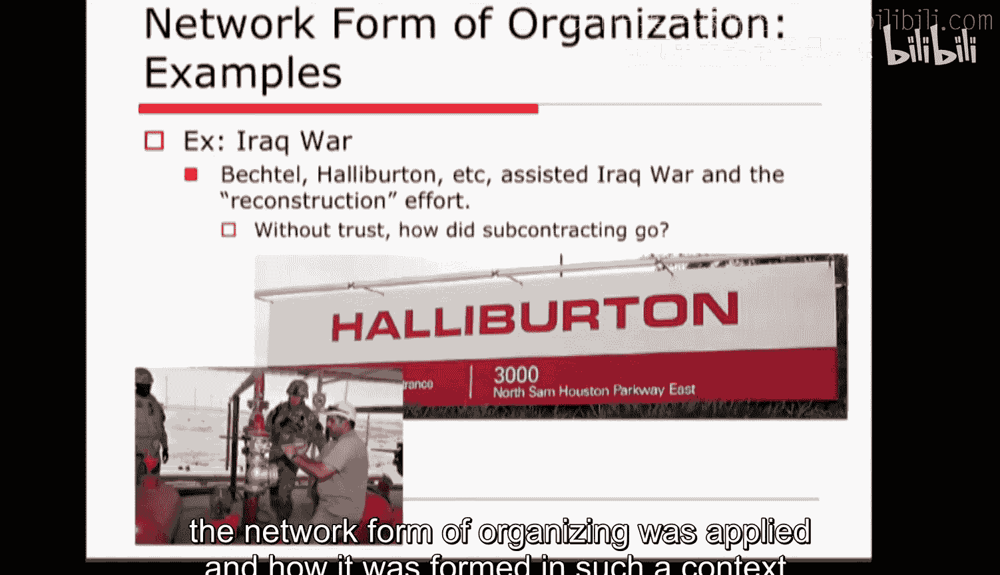
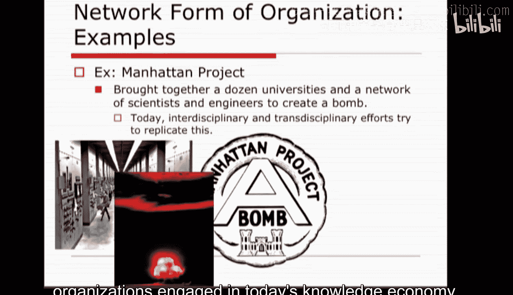
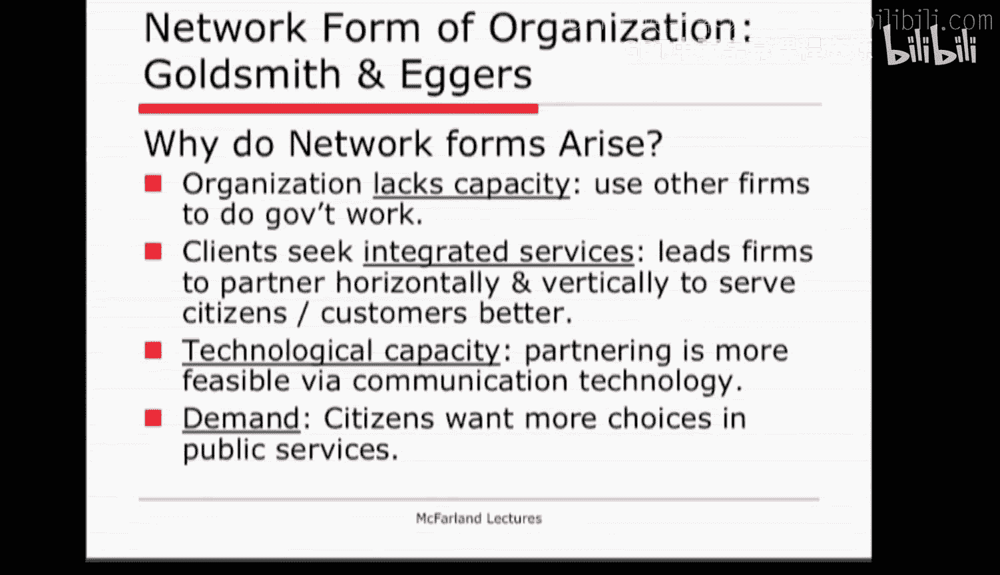
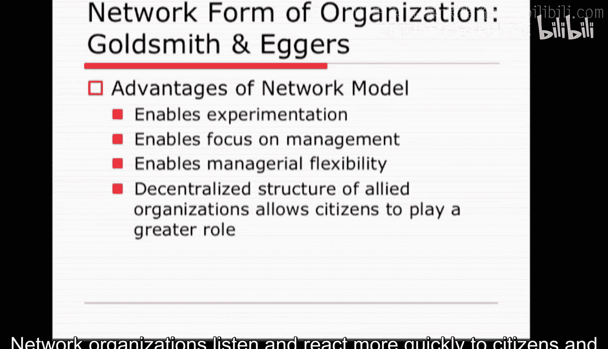
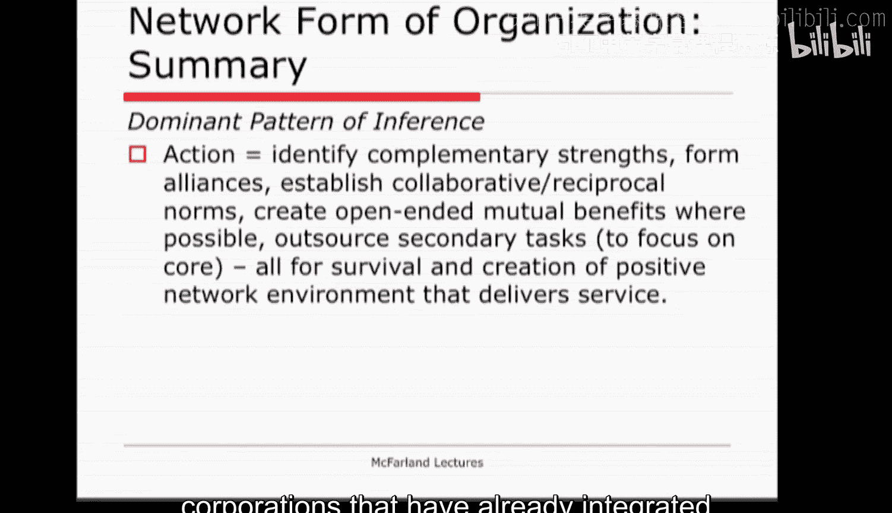
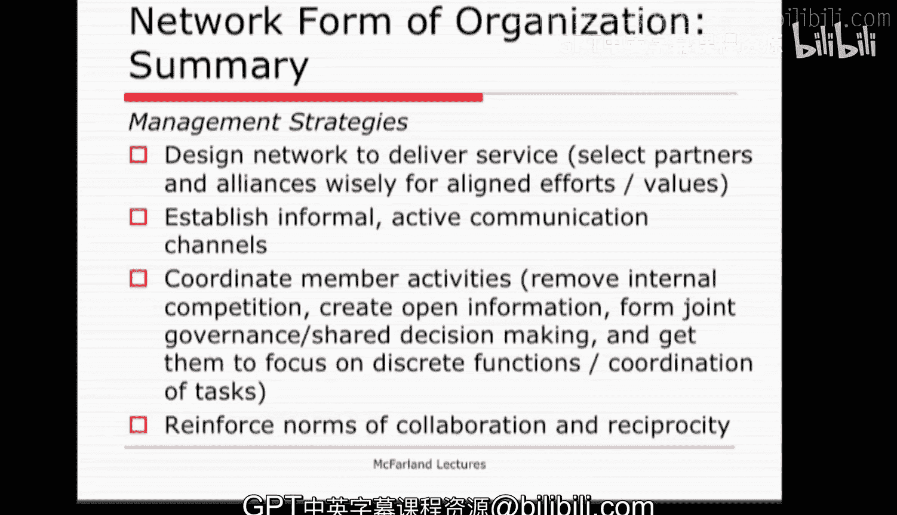

# 斯坦福大学《组织分析｜Organizational Analysis》中英字幕 p81 081_08_06_第二十讲-网络型组织-第二部分.zh_en -BV17J4m157qN_p81-

But we can also consider more controversial cases like the Iraq War as an example where firms like Btel and Halliburton were contractors that maybe coordinated a variety of services and worked on the of the reconstruction effort Now I don't know the details of this operation or how it went so it's all conjecture to some point but in terms of network organization it's an interesting case one could arguably believe that there was little local trust in United States agencies and you can ask。

 is this why contracting firms were used and even then was there much trust to make that network form of organizing helpful。

Again， I have to plead ignorance here， but I think it's interesting to ponder how the network form of organizing was applied and how it performs in such a context。

A final example for the network form of organizing is the Manhattan Project here over a dozen universities and a network of scientists。

 engineers， military agencies and service providers were brought together to create an atomic bomb。

To many， the project was such a success technologically and scientifically that they now see it as a network form they want to repeat in other areas of knowledge creation。

 so for example， I'm often asked to study interdisciplinary and transdisciplinary projects as well as centers that bring together heterogeneous sets of individuals and ask them to learn from one another and through that kind of interaction they create new ideas that they never would form if they stayed in their respective disciplinary silos。

 the model of organizing there as very much a network form and many people in academs see it as a potentially powerful one for organizations engaged in today's knowledge economy。

So now that we have a few examples under our belt， we can start to ask a few more substantive questions about the network form of organizations a very simple one and a common sense one is why do network forms of organization come about in chapter1 of Goldsmith and As they relate a few reasons why governments use network organization and we can extend it to firms more generally。

The first reason that firms adopt a network form of organization is that they lack capacity to provide a service that it must and because of that it has to rely on other firms for the government。

 this means the use of for profit and not for profit kinds of firms as contracts and subcontracts。

The second reason is to provide more integrated services if you outsource alone， it's not enough。

 all you've done is create four subcontractors and narrow channels to a service that would have existed via four government agencies anyway。

The network organization calls upon agencies and subcontractors to join up or partner horizontally and vertically so as to provide more integrated services。

 a sort of one stop shopping experience instead of a disparate four stop one。

A third reason that they're arising is the digital revolution and the increase in technological capacity。

Technology has made external partnering far more viable。

 companies can share scheduling information on production， demand， shipments， transactions， etc。

 all sorts of information can be shared by digital means and often instantaneously。

Making a variety of partnerships across small， specialized firms possible。

A final reason for the emergence and expanded relevance of network organization is demand。

 citizens today want more options and choices， and they become less tolerant of mediocre services。

In a network organization。There are many multiple contracts and subcontractors。

 many of whom compete to meet the demand and win consumer choices。

By creating an efficient network organization or arrangement of complementary parts that have provided this service in an efficient means。

 a lot of the consumers get what they want。

Goldsmith and Es contend that the network form of organization has certain advantages for government agencies。

The first is that it enables experimentation by allowing agencies to explore wider sets of alternatives of service provision。

The second is that the government can focus more on management and delivery by outsourcing tasks to the best providers and experts for many organizations。

 this means that they've shoved off tasks that aren't central to their technological core。

 and the core of a government is management， not the provision of say food services and the like。

Third， network organization also increases managerial flexibility。

 the government agency often finds it can provide services more quickly and it changes the nature of service by drawing upon multiple resource providers。

Last， network organization is a decentralized fluid form and the autonomy of allied organizations enables citizens to play a greater role in decision making。

Network organizations listen and react more quickly to citizens and consumers than do large hierarchical firms。

A core feature of network organization is the creation and maintenance of partnerships。

You can find a long discussion of this in Cha5 of Goldsmith and Agerers。

 but I think it helps to consider factors of partnership formation and splitting because it's a central means of successfully forging and undermining network organization。

On the far side of this screen there are factors that form a trusting partnership and sustain it on the near side are factors that create competition。

 distrust and effectively split partnerships apart many of the features reflect our common sense about trusting collaborative relationships。

For networked organizations， partnerships are healthy and they're sustained when the organization addressed。

Discrete functions， either the discrete functions an agency needs to address or the discrete functions a firm needs to address in order to keep itself alive。

Also， the firms need to cooperate on matters outside their core business。

 so one firm will coordinate and align with another in a division of labor that each needs from the other。

 but not the same labor they both produce。So what I mean by this is that they don't want to compete and they need to regard one another as differentiated collaborators as role complements in the provision of services。

Now firms can sustain healthy collaborations when they're open and trusting with information and they lack a history of competition。

 there's any sense of competition or lack of trust the collaboration will disintegrate。Last。

 it's important that the firms involved do not regard the information and the current collaboration as proprietary or to see it as putting them in at a disadvantage with one another later。

So in these ways， one knows kind of the means by which you can sustain and nurture a trusting partnership and the things that you need to do to avoid creating competition and distrust in a partnership thereby dissolving the larger network organization managing individuals is difficult。

 managing individual firms is difficult， managing sets of firms is more difficult yet and managing their relationships as a network is harder still。

 so。It helps to have a variety of ideas on what you can do to make network organization work better for you and your clients。

First， as the last slide indicates you need to weigh your partners carefully。

 you want trusted collaborators that can assume role complements with one another。

 each pair becomes the yang for the other Jang and vice versa。

 you don't want a network composed of directly competing firms or the network of provision will be undermined。

As a network manager， you need to think about the larger network structure and how it can be integrated。

 how it can be organized， how can the larger network of alliances work so as to afford a suite of services that encourage firms to join up or across and that clients will want to utilize。

Third。And I've said this repeatedly in this courses go deep。

 by that I mean is you want to try and align the goals and cultures of these firms so they value collaboration。

 trust and openness。If you can forge these beliefs and values。

 then it's likely that their relationships will manifest as healthy， complementary partnerships。

Fourth。Developing the capacity for group processing is also important here the network manager needs to listen to other firms and include them。

 but somehow you have to balance that listening and inclusion with moving the network forward on the interest that everyone shares。

In addition， the network manager needs to focus partners on their discrete functions so they don't gravitate toward competition with each other。

 and then they need to coordinate those activities so that they're interrelated in an efficient manner。

 so the manager needs to ensure there's no direct competition between companies in the network of provision。

Fifth， network organization also responds well to shared information on performance。

 since the functions are differentiated and action is distributed。

 it helps to let other parts of the network know what the other parts are doing and how their coordination as a network relates to their joint performance。

Because of this open access and discussion of performance data is frequently beneficial to the manager and firms within the network。

All the features related thus far build trust， but there are a few other things you can do to build trust and manage relationships even further an obvious one is to bring out and to open any initial contention between the firms of your network another is to create a joint governance structure and shared decision making that spans partners。

As such， everyone has a stake and a responsibility in decisions。

 so the network holds together and proceeds。Now， mind you， network management is not easy。 Often。

 one finds they constantly managing relationships， and the network as a whole in ways akin to a coalition。

 However， the network is more stable if done right。

 where firms kind of regard one another as complements to one another and that in the whole。

 they form a system of service provision that's superior to what they can do on their own。

 Such an arrangement extends well beyond a single decision and toward the repetition of many decisions。

So let's summarize what we know about the theory of network organization using the course's theory note taking template。

The first question to ask is， when does it apply， does it apply if I'm looking at a particular decision among individual workers。

 probably not so well？But it does seem well suited to studying the wider context of organizational relations and how they influence the organization's behavior and survival。

As for the general summary or argument， I suppose we can attempt kind of a caricature， if you will。

 organizations focus on network relations， positions。

 and the larger context in developing strategy in deciding their behavior。

Multiple types of networks are feasible， like one on trust as well as exchange。

 and they can guide resultant firm behaviors so the network can guide resultant behaviors。

If we consider how the organizational elements are typically related。

 we get a sense for how the theory characterizes organizations and what elements it focuses on and how it portrays them。

 for example， the participants in the case of network organization are organization or at least potential organizational partners and their kind of arrangement。

The goal of an organization within these kinds of arrangements is to create a network organization so as to deliver a service。

 so the collaborations and outsourcing aspects， they do that in order to kind of provide a service。

The technology by which the network organization kind of arises is dynamics of linking。

 coordinating and align between firms in order to deliver that service。

 you have acts like outsourcing and subcontracting that create that network now the social structure then consists of communication and coordination across organizations interorganizational networks。

 and the network as a whole and its pattern influences the organization's output and performance undergirding that network as a norm of trust between the firms and it allows for interdependent organizations to work together。

Last the environment network organizations are essentially in the environment。

 they're extending well into the environment， in fact。

 those interorganizational relations constitute the environment。

 so the firm is highly concerned with the social structure within the environment。

 so this array of elements in their characterization are distinctive and help us understand how network organization is differently characterizing elements of organizing。

Next， if we consider the dominant pattern of inference or the means of organizational action。

 we learn further how it differs from other theories presented in this course thus far。

 so organizations trying to accomplish network organization identify complementary strengths。

 they form alliances， they establish collaborative norms they create opportunities for open-ended mutual benefits and then they outsource their secondary task。

 all of this is done to survive and create a positive network environment through which they could complement one of another's needs and deliver a service。

 so it's all on the purpose of survival and potentially competing with larger corporations that have already integrated these services within themselves and finally。

 how can one manage a network form of organization。

Well， you can manage it by designing the network in a way that selects partners wisely so their values and efforts complement and align with one another。

You can establish frequent informal active communication channels with the involved organizations and this way you build up frequent contact and sharing of information that develops trust。

Third， you can coordinate member activities by preventing internal competition between collaborators。

 you can create access to shared information in the network。

 you can form a shared decision- making structure and you can try to focus the participating firms on their distinctive functions and the coordination across those functions rather than letting them veer into competitive relations with one another over the same functions and last it helps to establish a norm of collaboration and reciprocity within the network of organizations so in this manner you can create a distributed organization that's in the environment instead of housing divisions and functions within a single firm。

 it's rendered into a network form that exists within the environment and this accomplishment requires a distinctive set of managerial approaches and efforts to make it work。

